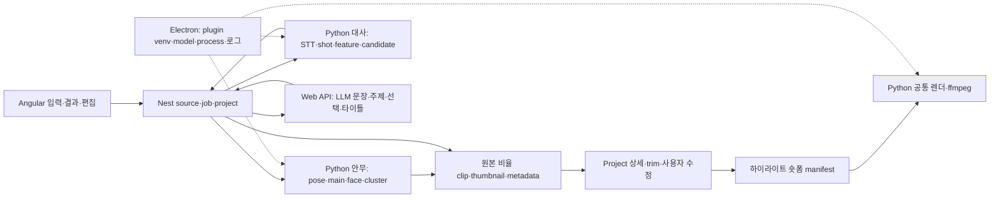

# W12 — 안무·인물·대사 하이라이트 조사와 개별 세션 인계

조사일: **2026-09-29 KST**. 상태: **코드·이력 조사와 설계 제안 완료 / 구현·실제 ML 평가 미실행**.

[작업 현황판](../../../../../handoff/WORKBOARD.md) · [전체 조사 카드](../../../../../handoff/tasks/highlight-overview.md) · [새 세션 시작 프롬프트 3개](../../../../../handoff/prompts/2026-09-29-highlight-sessions.md)

9/29 후속 사용자 결정: **인물은 배경 포함 전부 표시, 자동 배경 필터는 후속으로 연기. 얼굴 공통 모듈은 향후 다른 플러그인도 재사용.** [피드백·좌표/crop 설명](29-user-feedback-clarifications.md), [7/1 얼굴 변경 상세](29-face-change-detail.md), [9/18 제목 변경 상세](29-title-change-detail.md)를 함께 읽는다.

이 문서는 사용자가 요청한 조사·구상·작업 분리를 위한 인계다. 아래 MVP, 임계값, 실행 상한, 계약은 **설계 제안**이며 구현 승인이나 성능 검증 결과를 뜻하지 않는다. 파일·함수·Git diff는 확인 사실, 사용자 증상은 사용자 보고, 인과관계와 개선 효과는 가설로 구분한다.

## 1. 먼저 이어받을 결론

- 안무는 YOLOv8s Pose → 메인 인물 선정 → 단순 IoU track → **OpenCV YuNet + SFace** → 얼굴 cluster → 멤버 참조 이미지 매칭 → 개별 clip·썸네일·메타데이터 순서다. InsightFace를 계속 쓴다는 과거 설명은 현행과 다르다. 메인 선정과 신원 매칭은 서로 다른 오류원을 갖는다.
- 7/1 얼굴 backend·표본 선정·매핑 변경, 8/13 단일 참조 멤버 과잉 매핑 제한, 9/18 montage 제거를 비교 기준선으로 삼는다. “예전보다 정확도가 낮아졌다”는 동일 영상·참조 이미지·모델 파일 비교 전에는 가설이다.
- 안무 **개별 clip 이동·숨김·되돌리기·인물 묶음 배정·숏폼 생성**은 이미 구현돼 있다. 복수 clip 이동, 원본 타임라인에서 분석 결과를 검토한 뒤 export, 메인 인물 추적 crop이 후속 설계 범위다.
- 대사는 로컬 faster-whisper `small`·OpenCLIP 분석과 Nest 단계 오케스트레이션, Web API의 OpenAI Responses LLM 호출로 나뉜다. 기본 LLM은 `gpt-5-mini`이며 실제 배포 설정은 확인하지 않았다. 9/18 민준님 변경으로 원본 비율 clip과 타이틀 데이터가 분리되고 제목 보정 호출이 추가됐다.
- OCR은 EasyOCR 경로지만 기본 OFF, CUDA 조건, 선택 의존성 누락이 겹친다. Mac에서 상수 하나를 켜는 것만으로 OCR 품질 A/B가 성립하지 않는다. OCR 근거가 downstream에 실제 전달되는지도 별도 검증해야 한다.
- 인물 MVP는 **참조 이미지 없이 같은 영상 안의 인물을 익명 그룹으로 묶고, 대표 이미지 카드에서 등장 구간을 찾아 선택 export**하는 제안을 권한다. 실명 식별과 화자 식별은 별도 문제다. 안무의 메인 한 명만 남기는 경로를 그대로 복제해서는 모든 등장 인물을 찾을 수 없다.
- 공통화 대상은 향후 여러 플러그인이 재사용할 얼굴 검출·정렬·임베딩·품질·대표 이미지 후보와 versioned 관측 계약이다. 안무와 인물은 초기 소비자이며 두 이름에 이용 대상을 제한하지 않는다. 플러그인별 메인 선정/참조 매핑/장면 grouping 정책은 소비자가 소유하고 공통 경로를 수정하는 세션은 한 곳으로 정한다.

## 2. 조사 범위와 Git 기준선

원본 checkout에서 읽기 전용으로 조사했다. root 자체는 Git repo가 아니고 하위 repo와 `.codex`가 각각 별도 repo다. 아래 대상은 조사 시 `dev`, tracked/untracked clean, 로컬 `origin/dev`와 0/0이었다. **fetch하지 않았으므로 원격 최신성·설치된 모델·실행 앱·서버 배포 SHA를 보증하지 않는다.**

| repo | 조사 HEAD |
|---|---|
| desktop/clipper_python | `47782953228861f4bdbdc135265d067c2a826b0e` |
| desktop/clipper_nestjs | `824a7a9f71dde8aa44c8692eadacb6ba6e4961b8` |
| desktop/clipper_angular | `797782e8f8e1c8488d024d23e6291e91c2b1e30e` |
| desktop/clipper_electron | `0cd7ed7b9444bb00c6372bdcff47a356f5520c35` |
| web/clipper_web_api | `31f448260148b11e61e9f53cad0ee9ac372345fe` |

Python lock의 조사 버전: Ultralytics `8.4.38`, OpenCV `4.13.0.92`, torch `2.11.0`, scikit-learn `1.8.0`, faster-whisper `1.2.1`, CTranslate2 `4.7.1`, open-clip-torch `3.3.0`, numpy `2.4.4`. 이는 선언·lock 기준이며 plugin venv의 실제 설치 버전은 확인하지 않았다.

근거: [uv.lock](/Users/jina/project/adlight/desktop/clipper_python/uv.lock), [Python workspace](/Users/jina/project/adlight/desktop/clipper_python/pyproject.toml:8). 제품 소스·의존성·브랜치·worktree·환경설정·서버는 변경하지 않았다. `.codex`에는 다른 세션의 기존 미커밋 문서가 있어 이를 보존하고 W12 관련 문서만 갱신한다.

## 3. 현행 전체 구조와 변경 이력

세부 파일·라인·커밋·diff는 [안무 조사](29-dance-code-history.md), [대사 조사](29-dialog-code-history.md), 공식 후보와 라이선스는 [모델 조사](29-official-model-candidates.md)에 기록했다. 로컬 근거를 재개 시점의 최신 코드와 다시 대조한다.

### 3.1 안무: 메인 선정·얼굴 매칭을 분리해서 본다

현행 모델은 `yolov8s-pose.pt`, YuNet `face_detection_yunet_2023mar.onnx`, SFace `face_recognition_sface_2021dec.onnx`다. Pose는 Mac MPS/CPU, CUDA 가능 환경은 CUDA, 얼굴은 OpenCV backend를 쓴다. `analyze_skip=4`, track IoU `.35`/TTL `1s`, 얼굴 후보 12개 중 품질 상위 5개, 최소 2개 임베딩을 가진 track 평균, agglomerative cosine distance `.42`가 기본이다. 멤버 매핑 `.60`, 중복 cluster 합류 `.45`와 주인 거리+.08 제한을 구분한다. 이 숫자는 실측 최적값이 아니다.

메인 점수는 중앙 위치 `.45`, bbox 상대 면적 `.35`, 관절 간 거리 합 `.20`이다. `pose_energy_score`는 **시간에 따른 움직임 에너지 계산이 아니다**. Pose 결과에서 confidence가 보존되지 않는 점, 해상도·가림·큰 체격·중앙 인물 편향, shot 전환 때 IoU track이 유지/교체되는 효과를 확인 대상으로 둔다.

`MainSelector`는 원본 fps로 streak 문턱을 만들지만 4프레임마다 호출된다. 30fps에서 처리 횟수/유효fps로 환산하면 BASE 7회≈.93초, FAST 3회≈.40초, group enter 10회≈1.33초, exit 7회≈.93초다. 의도한 유지 시간과 차이가 날 가능성은 있지만 이 코드가 최근 변경됐다는 근거는 없다. 먼저 측정하고 시간 기반 판정 후보와 비교한다.

얼굴 미검출 또는 유효 track 평균 embedding이 없는 main segment는 export 전에 제거된다. 얼굴이 한 번 검출돼도 track당 유효 표본이 2개 미만이면 탈락할 수 있다. 따라서 “얼굴이 안 보여도 같은 인물의 뒷모습을 계속 모으기”는 현행 보장에 포함되지 않는다. 하나의 확장 ROI 안에 얼굴이 여러 개면 검출 점수가 높은 하나를 쓰므로, 잘못 선택된 main bbox/ROI 안의 다른 사람 얼굴이 identity 오류로 이어질 수 있다.

근거: [메인·track 연결](/Users/jina/project/adlight/desktop/clipper_python/plugins/dance_highlight/dance_highlight/services/pipeline.py:78), [점수·streak](/Users/jina/project/adlight/desktop/clipper_python/plugins/dance_highlight/dance_highlight/services/segment.py:10), [face 후보·track 평균](/Users/jina/project/adlight/desktop/clipper_python/plugins/dance_highlight/dance_highlight/services/face_cluster.py:66), [설정](/Users/jina/project/adlight/desktop/clipper_python/plugins/dance_highlight/dance_highlight/services/config.py:78).

### 3.2 안무: 이미 있는 UX와 추가 범위

`projects` API에는 clip별 이동/해제, 숨김/복원, cluster→멤버 배정/해제가 있다. 원래 자동 판정과 파일을 유지하고 `result.dance_clip_assignments`, `dance_hidden_clips`, `dance_member_assignments`로 사용자 수정이 overlay된다. 상세 builder가 최종 person별 clip 목록을 다시 구성한다. **단일 clip을 여러 API로 이동시키는 방식은 복수 수정의 원자성·동시 저장을 보장하지 않는다.** 실제 테스트 없이 이를 batch 기능으로 소개하지 않는다.

현재는 Python 분석 중 실제 clip과 thumbnail을 먼저 만든다. 안무 trim은 Nest에서 명시적으로 거절되고 UI 이벤트도 연결되지 않는다. 대사 trim은 이미 생성된 clip 내부의 상대 구간만 편집한다. 원본 전체 타임라인에서 clip 생성 전 경계를 조절하는 요구는 두 현행 흐름과 다르다. 인물 재배정은 membership을 바꾸며 새로운 주인 인물의 bbox를 자동 확보하지 않는다.

근거: [이동·숨김 API](/Users/jina/project/adlight/desktop/clipper_nestjs/src/modules/projects/presentation/projects.controller.ts:111), [수정 영속화](/Users/jina/project/adlight/desktop/clipper_nestjs/src/modules/projects/application/projects.service.ts:200), [clip-local trim](/Users/jina/project/adlight/desktop/clipper_nestjs/src/modules/projects/domain/project.model.ts:29).

### 3.3 대사와 OCR의 현재 기준

대사는 Python 분석과 Nest orchestration 사이에 artifact를 저장하고, Web API가 문장 분할·줄거리·용어 교정·주제·후보 선택·메타데이터를 생성한다. 저장 artifact를 재개하는 checkpoint 기능은 없다. Python의 과거 직접 LLM 경로를 현행으로 설명하지 않는다. 기본 모델은 STT `small`, OpenCLIP `ViT-B-32/laion2b_s34b_b79k`, LLM `gpt-5-mini`; Web API LLM env override와 credential은 조사하지 않았다. 현행 faster-whisper 호출은 word timestamps ON·VAD OFF이며 common의 VAD 선언값과 다르다. Mac은 CTranslate2 MPS 경로가 없어 CPU int8을 사용한다. `small`이 여러 경로에 고정돼 있어 모델 후보 비교는 실제 호출 설정을 먼저 맞춘다.

시작 순서는 Angular preview/quote → durable job·operation start → 큐 → runtime lease → Nest 실제 source ingest다. 입력 preview와 실제 ingest를 구분하고 과금 후 ingest 실패·취소·환불을 확인한다. UI 취소/slot 해제와 Python STT/OCR/ffmpeg 계산 중단은 별개이며 현재 worker에 cancel flag가 전달되지 않는 구간은 자원 겹침 가설로 남긴다.

9/18 변경은 원본 비율 clip+타이틀 데이터, 기존 대사 clip 백필 및 ready/pending/unavailable, 숏폼 생성·재편집 복원, overlay_title 품질 검사와 나열형 제목 보정이다. 예전 제목 품질과 비교할 때 STT/주제/선택 구간을 고정한 뒤 타이틀 생성과 보정 효과를 별도로 본다. 서버 기본 모델과 실제 설정을 구분하고, Gemini를 이 대사 경로의 현행 모델로 쓰지 않는다.

OCR 현행은 `RUN_OCR=False`, `OCR_EVERY_SEC=1.0`이며 EasyOCR `ko/en` full sweep이다. CUDA 조건과 의존성 설치 상태를 확인한 후 평가해야 한다. `detail=0`으로 bbox/confidence 정보가 downstream에 남지 않는 점, 매초 random seek, OCR model 초기화, 텍스트 중복/긴 evidence/token 비용을 함께 측정한다. `.8s` stream merge와 달리 실제 analyze는 raw 결과를 `1.5s` gap dedup에 넣는다. 반복 문구가 긴 간격 뒤 다시 나타날 때 base pointer가 갱신되지 않는 로직, `ok=False`가 무시돼 실패와 no-text가 구분되지 않는 경로는 fixture 검증 대상으로 둔다. `elapsed_sec`는 Reader 생성 뒤부터라 초기 model load까지 포함한 시간을 별도 기록한다. OFF·CUDA gate는 4/17 최초 반입부터 있었고 최근 민준님 변경이 아니다. 꺼둔 제품/기술 이유는 기록으로 확인되는 범위만 인용하고 성능 때문이라고 단정하지 않는다.

근거: [Web API 모델·timeout·title repair](/Users/jina/project/adlight/web/clipper_web_api/src/modules/dialog-highlight/application/dialog-highlight-llm.service.ts:24), [OCR OFF](/Users/jina/project/adlight/desktop/clipper_python/plugins/dialog_highlight/dialog_highlight/services/pipeline/common.py:28), [EasyOCR 처리](/Users/jina/project/adlight/desktop/clipper_python/plugins/dialog_highlight/dialog_highlight/services/pipeline/ocr_pipeline.py:60). 9/4 감사의 memory/warmup/과금 설명은 [현행 대조표](29-dialog-code-history.md)에서 해결·잔여·변경을 구분한다.

## 4. 안무 편집·crop 설계 선택지

### 4.1 인물 추적 crop

권장 순서는 **저장된 bbox 경로로 고정 인물 crop을 재현 → preview/render 같은 경로 사용 → track 누락/교체 정책 검증 → 필요하면 tracker 개선**이다. 새 pose 모델과 crop UX를 한 번에 바꾸지 않는다.

현행 bbox는 OpenCV가 읽은 프레임 기준 `float32 [x1,y1,x2,y2]` 픽셀 좌표이며 시간은 `frame_index/fps`다. 기본 4프레임마다 메인 한 명을 기록한다. 앞선 대화의 왼쪽/가운데/오른쪽은 설명용이고 모든 인물·모든 프레임 저장이 아니다.

현행 분석 메모리에는 `(source time, bbox, track_id)`가 있지만 `dance_meta_v1` clip 항목에는 start/end/path/person_id만 저장된다. 공통 숏폼 manifest도 mediaSlots에 fit/seek/길이만 전달한다. FE video는 object-fit, Python cover는 중심 crop이다. 현재 pan 효과는 미리 정한 이동이며 인물 tracking 결과를 읽는 경로가 아니다.

근거: [DanceMetaBuilder](/Users/jina/project/adlight/desktop/clipper_python/plugins/dance_highlight/dance_highlight/services/dance_meta.py:67), [manifest 슬롯](/Users/jina/project/adlight/desktop/clipper_nestjs/src/modules/highlight-shortform/application/highlight-shortform-manifest.builder.ts:124), [FE preview](/Users/jina/project/adlight/desktop/clipper_angular/src/features/highlight-shortform/components/highlight-shortform-preview/highlight-shortform-preview.component.html:19), [ffmpeg 중심 crop](/Users/jina/project/adlight/desktop/clipper_python/plugins/clipper_video_render/clipper_video_render/filter_graph.py:70).

제안 계약은 clip 원본을 파괴적으로 자르지 않고 `cropTrack` sidecar를 보존한다. `sourceHash`, `modelHash`, `analysisRevision`, `trackId`, `timeBase=source`, 원본 width/height/rotation, 정규화 bbox/crop center keyframes와 validity를 기록한다. source timestamp → clip start → trim seek → render-local timestamp의 변환을 한 규칙으로 정하고 FE/renderer가 같은 keyframe·보간·경계 제한·템플릿 content rectangle을 사용한다.

메인 bbox 중심을 기본 focus로 하되 안무는 전신 포함을 우선한다. smoothing, dead zone, 이동 속도 상한, 화면 경계 clamp를 적용하는 후보를 비교한다. 짧은 누락에는 마지막 유효 중심 유지+짧은 보간, shot cut/긴 누락에는 중앙 또는 contain fallback, 불확실한 identity에는 다른 사람을 쫓지 않는 정책을 제안한다. 대상이 crop 창보다 크거나 여러 명이면 비율 유지와 전신 보존을 동시에 만족하지 못할 수 있어 contain/수동 중심 옵션을 비교한다.

인물 카드 이름 변경, clip을 다른 인물 카드로 재배정, 렌더 crop 대상 변경은 서로 다른 작업이다. 앞선 대화의 ‘화면이 따라간다’는 미래 추적 crop의 잘라낼 창 이동을 뜻하며 현재 UI·재생 동작이 아니다. 사용자 clip 이동은 같은 인물의 분류를 바로잡는 경우와 다른 실제 인물을 고르는 경우를 나눈다. 후자는 원래 main track만 저장돼 있으면 crop 대상 경로가 없다. 재분석/다중 track 저장/수동 focus 중 선택해야 하며 membership 변경만으로 crop이 개선됐다고 보장하지 않는다.

### 4.2 복수 재배정

체크박스 선택 → ‘다른 인물로 이동’ → 목적 인물 카드 선택 → 적용·되돌리기를 권장한다. 현재 단일 이동을 유지하면서 같은 방식으로 확장할 수 있고 키보드 조작·여러 화면에서도 이해하기 쉽다. 드래그 앤 드롭은 보조 동작 후보이며 유일한 입력 방식으로 삼지 않는다.

최소 계약은 선택 clip ID 목록, 목적 person ID, 예상 edit revision이다. 서버에서 모두 검증한 후 한 번 저장하는 batch가 일관성이 좋다. 대안인 기존 API 순차 호출은 구현량이 작지만 중간 실패·read/modify/write 충돌·undo 단위 문제가 있어 소규모 임시 UX에도 결과를 명시해야 한다. 자동 판정은 보존하고 사용자 override만 기록하며, 재처리 시 source/model/analysis revision이 달라지면 기존 override를 몰래 새 clip ID에 붙이지 않는다.

### 4.3 타임라인 검토 후 실제 clip 생성

| 선택지 | 장점 | 비용·제약 | 판단 |
|---|---|---|---|
| 현행 전량 export 후 이동·숨김 | 현재 저장·미디어·재시도 계약 유지 | 제외할 clip도 생성, 안무 경계 편집은 신규 범위 | 기준 동작으로 유지 |
| 분석·저해상도 thumb·원본 seek preview → 검토 → 선택 export | 불필요 export 감소, 원본 경계/인물/제외 일괄 검토 | 분석 완료와 영상 생성 완료 분리, 원본 보존·draft·revision·큐·취소·재개 계약 필요 | 목표 UX 제안 |
| 현행 완료 결과에 원본 타임라인 검토 추가 후 선택 재export | 점진적 도입 가능 | 최초 전량 export 비용은 그대로, 편집 파일과 분석 구간 이중 관리 | 중간 단계 후보 |

출력 생성 지연을 확정하지 않는다. 채택 시 상태를 `analyzing → review_ready → exporting → completed/failed/cancelled`처럼 설계하되 현행 `ProjectSnapshot.status='completed'`에 새 상태를 억지로 넣지 않고 job/draft/project의 소유를 정한다. 원본 seek preview는 즉시 MP4가 필요한 목록과 구분하고 ‘미리보기/장면 확정/영상 생성’의 사용자 의미를 설명한다. 정확한 경계는 stream copy의 keyframe 오차와 재인코딩 시간을 비교한다.

## 5. 신규 인물 하이라이트 MVP 제안

### 5.1 활용과 범위

사용자 요청은 임의 영상의 인물별 장면 grouping이다. 첫 품질 검증 범위는 **인터뷰·토크의 소수 반복 등장 인물**을 기본 가정으로 둔다. 드라마·예능은 shot/가림/옷 교체·동시 출연이 많아 두 번째 비교군, 행사·거리·브이로그는 많은 얼굴의 재등장/가림/grouping 일관성이 어려워 후속 확장 후보로 둔다. 각 대상에서도 배경 포함 모든 검출 인물 그룹을 표시한다. 사용자 선호에 따라 순서를 바꾼다.

| 접근 | 결과와 장점 | 한계 | 추천 |
|---|---|---|---|
| 참조 없는 얼굴 grouping | 업로드만으로 Person 1/2 카드, 등장 구간 탐색 | 가림/작은 얼굴·단역 분리·오병합 | 첫 MVP |
| 참조 이미지로 특정 인물 찾기 | 목적 인물 중심 검색, known identity | 이미지 준비와 open-set 거절 필요 | 후속 선택 옵션 |
| 얼굴+body ReID+화자 정보 fusion | 얼굴 없는 구간·재등장 coverage 확대 가능 | 새 모델·의존성·다른 종류의 오매칭·평가 증가 | 첫 MVP에서 제외 |

‘동일 인물 grouping’의 이름은 영상 안의 익명 ID다. 유명인 실명 DB 검색이나 얼굴=말하는 화자라는 판단을 포함하지 않는다. 같은 옷이나 가까운 시간만으로 서로 다른 얼굴을 하나로 합치지 않는다.

### 5.2 유저 플로우와 출력

1. 로컬 원본 영상 선택 → 분석 진행. 첫 품질 샘플은 720/1080p, 2~10분, 주요 인물 2~8명 구성이라는 제안이다. 이는 샘플 구성 설명이며 결과 카드 수의 상한이 아니다. 배경을 포함해 검출된 모든 인물 그룹을 표시한다. YouTube ingest는 기존 source 기능을 후속 재사용할 수 있다.
2. 대표 얼굴 카드에 ‘인물 1’, 장면 수, 등장 시간, 확인 필요 표시. 카드 클릭 → 해당 인물의 source-relative 구간/썸네일 목록과 원본 seek preview.
3. 잘못 묶인 구간은 다른 카드로 이동, 그룹 병합, 이름 변경, 대표 이미지 교체, 제외/복원. 완전한 frame 단위 split editor보다 장면/track 단위 수정부터 시작한다. 배경 여부로 접거나 숨기지 않고 모든 그룹을 기본 목록에 표시한다. 그룹을 확정하기 어려운 관측도 확인 필요 결과로 보존한다.
4. 원하는 구간 단일/복수 선택 → 경계 조절 → 개별 MP4 또는 ZIP 저장. 동일한 편집 구간이 여러 인물 카드에 속하면 `(sourceHash, editedStartMs, editedEndMs, outputSettingsHash)`로 중복 export를 제거한다. scene ID가 같아도 경계를 다르게 편집한 구간은 보존하고, 겹치는 다른 구간의 자동 합침은 별도 선택으로 둔다.
5. 선택 구간을 원본 순서로 한 MP4에 합치기는 두 번째 작은 출력 단계 후보다. 썸네일/순서/원본 소리/길이를 확인한 뒤 생성한다. 템플릿·BGM·자동 제목·추적 crop을 모두 첫 버전에 넣지 않는다. 기존 하이라이트 숏폼 연결은 별도 확장 계약을 만든 뒤 활용한다.

핵심 소구점은 ‘긴 영상에서 한 사람의 등장 구간을 찾아 편집 재료를 모으는 시간 절감’이다. 완성 쇼츠의 자동 흥미도 선정을 약속하지 않는다. MVP 필수는 카드·장면 탐색·기본 오분류 수정·선택 export, 합치기는 scope 승인 때 포함 여부를 정한다.

### 5.3 인물 전부 표시와 대표 이미지

사용자 결정으로 **배경 인물 포함, 찾아낸 모든 인물 그룹을 기본 결과 목록에 표시**한다. 결과가 복잡해져도 등장 시간·반복 shot·얼굴 크기·중요도 때문에 자동 숨김/제외하지 않는다. 앞서 제안한 soft filter와 48px/2초/2shot 표시 기준은 첫 MVP·평가 범위에서 제거하고 후속으로 미룬다.

품질 정보는 같은 사람인지 판단하거나 대표 사진을 고르는 근거로 사용할 수 있지만, 낮은 품질·짧은 등장이라는 이유로 결과에서 조용히 빼는 정책으로 사용하지 않는다. 그룹 판정이 불확실하거나 임베딩을 만들지 못한 검출은 확인 필요 상태로 보존한다. 이는 모델이 검출하지 못한 실제 사람까지 전부 찾는다는 정확도 보장이 아니다.

대표 이미지는 충분한 얼굴 크기·정면/선명도·가림 없음·cluster centroid 근접성을 함께 평가한다. source timestamp·bbox·모델·품질 근거를 저장하고 사용자 교체가 재분석으로 덮이지 않게 한다. 얼굴이 보이지 않는 구간은 같은 shot 내 검증된 track의 짧은 연결만 후보로 다루며 shot을 넘어 body만으로 붙이는 것은 후순위다.

### 5.4 기술 구조와 현행 재사용 한계

현재 안무는 main 한 명만 tracking하고 `batch_segment_embeddings`는 main segment만 다룬다. 인물에서는 **모든 유효 얼굴 검출 → shot-local 여러 track → track 품질 표본·임베딩 → 영상 전체 identity cluster → 등장 구간**이 필요하다. shot cut에서는 motion track을 끊고 appearance cluster로 재등장을 연결한다. 동시에 서로 다른 위치에 나타난 두 얼굴은 동일 그룹으로 합치지 않는 제약을 평가한다.

얼굴 detector가 다수 얼굴·bbox·landmarks를 내보내는 경로가 필요하므로 현재 ‘ROI에서 점수 높은 얼굴 하나의 embedding 반환’을 통째로 재사용할 수 없다. 현재 `TrackAssigner.assign()`도 main 하나용 IoU·TTL이며 한 프레임의 여러 detection에 one-to-one 할당을 보장하는 tracker가 아니다. 얼굴 없는 짧은 track, 단일 표본, outlier는 강제 병합하지 않고 uncertain으로 보존한다.

저장 제안: `PersonGroup{id, label, representativeObservationId, stats}`, `Scene{id, sourceStartMs, sourceEndMs}`, `ScenePerson{sceneId, groupId, trackIds, evidence, confidence}`, `Observation/Track` sidecar와 `userEdits{revision, merge, assignment, excluded, representativeOverride}`. 한 Scene에 여러 PersonGroup이 속하는 다대다 관계다. 모델·분석 변경 전후 ID 안정성은 별도로 설계하며 cluster 순번을 영속 ID로 사용하지 않는다.

현행 [ProjectClipItem.personId](/Users/jina/project/adlight/desktop/clipper_nestjs/src/modules/projects/domain/project.model.ts:35)는 단일 인물, category는 dance/dialog/storyboard/unknown이고 [숏폼 origin DTO](/Users/jina/project/adlight/desktop/clipper_nestjs/src/modules/highlight-shortform/presentation/dto/highlight-shortform-render.dto.ts:23)도 dance/dialog만 허용한다. [ZIP](/Users/jina/project/adlight/desktop/clipper_nestjs/src/modules/projects/application/project-zip-entries.ts:16)은 전체 또는 한 인물만 선택하고 임의 선택 clip 목록은 받지 않는다. 재사용 가능한 UI·media ticket·ffmpeg·큐가 있지만 신규 플러그인 등록, category, relation, 선택 export, 과금/취소/재시도 계약을 별도 확인해야 한다.

## 6. 여러 플러그인이 재사용할 얼굴 공통 모듈과 세션 소유권

**목표는 플러그인 공용 얼굴 모듈**이다. 안무·인물은 초기 소비자이며 향후 다른 플러그인도 공개 API로 검출/비교/대표 이미지 등 필요한 기능을 가져다 쓸 수 있어야 한다. 모듈의 입력·출력은 안무 Segment, 인물 PersonGroup, 특정 UI/job 타입에 직접 의존하지 않는다.

| 공통 후보 | 공유할 규칙 | 플러그인에 남길 판단 |
|---|---|---|
| 모델 파일 검증·로딩, 다중 검출·정렬·임베딩 | model id/revision/hash, dimension·정규화, 모든 얼굴 observation | 메인 선택·참조 이미지 선택·실명 매핑 |
| 품질·대표 이미지 후보 | timestamp, pixel/normalized bbox 기준, landmarks/quality·실패 상태 | 카드 표시·대표 이미지 UX·사용자 수정 |
| track 입력·출력 도구 | shot/time base·track ID·bbox/keyframe·validity | 메인 한 명/다중 tracker·재등장 연결 정책 |
| 거리·cluster 독립 함수 | 알고리즘/version·centroid·근거 | 각 기능의 grouping threshold·동시 출연 제약 |
| artifact/cache | source/model/config hash·analysis revision | clip export·타이틀·과금·작업 상태 |

Python workspace에서 독립 공통 패키지/모듈과 공개 API 위치, 버전·오류·모델 backend 교체 규칙을 먼저 정한다. 각 플러그인 venv의 선택 의존성·모델 준비 계약을 유지한다. 공용화가 앱 시작 시 모든 ML 패키지/모델을 일괄 설치·로드해야 한다는 뜻은 아니다. SFace/ArcFace 등 다른 embedding 공간의 centroid/cache를 섞지 않는다. 공통 기본 기능은 작은 실제 구현부터 추출하되 이용 대상을 두 플러그인으로 고정하지 않는다.

**초기 작업 소유 제안:** W14가 공용 관측 계약·기본 모듈 수정의 초기 소유 세션, W13은 기존 FaceClusterService adapter와 main/mapping/crop의 초기 소비 세션, W01은 STT/LLM/OCR를 소유한다. W14 담당이라는 말은 향후 소비자의 이용을 제한하는 소유권이 아니다.

**병합 순서:** (1) W13 baseline과 W14 MVP/공용 API 설계 → (2) 패키지 경로·공개 DTO·version·호환성·파일 소유권 합의 → (3) 한 소유자가 최소 공용 기능을 추출하고 기존 안무 adapter를 검증 → (4) 초기 소비자 연결 → (5) 개별 crop/다중 track 개선. 동일 공통 파일을 여러 세션이 동시에 수정하지 않는다. 향후 플러그인이 사용할 계약에 안무/인물 이름이나 정책을 필수 값으로 넣지 않는다.

## 7. 실제 ML 평가 입력과 실행 범위 제안

아래는 **다음 세션에서 입력과 상한을 확정할 실행안**이다. 이번 조사에서 승인·실행된 ML pass, 모델 다운로드, 외부 유료 호출은 모두 0이다. 새 모델 설치·과금·전체 Build5를 일반적인 개선 요청에서 자동 승인된 것으로 취급하지 않는다. 각 평가 전에 정확한 inputPath/source hash, interval, labels, 모델 파일 hash, 실행 repo SHA, OS/device/메모리, 반복 횟수, 출력 위치, 외부 전송/비용 상한을 기록한다.

### 7.1 현재 확보한 입력의 한계

tracked 프로젝트 파일에서 라벨 있는 안무/대사/grouping benchmark는 찾지 못했다. `legacy/adlight_nestjs/uploads`에는 영상이 있지만 학습/평가 동의·원본성·정답 라벨·내용 적합성을 확인하지 않았다. 이번에는 ffprobe로 **아래 파일 메타데이터만** 읽었다. STT/OCR/얼굴 추론은 하지 않았다.

| 기존 로컬 파일 (root 기준, 실제 파일명은 Unicode 분해형일 수 있음) | 길이·해상도 | 활용 가능 범위 |
|---|---|---|
| `legacy/adlight_nestjs/uploads/같은 공식석상 정반대 코디 나나 vs 정혜성!.mp4` | 32.93초, 720×1280, 30fps | multi-person/crop 진단 후보; 내용·라벨 검토 필요 |
| `legacy/adlight_nestjs/uploads/김경율의_정치적_변곡점.mp4` | 30.60초, 1080×1920, 25fps | STT/OCR 짧은 probe 후보; 원본 대사 품질 기준선 아님 |
| `legacy/adlight_nestjs/uploads/로제와_마스의_아파트_열풍.mp4` | 34.20초, 1080×1920, 25fps | 자막·빠른 cut probe 후보; 안무 원본이라고 추정하지 않음 |

이 짧은 세로 영상들을 장편 pipeline 성능·가로 원본 crop·25~55초 후보 품질 평가의 대표 샘플로 쓰지 않는다. 본평가의 정확한 원본 경로/구간은 아직 선택되지 않았다. 선택은 실행에 필요한 입력이지 이번 인계 문서의 조사 미완료 사유가 아니다.

### 7.2 안무 W13

**입력 제안:** D1 중앙/리드 교체, D2 좌우 큰 이동+1:1 crop, D3 가림/뒤돌기/작은 얼굴·동시 댄서. 원본 3개에서 각 120초 이하, 합계 6분 이하, 동일 참조 이미지 1~3장/선택 멤버. 타임스탬프 main 인물, group 구간, face-visible 여부, true member/unknown, bbox를 라벨링한다. 최소 60개의 비교 interval을 포함하고 어려운 사례를 별도 보고한다.

**실행 제안:** 현행 3pass와 선택한 대조 조건 하나 3pass, 최대 6pass(총 12 source-minutes), 분석 metadata까지만. 현행 `run()`은 export 후 metadata를 저장하므로 **모델·판정은 그대로 쓰되 export를 하지 않는 평가 adapter 준비가 선행 조건**이다. adapter가 없으면 기존 output artifact의 정적 비교까지만 진행하고 metadata 전용 실행이 된다고 주장하지 않는다. 예전 InsightFace weights가 현재 제품 이용조건에 맞지 않으면 이전 출력 artifact/로그 비교로 제한한다. 실행 허용/모델 확보 조건이 맞는 역사 기준선을 선택한다. skip/streak, 얼굴 threshold, tracker, pose 모델 중 **한 변경만** 대조한다. 추가 후보와 cold/warm 반복은 최초 결과 후 범위를 확장한다.

**지표:** main frame/interval accuracy·전환 지연·group 오판; main이 맞고 face-visible인 구간의 조건부 identity precision/recall·unknown 오배정률; 전체 clip 배정 precision/recall·no-face 탈락률·coverage·cluster split/merge 오류를 따로 측정. 정확도 평균만으로 주요 인물 false merge를 숨기지 않는다.

**crop 소규모 제안:** 고정된 10초 구간 4개 × ratio 1:1/4:3 × center/follow = 16개 결과, 총 출력 160초. 얼굴/전신 in-frame 비율, target bbox coverage, jitter·crop 속도·shot 교체·누락 fallback, preview/export의 동일 시간 위치와 A/V 경계를 확인한다. 원본 메타데이터와 trim offset을 고정해 모델 정확도와 렌더 차이를 분리한다.

### 7.3 인물 W14

**입력 제안:** P1 인터뷰 2~3명, P2 토크/드라마 cut과 재등장 3~6명, P3 주요 인물+일시적 배경 인물. 원본 3개에서 각 120초 이하, 합계 6분 이하. 얼굴별 익명 GT ID, 등장 interval, 동시 출연 쌍, 주요/배경/의미 있는 단역, 가림·작은 얼굴을 라벨링한다. 참조 이미지는 제공하지 않는다.

**실행 제안:** 배경 포함 전체 인물 표시를 기본으로, face-only 관측 추론 최대 3회 → 같은 관측/embedding에서 grouping 기준 하나를 대조한 결과 3개, 최대 6개의 조건 결과를 만든다. soft-filter 대조는 하지 않는다. 신규 다중 얼굴 관측/evaluation adapter가 준비돼야 실행할 수 있다. body ReID/새 detector/모델 download는 이 단계에 묶지 않는다. 그룹 불확실 결과도 보존하며 화면 복잡성을 이유로 자동 제외하지 않는다.

**지표:** pairwise precision/recall 또는 B-cubed F1, 배경·단역 포함 인물/interval 누락률, false merge/split 개수, unknown coverage, 대표 이미지 적합도(사람 검토), 사용자 수정 횟수·탐색 시간. 같은 구간을 여러 인물 카드에서 선택했을 때 중복 export 0, exclude/merge/재개 후 사용자 수정 보존을 계약 검증 항목으로 둔다.

### 7.4 대사 W01

**입력 제안:** T1 깨끗한 한국어 인터뷰, T2 BGM/겹말/고유명사, T3 화면 자막이 발화의 이름·용어를 보완하는 영상. 각 180초 이하, 합계 9분 이하. 사람이 보정한 transcript/word timing 표본, 화면 글자 GT, 쓸 만한 highlight·경계, title fact evidence를 준비한다. 자막이 도움 없는 구간도 포함해 OCR negative control을 둔다.

**STT 제안:** small baseline 3pass + 후보 하나 3pass, 최대 6pass(총 18 source-minutes), language/VAD/beam/device/audio preprocessing 고정. 한국어 CER·WER, 이름·숫자 오류, 말 끊김/무음 hallucination·단어 경계 오차, real-time factor·cold/warm model load·process-tree peak RSS/VRAM을 기록한다. STT API는 로컬 대조 후 별도 비용/외부 전송 범위가 확정된 경우만 사용한다.

**OCR 제안:** 동일 STT·shot·candidate artifact에서 OFF vs ON. ON 3개×180초×1fps=최대 **540프레임**; ROI/scene-keyframe 전략은 별도 대조로 분리한다. package/model이 사전 준비된 CUDA 경로만 현행 제품 ON으로 비교한다. CPU 평가 adapter를 별도 준비해 직접 호출한 결과는 제품 CUDA 경로와 다른 실험으로 표시하고, Mac skip/실패를 ON으로 계산하지 않는다. 초기화 포함/제외 OCR elapsed, 전체 재분석 추가 elapsed, peak RSS/VRAM, seek/decode 비용, OCR CER/이름 교정, 중복 글자·오인식 evidence가 title/candidate에 주는 악영향까지 기록한다.

**후보/타이틀 제안:** STT를 고정한 12개 candidate evidence와 12개 title 입력을 사람이 blind 평가한다. 후보는 영상별 4개씩 3batch, 타이틀은 6개씩 2batch로 묶어 baseline/한 변경에 각각 한 번 요청하면 최초 10 provider calls다. 타이틀 repair는 최대 4회 추가, 반복/재시도는 남은 상한 안에 배분한다. 완결성·후킹·독립성·중복·경계·사실성·이름 오류·두 줄 길이·키워드 나열률을 각각 1~5점 또는 오류 개수로 기록한다. OCR downstream 효과는 별도 입력 쌍으로 분리하고 동일 STT/선택 구간에서 비교한다. **repair/retry 포함 최대 24 provider calls**와 가격 확인 후 **총 $2 이하** 중 먼저 도달하면 중단하는 소규모 대조를 제안한다. 이는 현재 승인된 예산이 아니다.

현행 전체 workflow의 logical LLM 호출은 문장 분할 batch 수 `B+5`, Desktop→Web API LLM POST는 `B+5+R`, 실제 provider 요청은 `B+5+R+P`다. `R`은 timeout 추가 재시도, `P`는 조건부 내부 title repair이며 전체 workflow에서 최대 2다. 주제 개수는 호출수보다 token량에 영향을 준다. provider_request 집계와 내부 repair 요청수, 사용자 credit 차감은 같은 숫자가 아니다. 과금 시점도 9/4와 달라졌으므로 과거 설명으로 테스트 비용을 추정하지 않는다. 프로덕션 이용권/ledger를 실험용으로 변경하지 않는다.

### 7.5 모든 실험의 기록·중단·승격 기준

- 결과 폴더 제안: 해당 격리 작업 root의 `evaluation/<topic>/<run-id>/`. source/model/config hashes, SHA, timestamp, OS/arch, device, seed, cache/cold-warm, phase wall time, 오류·sample count·출력 artifact·human labels를 보존한다.
- 비용 0 로컬 baseline을 먼저 진행하고 다운로드/모델 로드/분석/LLM/clip export/최종 렌더·큐 대기·credit를 분리해 기록한다. 하나의 `elapsedMs`를 모든 단계의 종단 시간으로 해석하지 않는다.
- resource monitor는 root만이 아니라 Python worker·ffmpeg 등 process-tree를 포함한다. Mac unified memory는 별도 표기로 남기고 CPU RSS와 CUDA VRAM을 단순 더해 비교하지 않는다. 물리 RAM·가용 RAM 확인 후 pause/abort 문턱을 정한다. OOM·swap 급증·UI 응답 불가·비용/호출/시간 상한 도달 시 중단한다.
- 각 trial에 15분 wall-clock 상한을 제안하고 상한을 넘으면 실패/중단 artifact를 보존한다. 느린 후보를 임의 재시도·장편으로 확대하지 않는다. long-video memory slope 평가는 짧은 샘플 통과 후 별도 20~30분 원본 1개와 실행 상한을 정한다.
- 모델 교체는 GT 품질 향상+오병합/오배정 악화 없음+시간/자원/상업 weight 조건 충족을 확인한 후 결정한다. upstream COCO/WER/face benchmark를 우리 영상의 정확도로 옮겨 쓰지 않는다. calibration/test 샘플을 나누고 적은 샘플의 탐색 결과를 일반화하지 않는다.

## 8. 세 세션의 경계와 첫 산출물

| 세션 | 소유 범위 | 필요한 repo | 첫 산출물·다음 결정 |
|---|---|---|---|
| 안무 W13 | 정확도 분해·기존 이동 UX 검증·복수 이동·main crop·원본 검토/export 설계 | Python/Nest/Angular, runtime 변경 시 Electron, 과금 바뀔 때만 Web API | 현행 기준선과 실험 manifest → 원인별 후보 하나 → crop·batch·timeline 중 선택 범위 spec |
| 인물 W14 | 참조 없는 grouping·전체 인물 표시·대표 이미지·장면 관계·선택 export·플러그인 공용 face 계약 | Python/Nest/Angular, plugin 등록/모델 설치 Electron, 신규 billing/entitlement Web API | MVP/비교안·샘플 labels·다대다 artifact·공통 경로 소유권 spec |
| 대사 W01 | 민준님 diff·STT/후보/타이틀/OCR·resource/cost 대조 | Python/Nest/Web API/Angular, model warmup 계약 바뀔 때 Electron | 현행 감사 delta → 입력/호출/예산 manifest → STT/logic/OCR 중 첫 개선 하나 |

세션 첫 단계는 문서·코드·기준 SHA 확인과 설계다. 수정 대상이 정해지면 그 repo만 최신 origin/dev를 확인하고 새 브랜치·격리 worktree를 준비한다. 공통 root 아래 Desktop/Web 형제 상대경로를 유지한다. 삭제된 옛 worktree를 사용하지 않는다. 제품 구현은 선택 scope의 Superpowers spec/plan 절차로 진행하고 commit/push/merge/deploy는 기존 사용자 지시에 따른다.

## 9. 검증 상태

코드·manifest·lock·Git 이력·공식 모델 문서와 로컬 영상 메타데이터를 확인했다. 실제 ML 정확도·OCR 품질·모델 load·앱 렌더·Windows parity·전체 Build5는 실행하지 않았다. 공식 모델 후보의 속도/정확도는 공개 조건과 함께 표기하며 이번 제품 평가 결과가 아니다. 문서 링크·요구 범위·3개 프롬프트와 카드/보드 일관성, 대상 제품 repo clean 상태를 검증했다.
