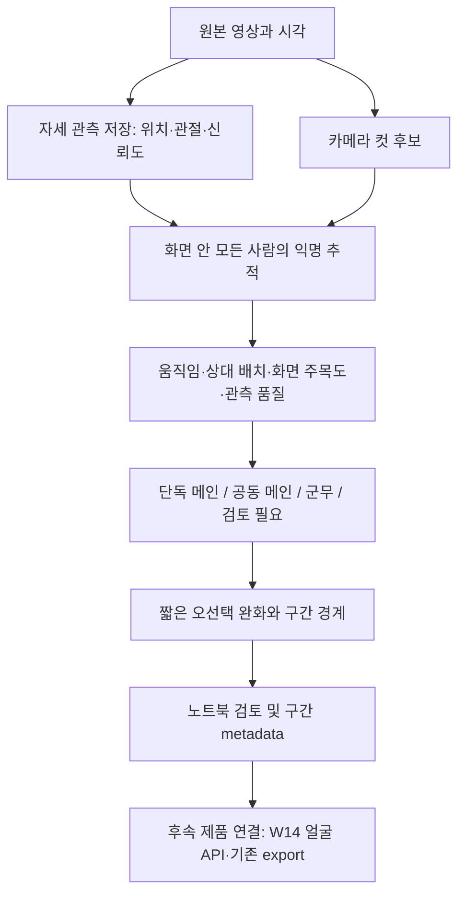

# W13 — 안무 하이라이트 파이프라인 재검토와 단계별 개선 설계

확인일: 2026-10-13 KST. **조사·설계 결과이며 구현/새 평가 결과가 아니다.** 사용자가 제공한 ChatGPT 조사문을 현재 코드와 공식 자료에 대조했다. 대표 보고용 임시 문구는 근거로 사용하지 않았다.

## 1. 먼저 읽을 결론

**MoveNet과 YOLO로 비교해 온 것은 유효하다. 하지만 두 모델의 가중치 조절만 계속하는 것으로 해결될 문제는 아니다.** 현재 가장 명확한 결함은 군무의 의미를 잘못 구현한 것과 군무에서도 메인 한 명을 강제로 고르는 구조다. 모델 교체 없이 먼저 검증할 수 있다.

- 기존 MoveNet 256·512와 YOLO26s 결과는 비교 기준으로 유지한다. 256·512는 같은 MoveNet 가중치에 서로 다른 입력 크기를 쓴 조건이다.
- 추가 자세 모델은 **RTMO-s를 우선 검토 후보**, **RTMPose-s/m + 별도 사람 검출기를 다음 후보**, MediaPipe Pose Landmarker를 예비 후보로 기록한다. 아직 다운로드·실행·제품 채택한 것이 아니다.
- 먼저 **전체 인물 추적 → 메인/공동 메인/군무/검토 필요 판정 → 짧은 오선택 완화 → 구간 만들기**를 기존 실험 경로에서 검증한다.
- 카메라 컷 처리와 OC-SORT 비교는 유용한 다음 단계다. 새 자세 모델·트래커·선정 규칙을 한꺼번에 바꾸지 않는다.
- 행동 인식 신경망, 안무 분할 신경망, 새 재식별 모델 학습은 별도 연구 범위로 남긴다. 현재 1개 영상의 정답만으로 도입할 근거는 부족하다.
- **1~2일 안의 목표는 노트북에서 새 판정과 구간을 비교하는 실험판**이다. 앱 통합·양 OS 설치 검증·일반 영상 정확도 보증까지 포함하지 않는다.

### 선택 가능한 세 방향

| 방향 | 얻을 수 있는 것 | 한계 | 권장 |
|---|---|---|---|
| 자세 모델부터 교체 | 누락·관절 흔들림의 차이 확인 | 군무 강제 메인과 잘못된 평가 기준이 그대로 남음 | 다음 독립 실험 |
| 기존 자세 자료로 판정 구조부터 수정 | 모델 추가 비용 없이 현재 실패 원인을 직접 비교 | 검출 자체의 오류는 해결 못 함 | **먼저 진행할 안** |
| 행동·시간 분할 모델을 새로 학습 | 복잡한 동작·문맥을 학습할 가능성 | 데이터·라벨·학습·배포 검증이 추가됨 | 장기 확장 |

## 2. 현재 실제 구조 — 제품과 실험을 구분

### 제품의 로컬 dev

```text
원본 → 4프레임마다 YOLOv8s Pose로 전체 사람 검출
     → 화면 위치·크기·관절 길이로 메인 한 명 선정
     → 선정된 한 명의 bbox만 IoU로 추적
     → 메인/군무 구간 생성·병합·일부 메인 구간 제거
     → 얼굴 표본·군집·참조 매칭 → 개별 clip export
```

**한 명을 고른 다음 그 한 명만 추적한다.** 따라서 모든 사람의 이동 이력을 비교해 메인을 고르는 구조가 아니다. 메인이 바뀌면 다른 몸인데 이전 track과 연결되거나, 같은 몸인데 새로운 track이 될 수 있다. 실제 빈도는 별도 추적 정답 없이는 알 수 없다.

근거: [제품 pipeline.py](/Users/jina/project/adlight/desktop/clipper_python/plugins/dance_highlight/dance_highlight/services/pipeline.py:65), [선정 규칙](/Users/jina/project/adlight/desktop/clipper_python/plugins/dance_highlight/dance_highlight/services/segment.py:23), [PoseEngine](/Users/jina/project/adlight/desktop/clipper_python/plugins/dance_highlight/dance_highlight/services/pose_engine.py:19).

### 현재 W13 실험판

```text
저장된 MoveNet/YOLO26 자세 자료
     → 전체 사람을 위치·크기로 짧게 연결
     → 약 0.267초 전 관절과 비교, 약 0.67초 움직임 평균
     → 시간 유지 조건을 둔 단일 메인 선정
     → 별도로 움직임 참여 인원으로 군무 표시
     → 노트북에서 원본과 선택 상자 비교
```

전체 사람을 연결하고 실제 시간 변화량을 계산하는 부분은 이미 있다. export 없는 평가 adapter, 입력/hash 기록, 사용자 정답표, 비교 노트북도 있으므로 다시 만들 필요가 없다. 다만 실험12는 최종 clip 경계/MP4를 만든 결과가 아니다.

근거: [실험 추적·선정 코드](/Users/jina/project/adlight/.worktrees/w13-dance-metadata-eval-20261001/desktop/clipper_python/tools/w13_temporal_pose.py:18), [실험12 기록](13-w13-temporal-motion-result.md).

### 유지할 기존 기능과 작업 경계

- clip 이동·숨김·되돌리기·인물 묶음 배정·숏폼 생성 계약을 유지한다. 안무 trim은 현행 거절 경로이며 이번에 새로 구현하지 않는다.
- 얼굴 검출·특징·멤버 이름 매칭 개선은 **W14/인물 하이라이트 세션** 소관이다. W13은 익명 인물 위치·메인 집합·군무·구간을 만든다. track ID는 멤버 이름이 아니다.
- 추적기 교체가 얼굴 매칭 해결이나 카메라 컷 전후 멤버 동일성 해결을 의미하지 않는다. 공통 얼굴 파일은 W14가 소유하고 소비 계약으로 연결한다.
- source bbox/track 저장은 향후 따라가는 crop에 재사용한다. 현재 최종 dance_meta에 추적 경로가 없고 preview/render는 중앙 crop이다. 얼굴 이름 재배정만으로 다른 사람의 crop track이 생기지는 않는다.

## 3. 확인한 문제와 아직 가설인 부분

| 구분 | 확인 내용 | 개선에 주는 의미 |
|---|---|---|
| 코드 사실 | 제품 pose_energy는 한 프레임의 관절 거리 합 | 동작량·안무 강도를 측정한 값으로 해석하면 안 됨 |
| 코드 사실 | 제품 streak는 원본 fps로 계산하지만 skip4 관측에 적용 | 설정한 시간보다 실제 유지 시간이 대략 4배 길어질 수 있음. 실험12는 초 단위 전환으로 수정 |
| 코드 사실 | 제품과 저장 YOLO adapter는 bbox/keypoint confidence를 버림 | 가림·부정확한 관절을 구별하기 어렵고 ByteTrack의 저신뢰 검출 연결을 온전히 비교할 수 없음 |
| 코드 사실 | 실험12 군무는 움직임 참여 인원만 확인 | 명확한 메인이 있고 다른 사람도 움직이면 군무를 잘못 켤 수 있음 |
| 코드 사실 | 실험12 메인 선택 함수는 군무 여부를 입력받지 않음 | 군무에서도 계속 한 명을 골라 불필요한 인물 전환 발생 |
| 코드 사실 | 실험12 화면 중앙 계산에 960 고정값 사용 | 현재 1920px 영상에서는 맞지만 다른 해상도 일반화 전 width 기반으로 바꿔야 함 |
| 코드 사실 | 실험12 공통 이동 제거는 인물들의 중앙 이동값을 사용 | 카메라 이동과 전원이 함께 이동하는 안무를 완전히 분리하지 못함 |
| 코드 사실 | 컷에서 추적·움직임 이력을 끊는 처리가 없음 | 컷 직후 큰 관절 이동을 안무 동작으로 오인할 가능성. 해당 영상의 기여도는 미측정 |
| 사용자 보고 | 명확한 메인 선택은 일부 개선, 군무는 과표시, 사람 사이 튐이 남음 | 후보12는 미채택. 모델 전체 우승은 정하지 않음 |
| 기존 측정 | main-only 642관측 중 군무 오표시: MoveNet512 200, YOLO26s 272 | 31.2%/42.4%. 기존 군무 F1 최적화가 명확한 메인을 잃는 비용을 제대로 통제하지 못함 |
| 기존 측정의 한계 | 일부 인물 표본 45/45 검출, 일부 메인 위치 표본 개선 | 전체 영상 추적 정확도·관절 품질·다른 영상 정확도를 입증하지 않음 |
| 미검증 | 더 좋은 pose/트래커가 최종 구간 정확도를 얼마나 높이는가 | 같은 입력·같은 판정 조건에서 별도 비교해야 함 |

제품의 얼굴 표본 부족 구간 drop 문제도 남아 있다. 이번 연구에서는 얼굴 모델이나 매칭 규칙을 바꾸지 않고, **W13이 찾은 구간을 얼굴 결과와 무관하게 보존할 소비 계약**에만 반영한다.

### 지금 군무가 켜지는 정확한 기준

실험12는 각 사람의 움직임이 `max(최소 움직임, 해당 프레임 최대 움직임×0.4)` 이상인지 센다. MoveNet512는 5명 중 4명, YOLO26s는 5명 중 3명이 문턱을 넘는 상태가 0.35초 지속되면 군무를 켠다. 움직임의 절대 문턱도 각각 0.16/0.06으로 다르다.

이것은 **몇 명이 함께 움직이는가**를 나타내는 신호다. **누군가 두드러진 메인인가**를 검사하지 않는다. 그래서 군무 과표시를 모델의 성능 문제로만 해석하면 원인을 놓친다. 군무로 표시된 관측에도 단일 메인 상자가 모두 남아 있는 것은 별도의 설계 오류다.

## 4. 제안 자료에서 채택·수정할 점

1. **문제를 나누는 접근은 적합하다.** 검출/추적, 움직임 특징, 역할 판정, 구간 경계를 각각 평가한다. 라이브러리를 단계마다 하나씩 추가해야 한다는 뜻은 아니다.
2. **화면 주목도와 안무 중심은 분리한다.** 화면 중앙·큰 bbox는 camera focus의 증거다. 실제 안무 센터나 앞줄의 증거로 확정하지 않는다. 단안 2D pose로 무대 깊이·화면 밖 인물을 알아낼 수는 없다.
3. **카메라 컷은 추적 경계로 활용한다.** 컷마다 완성 클립을 무조건 자르면 안무가 잘게 끊긴다. 추적 reset과 최종 clip 경계는 다른 결정이다.
4. **음악 박자는 경계 보조로만 쓴다.** 먼저 메인 교대 구간을 찾고, 의미를 해치지 않는 좁은 범위에서 시작·끝을 조정한다. 박자마다 자르거나 메인 교대를 다른 박자로 미루지 않는다.
5. **임의의 AI 판단을 정답으로 추가하지 않는다.** 사용자 정답은 평가에만 사용한다. 특정 시각·멤버 이름을 판정 코드에 넣어 정답을 재생하지 않는다.
6. **추적부터 전면 교체하는 순서는 지금은 비효율적이다.** 이미 확인한 군무 의미 오류를 먼저 분리하고, 그다음 같은 pose 자료로 추적기만 바꾼다.

## 5. 후보별 검토 — 기술 적합성·권리·우선순위

확인일은 모두 2026-10-13. 논문 발표일은 모델 계열의 연혁이며, 이번에 정확히 받은 가중치의 발행일/권리와 같은 개념이 아니다. upstream AP/FPS/HOTA를 우리 서비스 정확도나 처리시간으로 환산하지 않는다.

### 5.1 자세 모델

| 후보 | 우리 기능에 기여하는 부분 | 코드·가중치 근거 | 판단 |
|---|---|---|---|
| MoveNet MultiPose Lightning v1 (2021 계열) | 가벼운 다인 관절 추출. 같은 weights의 256/512를 비교 중 | TensorFlow/공식 모델 variation은 Apache-2.0. 학습 자료는 COCO·Active·합성 자료로 공개 설명 | **유지할 기준 모델.** 최대 6명 제한, 작은 인물·군중 영상의 한계 확인 필요 |
| YOLO26s-Pose / 제품 YOLOv8s | 사람 검출과 17관절 추출을 함께 수행 | Ultralytics 코드·공개 pretrained weights는 기본 AGPL-3.0, 비공개 상업 배포는 공식 Enterprise 안내 대상 | **기존 사용자 승인 실험 기준 유지.** 무료·비공개 배포 적합 후보로 분류하지 않음 |
| RTMO-s (2023 논문, CVPR 2024) | 한 번에 여러 사람의 17관절 추정. 현재 인터페이스와 가까움 | MMPose/rtmlib Apache-2.0, 공식 연결 mirror에도 Apache 표시. 개별 body7 가중치의 학습 계보는 추가 확인 | **추가 자세 후보 1순위.** CPU 속도·교차/가림 개선은 우리 영상에서 미측정 |
| RTMPose-s/m (2023) + 사람 검출기 | 검출한 각 사람을 잘라 자세를 추정. 작은 몸/관절 품질 비교에 가치 | pose 외에 detector 가중치도 따로 검토 필요. 기본 detector는 HumanArt 학습판 | **2순위.** 사람 수만큼 자세 추론 비용 증가, 검출 실패 시 pose도 실패 |
| MediaPipe Pose Landmarker | 경량 기기용 자세/연속 영상 처리 | 코드 Apache-2.0. 정확한 `.task` bundle의 사용·재배포 근거는 이번 확인 범위에서 미완료 | **예비 후보.** 현대 Tasks API는 복수 인물 지원. 33→17관절 매핑·가림·군중 검증 필요 |

근거: [MoveNet 공식 variation](https://www.kaggle.com/models/google/movenet/tensorFlow2/multipose-lightning/1), [MultiPose 모델 카드](https://storage.googleapis.com/movenet/MoveNet.MultiPose%20Model%20Card.pdf), [Ultralytics 공식 안내](https://www.ultralytics.com/license), [RTMO 논문](https://arxiv.org/abs/2312.07526), [RTMPose 논문](https://arxiv.org/abs/2303.07399), [MediaPipe 공식 API](https://developers.google.com/edge/mediapipe/solutions/vision/pose_landmarker), [MediaPipe 코드 LICENSE](https://github.com/google-ai-edge/mediapipe/blob/master/LICENSE).

MoveNet의 공식 가중치 라이선스는 명시적이다. 다만 학습 데이터 설명이 모든 원본 이미지의 권리 실사를 제공하는 것은 아니다. 데이터 자체를 우리 학습/배포 자료로 가져오는 결정과 공개 가중치를 사용하는 결정을 구분한다. MediaPipe 모델 카드 PDF는 이번 조회에서 가져오지 못했으며 문서 하단 코드 예제 라이선스를 모델 가중치 허가로 대신하지 않았다.

#### rtmlib를 곧바로 “완전히 무료 배포 가능”으로 결론내리지 않은 이유

- `rtmlib`는 MMPose 전체 학습 스택 없이 ONNX 추론을 사용할 수 있다. **우선 검토할 연결 방식**이다. 기본 자동 다운로드 대신 정확한 모델 파일·버전·hash를 지정해야 한다. [공식 rtmlib](https://github.com/Tau-J/rtmlib)
- 기본 `Body`는 `yolox_m_8xb8-300e_humanart-c2c7a14a`와 `rtmpose-m_simcc-body7_pt-body7_420e-256x192-e48f03d0_20230504` 조합이다. RTMO-s 기본은 `rtmo-s_8xb32-600e_body7-640x640-dac2bf74_20231211`이다. [실제 기본 매핑](https://github.com/Tau-J/rtmlib/blob/main/rtmlib/tools/solution/body.py)
- 긍정적인 근거도 있다. MMPose 협업자는 2023-05-24 RTMPose/YOLOX-Pose의 상업 이용 허용을 답했고, rtmlib가 공식적으로 연결한 Tau-J의 모델 mirror는 Apache-2.0을 표시한다. **가중치 라이선스 근거가 전혀 없다는 뜻은 아니다.** [유지관리자 답변](https://github.com/open-mmlab/mmpose/issues/2393), [모델 mirror](https://huggingface.co/Tau-J/RTMPose)
- 그러나 기본 detector의 HumanArt는 데이터 이용에 비상업 조건을 명시하고, body7 계열에는 MPII 등 별도 데이터 조건이 있다. mirror의 짧은 license tag만으로 데이터 조건과 정확한 checkpoint의 관계까지 설명되지는 않는다. [HumanArt 이용 조건](https://github.com/IDEA-Research/HumanArt), [MPII 이용 조건](https://www.mpi-inf.mpg.de/departments/computer-vision-and-machine-learning/software-and-datasets/mpii-human-pose-dataset/download), [RTMO body7 학습 설정](https://github.com/open-mmlab/mmpose/blob/main/configs/body_2d_keypoint/rtmo/body7/rtmo-m_16xb16-600e_body7-640x640.py)
- 데이터의 비상업 조건이 모든 학습 가중치에 자동으로 같은 조건을 부과한다고 단정하지 않는다. 사용자가 요구한 엄격한 배포 기준에서는 **정확한 파일·pretraining 계보·변환본 재배포 범위를 추가 확인**하는 상태로 둔다. 다른 이용자의 미답변 질문을 공식 허가/금지로 인용하지 않는다.
- YOLOX는 Ultralytics YOLO와 다른 프로젝트이며 [코드는 Apache-2.0](https://github.com/Megvii-BaseDetection/YOLOX/blob/main/LICENSE)이다. 이름에 YOLO가 있다고 모두 AGPL은 아니다. 다만 YOLOX 코드의 허가와 HumanArt fine-tuned weight의 판단도 별개다.

### 5.2 추적·컷·시간 분석

| 기술 | 확인 내용 | 이번 판단 |
|---|---|---|
| Roboflow Trackers의 OC-SORT / ByteTrack | Apache-2.0 재구현. 현재 README의 지원 목록은 SORT/ByteTrack/OC-SORT이며 BoT-SORT 패키지로 보지 않음. 기하 기반 연결은 자체 학습 가중치 불필요 | **트래커 단독 대조에 유용.** detector 연동 extra/API 없이 저장 bbox를 입력. 현재 Hungarian 추적과 비교 |
| BoT-SORT 공식 구현 | MIT. README 검증 환경은 Ubuntu 20.04/Python3.7/torch1.11+CUDA. Re-ID와 detector 등 별도 구성 포함 | 알고리즘 참고 가치 있음. 전체 연구 repo를 설치형 앱에 그대로 넣는 경로는 후순위 |
| PySceneDetect | BSD-3-Clause. AdaptiveDetector는 주변 프레임 변화와 비교해 컷 탐지 | **컷 reset 후보.** 조명 섬광·줌을 컷으로 오인하는지 따로 검증 |
| librosa | ISC. 음악 특징·박자 추출 | 메인 구간이 안정된 뒤 경계 보조 실험. 즉시 필수 의존성은 아님 |
| DanceTrack | tracking benchmark. 코드 MIT, annotation CC BY 4.0, 데이터 자체는 비상업 연구 조건 | 연구 결과 참고. 현재 상업 프로젝트의 다운로드/학습/평가 데이터로 채택하지 않음 |
| ST-ReIDNet / DanceReID (ICASSP 2020) | 춤 자세 변화에 대한 재식별 연구. 오래된 torch 환경. 확인한 repo에서 코드/weights/data의 충분한 재배포 근거 미확보 | 연구 목록으로만 보존. W13에서 얼굴·멤버 재식별 경로 추가하지 않음 |

근거: [Roboflow Trackers](https://github.com/roboflow/trackers), [실제 dependencies](https://github.com/roboflow/trackers/blob/main/pyproject.toml), [BoT-SORT](https://github.com/NirAharon/BoT-SORT), [OC-SORT 원 구현 MIT](https://github.com/noahcao/OC_SORT/blob/master/LICENSE), [PySceneDetect BSD](https://github.com/Breakthrough/PySceneDetect/blob/main/LICENSE), [AdaptiveDetector](https://www.scenedetect.com/docs/latest/api/detectors.html), [librosa ISC](https://github.com/librosa/librosa/blob/main/LICENSE.md), [DanceTrack 조건](https://github.com/DanceTrack/DanceTrack), [ST-ReIDNet](https://github.com/azuxmioy/ST-ReIDNet), [DanceReID](https://github.com/azuxmioy/DanceReID).

Roboflow Trackers도 dependencies 없이 동작하는 것은 아니다. 확인한 main은 NumPy>=2.0.2, SciPy>=1.13.1, supervision 등과 결합하므로 현행 uv lock과 충돌 검사를 해야 한다. BoT-SORT의 Re-ID weights를 켜면 “트래커 자체는 가중치 불필요”라는 설명을 적용할 수 없다. Ultralytics가 제공하는 tracker 호출 경로의 라이선스도 원 알고리즘 repo와 구분한다.

### 5.3 즉시 추가하지 않을 연구 계열

| 후보 | 직접 해주는 일 | 지금 넣지 않는 이유 |
|---|---|---|
| MMAction2 ST-GCN++ / PoseC3D | 시간에 따른 skeleton 행동 특징·분류 | K-pop 메인 역할 정답을 학습한 모델이 아님. checkpoint별 데이터·17/25관절 구성·배포 확인 필요 |
| ASFormer (BMVC 2021), MS-TCN++ (TPAMI 2020) | 프레임 특징을 행동 구간 라벨로 변환 | 메인/군무에 맞는 특징·정답·학습 필요. 한 영상 튜닝을 대체할 검증 자료가 없음 |
| ActionFormer (ECCV 2022) | 행동 발생 구간 위치·종료 예측 | 메인 역할 교대와 행동 발생 구간은 다른 목표. 학습/feature backbone 비용 추가 |
| DanceBits API / 2024 안무 분할 연구 | pose+음악으로 춤 동작 경계 추정 | 동작 연습용 단위 분할과 인물별 메인 구간은 다름. API의 공개 weight·재배포 근거도 미확인 |

MMAction2 코드는 Apache-2.0, ASFormer/MS-TCN++/ActionFormer 코드는 MIT다. 이는 모든 pretrained checkpoint의 조건을 보증하지 않는다. [MMAction2](https://github.com/open-mmlab/mmaction2), [ASFormer MIT](https://github.com/ChinaYi/ASFormer/blob/main/LICENSE), [MS-TCN++ MIT](https://github.com/sj-li/MS-TCN2/blob/master/LICENSE), [ActionFormer MIT](https://github.com/happyharrycn/actionformer_release/blob/main/LICENSE).

**DanceBits 관련 정정:** 제시된 API repo는 MIT이며 W&B 조직·프로젝트·모델 버전·API key를 통해 weights를 가져오는 구성을 안내한다. 바로 쓸 수 있는 특정 공개 weight/hash/license를 확인하지 못했다. 2024-05-30 논문과 저자 공식 페이지는 pose·음악을 통한 동작 분할을 설명하지만, 확인한 저자 페이지에서 이 API repo를 공식 구현으로 연결하지 않았다. 두 자료를 같은 공식 배포물이라고 단정하지 않는다. [API repo](https://github.com/dance-segmentation/dance-bits-api), [논문](https://arxiv.org/abs/2405.19727), [저자 공식 페이지](https://shuhei2306.com/research/automatic_segmentation.html).

### 라이선스 결론을 읽는 방법

- **코드 조건이 비공개 상업 배포와 양립하는 후보:** rtmlib/MMPose, Roboflow Trackers, OC-SORT, BoT-SORT, PySceneDetect, librosa, ONNX Runtime 등. 각 LICENSE/NOTICE 유지와 수정 고지 등 해당 조건은 지킨다.
- **명시적 모델 라이선스 근거가 있는 유지 후보:** MoveNet MultiPose v1 Apache-2.0. RTMPose/RTMO mirror의 Apache 표시도 긍정 근거지만 exact artifact와 데이터 계보 확인을 추가한다.
- **추가 확인 후보:** RTMO/RTMPose의 선택 checkpoint·detector 조합, MediaPipe `.task`, 행동 인식/분할 pretrained weights, DanceBits weights.
- **사용자 선호 조건과 맞지 않음:** 무료 AGPL 경로의 Ultralytics 비공개 제품 배포, DanceTrack 데이터의 상업 이용. 기존 YOLO 평가 승인과 향후 제품 배포 판단은 별개다.
- **전체 설치본 “라이선스 검증 완료” 후보는 이번 조사로 만들지 않았다.** 정확한 wheel·네이티브 라이브러리·모델 파일을 고정한 배포 명세와 고지 목록이 추가로 필요하다.

## 6. 권장 파이프라인 설계



### 역할 네 가지를 한 번에 결정

| 상태 | 의미 | 메인 집합 |
|---|---|---|
| 단독 메인 | 특정 한 명의 우세가 일정 시간 유지됨 | 해당 track 1명 |
| 공동 메인 | 특정 복수 인물이 나머지보다 함께 두드러짐 | 해당 track 여러 명 |
| 군무 | 충분히 관측된 인물들이 비슷한 비중이며 두드러진 메인 집합 없음 | **빈 집합** |
| 검토 필요 | 가림·누락·컷 직후·불충분한 정보로 역할 판단 어려움 | 확정 없음, 후보·이유 보존 |

“여러 명이 움직임”은 보조 특징으로 남긴다. 군무는 메인 점수의 차이·상위 인물 집합의 우세·분포를 함께 본다. 높은 관측 품질을 요구해, 모두 잘 안 보여서 점수가 비슷한 상황을 군무로 오인하지 않는다. 두 사람이 함께 두드러지는 경우와 전체가 비슷한 경우도 구분한다. 군무 인원을 무조건 3명 이상으로 고정할 근거는 없다.

초기에는 현재 메인 점수를 재사용하고, 점수의 상대 차이와 일정 시간 지속 여부를 추가한다. 중앙 점수만 높아서 단독 메인이 되는 사례를 별도 실패군으로 검사한다. 점수는 학습된 확률이 아니므로 “메인 확률 90%”처럼 표시하지 않는다. 모델마다 관절 품질이 달라 생긴 값의 차이는 모델별 튜닝 대조와 모델만 바꾼 공통 조건 대조를 구분한다.

가장 중요한 예외는 **움직임이 작은 포즈 유지 장면**이다. 움직임이 없다고 제외하거나 자동으로 검토 필요로만 보내지 않는다. 보이는 대형·직전 역할·화면 주목도를 보되, 화면 밖 실제 센터를 추측해 이름을 붙이지 않는다.

### 시간 안정화와 구간

- 실제 경과 초로 유지 시간을 계산한다. 출력은 원본 시각을 사용하고 skip4를 fps와 혼동하지 않는다.
- A→B→A가 짧게 나타났다고 무조건 B를 지우지 않는다. A가 같은 실제 track인지, B의 우세가 약한지, 컷/가림이 없는지 함께 검사한다.
- 강한 실제 교대는 지연시키지 않도록 짧은 오선택 횟수와 교대 지연을 동시에 측정한다.
- 관측 품질 부족은 별도 상태로 남긴다. 검토 필요를 늘려 오선택률만 낮추는 설정은 coverage 평가에서 드러나게 한다.
- 컷마다 추적·움직임 이력은 초기화한다. 컷 전후 같은 이름을 연결하는 일은 W14 소비 계약/별도 근거가 있어야 한다.
- 초기 구간은 역할/메인 집합이 연속되는 범위로 만든다. 짧은 누락의 병합은 같은 track과 경계 증거가 있을 때만 한다. 긴 누락은 별도 후보로 보존한다.
- 군무 구간은 군무 clip 후보로 유지한다. 메인 카드에 강제로 배분하지 않는다. 공동 메인은 같은 원본 구간을 여러 인물 카드에서 참조할 수 있어야 한다.

### 보존할 관측 계약

원본 hash, frame index, source time/PTS 여부, frame size, shot ID, 익명 track ID, bbox, COCO17 keypoints와 confidence, detection confidence, 역할, main track 집합, 판정 근거, 모델 hash, 코드 hash, 설정 revision을 보존한다. confidence가 없는 기존 자료에는 임의의 1.0을 채우지 않고 unavailable로 둔다.

자동 결과와 사용자의 수동 override는 분리한다. 새 실험은 새 run ID를 쓰고 기존 프로젝트·정답표·노트북을 덮어쓰지 않는다. source-relative track sidecar는 향후 clip/trim/render 시간 변환과 동일 preview/render crop에 사용한다. 전체 인물 bbox를 보존해야 멤버 재배정 시 다른 사람의 track을 선택할 여지가 생긴다.

## 7. 1~2일 개선안 — 큰 변경을 뺀 버전

전제: 기존 저장 pose와 실험용 익명 추적을 재사용하고, 연구 코드/노트북에서만 진행한다. 예상 12~16 작업시간이며 품질 성공을 보증하는 납기 약속은 아니다.

| 순서 | 작업 | 사용자에게 보이는 결과 |
|---|---|---|
| 1일차 앞부분 | 기존 main/group 중첩 라벨을 보존하며 평가 분리, 역할 네 상태 출력 계약 | 군무·메인·검토 필요를 왜 나눴는지 확인 가능한 표 |
| 1일차 나머지 | 메인 우세 기반 군무/공동 메인 규칙. 기존 모델·추적·움직임 특징 고정 | 군무에서 메인 상자가 사라지고, 명확한 메인을 군무로 잘못 없애는 시각 표시 |
| 2일차 앞부분 | 짧은 오선택 완화 하나를 추가하고 구간 metadata 생성 | 불필요한 인물 튐·구간 쪼개짐과 실제 교대 지연 비교 |
| 2일차 나머지 | 같은 원본 전체의 새 비교 노트북·실패 구간 표·회귀 검증 | 사용자 정답/기존12/개선안의 타임라인과 동시 재생 |

이 범위에서 새 모델 다운로드·추론, 얼굴 분석, 새 트래커 dependency, 학습, 음악 분석, 새 crop/편집 UI, 제품 배포까지 함께 하지 않는다. shot 정보가 없는 현재 cache에서는 떨어진 track 구간의 재연결·병합을 끈다. 이것만으로 컷 직후의 오추적까지 해결되지는 않으며, 컷 탐지 추가는 다음 독립 조건으로 측정한다. 컷 처리가 선행돼야 한다는 실패 증거가 나오면 실험 순서를 조정하되 해당 제한을 기록한다.

**완료 기준은 “좋아졌다고 선언”이 아니라 사용자가 개선·악화 구간을 직접 판단할 자료가 생기는 것**이다. 아직 열린 노트북 파일은 디스크에서 수정하지 않고 새 번호의 노트북을 만든다.

## 8. 확장안과 우선순위

| 우선순위 | 추가 변경 | 필요한 이유/시작 조건 | 예상 범위 |
|---|---|---|---|
| P0 | 위 역할·시간·구간 실험 | 이미 재현된 군무 오류를 직접 수정 | 1~2일 실험판 |
| P1 | 컷 탐지와 track/motion reset | 컷 직후 오선택·관절 점프가 확인될 때 | 소규모 독립 비교. 조명/줌 반례 포함 |
| P1 | OC-SORT 대조 | 교차/가림에서 현재 익명 연결 실패를 줄이는지 | 저장 pose 재생부터. 새 모델 불필요 |
| P2 | RTMO-s 추가, 필요하면 RTMPose 조합 | 관절 흔들림·누락이 여전히 병목이고 exact weight 권리/런타임 준비 완료 | 모델 한 개씩 전체 1pass metadata, 이후 cache 비교 |
| P2 | 배경 기반 카메라 이동/줌 보정 | 인물 공통 이동만으로 안무와 촬영을 분리하지 못할 때 | 배경 optical flow/affine, 실패 fallback 검증. 단순 점수 조정보다 큼 |
| P3 | 음악 박자에 좁은 경계 정렬 | 인물 구간은 맞는데 clip 시작/끝이 어색할 때 | librosa 별도 실험. 정답 경계 이탈량 제한 |
| P3 | 자체 분류/시계열 모델 | 여러 독립 영상에서 규칙의 한계가 재현될 때 | 우선 작은 분류기/순위 모델, 이후 GCN/TCN 검토. 데이터 구축 포함 수주 이상 가능 |
| 별도 | W14 연결·crop·앱 export 통합·OS 배포 | 익명 구간 품질과 공통 API 계약 확인 뒤 | 소비자 통합 계획과 실제 설치 검증 필요 |

자체 학습을 한다면 같은 공연의 인접 프레임을 임의로 train/test로 나누지 않는다. 영상·공연·카메라 조건 단위로 나누고 권리가 확인된 입력을 쓴다. 30~50개 영상은 보장된 충분량이 아니며 지금 사용자에게 당장 요구할 준비물도 아니다.

## 9. macOS / Windows 배포 가능성

### 현재 배포 구조를 활용

Electron은 Python source/SDK와 uv를 포함하고, 플러그인별 venv를 `uv sync --managed-python --python 3.11`로 준비한다. 모델 `.pt/.onnx`와 기존 `.venv`는 builder 리소스에서 제외된다. 사용자가 Python/CUDA를 직접 설치하지 않는 기존 흐름을 유지한다. 모델은 기존 모델 설치/cache 경로에서 관리하며, 앱 설치 파일 자체에 weights를 넣으려면 별도 배포 변경이다.

근거: [builder 리소스](/Users/jina/project/adlight/desktop/clipper_electron/electron-builder.yml:16), [venv 준비](/Users/jina/project/adlight/desktop/clipper_electron/src/main/plugin/plugin-venv.ts:51), [OS별 빌드 명령](/Users/jina/project/adlight/desktop/clipper_electron/package.json:17). **새 모델 도입을 위해 PyInstaller로 전환할 필요는 없다.** 최초 설치의 네트워크 준비와 준비 완료 후 오프라인 추론을 구분해 검증한다.

| 환경 | 현실적인 기본 경로 | 미검증 사항 |
|---|---|---|
| macOS Apple Silicon | 기존 TF/torch 실험 유지, 새 ONNX 후보는 ORT CPU부터 | 실제 target 최소 OS, wheel/모델 연산자, CoreML 결과·성능 |
| Windows x64 | ORT CPU, 기존 managed Python 3.11 | 깨끗한 PC의 DLL/VC runtime, 한글 경로, no-CUDA, 취소·재개 |
| macOS Intel | CPU용 호환 버전 별도 고정 | 최신 ORT/MediaPipe가 Intel wheel도 제공한다고 가정하면 안 됨 |

실제 PyPI 파일 목록 확인: ORT 1.31.0(2026-10-09)은 CPython3.11 Windows x64 및 macOS14+ arm64 wheel을 제공한다. MediaPipe1.1.0(2026-10-06)은 Windows x64·macOS11+ arm64 wheel을 제공한다. 해당 최신 목록에는 Mac Intel wheel이 보이지 않는다. **wheel 존재는 우리 앱 설치 성공 증거가 아니다.** [ORT 배포 파일](https://pypi.org/project/onnxruntime/1.31.0/#files), [MediaPipe 배포 파일](https://pypi.org/project/mediapipe/1.1.0/#files).

ORT는 MIT이며 새로운 ONNX 모델의 CPU 공통 런타임으로 적합한 후보이다. 추적·점수·구간 코드까지 ONNX로 변환할 이유는 없다. CoreML은 모델 연산자/shape별 지원과 CPU fallback을 확인한다. DirectML은 현재 유지보수 단계이고 새 기능은 WinML로 이동한다고 공식 문서가 안내하므로 Windows GPU 경로를 DirectML로 미리 확정하지 않는다. [ORT LICENSE](https://github.com/microsoft/onnxruntime/blob/main/LICENSE), [CoreML](https://onnxruntime.ai/docs/execution-providers/CoreML-ExecutionProvider.html), [DirectML/WinML 안내](https://onnxruntime.ai/docs/execution-providers/DirectML-ExecutionProvider.html).

패키징 검증은 버전/hash 고정, dependency 고지·LICENSE 목록, 최초 설치/재시작/오프라인, 한글·공백 경로, 모델 파일 누락·손상, 취소/재개, CPU fallback, 추론 시간/RSS, 기존 플러그인 환경 갱신을 포함한다. W14 공통 package가 설치 fingerprint에 반영되는 변경은 소유자와 합의해 진행한다. FFmpeg는 기존 binary의 build flags와 실제 포함 codec에 따라 LGPL/GPL 의무를 확인해야 하며, 코드 이름만으로 판정하지 않는다. [FFmpeg 공식 법적 안내](https://ffmpeg.org/legal.html).

**이번 turn에서 Windows/macOS 설치본 빌드·기동 검증을 수행하지 않았다.** 위 표는 코드·공식 배포물 기반 가능성 검토다.

## 10. 최소 비교 실험과 manifest 초안

[구조화한 manifest 초안](13-w13-pipeline-redesign-experiment-manifest.json). 상태는 `draft_not_executed`이며 새 실행을 기록한 문서가 아니다.

### 첫 묶음: 새 모델 추론 없이 6개 조건 재생

| 조건 | 바꾸는 것 | 고정하는 것 |
|---|---|---|
| C0 | 기존12 결과 재현/참조 | 기존 pose·추적·main/group 규칙 |
| C1 | 역할 네 상태와 메인 우세 기반 군무/공동 메인 | pose·추적·움직임 특징·기존 메인 점수 |
| C2 | C1에 짧은 오선택 완화 하나 추가 | C1의 역할 기준 및 나머지 |

MoveNet512와 YOLO26s 각 3조건, 총 6회 **metadata 재생**이다. MoveNet256 cache는 보존하되 최초 비교 화면에는 조건을 늘리지 않는다. 기존 C0의 군무 설정이 모델마다 다르다는 점은 표시한다. C1/C2는 같은 설정으로 시작하고, 모델별 최적화를 하면 별도 조건으로 분리한다. 이번에 실제 재생하지 않았다.

### 입력과 평가 의미

- 기존 전체 원본 0–133.654059초와 확정 정답표 21행을 사용한다. 입력 경로·SHA256·cache hash·기존 모델 provenance는 manifest에 기록한다.
- 얼굴/참조 이미지 입력은 없다. 멤버 이름은 사용자 정답의 의미이며, W13의 예측은 익명 track/bbox 집합이다. 현재 인물 위치 표본 라벨은 조사자 작성 보조 자료라는 한계를 유지한다.
- 기존 2002관측은 main-only642 / group-only407 / main+group중첩556 / exclude388 / 미표시9로 나뉜다. 새 군무 정의와 충돌할 수 있는 중첩556은 **별도 표**로 보고하고 임의로 정답을 고치지 않는다. 중첩을 모두 군무 정답으로 넣은 예전 F1과 새 strict group 지표를 같은 지표처럼 비교하지 않는다.
- 미표시는 평가에서 무시한다. 명시적 제외는 negative 평가로만 사용한다. 정답 구간을 읽어 예측을 강제로 끄는 mask를 만들지 않는다.
- 평가 이름을 붙일 수 없는 전체 프레임에는 메인 identity accuracy를 꾸며내지 않는다. 연속 body-ID 정답이 없어 HOTA/IDF1도 지금 계산 가능한 지표가 아니다.

### 지표와 채택 기준 제안

1. **역할:** main-only를 군무로 잘못 지운 비율, group-only의 군무 precision/recall, 공동 메인 집합 precision/recall, 검토 필요와 자동 판정 coverage를 함께 표시한다.
2. **선택:** 위치 정답이 있는 표본에서 올바른 몸 선택/잘못 선택/검출 누락/보류를 분리한다. 검출된 경우만의 정확도와 전체 coverage를 함께 본다.
3. **시간:** 실제 교대 지연 중앙값/p95, 1초 미만 선택 조각 수, 구간별 시작·끝 오차, temporal IoU와 boundary F1(허용0.25/0.5/1초)을 병기한다. 큰 bbox 이동 횟수는 오류의 대용치로 단독 사용하지 않는다.
4. **초기 목표 제안:** main-only 거짓 군무 ≤10%, group-only 회수율은 각 모델 C0보다 낮아지지 않을 것. 기존 명확한 네 시점22.02/28.03/54.39/60.19초의 정답 선택 유지. 기존 표본 전체의 `정답 선택 수/전체 표본 수`도 낮아지지 않을 것. 실패하면 채택하지 않고 trade-off를 보인다. 수치는 달성 결과나 사용자 확정 합격선이 아니다.
5. **시간 처리 목표 제안:** C2는 C1보다 잘못된 짧은 선택을 줄이되 올바른 교대의 p95 지연을 0.2초 넘게 악화시키지 않는다. 군무 메인 집합은 항상 비어야 하지만 이 계약만 지켰다고 군무 정확도가 높아지는 것은 아니다.
6. **자원:** cache 재생은 각120초/최대RSS2GiB/전체 출력100MiB를 제안한다. 영상은 원본을 참조하는 notebook overlay로 확인하고 완성 clip은 만들지 않는다.

같은 영상으로 설정을 고르고 확인한 결과는 **이 영상에 대한 개발 결과**다. 여러 공연에 통하는 품질은 아직 얻지 못했다. 다음 입력 확장은 기존 한 영상의 개선 후보가 정리된 뒤 별도 원본·라벨·권리·실행 범위로 설계한다.

## 11. 이번 작업의 검증 범위와 남은 결정

- 읽기 전용 코드 확인: 제품 Python 로컬 dev `47782953228861f4bdbdc135265d067c2a826b0e`; 실험 worktree는 같은 HEAD의 기존 미커밋 작업. Electron 로컬 dev `9d5ea55daf5641921912ef9085fe63079e45d5de`. fetch하지 않았다.
- 공식 문서·논문·LICENSE·모델 카드·wheel 목록을 대조했다. 모델 가중치/데이터셋 다운로드나 새 추론을 하지 않았다.
- 문서/manifest 검증: JSON 구문과 2모델×3조건=6재생 일치, 원본·정답표·pose cache 2개·기존 결과·기준 코드 2개 총7개 SHA256 일치, 보고서의 로컬 링크 존재, 제안 출력 경로 미생성 확인. 제품 Python/Electron의 tracked 변경은 없고 실험 worktree의 기존 tracked 변경3개는 유지됐다.
- 기존 테스트 수치는 해당 과거 기록에만 속한다. 이번 문서 변경을 새 ML 성공·제품 품질 통과로 표현하지 않는다.
- **제안:** 우선 §7의 1~2일 실험판을 진행하고, 동일 영상에서 군무 과표시와 불필요한 메인 선택이 줄어드는지 확인한다. 이후 컷/OC-SORT, RTMO 순으로 원인별 조건을 추가한다.
- 남은 결정은 제안한 개선 범위의 선택, exact RTMO/RTMPose artifact 권리·배포 검증, strict 군무와 기존 중첩 라벨의 최종 해석, 후속 독립 영상과 제품 통합 범위다. 사용자에게 정답표 전체를 다시 쓰도록 요구하지 않는다.
