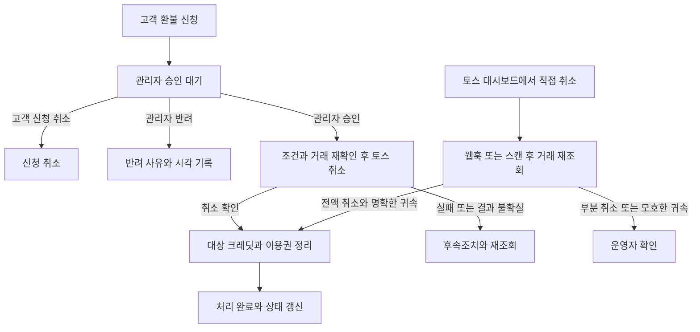

# PG 두 세션 작업과 최종 인계

2026-11-04 KST. 「고객 환불·외부 취소 설계 독립 검증」과 「pg 검증, 문제 수정」에서 진행한 작업을 함께 정리한다. 두 세션의 **서비스 기능 코드는 원격 dev에 반영됐다.** 실제 토스 연동 전체 시나리오와 운영 배포 검증은 별도로 남아 있다.

이 문서가 두 세션의 통합 인계 기준이다. 아래 날짜별 설계·검증 기록은 각 단계의 상태를 보존한다. 특히 과거의 ‘외부 취소 후처리 미구현’, ‘가격·무료체험 변경 미커밋’, ‘최대 3,650일’은 현재 상태가 아니다. 현재 상한은 **365일**이다.

## 세션과 작업 위치

| 세션 | 역할 | 스레드 ID |
| --- | --- | --- |
| pg 검증, 문제 수정 | 초기 PG 운영 조사, 업그레이드 소액 차액, 가격·크레딧·무료체험, 실제 Toss TEST 실험 | `01a19d31-4956-7a80-ae73-6ec56fefe6c6` |
| 고객 환불·외부 취소 설계 독립 검증 | 고객 환불 승인 기능과 운영 UI, 앱 정산 복구, 독립 검토, 두 세션 통합·dev 반영, 외부 취소 자동 후처리 | `01a19e06-16f8-75d1-ba54-0514b52e8414` |

작업 브랜치는 각 저장소의 `pg-ops-20261103`이다. 두 세션이 아래 작업 폴더를 공유했으므로 세션별 변경을 다른 폴더에 새로 복제하지 않았다.

- API: `/Users/jina/project/adlight/.worktrees/pg-ops-20261103-api`
- 관리자: `/Users/jina/project/adlight/.worktrees/pg-ops-20261103-admin`
- 클라이언트: `/Users/jina/project/adlight/.worktrees/pg-ops-20261103-client`
- 앱 네 저장소: `/Users/jina/project/adlight/.worktrees/pg-ops-20261103-app/clipper_{electron,angular,nestjs,python}`

## 현재 환불 흐름

고객은 결제내역에서 환불 가능 조건을 통과한 결제에 대해 신청한다. **신청만으로 토스 취소를 시작하지 않는다.** 관리자가 신청을 확인하고 승인해야 서버가 조건·대상 주문·토스 상태를 다시 확인한 뒤 취소를 실행한다. 승인 전에는 고객이 신청을 취소할 수 있다.

관리자의 토스 대시보드 조작으로 이미 취소된 결제는 별도 흐름이다. 서버가 거래를 다시 조회·검증한 뒤 내부 혜택을 정리하며, 토스 취소 API를 다시 보내지 않는다.

### 고객 신청과 관리자 승인

- 고객 API에서 회원 소유권·대상 주문 묶음·현재 정책·중복 신청을 검사한다. 관리자는 승인 직전 같은 대상을 재검증한다.
- 실패와 결과 불확실을 성공으로 표시하지 않는다. 처리에 문제가 생긴 신청과 내부 후속조치를 운영자가 따로 모아 볼 수 있다.
- 반려 사유와 시각은 관리자에게 표시한다. 고객에게는 내부 사유를 그대로 공개하지 않고 반려 상태와 문의 안내를 제공한다.
- 환불 요청 취소는 승인 대기 상태에서 제공한다. 관리자 처리 및 외부 취소 완료와 경합해도 최종 결과를 따른다.
- 고객 환불 조회·신청은 기본 제공한다. `CUSTOMER_REFUNDS_ENABLED`와 응답의 `requestsEnabled`는 제거했다. 신청은 관리자 승인 대기로 접수하며 승인 전 토스 취소를 시작하지 않는다. [플래그 제거와 필수 검증 절차](04-customer-refunds-default-and-pre-dev-review.md)를 따른다.

### 환불 실행과 복구의 안전장치

- 잠금을 얻은 뒤의 시각으로 이용기간과 환불 가능 여부를 판단한다.
- 토스 취소를 보내기 전에 시도 기록을 남긴다. 실제 취소 후 DB 기록이 실패했을 수 있으므로 DB 취소 금액이 0이라는 이유만으로 그 건을 무효화하지 않는다.
- 응답을 받지 못하면 결제·취소 거래를 조회해 결과를 확인한다. 거래키와 금액·잔액을 검증하며 금액만 같다고 다른 거래를 연결하지 않는다.
- ‘15일’은 취소 요청 중복 방지 키의 유효기간이다. 15일 동안 환불을 기다리는 기능이 아니다. 유효기간이 지난 불확실 건도 기존 결과를 확인한 뒤 재시도한다.
- 미지원 가상계좌 관련 서비스·화면·계약과 DB 컬럼 정리도 dev에 반영했다. 현재 서비스의 지원 결제수단으로 가상계좌를 취급하지 않는다.

## 외부 취소 자동 후처리

초기 구현은 토스 대시보드의 취소를 감지하고 조사 목록에 남겼지만, 기존 내부 환불 건이 없는 취소에 대해서는 혜택을 회수하지 않았다. 이 누락을 두 세션 대조에서 확인한 뒤, 사용자가 선택한 **전액 취소 확인 후 자동 정리** 방식으로 구현했다.

| 대상 | 처리 |
| --- | --- |
| 해당 결제에서 지급된 남은 크레딧 | 같은 회원·결제에 귀속되는 분량만 회수하고 원장을 남긴다. |
| 무료체험·프로모션·수동 지급·다른 결제의 크레딧 | 보존한다. |
| 귀속이 명확한 현재 구독 | 관련 이용권과 다음 자동결제·재시도를 중단한다. 연간 계약의 향후 월별 지급도 막는다. |
| 과거 결제 취소와 이후 유효한 결제 기간 | 새 유효 기간과 다른 결제의 권리를 보존한다. |
| 이미 사용한 크레딧 | 남은 해당 크레딧은 회수하고, 사용한 분량의 정산은 운영자 확인 대상으로 남긴다. 다른 지급분 차감이나 음수 잔액을 만들지 않는다. |
| 부분 취소·업그레이드·복수 결제 등 귀속이 불명확한 건 | 확인 사유를 표시하고 운영자 판단 대상으로 남긴다. 임의 비례 회수나 강등을 하지 않는다. |
| 기존 내부 환불 건이 있는 취소 | 기존 환불 엔진이 혜택 정리를 소유하며 중복 회수하지 않는다. |

결제별 영속 작업, 처리 소유권과 만료 시간, 멱등 원장으로 중복 웹훅·스캔·실패·재시작에 대응한다. 토스 조회는 금융 DB 잠금 밖에서 수행하고, 실제 권리 변경은 구독·회원·주문의 일관된 잠금 순서를 따른다. 동시에 진행되는 지급·갱신과 지연된 작업 실패 크레딧 반환도 취소된 혜택을 다시 사용 가능하게 만들지 않도록 막았다.

모든 원래 신청 대상 결제의 외부 정리가 완료된 대기 신청은 시스템 상태 `resolved_externally`로 닫는다. 고객에게는 완료로, 관리자에게는 **외부 취소 완료**로 표시한다. 관리자 승인·반려를 한 것으로 기록하지 않는다. 이미 반려·철회·승인된 이력은 보존한다.

## 고객 웹과 관리자 화면

| 영역 | 반영한 내용 |
| --- | --- |
| 고객 결제내역 | 결제 상태와 환불 상태 분리, 미완료·만료된 구매 시도 숨김, 환불 가능 대상 신청, 공통 확인 모달, 신청 상태 툴팁과 신청 취소. 임의 고정 컬럼 너비 요구는 최종 철회에 따라 제거했다. |
| 고객 환불 신청 목록 | 회원 이메일과 회원 상세 링크, 상품·주문 정보와 주문 상세 링크, 원 결제금액과 예상 환불액, 신청·철회·반려 시각과 내부 반려 사유. |
| 환불 가능 여부 | 목록에서 가능 여부를 표시하고 팝오버로 조건·근거를 확인한다. 다시 조회할 수 있으며 승인 시 서버가 재검증한다. |
| 승인·반려 조작 | 처리 컬럼에는 승인·반려를 두고, 반려 사유는 기존 공통 모달로 입력한다. 행 높이를 늘리는 인라인 편집을 없앴다. 외부 취소가 먼저 완료된 경합에서도 실제 결과를 안내한다. |
| 결제 운영 | 주문 / 지급 실패 / 결제 상태 점검 / 웹훅. 지급 실패는 이전 별도 메뉴에서 이곳으로 합쳤다. |
| 환불 관리 | 고객 환불 신청 / 환불 처리 내역 / 환불 후속조치. 각 화면의 상태 탭·건수·검색·공통 그리드·페이지네이션을 유지한다. |
| 상품·정책 | 상품 / 크레딧 정책 / 구독 갱신 정책을 탭으로 묶었다. |
| 결제 상태 점검 | 점검 대상 / 외부 취소 조사 / 조회 실패의 건수와 설명을 정리했다. 자동 점검 현황은 표를 밀어내지 않는 팝오버로 표시한다. |
| 공통 화면 안정성 | 하위 탭 전환·새로 조회·조건 확인 때 행이나 카드가 커졌다 줄어드는 현상을 보완하고, 숨긴 화면의 지연 검색이 다른 탭 URL에 반영되지 않도록 했다. |
| 외부 취소 조사 | 토스 거래의 조사 상태와 내부 혜택 처리 상태를 구분한다. 상세는 툴팁으로, 재확인은 기존 권한과 잠금을 유지해 제공한다. |

## 앱 크레딧 정산과 프로세스 처리

결제 취소로 혜택을 회수하는 기능과, 앱 프로젝트가 실패해 차감한 크레딧을 반환하는 기능은 서로 다른 흐름이다.

- 미완료 작업은 실행 중·대기 중 여부와 관계없이 복구 대상이다. 실행 중이었다는 이유로 반환을 수동 확인 상태에 남기던 경로를 수정했다.
- 실패 반환은 원래 차감한 지급분으로 돌아가며 원 지급분의 만료와 사용 순서를 보존한다. 새 지급분을 만들어 재시도 때 차감 순서가 바뀌는 문제를 보완했다.
- 반환·재시도는 실행별 식별자와 영속 명령으로 중복을 막는다. API에 연결되지 않아도 명령을 보존하고 연결 복구 후 자동 처리한다.
- 특정 결제의 크레딧 사용 내역을 환불 가능 판정에 반영하며, 단순 전체 지갑 잔액으로 미사용 결제라고 판단하지 않는다.
- 이번 세션 전용 앱의 웹 URL·프로필 분리와 소유 프로세스 종료 검증을 보완했다. `nest-owned-child-cleanup` 관련 기존 실패도 통합 과정에서 해결·검증한 코드에 포함된다.
- 조사 중 언급된 레거시 Variation은 현재 베리에이션 플러그인의 새 구현 요청이 아니다. 옛 작업 복구 경로와 현재 플러그인 작업을 구분했으며, 별도 베리에이션 기능을 새로 개발한 것으로 세지 않는다.

실제 강제 종료 시험에서는 실행 중 160크레딧과 대기 중 80크레딧을 차감한 두 작업을 중단한 뒤 다시 실행했다. 두 건 모두 원 지급분에 **각각 한 번씩** 반환됐고, 두 번째 재시작에서도 원장은 변하지 않았다. API가 없는 상태로 다시 켠 별도 시험에서도 명령 두 개가 보존됐으며, API 복구 후 앱 재시작이나 수동 정산 없이 각각 한 번씩 반환됐다.

## 가격과 무료체험 정책

| 요금제 | 월 결제액 | 연 결제액 | 매월 지급 크레딧 | 연간 할인 표시 |
| --- | ---: | ---: | ---: | ---: |
| Basic | 8,900원 | 90,000원 | 1,500 | 16% |
| Pro | 26,900원 | 264,000원 | 5,000 | 18% |
| Business | 99,000원 | 948,000원 | 20,000 | 20% |

현재 상품 카탈로그와 개발·테스트용 목 데이터를 이 값에 맞췄다. 기존 구독 계약·결제·지급분은 소급 수정하지 않았다. 기존 계약의 다음 갱신도 저장된 계약 값을 사용하는 점을 검토했다.

가입 크레딧은 실제 기본 정책이 이미 **400크레딧·30일**이다. 클라이언트의 가짜 응답만 200으로 남아 있어 400으로 맞췄다. 실제 회원에게 추가 지급한 작업이 아니다.

관리자는 가입 크레딧 유효일수를 **1~365일 정수**로 편집할 수 있다. API 검증·OpenAPI·화면·목 API가 같은 상한을 사용한다. 365일은 저장되고 366일은 거절된다. 정책 변경은 이후 새 지급분부터 반영하며 기존 지급분의 만료일은 유지한다. 처음 구현한 상한 3,650일은 사용자 지시로 365일로 수정해 dev에 반영했다.

업그레이드 차액이 **1~99원**이면 즉시 청구 대신 명확한 거절·문의 안내를 제공하고 의도치 않은 다음 갱신 예약을 만들지 않는다. 정확히 100원은 즉시 청구 경로다. 소액을 면제하고 즉시 상향하는 제안은 사용자가 철회한 안이며 구현 완료나 남은 필수 작업으로 기록하지 않는다.

## 커밋과 dev 반영

다음 SHA는 이 작업의 통합·감사 시점 기록이다. 이후 다른 세션이 dev에 추가한 커밋과 혼동하지 않는다.

| 저장소 | 두 세션 작업의 최종 HEAD | 감사 시점 원격 dev | 미병합 세션 커밋 |
| --- | --- | --- | ---: |
| API | `b924ca5cec28ac6ad91adb089f17f4875ca9bfde` | 동일 | 0 |
| Admin | `13b0568df99c3e3c6f99374f329d8f9bccc7b6a7` | 동일 | 0 |
| Client | `b90eedc952b7ca0ba2666c21699d91f995c7c67f` | 동일 | 0 |
| Electron | `febb1670a56efc2348ad42f2b48ca4f30b74f7a7` | `849a51b7906f84054e1a55d02da45bfa3768be6f` | 0 |
| 앱 Angular | `7b559706cea07e21374592f3106c0503d7a93d34` | 동일 | 0 |
| 앱 Nest | `a5f8db6f795847f778e67810e35f5d1af83c7fd0` | 동일 | 0 |
| 앱 Python | `9a9a940801f03c5a37e8a5897a474e5bb14bb7fd` | `17259bcf1c7c466cd7108e04a25250172dd28151` | 0 |

Python은 이 두 세션의 제품 변경 저장소가 아니며 기존 dev를 포함한 상태였다. Electron은2커밋, Python은3커밋 뒤인 것은 다른 세션의 후속 변경 때문이고, 두 세션 작업이 미병합이라는 뜻이 아니다.

| 변경 묶음 | API | Admin | Client |
| --- | --- | --- | --- |
| 환불·운영 UI·앱 복구의 최초 통합 | `7550104` | `e079df7` | `e996b95` |
| 외부 취소 자동 후처리 | `91afe80` | `b68e415` | 기존 상태 표현 재사용 |
| 가격·월 크레딧·유효기간 편집 | `fa169401` | `442d66f` | `aabcf3d` |
| 유효기간 상한 365일 | `197af45` | `13b0568` | 변경 없음 |
| 환불 신청 기본 제공과 플래그 제거 | `b924ca5` | 변경 없음 | `b90eedc` |

최신 원격을 확인하고 정상 fast-forward로 푸시했다. 환경·빌드 산출물·다른 세션의 변경을 전체 staging하지 않았다. 검증한 임시 소스 tree와 커밋 tree가 같음을 확인했고, 원래 작업 파일의 내용도 보존했다. `.codex`는 제품 저장소와 별개의 문서 저장소이며 이 문서화 요청으로 문서 커밋·푸시를 실행하지 않았다.

## 검증한 범위

| 항목 | 결과와 경계 |
| --- | --- |
| 최신 API 전체 실행 | 492개 묶음·5,403개 테스트 성공, snapshot 5개 성공. 9개 묶음·86개 테스트는 조건부 미실행. |
| 최신 관리자 전체 실행 | 2,868개 성공. |
| 최신 클라이언트 전체 실행 | 637개 성공. |
| 빌드와 색상 | API·관리자·클라이언트 빌드 성공, 관리자 직접 색 0개. 초기 번들 경고는 있으나 오류 임계 미만이다. |
| 외부 취소 DB 검증 | fake Toss와 실제 격리 PostgreSQL의 35개 사례. 귀속·기간·중복·실패·재시작·동시 지급/갱신·기존 환불 공존·지연 반환·고객 신청 종료 복구를 포함한다. |
| 가격 마이그레이션 | 52까지 적용한 격리 DB에 미적용 가격 42를 나중에 추가해 해당 마이그레이션만 실행함을 확인했다. 3개 등급·6개 가격, 기존 grant 보존, 유효기간 저장, 재실행 0건을 확인했다. |
| 실앱 강제 종료 | 실행 중 160·대기 중 80의 각 1회 반환, 원 지급분 복원, 재시작 후 중복 없음. |
| 실앱 오프라인 복구 | API 불통 중 명령 2개 유지, 연결 복구 후 자동 반환, 자동 재점검 후 중복 없음. |
| 독립 검토 | Sol로 설계·작업·최종 검토를 수행했다. API 경합/표시 3건과 관리자 동시 처리 안내 1건을 보완하고 재검토를 통과했다. Astra는 사용하지 않았다. |
| 실제 Toss TEST의 과거 확인 | 일반 관리자 환불, 첫 빌링 결제, 종료 시각을 앞당긴 cron 갱신, 일부 DONE/CANCELED 웹훅을 확인했다. 자연 한 달 경과나 새 외부 후처리 전체 E2E를 증명한 것은 아니다. |

위 수치는 각 코드 통합 시점의 실행 결과다. 이 문서를 작성하며 테스트·실결제를 새로 실행하지 않았다. 기존 통합의 판정·원본 해시는 [보존한 증거 요약](04-two-session-pgops-evidence.json), 환불 기본 제공의 추가 검증·푸시 결과는 [새 증거](04-customer-refunds-default-evidence.json)에 있다.

## 남은 검증과 후속 작업

1. **실제 Toss TEST 전체 흐름**: 고객 신청부터 관리자 승인·토스 취소·혜택 정리·양쪽 화면까지 정상과 실패 복구를 연결한 시험, 대시보드 외부 취소 후 새 자동 정리 전체, 응답 유실 후 기존 환불 항목에 외부 거래를 수동 매칭하는 전체 복구 시험.
2. **조건부 DB 테스트 9개 묶음·86개**: 크레딧·이용권 변경, 결제창 재진입, 회원 일괄 처리, 상품명/구형 상품 마이그레이션, 가입 프로모션 통합 시험이다. 최근 전체 실행에서 환경 변수를 주지 않아 제외됐다. 이번 환불·구독에 직접 관련된 격리 DB 시험은 실행했다. 다른 세션의 과거 실행 여부와 ‘최근 실행에서 제외’를 구분한다.
3. **운영 환경**: 공유 DB 마이그레이션, 기존 외부 취소의 누락 정리, 플래그·키 설정, 배포 후 스모크와 복구, 알림·점검 주기 기준, 종합 PG 매트릭스 확인.
4. **공개 문구**: 정식 환불정책의 기간·예외·CS 연락 문구 확정과 실제 동작의 정합성. 이미 수정한 프로모션 FAQ 일부와 별개다.
5. **로컬 실행**: 환불 플래그 제거 작업에서 새 API 빌드를 완료했다. API3311도 이미 종료돼 있음을 확인했고 웹4203/4204와 함께 정지 상태로 두었다. 실제 UI·HTTP 연동 검증을 다시 수행할 때 같은 전용 DB 설정으로 기동한다.
6. **시험 도구 보관 여부**: 아래 미커밋 실제 갱신 시험 도구를 최신 dev 기준으로 재검증한 뒤 별도 커밋할지 결정한다.

### 의도적으로 남겨 둔 미커밋 파일

- API 시험 도구: `src/modules/payments/infrastructure/renewal-wall-clock.postgres.spec.ts`, `test/helpers/renewal-wall-clock-fixture.ts`, `test/fixtures/renewal-wall-clock.md`. 실제 시험 이력은 있으나 최종 dev 기준 재실행·통합 검증은 하지 않았다.
- API `admin.datasource.ts`의 Dance import 줄바꿈. 기능 변경과 마이그레이션 등록은 이미 dev에 있으며 남은 차이는 포맷이다.
- Admin·Client `environment.local.ts`의 API 3311 연결, `.env`·키·전용 포트 등 로컬 설정.
- 관리자 로컬 계획 문서 4개, 세션 기록, Electron `dist-app-refund-20261103/` 등 빌드 결과.

미커밋 도구·환경·기록이 남아 있다는 사실과 서비스 기능의 미병합을 구분한다. 제품 코드를 복제하거나 다른 세션의 작업 폴더를 초기화하지 않는다.

## 로컬 실행과 정리 상태

| 대상 | 두 세션 전용 상태 |
| --- | --- |
| 관리자 웹 4204 | 사용자 요청으로 종료했고 포트 반환을 확인했다. |
| 클라이언트 웹 4203 | 사용자 요청으로 종료했고 포트 반환을 확인했다. |
| API 3311 | 이후 확인 시 이미 종료돼 있었다. 새 실행 빌드는 최대365일·환불 플래그 제거를 포함한다. 별도 재기동은 하지 않았다. |
| 전용 DB | 포트 15433의 `clipper_{user,admin,release}_refund_ui_1103`을 보존했다. |
| 앱·작업 폴더·사용자 데이터 | 두 웹서버 정리를 소스·앱·DB 삭제로 확대하지 않았다. |

종료 대상은 각 `pg-ops-20261103-*` 작업 폴더의 `ng serve`임을 확인한 두 프로세스였다. 다른 세션의 웹·API·DB는 종료하지 않았다. 원본 dev 환경의 3000/4201/4202나 프로모션 전용 4340/4241/4242와 혼동하지 않는다. 원본 환경의 후속 실행은 [별도 런타임 기록](../../../../../operations/env-runtime/records/2026/11/04-original-web-restart-and-isolated-ports.md)을 따른다.

## dev 반영 전 검증 절차

이후 이 PG 작업은 별도 컨텍스트의 독립 검증 결과를 받아 문제를 보완하고 재검토를 통과한 뒤에만 dev에 반영한다. 최종 tree와 최신 원격 기준도 확인한다. [절차와 실제 적용 결과](04-customer-refunds-default-and-pre-dev-review.md)에 검토 대상 SHA와 푸시 전 판정을 기록했다.

## 상세 기록

- [환불 기본 제공과 필수 독립 검증](04-customer-refunds-default-and-pre-dev-review.md)
- [최종 미병합 감사와 웹서버 정리](04-final-pgops-status-and-web-cleanup.md)
- [외부 취소 설계](04-external-cancellation-effects-design.md) · [구현 계획과 완료 표시](04-external-cancellation-effects-plan.md) · [검증과 기술 판단](04-external-cancellation-effects-verification.md)
- [가격과 무료체험 유효기간 통합](04-catalog-price-trial-validity-integration.md)
- [최종 365일 상한 수정](04-trial-validity-365-limit.md)
- [증거 요약과 원본 해시](04-two-session-pgops-evidence.json)

2026-11-03의 [프로모션 세션 PG 기록](03-session-pg-discussions-and-changes.md)은 다른 세션이 담당한 앞선 범위다. 당시 ‘100원 문제는 다른 세션 담당’이라는 표현은 위 두 세션이 나중에 완료한 소액 차액 수정과 모순되는 현재 미완료 판정이 아니다.
