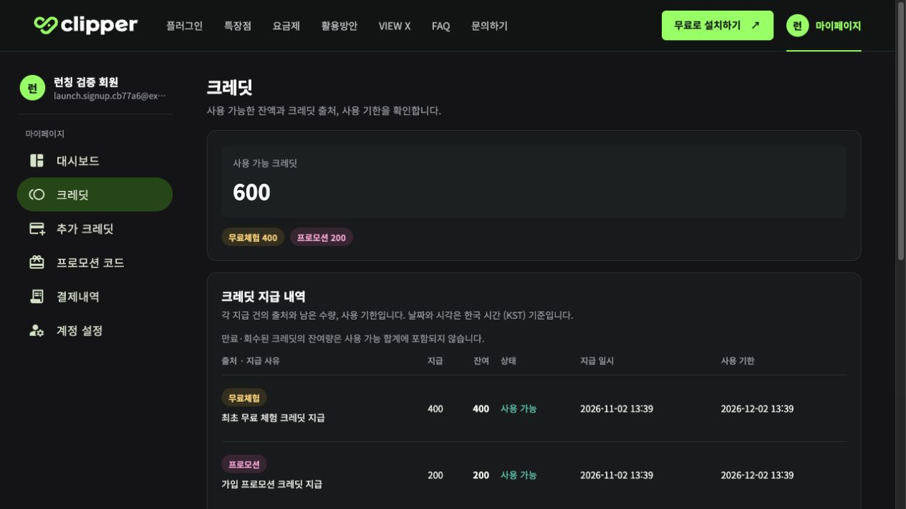

# AI 부스 가입 크레딧·Free 구현과 검증

기준일: 2026-11-02 KST. **구현·로컬 통합 검증·독립 최종 재검토 완료. 미커밋·미푸시·미병합·미배포.**

[확정 범위](02-ai-booth-signup-credits-and-free-scope.md) · [계획](02-ai-booth-signup-free-implementation-plan.md) · [W19](../../../../../handoff/tasks/signup-promotion-plan-entitlements.md).

## 구현 결과

- Google 인증을 마친 신규 회원의 가입 동의 화면에 선택 코드 입력을 추가했다. 소문자는 대문자로 정규화한다. 같은 대기표의 실패/새로고침은 입력을 보존하고, 다른 대기표·계정·취소·만료·완료는 이전 입력을 정리한다. OAuth state나 Google 요청에는 코드를 넣지 않는다.
- 캠페인 혜택은 기존 이용권형 `access`와 신규 가입 전용 `signup_credits`를 구분한다. 가입형은 수량/유효일수로 1회 지급하고 이용권·월 지급 일정을 만들지 않는다. 가입 후 일반 코드 등록, 기존 회원·재동의에는 가입형 혜택을 주지 않는다.
- 사용자 DB에는 회원과 지급 의도를 함께 저장하고 기존 내구 작업으로 처리한다. 관리자 DB에는 가입 지급·프로모션 지급·각 원장·등록 건수/참여를 한 트랜잭션으로 반영한다. 두 DB의 FK/JOIN/공유 트랜잭션은 도입하지 않았다. 완료 확인 전 세션/잔액 성공을 표시하지 않는다.
- 코드별 상한과 회원당 캠페인 1회, 참여 이메일/코드/추천인, 운영 이력, 남은 혜택 회수를 유지한다. 프로모션 보고서·결제 귀속·XLSX API/서비스/탭과 신규 프로모션 유료 예약은 제거했다. 일반 구독·재시도·환불·기존 수락한 결제 약속은 보존한다.
- 주 이용권이 없으면 계속 Free를 반환한다. 가입 혜택 잔액 0·만료·없음이 Free를 없애지 않는다. 기존 tier를 Free로 이름 변경해 FK/기록을 보존하며 별도 0원 구독/주 이용권을 만들지 않는다. 가입 크레딧 재지급도 없다.
- 관리자 허용 모드/목록은 한 번에 저장하고 Basic⊆Pro⊆Business를 같은 잠금에서 검증한다. Free는 독립이다. 읽기도 단일 SQL 스냅샷으로 처리해 저장 중 다른 버전이 섞이지 않는다.
- 작업 시작 시 서버가 계정 잠금 뒤의 현재 등급과 잔액을 검사한다. 미허용 새 실행은 차감/실행 기록 생성 전 거절한다. 이미 승인된 같은 시도의 복구·완료·실패 반환은 등급 변경으로 막지 않는다. 앱은 제한 배지를 표시하면서 탐색·설치·열기·준비는 허용한다.
- `/#price`와 `/pricing`은 같은 4카드를 재사용한다. 가격·할인·수량·N/D·플러그인 체크/X는 API 데이터다. Free 문구는 ‘가입 시 1회 N크레딧’, ‘가입 크레딧 유효기간: 가입일부터 D일’이다. 제안 F의 Pro 밝은 강조·Business 강조색·Free 왼쪽 배치·추가 상품 구분을 적용했다.
- 고객용 플러그인 이름은 과금 단계 이름과 구분한 기존 ID의 서버 표시 목록을 사용한다. 앱/관리자 전체 목록 자동 감지·동기화·카테고리·공개/전역 중지 기능은 구현하지 않았다(W18).

## 브랜치와 변경 위치

작업 루트: `/Users/jina/project/adlight/.worktrees/signup-promotion-plugin-access-20261028`.

모든 6개 checkout은 `feat/signup-credit-promotion-free-20261102`다. API·회원 웹·관리자 웹·데스크톱 Nest·데스크톱 Angular 5개 저장소를 수정했고 Electron은 변경하지 않았다. 각 기준 SHA와 보존 브랜치는 [범위 문서](02-ai-booth-signup-credits-and-free-scope.md#6-브랜치-보존과-작업-준비)를 따른다. 원본 checkout, 기존 로컬 DB와 서버는 변경/초기화하지 않았다. 기존 topup 승인 전 검사 6파일 패치는 보존·통합했다.

## 최종 검토와 가입 복구 보완

독립 Astra 전체 검토에서 발견한 I1/I2/I3와 Minor M1을 한 번의 수정 작업으로 해결했고, [범위를 제한한 재검토](02-launch-implementation-evidence/final-scoped-re-review.md)에서 모두 ADDRESSED·신규 Critical/Important 없음으로 승인됐다. [최초 검토](02-launch-implementation-evidence/final-review.md) · [수정·RED/GREEN·마이그레이션 보고](02-launch-implementation-evidence/final-fix-report.md).

- I1: 지급 후 응답 유실 상태에서 다른 코드/빈 값으로 바꾸려 하면 실제 적용된 코드를 확인해 409 `SIGNUP_PROMOTION_ALREADY_APPLIED`로 안내한다. 기존 의도를 유지하고 UI는 실제 코드를 복원해 ‘적용된 혜택으로 가입 완료’를 제공한다. 두 번째 혜택을 지급하지 않는다. 실제 지급 전 실패한 코드는 계속 수정·제거할 수 있다.
- I2: 재시도 횟수와 분리한 단조 증가 claim 세대로 모든 완료/실패/수동 검토 쓰기를 검사한다. 지급 전 사용자 작업 행을 잠그고 의도 변경과 관리자 지급 효과를 직렬화한다. 관리자 DB 커밋은 독립하며 응답 유실은 멱등 복구한다. 사용자 조회를 잠금 전에 끝내 연결 풀을 중첩 점유하지 않는다. 연결 풀1개에서 동시3가입도 완료됐다.
- I3: 같은 서명 대기표로 이미 가입을 끝낸 뒤 세션/응답이 유실되면 409 `SIGNUP_ALREADY_COMPLETED`와 명확한 다시 로그인 화면을 제공한다. 이전 입력을 붙들고 ‘신규 회원 전용’ 오류를 반복하지 않는다. 실제 기존 회원의 새 가입 혜택은 계속 거절한다.
- M1: 회수 안내는 ‘프로모션 혜택’으로 표시한다. 크레딧형을 회수해도 Free나 존재하지 않았던 이용권이 회수됐다고 안내하지 않는다. 실제 화면에서 프로모션200 회수 후 Free/가입400 유지도 확인했다.

## 검증 증거

| 대상 | 최종 확인 결과 |
|---|---|
| Web API 전체 | 468 suites·5,082 tests 통과, 86 skip; build 통과 |
| 실제 PostgreSQL16 | 새 admin/user/release 마이그레이션 적용 및 통합 16개 통과 |
| 회원 웹 | 전체 587/587·build·색상 검사 통과 |
| 관리자 웹 | 전체 2,701/2,701·build·색상 검사 통과; 문구 보완 focused74 통과 |
| 데스크톱 Angular | 전체 10,642/10,642·build·스타일 검사 통과 |
| 데스크톱 Nest | 전체 5,280 통과·8 skip; build 통과 |

통합 시험은 실제 3개 격리 DB에서 가입400+코드200, 두 DB 장애·커밋 후 응답 유실, 세션 실패, 코드별 마지막 자리 경쟁, 원장 실패 롤백, 목록 동시 수정, 미허용 실행 무차감, 승인된 시도 복구/반환, 크레딧 만료 후 Free를 검증한다. 추가 복구 보완의 16개 실제 DB 시험에는 코드 변경/제거, 늦은 작업의 세 가지 상태 쓰기, 행 잠금 경쟁, 재시도 상한에서 커밋 응답 유실 복구, 연결 풀1개/동시3요청을 포함한다.

Nest 최초 전체 실행에서 14건은 격리 checkout의 폰트와 ignored `.env.packaged` 부재로 실패했다. 원본 폰트는 읽기 의존 링크로만 연결하고 기존 whitelist 복사 스크립트를 실행했다. `.env.packaged`는 실환경 파일이 아닌 tracked `.env.example` 사본으로 준비했다. 에셋 관련 38개와 전체 재실행이 통과했고 원본 환경/비밀/폰트는 수정하지 않았다.

기존 헤더 간헐 실패는 auth-callback 테스트가 브라우저 URL을 돌려놓지 않아 생겼다. production 헤더는 바꾸지 않고 테스트 teardown에서 URL/history를 복원해 ordered15 및 전체585 통과를 확인했다. 기존 웹 번들 예산 경고(Client505.20kB/Admin880.13kB)는 남지만 build는 성공한다.

## 실제 로컬 화면 확인

실제 Google 서비스 호출 대신 서명된 테스트 Google 프로필 대기표를 사용했다. 그 이후 가입 동의·API·DB·첫 로그인·관리자 조회는 실제 구현이다.

- 잘못된 코드에서 회원 생성0·입력 유지, 새로고침 보존, 유효 코드 가입 후 첫 잔액600 및 별도400/200 지급·원장/한국어 사유 확인.
- Free 대시보드, Free의 추가 크레딧 신규 구매 제한, 참여 코드/추천인과 관리자 동일 이메일/코드/등록수 확인.
- 관리자 Free 허용 목록을 실제 저장한 뒤 두 공개 요금제 화면에 같은 체크/X 반영 확인. 연간 선택에도 가입1회400/D30 유지. 랜딩 요금제 메뉴는 `#price`로 스크롤된다.
- 실제 360/768/1280px iframe viewport에서 카드 1/2/4열, 동일 행 순서와 가로 넘침 없음. IAB viewport override가 기존 탭 너비를 바꾸지 않아 로컬 검증 프레임을 사용했고 제품 코드는 변경하지 않았다.
- 긴 플러그인 이름, 빈 목록, 응답 대기, API503 상태는 별도 로컬 모의 응답으로 실제 렌더했다. 긴 이름에서도 4카드의 높이/행 수가 같고 안내가 표시된다.
- 데스크톱은 별도 mock 인증/계정 응답과 실제 로컬 Nest로 route/nav/provider를 확인했다. Free600, 제한 배지, 제한 플러그인 설치·작업 준비 화면 진입 성공. 다크·라이트 모두 확인했다. Python 모델 다운로드나 실제 생성은 실행하지 않았다.

## 배포/환경 한계

실제 Google 로그인, 실제 Toss 승인·청구·환불, 운영/공유 dev 마이그레이션, 구버전 설치 앱과의 배포 호환성은 검증하지 않았다. API의 Free source/가입 계약/목록 저장 계약이 바뀌므로 API·웹·데스크톱 배포 대상을 함께 확인해야 한다. 이 작업에서 운영값·요금제 허용 조합을 확정하거나 운영 데이터 삭제를 수행하지 않았다. 기능 설정값은 회사 운영 정책을 입력해야 한다.

검증용 PostgreSQL 컨테이너는 `clipper-signup-launch-test-20261102`/포트15437이며 기존5433/5434/5435 DB와 분리했다. 임시 화면은 별도4241/4242, API4340, 데스크톱4243/9019에서 확인했다. 종료 시 임시 프로세스 상태는 아래 최종 인계에 갱신한다. 실서비스 키를 테스트 서버에 복사하지 않았다.

## 스키마와 배포 시 적용 순서

새 마이그레이션은 관리자 DB의 `1793577600000-AddSignupCreditPromotions`, `1793577700000-PersistentFreeTier`, 사용자 DB의 `1793577600000-AddSignupBenefitIntent`, `1793664000000-AddOnboardingClaimGeneration`이다. 실제 빈 격리 DB에 적용했다. 기존 기록/키를 보존하며 사용 후 파괴적인 down은 차단한다. 운영 DB에는 적용하지 않았다.

사용자 claim 세대 필드를 모르는 이전 작업 프로세스와 혼용하지 않는다. 배포 작업에서는 이전 worker를 drain/중지하고 additive 마이그레이션을 먼저 적용한 뒤 새 API/worker를 시작해야 한다. 독립 DB 백엔드를 실행 중 강제 종료하는 모든 경우까지 증명한 것은 아니며, 기록된 응답/커밋 유실과 동시성 시험 범위로 한정한다.

## 구현 중 판단과 보존 원칙

- 일반 첫 결제·재시도·취소와 이미 수락한 결제 예약은 보존했다. 이를 프로모션 삭제에 포함하면 기존 금전 약속이 화면 없이 청구되거나 복구되지 않을 위험이 있다.
- 과거 이용권/크레딧/참여 및 nullable 결제 참조를 보존했다. 미사용 보고 기능을 제거한다는 이유로 재무 증빙을 지우지 않았다.
- 계정 DB와 관리자 DB는 기존 독립 작업·멱등 지급을 확장했다. 공유 트랜잭션/인증↔이용권 모듈 순환 대신 순수 지급 모듈을 사용한다. 장애 시 미완료 의도를 복구하는 책임이 추가된다.
- 원래 날짜에 고정된 테스트의 시계를 동결했다. 실제 날짜 경과로 캠페인이 만료되는 기존 기대를 안정화한 것이며 운영 기간 정책을 바꾸지 않았다.
- API와 프런트 계약 의존 부분은 순차 처리하고 격리된 프런트 작업만 한 구현자에게 위임했다. 잘못된 분할은 통합 재작업 비용을 만들 수 있어 계약과 최종 diff를 독립 검토했다.
- 목록 모드/키를 읽는 SQL도 하나로 합쳤다. 읽기 버전이 섞이면 실제 허용 목록과 화면이 어긋날 수 있어 쓰기뿐 아니라 읽기 일관성도 보장했다.
- 계정 전체의 기존 cross-tab/Set-Cookie 취소 경쟁은 별도 인증 개선 범위다. 이번 입력의 대기표/계정별 보존·제출·복구는 검증했으며 전역 인증 경쟁 전체가 해결됐다고 주장하지 않는다.
- 커밋 요청이 없으므로 branch/worktree와 SDD 원장을 보존한다. 아직 Git commit이 없는 원본을 cleanup으로 없애지 않는다. 이후 커밋/병합은 사용자 요청 시 별도 수행한다.

최종 소스 파일 해시는 [manifest](02-launch-implementation-evidence/final-source-manifest.json)에 저장했다. API93·회원 웹53·관리자21·Nest4·App17개 변경 파일(추적/신규/삭제 포함), Electron0개이며 index에 stage한 파일은 없다. 새 브랜치 HEAD는 각 보존 브랜치와 같은 시작 SHA다.

## 최종 인계 상태

검증용 API4340·웹4241/4242·앱4243·모의서버4244/4341/4342·직접 실행한 Nest9019를 종료했다. 테스트 컨테이너는 **중지하고 보존**했으며 삭제/초기화하지 않았다. 기존 admin4202(PID17622)와 기존 DB5433/5434/5435는 계속 실행 중이었다. 임시 브라우저 검증 탭만 닫았고 사용자 탭은 건드리지 않았다. 작업 브랜치/작업 폴더/소스와 `.codex` 문서는 모두 보존한다.

최종 전체 검사 수치: API5,082·Client587·Admin2,701·App10,642·Nest5,280 통과, 별도 실제 DB16통과. 각 저장소 빌드 및 whitespace 검사 통과. skip과 기존 bundle warning은 앞 표/증거를 따른다.
