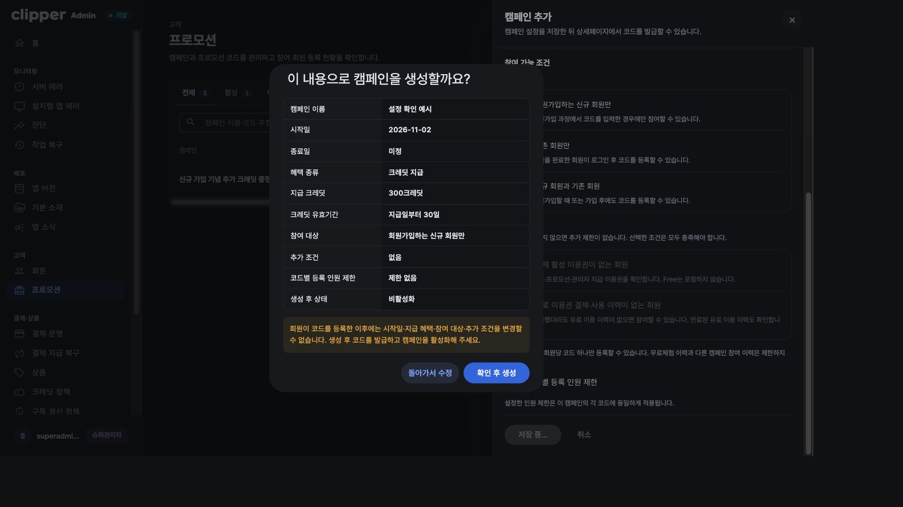
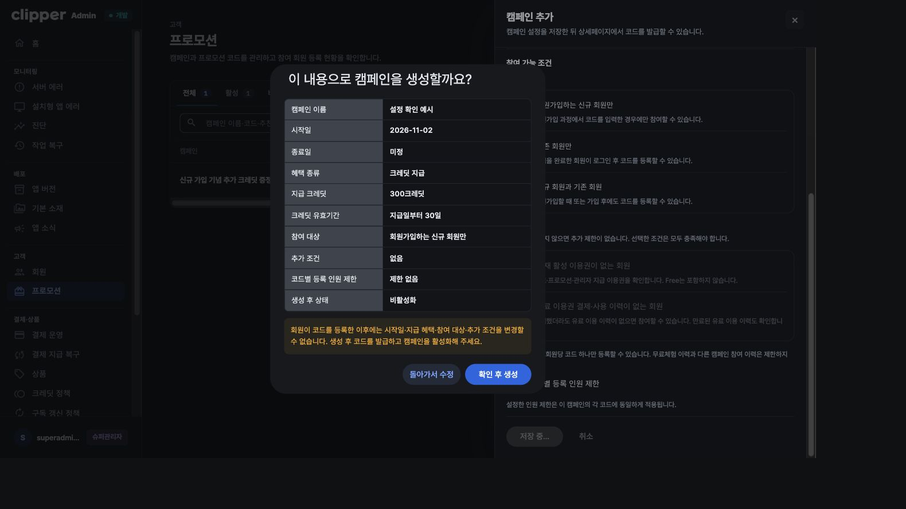
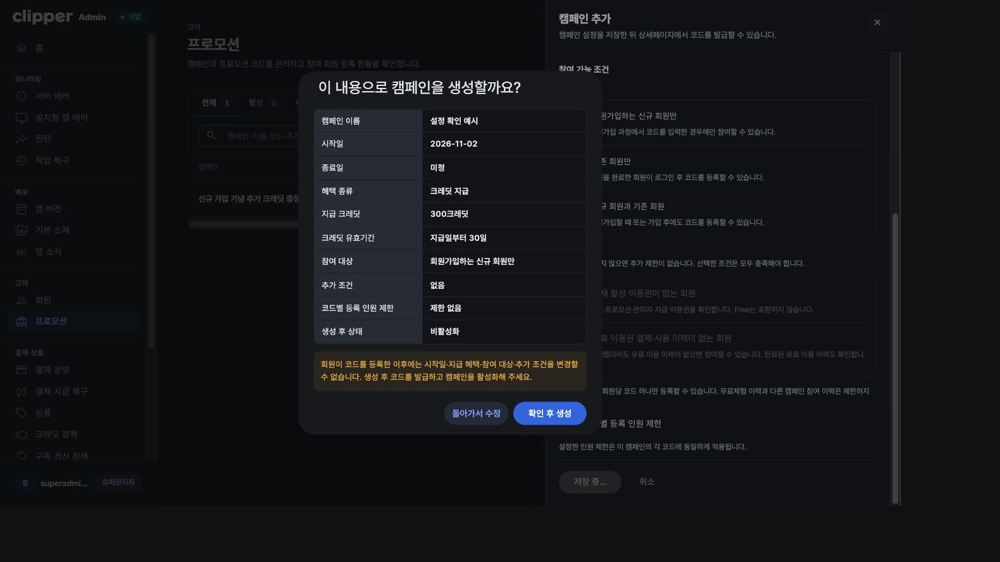
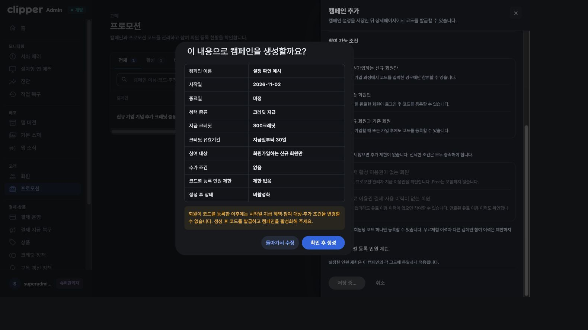

# 캠페인 종료일 단축 허용 · 인원 제한 확인 · 요약 열 배경

**사용자 최종 승인 스타일:** 두 열 같은 배경, 가로·세로·외곽선 outline-strong, 왼쪽 라벨 on-surface-muted/오른쪽 값 on-surface, 두 열 왼쪽 정렬. 아래 열별 배경색·같은 글자색 설명은 이전 시안 기록이다. [승인 화면](02-campaign-summary-final-approved.png).

2026-11-02 KST. 사용자 피드백에 따라 이전의 등록 이력 후 종료일 단축 금지를 정정했다. 작업은 격리 브랜치 `feat/signup-credit-promotion-free-20261102`의 API/Admin이며 커밋·푸시·병합 없음.

## 최신 정책

캠페인 등록 종료일은 신규 코드 등록을 받는 기한이다. 이미 지급한 크레딧 만료일/이용권 기간과 다르다. 비활성화로 신규 등록을 언제든 중단할 수 있고 날짜→미정→다른 날짜도 이미 허용됐는데, 기존 날짜를 바로 앞당기는 것만 막던 보호는 일관되지 않았다.

이제 등록 이력이 있어도 종료일 단축/연장/날짜↔미정을 모두 허용한다. 정상적인 종료일은 시작일 이후여야 한다. 관리자 날짜 입력의 최소 날짜는 기존 종료일 대신 시작일이며, 선택일은 그날 전체를 포함한다. 이전에 지급한 크레딧/이용권/잔량/만료일은 수정하지 않는다. 지난 날짜로 종료시키면 비활성이 되고 신규 등록을 막는다. 이미 비활성이거나 종료된 캠페인을 날짜 수정만으로 자동 재활성화하지 않는다.

시작일, 혜택 종류/지급량/이용권 등급/개월/크레딧 자체 유효기간, 참여 대상/추가 조건의 기존 참여 이력 잠금은 유지한다. 캠페인 이름 변경·운영 활성/비활성·등록 이력 있는 캠페인 삭제 금지도 기존대로다.

인원 제한은 기존 정책을 검증했고 변경하지 않았다. 각 코드의 등록 인원을 개별 검사한다. 한 코드에5명이 등록했다면100→90,100→5,제한없음→90,제한해제 모두 허용한다.100→4 또는 제한없음→4는 거절한다.5명으로 낮추면 기존5명을 유지하면서 그 코드의 신규 등록은 마감된다. 캠페인 전체 등록 합계를 상한과 비교하지 않는다.

## 구현

- API `PromotionsService.updateCampaign`: 등록 이력 잠금에서 endsAt 단축 비교 한 줄만 제거. 공통 날짜 검증/코드별 인원 하한 검사/다른 설정 잠금/감사/SQL 상태 전환 유지.
- 관리자 종료일 min을 draft.startsAt으로 바꾸고 잠금 오류에서 단축 금지 문장을 제거. 다른 잠긴 입력은 유지.
- 기존 공통 확인창 columns variant에만 같은 글자색 `--on-surface` 적용. 왼쪽 배경 `--surface-raised`, 오른쪽 `--surface-sunken`과 은은한 행 구분선으로 두 열을 구분한다. 기본 확인창/다른 페이지 스타일은 유지한다. 직접 색상이나 별도 모달 없음.

## 검증

- RED: API 종료일 단축1개, 관리자 이전 min으로 인한 rangeUnderflow/거짓 안내/색상 불일치3개를 확인 후 수정했다. 인원 제한 예시는 기존 구현을 검증하는 회귀 검사다.
- API 수정 정책42개 통과. 전체470 suites/5,113 tests 통과,11 suites/108 tests skip(별도 opt-in 실제DB38개 포함). snapshots5개 통과.
- 관리자 관련74개 및 전체2,718개 통과. API/Admin build 통과, check:colors 직접 색상0, 두 repo git diff --check 통과.
- 일회용 PostgreSQL16/15439 통합38개 통과. 기존33개에 크레딧형/이용권형 각각 미래·과거 등록 종료일 단축4개와 실제5명 인원 제한 증감/추가1개를 보강했다. 기존 회원의 지급 건/잔량/만료/이용권 기록이 동일함을 비교했고 미래 마감 전 새 가입은 지급 가능, 이미 지난 마감은 신규 지급/재활성화 거절을 확인했다.
- 처음 새 통합 검증은 테스트 기대 사유를 PROMOTION_INACTIVE로 잡았지만 실제 기존 우선순위는 PROMOTION_ENDED였던2건과, varchar 회원ID를 uuid[]로 비교한 테스트 쿼리1건이 실패했다. 기대 사유와 테스트 cast만 고친 뒤 새 일회용DB에서38개 통과했다. 이 과정에 제품 오류 우선순위나 ID 스키마를 변경하지 않았다.
- 실제 관리자4242의 확인창에서 양쪽 글자 rgb(231,233,238), 왼쪽 배경 rgb(23,26,32)/오른쪽 rgb(17,19,24), 기존 두 열 왼쪽 정렬을 확인했다. 확인용 캠페인은 생성하지 않았고 사용자 캠페인/회원 기록은 그대로 두었다.
- 로그 `/tmp/campaign-deadline-api-red.log`, `campaign-deadline-admin-red.log`, `campaign-deadline-api-full.log`, `campaign-deadline-admin-full.log`, `campaign-deadline-integration-final.log`, `campaign-deadline-*-build.log`. 기존 관리자880.45kB 예산 및 pg9 병렬쿼리 경고는 남아 있다.

## 로컬 실행과 보존

전용API4340만 새 빌드로 재시작(PID67957), health user/admin/release 모두ok. 관리자4242는 기존 웹60587을 중단하지 않고 번들만 갱신했다. 사용자DB15438 초기화/스키마 변경 없음. 클라이언트4241·앱16214/내장서버16285와 다른 작업 API3000/관리자4202/DB는 유지했다. 이번 검증용 컨테이너 `clipper-deadline-qa-20261102`(15439)만 검증 후 제거했다. 사용자 환경은 계속 실행한다.

## 열 대비 후속 보정

사용자가 이전 두 열 배경 차이를 알아보기 어렵다고 하여 columns variant의 왼쪽 배경만 `color-mix(in srgb, var(--surface-selected) 80%, var(--on-surface) 20%)`로 밝게 했다. 오른쪽/글자색/정렬/다른 확인창/정책은 그대로다. 빌드·check:colors 직접색0·diff 검사 통과 후 관리자4242에 반영했다. 실제 화면에서 왼쪽 약rgb(71,76,86), 오른쪽rgb(17,19,24)의 명확한 차이를 확인했다. CSS 한 줄 보정으로 새 테스트나 전체 테스트 반복은 하지 않았다. 확인용 캠페인 생성 없음.

### 최종 열 밝기 조정

사용자가20% 혼합은 너무 밝다고 하여 왼쪽 열의 on-surface 혼합 비중을6%로 낮췄다(`surface-selected94% + on-surface6%`). 오른쪽은 기존 surface-sunken이며 글자색/정렬/동작은 유지한다. 이전23/26/32보다 구분되면서 직전71/76/86보다 어두운 중간 명도다. 빌드·색상 검사·diff·실제4242 화면 확인 후 반영했고 API/DB/앱은 변경하지 않았다.

### 최종 선택: 같은 열 배경 + 명확한 가로·세로 선

사용자 요청으로 열별 배경색 차이를 없앴다. 두 열 모두 surface-sunken, 같은 글자색/왼쪽 정렬을 유지한다. 가로선·가운데 세로선·외곽선을 outline-strong 토큰으로 맞춰 구분한다. 이전 혼합 배경은 현재 스타일이 아니다. 공통 확인창 component13개/빌드/색상 검사/diff/실제4242 화면 확인 후 반영했다. 사용자 캠페인/서버/DB/앱 변경 없음.

### 사용자 최종 승인·실제 반영 확인

마지막 캡처의 흐린 왼쪽 라벨 스타일을 사용자가 승인했다. 실제 관리자 소스와4242가 제공하는 번들에 반영된 상태임을 재확인했다. 공통 확인창 관련13개 시험과 diff 검사 통과, 앞선 빌드 성공 확인. API/DB/앱/다른 확인창 기본 스타일은 변경하지 않았다. 커밋·푸시 없음.
