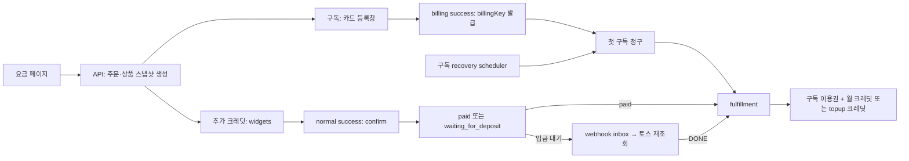

# TossPayments 새 MID·테스트/라이브 키 전환 조사와 실행안

기준: 2026-09-29 KST. **로컬 코드·공식 문서 조사 완료 / 키 변경·DB 정리·배포·실결제 미실행**.

> **2026-10-07 변경:** 아래의 PG 관련 행만 선택적으로 삭제하고 회원 등을 보존하는 권고는 폐기됐다. 사용자가 운영 회원·결제내역을 포함한 전체 초기화와 심사용 `_review` 스택 폐기를 지시했다. 현재 운영 상태·새 MID 용도·단건 `live_ck_` 방식·실행 순서는 [10월 7일 재조사](2026-10-07-toss-live-cutover-reassessment.md)를 따른다. 이 문서는 9월 29일 당시 코드 분석 기록으로만 남긴다.

[W06](../handoff/tasks/pg-production-followups.md) · [W03](../handoff/tasks/pg-card-review.md)

## 1. 결론과 확인 범위

키만 교체하면 우리 DB의 기존 결제·구독·이용권·크레딧은 그대로 남는다. 그러나 서버가 과거 주문도 현재 설정된 키로 조회·취소하고, 과거 billingKey도 현재 billing secret으로 재청구한다. DB에 MID/PG 환경/키 세대별 라우팅 정보가 없으므로, **다른 MID·test/live로 전환하면서 기존 데이터를 그대로 자동 처리하는 방식은 권하지 않는다.**

추천: 출시 전 내부 테스트라는 조건에 맞춰 **대상 DB의 구 PG 테스트 주문·구독 및 이에 연결된 이용권·크레딧을 정리하고, 새 test 키에서 카드를 재등록**한다. 사용자·로그인·운영자·상품·프로젝트·릴리스는 보존한다. 구 결제 호환 라우터는 실제로 보존해야 할 거래가 발견될 때만 검토한다.

아직 확인이 필요한 정보:

- 새 MID 2개의 관리자 표시 용도와 키 종류. 2개라는 이유로 일반/빌링이라고 단정하지 않는다.
- dev·prod 중 전환할 환경, 현재 실제 서비스/DB/심사판 경계.
- 구 MID의 미환불 실거래, 입금 가능한 미완료 가상계좌, pending 환불 유무. 내부 직원의 결제라도 실제 돈이 움직였으면 먼저 대사한다.
- 대상 내부 테스트 계정, 현재 상품가격, 실제 계약된 결제수단, UI 설정과 컨펌.

### 로컬 Git 기준

API·Client·Infra는 9/29 `git fetch origin dev` 성공 후 HEAD와 origin/dev가 각각 동일, clean·ahead/behind 0/0이다. Admin은 HEAD만 확인했고 fetch하지 않았다.

| 저장소 | 조사 SHA |
|---|---|
| `web/clipper_web_api` | `31f448260148b11e61e9f53cad0ee9ac372345fe` |
| `web/clipper_web_client` | `bd8fd8dea226544304556f869c84e5dce930df57` |
| `web/clipper_infra` | `8adbfcdedb95fc0a56efcd7bb7154752c49b23f6` |
| `web/clipper_web_admin` | `8025bc2aa8312174163f5c573f196e55c0902dab` (로컬 HEAD) |

코드 변경 전에 다시 fetch하고 최신 origin/dev에서 필요한 repo만 새 브랜치·격리 worktree로 만든다. 형제 `web/clipper_*` 관계를 유지한다. 기존 원본 checkout/다른 worktree를 변경하지 않는다. 이번 조사에서는 새 worktree·브랜치를 아직 만들지 않았다.

## 2. MID·키·우리 데이터의 관계

| 항목 | 의미 | 우리 코드·DB 연결 |
|---|---|---|
| MID | 토스가 발급한 상점/계약 식별자 | Payment/Billing 응답에는 `mId`가 있지만 provider 모델이 버리고, 결제 테이블에도 저장하지 않음 |
| clientKey | 브라우저 SDK 초기화, 계약/UI 설정 선택 | API의 CheckoutSession 응답으로 FE에 전달. FE environment 파일에 PG 키가 고정되지 않음 |
| secretKey | 서버의 토스 승인·조회·취소·빌링 API 인증 | 서버 환경변수에서 `widget` 또는 `billing` 한 세트씩 선택. DB 저장값 아님 |
| paymentKey | 토스의 개별 결제 식별자 | `payment_orders.payment_key`; 승인/조회/취소에 사용. 새 키를 넣어도 과거 paymentKey가 새 값으로 바뀌지 않음 |
| billingKey | 등록 카드로 반복 청구하는 토큰 | `subscriptions.billing_key_enc`에 AES-GCM 암호화, HMAC fingerprint로 삭제 webhook·카드 변경과 상관관계 확인 |
| authKey | 카드 인증 후 한 번 사용하는 발급용 값 | redirect → `billing_auth_attempts.auth_key_enc` → 빌링키 발급. 미완료 발급도 전환 시 정리/종결 필요 |
| customerKey | 빌링키와 결합되는 상점 생성 고객 식별자 | 구독 생성 시 UUID 생성 후 구독/주문/auth attempt에 공유. 단건 topup은 주문마다 UUID 생성. Google ID·clientKey가 아님 |
| orderId | 우리가 생성하는 주문번호 | DB의 `payment_orders.order_no`를 토스 `orderId`로 보냄. 내부 `payment_orders.id` UUID와 구분 |
| key_set | API 호출에 쓸 기능별 키 선택 | `payment_orders.key_set = widget/billing`. test/live·MID·키 세대를 뜻하지 않음 |

공식 근거: [API 키](https://docs.tosspayments.com/reference/using-api/api-keys), [Payment/Billing 객체·조회·취소](https://docs.tosspayments.com/reference), [빌링 연동](https://docs.tosspayments.com/guides/v2/billing/integration).

**같은 MID·같은 환경의 시크릿 키 재발급**과 **새 MID/새 환경 전환**은 다르다. 공식 키 문서는 같은 계약의 재발급·7일 교체 기간을 안내하지만, 이것이 다른 MID로 과거 거래나 빌링키가 이관된다는 뜻은 아니다. 문서가 보장하는 것은 생성한 client key와 짝인 secret key의 사용이다. 임시 MID→새 MID의 특별 이관/그룹 조회 권한은 공개 문서로 확정하지 못했다. 따라서 새 키로 구 거래가 처리된다고 가정하지 않고, 보존 필요 시 토스의 해당 계약 확인 또는 구 키로 조회 대사가 필요하다. cross-MID 실패의 특정 에러 코드도 여기서 단정하지 않는다.

### 실제 호출 흐름



- 단건: `TopupPaymentsService` → `HttpTossPaymentsProvider.confirmPayment()`（widget secret）。가입 시 이용권 구매가 아니라 **활성 유료 구독 사용자 대상 추가 크레딧 구매**다.
- 구독: `SubscriptionPaymentsService`·`BillingAuthService` → billing secret으로 카드 등록/발급 → **등록 완료 직후 첫 결제** → 이용권/월 크레딧 지급.
- 재청구/업그레이드: `SubscriptionRenewalService`·`SubscriptionPlanChangesService`도 billing 경로를 사용한다.
- 환불: `PaymentRefundExecutionService`가 주문 `keySet`으로 토스 사전 조회 후 취소, 이후 `PaymentRefundEffectsService`로 내부 크레딧·이용권 반영.
- 지급: `PaymentFulfillmentService`가 admin DB transaction 안에서 access·credit grant·ledger를 처리하고 주문별 멱등키를 사용한다. 구독 첫 결제는 access/월 크레딧, topup은 credit grant만 생성한다.

핵심 파일: `src/modules/payments/infrastructure/http-toss-payments.provider.ts`, `application/payment-checkout-session.service.ts`, `application/payment-fulfillment.service.ts`, `application/payment-webhook.service.ts`, `infrastructure/{payment-order,subscription,billing-auth-attempt,payment-webhook-inbox}.entity.ts`（API repo 기준）。FE는 `src/app/core/payments/toss-payments-sdk.service.ts`.

## 3. 키만 바꿀 때 영향

| 대상 | 실제 영향 |
|---|---|
| 과거 결제 내역 화면 | DB 기반 목록이므로 그대로 보임. 이것은 새 키로 토스 조회 가능하다는 증거가 아님 |
| 과거 결제 조회·재확인 | 현재 키로 요청. 구 객체에 접근 불가하면 조회 실패/재조정 필요. paid 주문은 조회 실패 시 paid로 남는 경로도 있어 화면이 실패를 숨길 수 있음 |
| 과거 환불 | 현재 키로 preflight 조회·취소. 조회 실패 시 `manual_action_required` 등으로 진행 중단. DB 금액을 수정해 환불 성공으로 처리하면 안 됨 |
| 구독 다음 결제 | 기존 암호화 billingKey를 복호화하여 새 billing secret으로 요청. 키 교체는 billingKey/customerKey의 이관이나 카드 재인증이 아님. 실패·유예·재시도·이용권 종료가 발생할 수 있음 |
| 새 결제 | client/secret 짝, key 종류, test/live, 계약 결제수단, return URL이 맞아야 성공 |
| 미완료 checkout/auth | 구 client로 열린 브라우저가 신 secret으로 승인/발급될 수 있음. 진행 중 흐름을 끝내고 새 주문으로 재시작 |
| 입금 대기 가상계좌 | 토스 계좌는 DB 삭제·키 교체만으로 없어지지 않음. live 계좌라면 구 MID에서 취소/만료·입금 상태를 대사하고 신규 계좌로 안내 |
| webhook | MID별 등록은 자동으로 이동하지 않음. 구 URL의 재전송/구 inbox가 새 키로 조회하면 실패·재시도·manual review 가능 |
| 이용권·크레딧 | 우리 DB 상태여서 즉시 없어지지 않음. 과거 grant의 월 지급/만료/복구도 계속됨. 주문만 지워도 자격·잔액이 자동 초기화되지 않음 |

### worker·webhook의 실제 동작

API process 안에 별도 off 스위치 없이 다음 scheduler가 등록되어 있다.

- 매분: 구독 재청구·미완료 지급 복구·후보/구 빌링키 삭제·이용권 종료, 카드 인증 복구/업무 완료, webhook inbox 처리.
- 10초마다: 저장된 환불 요청 실행·환불 조회 복구·내부 지급 회수.
- 별도 access scheduler도 매분 월 크레딧/무료체험 onboarding을 처리한다.

데이터 처리 동안 **해당 DB를 쓰는 모든 API 복제본/심사판 API까지 중지**해야 한다. 구독 스케줄러 하나만 멈추는 방식은 부족하다. UI 결제 진입도 중지하고 진행 중 직원 작업을 완료/종결한다. 상태 flag를 임의로 바꿔 worker를 속이지 않는다.

현행 webhook URL은 `/payments/tosspayments/webhook`（main에 global prefix 없음）。controller는 durable inbox 저장 후 200, 처리는 매분 scheduler가 한다. `PAYMENT_STATUS_CHANGED`는 현재 키로 토스 재조회·주문/금액/통화/type/paymentKey를 대조하고, `DEPOSIT_CALLBACK`은 승인 시 저장한 암호화 secret을 먼저 비교한다. `BILLING_DELETED`는 fingerprint로 현재/후보/구 키를 분류한다. 이 HMAC secret은 우리 내부 값이며 토스의 webhook 서명키가 아니다.

토스 webhook은 MID별 설정이며, 최초 실패 시 최대 7회·3일 19시간 후까지 재전송한다. 우리 inbox의 재시도 정책은 별도로 1/4/16/64분이며 소진 시 manual review다. 두 재시도 시스템을 구분한다. 자동결제 승인 성공은 webhook을 기다리지 않고 API 응답으로 확정한다. [등록·재전송](https://docs.tosspayments.com/guides/v2/webhook), [이벤트 계약](https://docs.tosspayments.com/reference/using-api/webhook-events).

## 4. 데이터 처리 선택지와 추천 범위

| 방안 | 장점·비용 | 적용 조건 |
|---|---|---|
| PG 개발 데이터 정리 + 카드 재등록（추천） | 새 키만 사용, 과거 호환 로직 불필요. 내부 직원 구매 상태가 초기화됨 | 구 MID의 미정산 실거래·환불·live 계좌를 먼저 대사할 수 있음 |
| 과거 데이터/구 키 경로 보존 | 과거 내역 조회·환불·구독 유지 가능성을 계약별로 검증할 수 있음 | MID/environment/credential generation 추가, historical 라우팅·암호화·검증 범위가 커짐. 실제 보존 필요 시 별도 설계 |
| 키만 교체 | 작업량은 적음 | 과거 데이터·worker 영향이 남으므로 새 MID 전환안으로 채택하지 않음 |

### 정리 대상（대상 환경 DB마다 별도 확정）

기준은 **검증된 구 PG 주문·구독 ID 집합**이다. test/live 판별 컬럼이 없으므로 시간이나 `key_set`만으로 실거래 여부를 판별하지 않는다. 구 MID 토스 거래내역과 대사한 대상 명단/건수로 dry-run을 만든다.

| 테이블/데이터 | 범위 |
|---|---|
| `payment_orders`, `payment_events` | 대상 구 PG 주문과 해당 이벤트. upgrade의 `base_payment_order_id` 등 참조까지 포함 |
| `subscriptions`, `billing_auth_attempts` | 해당 구 구독, 현재/후보/이전 billingKey·authKey·카드 스냅샷·예약 변경·재시도 |
| `payment_webhook_inbox` | 구 결제/구 billingKey 이벤트·진행 중 재시도. 외부 재전송은 구 MID 등록을 별도 정리 |
| `payment_refund_cases/items/attempts/internal_events` | 해당 주문·구독 환불. 진행 중 실환불이면 완료/대사 후 정리 |
| `user_access_grants`, `access_grant_events` | 구 구독에 연결된 유료 이용권·변경 이력 |
| `credit_grants`, `credit_ledger_entries` | 대상 payment/subscription/access에 연결된 subscription/topup grant와 관련 원장 |

보존: user DB의 계정·OAuth·세션·onboarding, admin 운영자/인증/감사, 상품/요금/entitlement 정책, release DB, 기존 프로젝트·로컬 데이터·S3 산출물, 기존 operation 기록. PG와 무관한 수동 이용권·수동 크레딧·프로모션·무료체험은 기본 보존한다.

주의:

- `user_free_trials.credit_grant_id`는 삭제 제한 FK다. 무료체험 grant/참여를 보존해 중복 재지급을 막는다. 유료 PG 정리에 무료체험 초기화를 섞지 않는다.
- 구 operation에서 차감한 grant/ledger를 삭제하면 과거 크레딧 감사와 늦은 operation refund가 깨질 수 있다. 실행 중/복구 대기 작업 0을 확인하고, 관련 사용 원장은 보존해야 하는지 dry-run에서 확정한다. 보존 필요 시 grant/원장을 archive 상태로 남기고 spendable 잔액을 회수하는 대안을 선택한다.
- 남겨 둔 수동 이용권이 테스트 계정에 있으면 새 구독에서 `ACTIVE_ACCESS_CONFLICT`가 발생한다. 선택한 검증 계정의 수동/예약 이용권만 따로 확인한다.
- refund hold와 case/subscription 사이 참조, upgrade 자기 참조, auth attempt·free trial FK가 있다. live schema의 FK 목록을 확인하고 명시적인 transaction/대상 건수 검증으로 처리한다. **전체 DB 삭제/무차별 TRUNCATE CASCADE/과거 migration 재실행을 초기화 방식으로 사용하지 않는다.**
- 데이터 초기화 허용은 백업 불필요나 구 토스 실거래 폐기 허용을 뜻하지 않는다. 민감한 DB/설정 백업은 서버 보안 경로에만 두며 Git/대화에 업로드하지 않는다.

## 5. 새 키와 환경 매핑

아래는 **현재 코드가 요구하는 형태**이며 실제 MID 매핑은 미확인이다. 비밀 값은 입력하지 않는다.

| 용도·키 변수 | dev 검증 | 운영 검증 | 연결 확인 |
|---|---|---|---|
| `TOSS_PAYMENTS_WIDGET_CLIENT_KEY` | 해당 계약의 test 결제위젯 client | 같은 계약의 live 결제위젯 client | 주문서형/결제창형 키인지 확인 |
| `TOSS_PAYMENTS_WIDGET_SECRET_KEY` | 위 client의 test 짝 | 위 client의 live 짝 | API 승인/조회/취소 |
| `TOSS_PAYMENTS_BILLING_CLIENT_KEY` | 자동결제 MID의 test client | 같은 MID의 live client | 국내 카드 billing 계약 |
| `TOSS_PAYMENTS_BILLING_SECRET_KEY` | 위 billing client의 test 짝 | 위 billing client의 live 짝 | 발급/재청구/조회/취소/삭제 |
| `TOSS_PAYMENTS_RETURN_BASE_URL` | `https://dev-api.clipperstudio.ai` | `https://api.clipperstudio.ai` | 실제 외부 API origin |
| `WEB_BASE_URL` | `https://dev.clipperstudio.ai` | `https://clipperstudio.ai` | 결제 결과 FE origin |
| webhook | 새 관련 MID의 test 등록/전송 확인 | live 등록/전송 확인 | 위 API origin + `/payments/tosspayments/webhook` |

단건 FE는 `widgets.renderPaymentMethods/renderAgreement`를 사용하며 `variantKey`를 지정하지 않는다（기본 UI）。billing FE는 `payment().requestBillingAuth({method:'CARD'})`다. 두 MID에서 받은 키가 모두 API 개별 연동 키라면 현재 단건 SDK에 그대로 넣을 수 없다. 계약의 widget 연동 키를 확보하거나 단건 UI 연동 방식을 바꿀지 결정해야 한다. prefix 판별만으로 같은 MID의 짝이 맞는지 증명할 수는 없다. [공식 키 종류](https://docs.tosspayments.com/reference/using-api/api-keys).

### 설정 소유권·재시작

- API: `ConfigModule.forRoot({isGlobal:true})`; process environment와 기본 `.env` 로딩. `.env.local`을 명시 선택하는 설정은 없다.
- 로컬 조사: API `.env`에는 신 PG 키 4개가 없고 `.env.local`에는 빈 항목만 있음. host process 주입은 미확인. 값은 출력하지 않았다.
- 표준 서버: Infra `env/stack.dev.env`·`env/stack.prod.env` → `apps/compose.yml` API environment. 로컬 Infra에는 실제 stack 파일이 없어 서버 값을 로컬로 확인하지 못함.
- 키만 변경: **API 컨테이너 recreate** 필요. 단순 restart는 기존 Compose environment를 유지한다. 런타임에 API에서 clientKey를 받으므로 FE 키 재빌드는 불필요하나 열린 결제창은 새로 시작해야 한다.
- FE API URL/SDK 방식/UI 코드 변경: Angular dev/prod configuration별 재빌드/배포 필요. 현재 dev 환경의 `production:true`는 Angular 빌드 플래그이며 Toss live 사용 여부가 아니다.
- `CLIPPER_ENV`도 토스 test/live를 자동 선택하지 않는다. 토스 환경은 설정한 API 키로 결정된다.
- `API_KEY_ENC_SECRET`는 공용 DB 암호화 키, `TOSS_PAYMENTS_BILLING_KEY_HMAC_SECRET`은 내부 fingerprint 키. **이번 PG 키 교체와 함께 바꾸지 않는다.** 유지 데이터 복호화·fingerprint 대사가 깨진다.
- 기존 Infra validator는 필수값·placeholder·URL·widget/billing 중복만 검사한다. 키 종류·전체 test/live 일치·실제 pair/MID 계약은 검사하지 않는다. prefix/환경 혼용 방지는 작은 보강 후보, 실제 pair/MID는 새 test 승인·조회로 검증한다.

## 6. 조사에서 확인된 가상계좌 검증 제한

1. 토스 테스트 가상계좌의 `X` 접두부를 `TopupPaymentsService`와 `PaymentReconciliationService`의 숫자 전용 마스킹이 거부한다. 실제 소스 메서드를 transpile해 합성 숫자/`X` 계좌를 입력한 결과 숫자는 허용, `X`는 두 클래스 모두 `invalid virtual account number`. 토스 API/실DB 재현은 아직 아니다. [테스트 계좌 공식 FAQ](https://docs.tosspayments.com/resources/faq).
2. 앱 자동 환불 preflight는 `payment.virtualAccount !== null`이면 차단한다. provider에는 `refundReceiveAccount` 옵션이 있으나 환불 DTO/실행 경로는 계좌를 받거나 전달하지 않는다. **가상계좌 자동 환불 지원 완료 상태가 아니다.**
3. 공식 계약상 입금 후 환불은 환불받을 계좌가 필요하며 `virtualAccount.refundStatus`로 처리 진행/완료를 구분한다. 현재 수동 취소 검증은 cancels/잔액만 확인하므로, 이를 곧바로 실제 입금 반환 완료 증거로 삼으면 안 된다. [취소·환불 객체](https://docs.tosspayments.com/reference).
4. 가상계좌 발급 승인에서만 받은 secret을 보관해야 한다. 조회 응답에서는 secret이 null이므로 새 키로 재조회한다고 잃어버린 secret을 복구할 수 없다. [가상계좌 승인·입금 테스트](https://docs.tosspayments.com/guides/v2/payment-window/integration-virtual-account).

첫 구현 제안: 기존 UI/호출 흐름을 유지할 수 있는 키 매핑인지 확인한 뒤 환경 혼용 preflight와 `X` 테스트 계좌 마스킹을 최소 수정한다. 가상계좌 환불은 첫 전환에서는 토스 관리자에서 사용자가 수행하고 실제 반환까지 별도로 대사하는 절차를 우선 제안한다. 앱 자동 환불에 환불계좌·비동기 반환 상태를 추가한다면 API/DTO/Admin/UI/민감정보 저장 계약이 바뀌므로 별도 설계가 필요하다. 단순히 preflight 차단만 제거하지 않는다.

## 7. 전환 순서·rollback

1. **현황 확정**: 서버 read-only inventory로 실제 컨테이너/이미지 revision/Compose project/DB/키 환경을 확인. 9/15 심사판 `_review` DB와 정식 `_prod` DB를 혼동하지 않는다. 구 MID 실거래·입금대기·환불, pending operation을 대사한다.
2. **설계 확정**: MID 키 종류, 전환 환경, PG 데이터 정리 대상/보존 원장, 가상계좌 수동 환불 경로를 확정. 이후 최신 origin/dev의 새 worktree에서 최소 변경·회귀 검증.
3. **dev test**: 실제 dev 설정·DB 보안 백업, 결제 진입 중단·진행 중 처리 종결, 모든 해당 API writer 정지. 확인된 대상 데이터만 transaction으로 정리. 사용자가 비공개 설정 경로에 새 test pair를 입력. 암호화/HMAC는 유지.
4. **재기동**: 기존 preflight+보강 검사 통과 후 API recreate. health·실제 주입 모드 확인. 새 MID의 dev webhook/return origin 확인. 새 세션으로 주문·카드 등록.
5. **test 검증**: 신규 구독→topup 카드/계좌/허용 간편결제→가상계좌 입금대기/모의 입금/취소/만료. 지급 원장·중복 callback/webhook·구독 카드 변경·실패 재시도·저장 환불 복구 확인. 운영 키로 실패 주입/시간 강제 이동하지 않음.
6. **UI 컨펌**: 아래 자료에 실제 새 MID 화면 증거를 추가해 영호 이사님 확인을 사용자 경로로 받음.
7. **prod live**: 심사판 복원/정식판 전환을 먼저 확인, 운영 DB를 별도로 백업/대사/정리. 개발 키로 만든 활성 구독을 남긴 DB에 live secret을 얹지 않음. 새 live pair→확정 image/DB→새 webhook→health.
8. **사용자 실기**: 아래 금액·계정·순서로 한 건씩 직접 결제/환불. 승인·지급·환불·실제 반환을 각각 증거로 기록.

rollback: 새 결제가 시작되기 전이면 쓰기 중단 후 old image+old env+같은 시점 DB 백업으로 되돌리고 old MID webhook 상태를 맞춘다. **새 live 승인/입금 이후에는 옛 DB를 바로 덮어 복원하지 않는다.** 우선 전체 worker/결제 진입을 멈추고 새 MID 거래를 조회·취소/환불/대사한 뒤 처리한다. DB 복원은 토스 승인을 취소하지 않는다. old billingKey를 토스에서 삭제한 이후 rollback은 재등록이 필요하므로, 초기 전환에서 구 live billingKey를 무조건 먼저 삭제하지 않는다.

표준 deploy 스크립트는 source pull·build·recreate를 수행한다. 현재 서버가 심사판인 상태에서 이 스크립트를 바로 실행하는 명령은 제공하지 않는다. 이미지·DB·경로가 확인된 후 사용자가 실행할 한 단계씩의 명령을 확정한다.

## 8. 영호 이사님 컨펌 자료 초안

현재는 **검토 항목 초안**이며 실제 새 MID 화면/지원수단/컨펌 증거는 없다. 사용자 승인 없이 이사님에게 전송하지 않는다.

| 확인 항목 | 제안/현재 코드 | 첨부할 실제 증거 |
|---|---|---|
| 추가 크레딧 주문서 | 상품·원화 금액·일회성 결제 안내, widget 기본 UI | PC/모바일 주문서·수단 선택·약관 |
| 노출 결제수단 | backend 허용: 카드, 계좌이체, 가상계좌, 간편결제（카카오/네이버/토스） | 해당 계약의 test/live별 활성 수단. 휴대폰/상품권/기타 간편결제는 자동 노출시키지 않음 |
| 디자인 | 브랜드명/로고/색/순서/공간/모바일 버튼 | 토스 관리자 실제 설정과 앱 화면. widget 기본 variant 적용 여부 |
| 자동결제 | 국내 카드 등록, 등록 직후 첫 결제, 월/년 갱신 동의 | 카드 등록 화면·첫 결제 금액·다음 청구일·해지 안내 |
| 가상계좌 | 발급은 입금대기, 입금 후 지급, 기한·안내·환불 경로 | 발급/입금대기/입금완료/만료 화면. 전체 계좌번호는 토스 화면에서 사용자 확인 |
| 결과/환불 | 성공·실패·취소·입금대기 구분, refund 접수와 완료 구분 | 실제 결과 화면/원장, 자동 환불 불가 시 운영 안내 |
| 정책 | 구독 갱신/해지/크레딧 미사용 환불 안내 | 현재 서비스 약관/정책과 문구 일치 |

토스 위젯 설정은 계약 후 관리자에서 결제수단/UI를 설정하는 범위다. billing 카드 등록창까지 같은 widget 디자인 설정이 적용된다고 가정하지 않는다. [위젯 UI FAQ](https://docs.tosspayments.com/resources/faq), [SDK/UI 오류 안내](https://docs.tosspayments.com/blog/widget-client-error-handling).

사용자가 전달할 문안: “새 정식 PG로 추가 크레딧 주문서와 자동결제 카드 등록 화면을 전환합니다. 첨부한 PC/모바일 화면의 표시 이름·로고·결제수단·약관·첫 결제와 갱신 안내·가상계좌 안내를 확인 부탁드립니다. 가상계좌 환불은 초기 운영 시 관리자 수동 처리 절차를 사용합니다.” 실제 합의한 환불 운영 방식에 맞게 문안 확정.

## 9. 사용자가 실행할 실결제 후보

**아직 결제 실행 지시가 아니라 review 가능한 후보**다. 대상 계정 ID/실DB 상품가격/키 매핑/환경/UI 컨펌 확인 후 실행 카드로 확정한다. 카드 등록도 첫 청구를 일으키므로 단순 인증 테스트로 취급하지 않는다.

환경 제안: `https://clipperstudio.ai` + `https://api.clipperstudio.ai`, 정식 prod DB, 새 live 일반/widget 키와 새 live billing 키. dev에서는 새 test 키만 사용. 웹 주소가 운영이라는 이유만으로 live라고 판단하지 않는다.

대상 제안: 사용자가 지정할 내부 직원 Google 로그인 계정 1개（비밀 값/전체 카드정보는 공유하지 않음）, 신규 구독 시작 가능한 이용권 상태, ML/렌더 실행 없이 지급 크레딧 미사용 유지. 환불 실행은 실제 super-admin 권한 운영자.

코드상 최신 기본 가격은 `basic_monthly` 5,900원/월·월 400 크레딧, `credits_400` 5,900원·400 크레딧이다. 서버의 `/catalog`·`/catalog/credit-products`를 읽어 다르면 멈추고 다시 확정한다. 100원 상품/조작한 FE 금액을 임의로 만들지 않는다.

| 순서 | 사용자 실행 | 예상/판정 |
|---|---|---|
| L1 | Basic 월간 카드 등록 및 첫 5,900원 결제 | 새 billing MID 승인 1회, payment paid·fulfillment succeeded, 구독 active/다음 청구일, access·400 grant·원장 각 1회 |
| L2 | 활성 구독에서 추가 크레딧 400을 **카드로 5,900원** 결제 | 새 일반/widget MID, topup 400 지급 1회. refresh/callback 재진입에 승인/지급 추가 없음 |
| L3 | Admin에서 L2 전액 환불 접수/처리 | 토스 취소·우리 refund money/internal 상태·topup 회수 모두 완료. 사용자 결제내역 반영. PG 완료와 카드사 반환 시점은 별도 확인 |
| L4 | 별도 새 topup 주문 **가상계좌 5,900원** 발급 | 입금 전 `waiting_for_deposit`, topup grant 0. 토스 발급 화면의 실제 계좌·금액·기한을 사용자가 확인 |
| L5 | 사용자가 L4 실제 계좌에 정확히 5,900원 입금 | 새 MID webhook 200/inbox 처리, 토스 DONE, topup 400 지급 1회. 두 이벤트/재전송에도 추가 지급 없음 |
| L6 | 사용자가 토스 관리자에서 L5 환불（수취계좌는 토스 비공개 화면에 입력） | 취소 접수·토스 refundStatus·은행 실제 반환을 구분. 앱 외부취소 연결/내부 credit 회수도 대사. 수동 경로 검증 전 자동 처리 완료 표시 금지 |
| L7 | L1 구독 즉시 환불/종료 또는 갱신 중단 | topup 처리가 끝난 후 구독 환불, 월 credit 회수·access 종료·다음 청구 중단 확인. 실제 환불 정책/금액을 preview로 확인 |

L1→L7 주 승인/입금 누계는 **17,700원**（각 5,900원 ×3）。예상 환불 계획도 17,700원이나 자격·처리·실제 반환이 검증되기 전 반환을 보장하지 않는다. 정기 재청구를 live에서 따로 검증하려면 새 `subscription_renewal` 주문 1건·5,900원 추가 승인을 구체화하고 사용자가 수행할 별도 단계로 만든다. 현재 날짜를 SQL로 조작하거나 테스트 실패 주입을 live에서 사용하지 않는다.

test 단계에서 먼저 수행: 가상계좌 별도 주문의 입금 전 전액 취소, 입금기한 만료, 개발자센터 모의 입금/입금 취소, 구독 실패/재시도·worker 복구. live에서도 취소/만료 실기를 원하면 별도 **무입금 발급 건**으로 진행해 추가 실입금과 구분한다. [가상계좌 테스트 입금](https://docs.tosspayments.com/guides/v2/payment-window/integration-virtual-account).

증거에는 test/live, 선택 MID의 비밀 아닌 별칭, app image SHA, DB 별칭, 내부 주문번호/환불 case ID, 원화 금액·PG 상태·지급/회수 건수·webhook 처리 상태·사용자 확인 시간을 기록한다. API 키/authKey/billingKey/입금 secret/전체 계좌/카드번호/로그인 토큰은 문서·응답·Git에 기록하지 않는다. 상세 대사용 paymentKey/customerKey도 공개 증거에는 넣지 않는다.

## 10. 먼저 실행 가능한 서버 read-only 확인

사용자가 dev 서버/운영 서버 각각 실행한다. **재시작·정리·배포·결제는 하지 않는다.** 아래 확인은 현재 컨테이너 식별용이며 설정 원문이나 전체 docker inspect/Compose config 출력은 공유하지 않는다.

```sh
docker ps -a --format 'table {{.Names}}\t{{.Image}}\t{{.Status}}\t{{.Ports}}'
```

이 목록에서 실제 공개 API 컨테이너명을 확인한 후 `PG_API_CONTAINER`에 넣는다. 아래 출력은 설정값 중 허용한 비밀 아닌 항목과 키의 **환경 종류/존재 여부만** 포함한다.

```sh
PG_API_CONTAINER='목록에서 확인한 API 컨테이너명'
docker inspect "$PG_API_CONTAINER" | python3 -c '
import json, re, sys
try:
    c = json.load(sys.stdin)[0]
    conf = c.get("Config", {})
    env = dict(v.split("=", 1) for v in conf.get("Env", []) if "=" in v)
    labels = conf.get("Labels") or {}
    out = {"name": c.get("Name"), "image": conf.get("Image"), "imageId": c.get("Image"), "labels": {k: labels.get(k) for k in ["org.opencontainers.image.revision", "ai.clipper.deployment.variant", "com.docker.compose.project", "com.docker.compose.service", "com.docker.compose.project.working_dir", "com.docker.compose.project.config_files"]}}
    names = ["CLIPPER_ENV", "CLIPPER_ADMIN_DATABASE_HOST", "CLIPPER_DATABASE_HOST", "CLIPPER_ADMIN_DATABASE_PORT", "CLIPPER_ADMIN_DATABASE_NAME", "TOSS_PAYMENTS_RETURN_BASE_URL", "WEB_BASE_URL"]
    out["routing"] = {k: env.get(k) for k in names}
    keys = ["TOSS_PAYMENTS_WIDGET_CLIENT_KEY", "TOSS_PAYMENTS_WIDGET_SECRET_KEY", "TOSS_PAYMENTS_BILLING_CLIENT_KEY", "TOSS_PAYMENTS_BILLING_SECRET_KEY"]
    def kind(value):
        if not value.strip(): return "unset"
        m = re.match(r"^(test|live)_(gck|gsk|ck|sk)_", value.strip())
        return "/".join(m.groups()) if m else "present/unrecognized"
    out["pgKeyKinds"] = {k: kind(env.get(k, "")) for k in keys}
    out["internalSecretsPresent"] = {k: bool(env.get(k, "").strip()) for k in ["API_KEY_ENC_SECRET", "TOSS_PAYMENTS_BILLING_KEY_HMAC_SECRET"]}
    print(json.dumps(out, ensure_ascii=False, indent=2))
except Exception:
    print("Inventory failed; raw configuration suppressed", file=sys.stderr)
    sys.exit(1)
'
```

HTTP read-only 확인은 환경별 `/health`, `/catalog`, `/catalog/credit-products`다. API 목록과 DB명이 확인된 뒤 DB table/상태/건수/FK/미완료 작업의 **SELECT만 수행하는** 다음 명령을 그 환경에 맞게 제공한다. 이 문서에는 아직 삭제 SQL·서버 실행 결과가 없다.

## 11. 수행 검증과 남은 일

- 지정 workboard/W06/W03, 실제 API/FE/Infra 및 관련 DB migration 대조.
- API·Client·Infra fetch와 기준 SHA·clean·0/0 확인.
- 소스의 마스킹 두 메서드 합성 입력 실험: 숫자 허용, `X` 계좌 거부 확인.
- 기존 Jest 7 suites / **247 tests passed**, exit 0: provider, topup, checkout session, webhook, renewal, refund execution, fulfillment. 실제 토스/DB/서버를 검증한 테스트는 아니다.
- 미실행: 새 키 입력, branch/worktree 생성, 제품 코드 수정, DB 변경, 서버 접속/명령, 배포, 실제 결제/환불/가상계좌 입금, UI 관리자 변경, 영호 이사님 컨펌.

다음 입력: 새 MID의 용도·연동키 종류와 대상 환경（키 값 제외）, 서버 read-only inventory, 추천 데이터 처리·최소 구현안에 대한 설계 확인.
