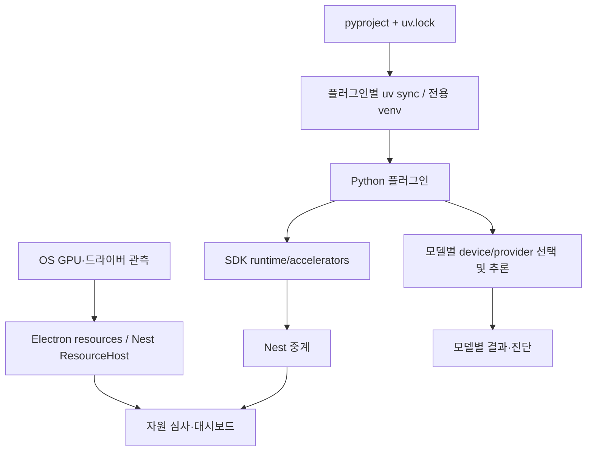

# 앱 전체 GPU 가속 구조 감사 — 2026-11-02

## 결론

앱에는 **공통 하드웨어 관측, 플러그인별 환경 설치, 공통 런타임 보고 계약**이 이미 있다. 반면 **모든 모델에 적용되는 단일 가속기 선택기·드라이버 설치기·provider 관리자는 없다.** PyTorch, ONNX Runtime, CTranslate2, FFmpeg의 실행 경로는 모델을 소비하는 플러그인이 선택한다. 따라서 대시보드의 GPU 이름, manifest의 `cuda/mps`, SDK의 `available=true`를 전체 파이프라인 GPU 실행 증거로 사용할 수 없다.

안무 전용 `DanceFaceSession`을 기존 `AuraFaceRecognizer.session_factory`에 주입하는 방향은 현재 경계에 적합하다. 공유 face core/인물의 기본값을 바꾸거나 새 전역 GPU 관리자를 만드는 변경은 필요하지 않다. Windows의 새 DirectML 의존성은 **안무 AuraFace에 한정**된다. 기존 Windows 설치본의 YOLO·OpenCLIP·Whisper까지 자동 가속하는 변경이 아니다.

가장 중요한 추가 결과는 다음과 같다.

1. 패키징 플러그인 설치는 additive `uv pip install`이 아니라 **플러그인별 `uv sync --package … --frozen`**이다. 정상 업그레이드는 fingerprint 불일치로 재동기화되고, Windows 안무에서 예전 CPU ORT는 선택 밖 패키지로 제거된다. 별도 설치 엔진을 추가할 근거가 없다.
2. 새 DirectML 경로의 같은 session 동시 `Run` 위험을 발견해 원래 구현 세션에 전달했다. 해당 세션이 추가한 실행 락과 detector의 thread-local 입력 크기/락을 최신 소스에서 확인했다. 이 감사에서 코드는 수정하거나 테스트하지 않았다.
3. 현재 대시보드에는 DirectML 표시가 빠져 있다. `DmlExecutionProvider + CPUExecutionProvider`를 ORT CPU로 표시할 수 있다. 모델별 실제 선택 정보는 기존 `selected` 계약과 안무 `face_evidence`를 확장하는 방식이 적합하다. 03:36 KST 재확인에서는 원래 세션이 모델별 보고와 얼굴 통계를 이 경로에 추가한 것도 확인했다.
4. Windows NVIDIA CUDA, AMD ROCm, Intel XPU/OpenVINO를 설치부터 실행까지 연결하는 공통 경로는 확인되지 않았다. 특히 Windows torch 설치가 CPU 전용이라는 기존 자원 정책의 주석과 PyPI lock/설치 구성이 일치한다. DirectML을 제외한 Windows GPU 실행을 검증 완료로 표시하면 안 된다.

## 감사 범위와 기준 시점

원본 `/Users/jina/project/adlight` 아래 desktop 4개와 web 4개를 조사했다. Python은 `fix/dance-gpu-performance-20261102`, HEAD `4b54bce`이며 다른 세션의 미커밋 안무 개선이 진행 중이다. 핵심 소스 스냅샷은 **2026-11-02 03:33:37 KST**, 모델별 보고 후속 확인은 **03:36 KST** 기준이다. 이후 원래 세션의 수정은 계속될 수 있으므로 마지막의 해시와 대조해야 한다.

| 저장소 / HEAD | GPU 관련 역할과 조사 범위 |
|---|---|
| `desktop/clipper_python` / `4b54bce` | 6개 플러그인 및 face/speech/SDK의 모델 실행·의존성·진단 |
| `desktop/clipper_electron` / `775ffd5` | OS GPU 정보 수집, plugin venv, Python/VC/FFmpeg 준비, 패키징 |
| `desktop/clipper_nestjs` / `e4e1fcf5` | 자원 심사, Python 실행/수명주기, runtime 보고 중계, TTS·렌더 호출 |
| `desktop/clipper_angular` / `7217bda1` | GPU 자원·manifest·runtime 표시. 모델 provider 선택은 수행하지 않음 |
| `web/clipper_web_api` / `ee9d418` | 데스크톱 GPU telemetry/오류 정보 수집·집계. 로컬 ML provider 없음 |
| `web/clipper_web_client` / `17e3e07` | 제품 UI. GPU 권장 문구는 mock 데이터에서 확인 |
| `web/clipper_web_admin` / `694a522` | telemetry GPU 분포·오류 정보 표시, Canvas 2D 미디어 처리 |
| `web/clipper_infra` / `9732aee` | 웹 배포·설치형 빌드 실행 구조. 조사한 compose/runner에 GPU runtime 할당 없음 |

제품 코드·브랜치·앱 프로세스·모델·의존성을 변경하지 않았다. 앱 시작/종료, provider import probe, 모델 추론, 설치/업그레이드, 테스트·벤치마크는 실행하지 않았다. 수행한 실행 검증은 **이미 존재하는 lock의 dependency marker/도달 그래프 파싱과 설치된 배포판 METADATA 읽기**뿐이다. 문서 저장과 임시 감사 자료만 생성했다.

## 1. 공통 구조: 관측과 실행 선택은 분리돼 있다

OS GPU 관측에서 설치 패키지나 모델 provider를 결정하는 화살표는 현재 없다. 시작 자원 심사는 메모리·VRAM 적합성을 판단하며 runtime 엔진을 고르는 기능이 아니다.

### OS별 GPU·드라이버 관측

| 위치 | 실제 수행 | 해석 및 한계 |
|---|---|---|
| [Electron host-resource-monitor.ts:338](/Users/jina/project/adlight/desktop/clipper_electron/src/main/resources/host-resource-monitor.ts:338) | 60초 캐시, 먼저 `nvidia-smi`, 없으면 OS별 수집 | NVIDIA가 하나라도 발견되면 Windows AMD/Intel 조회를 생략(:350–360). 전체 하이브리드 어댑터 목록이 아닐 수 있음 |
| [같은 파일:363](/Users/jina/project/adlight/desktop/clipper_electron/src/main/resources/host-resource-monitor.ts:363) | NVIDIA 이름·총/사용/가용 VRAM·사용률·driver version | 드라이버 존재·메모리 관측. CUDA/cuDNN 사용 가능성이나 모델 사용 GPU는 확인하지 않음 |
| [같은 파일:394](/Users/jina/project/adlight/desktop/clipper_electron/src/main/resources/host-resource-monitor.ts:394) | macOS `system_profiler SPDisplaysDataType -json`, Apple/Metal 정보 | Metal 지원은 MPS/ORT CoreML 모델의 실행·연산 배정 증거가 아님. 통합 메모리 가용 VRAM이 별도 수집되지 않음 |
| [같은 파일:433](/Users/jina/project/adlight/desktop/clipper_electron/src/main/resources/host-resource-monitor.ts:433) | Windows `Win32_VideoController`의 이름·vendor·AdapterRAM·DriverVersion | DX12/DML 기능 검증, 드라이버 설치/업데이트, GPU별 runtime 연결은 없음 |
| [Nest StaticResourceHost:149](/Users/jina/project/adlight/desktop/clipper_nestjs/src/modules/resources/infrastructure/static-resource-host.service.ts:149) | Electron과 거의 같은 NVIDIA/macOS/Windows 수집 구현 | standalone Nest용 중복 구현. [resources.module.ts:15](/Users/jina/project/adlight/desktop/clipper_nestjs/src/modules/resources/resources.module.ts:15)는 bridge 설정이 있으면 ElectronResourceHost를 선택 |
| [Electron gpu-vendor.ts:57](/Users/jina/project/adlight/desktop/clipper_electron/src/main/telemetry/gpu-vendor.ts:57) | `app.getGPUInfo('basic')`의 활성 PCI vendor ID를 고정 이름으로 변환 | 익명 telemetry 전용. Apple/NVIDIA/Intel/AMD 등 vendor만 알며 provider 선택에 쓰지 않음 |

Nest의 [plugin-resource-policy.service.ts:161](/Users/jina/project/adlight/desktop/clipper_nestjs/src/modules/resources/application/plugin-resource-policy.service.ts:161)는 가용 VRAM이 큰 GPU를 표시하지만 모델에 그 GPU index를 전달하지 않는다. `requires_gpu=false`이면 VRAM 부족으로 시작을 막지 않도록 되어 있다(:178–188). 이 정책을 DirectML 추가와 함께 일괄 GPU 필수로 바꾸면 CPU fallback 계약이 깨진다.

### 공통 runtime 보고 계약

- Python SDK의 [models.py:41](/Users/jina/project/adlight/desktop/clipper_python/clipper_plugin_sdk/clipper_plugin_sdk/models.py:41)는 `RuntimeProbe(installed, available, version, error, details)`와 `RuntimeAcceleratorsResponse(models_loaded, selected, probes)`를 정의한다. `selected`는 확장 가능한 dict다.
- SDK [base.py:398](/Users/jina/project/adlight/desktop/clipper_python/clipper_plugin_sdk/clipper_plugin_sdk/base.py:398)는 plugin hook의 `selected`에 torch·ORT·CTranslate2 probe를 합친다. [routes.py:42](/Users/jina/project/adlight/desktop/clipper_python/clipper_plugin_sdk/clipper_plugin_sdk/routes.py:42)의 `/runtime/accelerators`를 [Nest plugins.service.ts:149](/Users/jina/project/adlight/desktop/clipper_nestjs/src/modules/plugins/application/plugins.service.ts:149)가 실행 중인 plugin에서 가져온다.
- Nest [정규화:356](/Users/jina/project/adlight/desktop/clipper_nestjs/src/modules/plugins/application/plugins.service.ts:356)는 `selected`/probe `details`를 그대로 보존한다. Angular [plugin-status.service.ts:312](/Users/jina/project/adlight/desktop/clipper_angular/src/core/plugins/plugin-status.service.ts:312)가 이 API를 소비한다. 모델별 보고를 위해 새 transport가 필요하지 않다.
- torch probe는 CUDA/MPS 가용성·CUDA 장치명과 torch 버전을 확인한다([base.py:541](/Users/jina/project/adlight/desktop/clipper_python/clipper_plugin_sdk/clipper_plugin_sdk/base.py:541)). ORT는 `get_available_providers()` 및 ORT 버전을 반환하며 DML 전용 boolean은 없지만 provider 원문 목록은 전달한다(:573). CTranslate2는 CUDA device count를 확인한다(:598).

**보고 의미의 제한:** ORT `available=bool(providers)`이므로 CPU만 있어도 true다. `installed=false`는 import 실패에서도 반환되므로 wheel 부재와 DLL 로딩 실패를 구분하지 못한다. `get_available_providers()`는 설치 binary가 노출하는 EP 목록이고, session의 `get_providers()`도 등록된 EP 목록이다. 둘 다 해당 모델 연산이 실제 GPU에 배정됐는지를 증명하지 않는다. SDK `models_loaded` 역시 plugin의 preload hook 완료를 뜻하며 lazy STT/OpenCLIP의 실제 메모리 적재까지 보장하지 않는다.

현재 대시보드는 [dashboard.component.ts:411](/Users/jina/project/adlight/desktop/clipper_angular/src/shell/dashboard/dashboard.component.ts:411)에서 `primary_device`와 probe label을 한 줄로 합친다. [ORT label:645](/Users/jina/project/adlight/desktop/clipper_angular/src/shell/dashboard/dashboard.component.ts:645)는 CUDA→CoreML→CPU만 확인하므로 **DML+CPU가 ORT CPU로 표시될 수 있다.** `selected.models` 같은 추가 정보도 현재 화면은 자동으로 렌더하지 않는다. 백엔드 보고 확장과 UI 소비는 별도 변경이다.

## 2. 패키지 설치에서 실제 Python 실행까지

### 패키징 앱의 기존 설치 경로

1. [electron-builder.yml:37](/Users/jina/project/adlight/desktop/clipper_electron/electron-builder.yml:37)이 Python 소스와 lock을 번들에 담는다. `.venv`, 모델 `.pt/.onnx`, 테스트는 제외한다. 이미 개발기에 설치된 CUDA 환경을 앱에 복사하는 구조가 아니다.
2. [main.ts:338](/Users/jina/project/adlight/desktop/clipper_electron/src/main/main.ts:338)는 번들의 Python root를 선택하고, :372–386에서 공통 `ensurePluginVenv`를 plugin manager에 주입한다.
3. [plugin-manager.ts:298](/Users/jina/project/adlight/desktop/clipper_electron/src/main/plugin/plugin-manager.ts:298)는 plugin별 환경 준비 후 반환된 venv를 process에 전달한다.
4. [plugin-venv.ts:53](/Users/jina/project/adlight/desktop/clipper_electron/src/main/plugin/plugin-venv.ts:53)의 환경 경로는 `userData/venvs/plugins/<plugin>`. :72–94의 명령은 `uv sync --directory <bundle-python> --package <plugin-package> --frozen --no-dev --no-editable --python 3.11 --managed-python`이며 plugin/SDK 및 해당 face/speech core를 재설치한다. **GPU vendor에 따라 wheel/index를 바꾸는 분기는 없다.**
5. [plugin-process.ts:165](/Users/jina/project/adlight/desktop/clipper_electron/src/main/plugin/plugin-process.ts:165)는 해당 venv의 Python으로 `-m <plugin>`을 직접 실행한다. FFmpeg 경로와 `FFMPEG_BIN/FFPROBE_BIN`도 전달한다(:173–207).

Python/FFmpeg 모델 파일 준비, Python 배포판 설치, VC 재배포 패키지 확인은 GPU 드라이버 설치와 다르다. [windows-vc-runtime.ts:77](/Users/jina/project/adlight/desktop/clipper_electron/src/main/plugin/windows-vc-runtime.ts:77)는 manifest 요청에 따라 MSVCP140.dll의 버전을 검사한다. NVIDIA/AMD/Intel 드라이버나 CUDA/cuDNN을 설치하거나 버전을 협상하지 않는다.

FFmpeg는 [download-ffmpeg.ts:11](/Users/jina/project/adlight/desktop/clipper_electron/src/main/setup/download-ffmpeg.ts:11)의 OS/arch별 다운로드를 사용한다. 설치 파일이 존재한다는 사실은 특정 하드웨어 encoder 작동 증거가 아니다.

### Windows 기존 CPU ORT에서 DirectML로 업그레이드

정상 패키징 경로는 **추가적인 uninstall/migration 구현 없이 기존 exact sync를 재사용할 수 있다.**

- [plugin-venv.ts:113](/Users/jina/project/adlight/desktop/clipper_electron/src/main/plugin/plugin-venv.ts:113)는 `uv.lock`, 해당 plugin의 pyproject/manifest/소스, SDK/공유 core를 fingerprint에 넣는다. :97–110은 platform/arch/app version/root/fingerprint 등을 비교하고 :163–186은 stale일 때 sync한 후에만 완료 marker를 기록한다.
- Windows dance pyproject의 [11–12행](/Users/jina/project/adlight/desktop/clipper_python/plugins/dance_highlight/pyproject.toml:11)은 CPU ORT와 DML을 OS marker로 배타적으로 선택한다. [uv.lock:229](/Users/jina/project/adlight/desktop/clipper_python/uv.lock:229)의 dance 의존성도 Windows에는 DirectML만 포함한다.
- 현재 명령에는 `--inexact`가 없다. [uv 공식 exact sync 설명](https://docs.astral.sh/uv/concepts/projects/sync/#handling-of-extraneous-packages)에 따르면 선택 밖 패키지는 제거된다. 그러므로 기존 dance venv의 CPU `onnxruntime`은 재동기화 시 제거 대상이며 DirectML distribution이 설치 대상이다. **설계상 연결을 확인한 것이며 Windows 실제 업그레이드를 실행한 결과는 아니다.**
- [first-run.ts:131](/Users/jina/project/adlight/desktop/clipper_electron/src/main/setup/first-run.ts:131)의 `uv pip install`은 base venv에 yt-dlp를 준비하는 경로다(:141–144, 명령 :458–466). 이를 plugin 설치 경로로 오인해 새 DML additive 설치를 추가하면 기존 격리를 우회한다.
- DirectML의 CPU fallback은 같은 DML distribution이 제공하는 CPU EP를 사용하면 된다. fallback을 위해 별도의 CPU `onnxruntime`을 동적으로 설치하지 않아야 한다. ORT 배포판을 같은 환경에 중복 설치하지 말라는 [공식 Python 설치 지침](https://onnxruntime.ai/docs/get-started/with-python.html#install-onnx-runtime)과도 일치한다.

**실제 남는 예외:** 개발 Electron은 [plugin-process.ts:132](/Users/jina/project/adlight/desktop/clipper_electron/src/main/plugin/plugin-process.ts:132)의 `uv run --project <pythonRoot>`를, standalone Nest는 [local-plugin-process.ts:30](/Users/jina/project/adlight/desktop/clipper_nestjs/src/modules/plugins/infrastructure/local-plugin-process.ts:30)의 `uv run --directory <pythonRoot>`를 사용한다. 패키징 전용 venv와 다르다. `uv run`은 기본 inexact이므로 공용 개발 환경에서 다른 plugin/전체 workspace를 함께 설치하거나 CPU 환경에 DML을 추가하면 둘이 남을 수 있다. [README:51](/Users/jina/project/adlight/desktop/clipper_python/README.md:51)의 전체 workspace 동기화 안내도 Windows 배포판 충돌 관점에서 재검토할 대상이다. 이 감사에서는 개발 설치 절차를 바꾸지 않았다.

또한 lock 전체가 **모든** plugin fingerprint의 입력이다. 안무만의 marker 변경이어도 다른 plugin의 다음 시작에서 재동기화가 생긴다. 이것은 person 모델 실행 의미가 바뀐다는 뜻은 아니지만 “다른 plugin의 설치 수명주기에도 영향 없음”이라고 할 수는 없다. 다른 plugin의 dependency closure와 기존 버전 유지 여부를 별도로 확인해야 한다.

### lock 정적 도달 그래프 확인 결과

현재 `uv.lock`을 `tomllib`로 파싱하고 Python 3.11 / Windows AMD64 및 Darwin arm64 marker를 평가했다. dependency sync·wheel 다운로드·모델 import 없이 계산했다. 관련 배포판만 표기한다.

| plugin | Windows closure | Darwin closure |
|---|---|---|
| dance | **onnxruntime-directml 1.24.4**, torch 2.11.0 | onnxruntime 1.31.0, torch 2.11.0 |
| person | onnxruntime 1.31.0, torch 2.11.0, CTranslate2 4.7.1 | 동일 |
| dialog | onnxruntime 1.31.0, torch 2.11.0, OpenCLIP 3.3.0, CTranslate2 4.7.1 | 동일 |
| overseas_dub | onnxruntime 1.31.0, RapidOCR 1.4.4, CTranslate2 4.7.1 | 동일 |
| tts_supertonic | onnxruntime 1.31.0 | 동일 |

dance에는 speech core/faster-whisper/RapidOCR 의존성이 없고 face core도 ORT를 직접 요구하지 않는다([face core pyproject:6](/Users/jina/project/adlight/desktop/clipper_python/clipper_face_core/pyproject.toml:6)). 따라서 **현재 선택된 dance closure에는 CPU ORT를 되끌어오는 전이 의존성이 없다.** workspace lock에 CPU와 DML 항목이 함께 존재하는 것 자체는 패키징의 동일 venv 동시 설치 증거가 아니다.

## 3. 모델·기능별 실제 실행 경로

여기서 “실행 경로”는 제품 코드가 inference API에 전달하는 설정을 뜻한다. 이번 감사에서 새로 모델을 실행했다는 뜻은 아니다.

| 기능/모델 | 제품의 선택·호출 | 실제 가속 범위 / 근거 |
|---|---|---|
| 안무 YOLO pose | macOS MPS, 그 외 torch CUDA 가용 시 index 0, 아니면 CPU | [config.py:16](/Users/jina/project/adlight/desktop/clipper_python/plugins/dance_highlight/dance_highlight/services/config.py:16), [pose_engine.py:23](/Users/jina/project/adlight/desktop/clipper_python/plugins/dance_highlight/dance_highlight/services/pose_engine.py:23)의 `device/half`. CUDA/MPS 여부는 설치된 torch에 의존 |
| 안무 AuraFace | 이번 미커밋 변경에서 CoreML 또는 Windows CUDA/DML + CPU | [face_cluster.py:77](/Users/jina/project/adlight/desktop/clipper_python/plugins/dance_highlight/dance_highlight/services/face_cluster.py:77)의 session factory 주입, `face_runtime.py`. baseline shared 기본은 CPU |
| 안무 YuNet/SFace | OpenCV DNN 기본 backend/target | [face_cluster.py:68](/Users/jina/project/adlight/desktop/clipper_python/plugins/dance_highlight/dance_highlight/services/face_cluster.py:68), [secondary_faces.py:161](/Users/jina/project/adlight/desktop/clipper_python/plugins/dance_highlight/dance_highlight/services/secondary_faces.py:161). CUDA DNN/다른 가속 target을 설정하지 않음. ORT provider 변경으로 이 검출기들이 가속되지는 않음 |
| 안무 SAM2 | **device='cpu' 고정** | [mask_tracker.py:127](/Users/jina/project/adlight/desktop/clipper_python/plugins/dance_highlight/dance_highlight/services/mask_tracker.py:127). 이미지 특징 재사용은 별도로 존재. 기존 품질 차이 때문에 GPU 전환과 동일 계산 재사용을 분리해야 함 |
| 인물 YOLO body | torch CUDA→MPS→CPU, 모델 호출에 device 전달 | [model_assets.py:78](/Users/jina/project/adlight/desktop/clipper_python/plugins/person_highlight/person_highlight/model_assets.py:78), [body_detector.py:44](/Users/jina/project/adlight/desktop/clipper_python/plugins/person_highlight/person_highlight/body_detector.py:44) |
| 인물 YuNet/AuraFace | OpenCV detector + 공유 AuraFace CPU session | [OpenCvFaceBackend:31](/Users/jina/project/adlight/desktop/clipper_python/clipper_face_core/clipper_face_core/opencv_backend.py:31), [auraface.py:21](/Users/jina/project/adlight/desktop/clipper_python/clipper_face_core/clipper_face_core/auraface.py:21). 인물에는 dance session factory가 주입되지 않음 |
| 인물 frame inference | CPU 얼굴과 MPS/CUDA body를 한 프레임 단위 겹쳐 실행 가능 | [frame_inference.py:8](/Users/jina/project/adlight/desktop/clipper_python/plugins/person_highlight/person_highlight/frame_inference.py:8), :40–49. 2 GiB 가용 RAM 조건, 한 프레임만 진행. 전역 GPU 관리자가 아닌 인물 전용 실행 최적화 |
| 인물/대화 Whisper | 공통 speech core; CUDA float16 시도 후 CPU int8, MPS 요청은 CPU | [speech core model.py:34](/Users/jina/project/adlight/desktop/clipper_python/clipper_speech_core/clipper_speech_core/model.py:34). 인물 [app.py:231](/Users/jina/project/adlight/desktop/clipper_python/plugins/person_highlight/person_highlight/app.py:231), 대화 [stt_worker.py:15](/Users/jina/project/adlight/desktop/clipper_python/plugins/dialog_highlight/dialog_highlight/services/stt_worker.py:15)가 공유. 별도 worker process를 사용 |
| 대화 OpenCLIP | torch CUDA→MPS→CPU 선택, model/input을 `.to(device)` | [common.py:121](/Users/jina/project/adlight/desktop/clipper_python/plugins/dialog_highlight/dialog_highlight/services/pipeline/common.py:121), [embedding_pipeline.py:55](/Users/jina/project/adlight/desktop/clipper_python/plugins/dialog_highlight/dialog_highlight/services/pipeline/embedding_pipeline.py:55). GPU 가능한 시각 임베딩과 CPU STT가 공존 가능 |
| 대화 EasyOCR | 코드에는 CUDA `gpu=True` 분기, 기본 RUN_OCR=False | [common.py:27](/Users/jina/project/adlight/desktop/clipper_python/plugins/dialog_highlight/dialog_highlight/services/pipeline/common.py:27), [staged_artifacts.py:100](/Users/jina/project/adlight/desktop/clipper_python/plugins/dialog_highlight/dialog_highlight/services/pipeline/staged_artifacts.py:100), [ocr_pipeline.py:78](/Users/jina/project/adlight/desktop/clipper_python/plugins/dialog_highlight/dialog_highlight/services/pipeline/ocr_pipeline.py:78). [pyproject](/Users/jina/project/adlight/desktop/clipper_python/plugins/dialog_highlight/pyproject.toml:6)에 EasyOCR도 없음. 일반 설치의 실제 GPU OCR로 집계하면 안 됨 |
| 해외 더빙 STT | 별도 adapter가 Whisper CPU int8 고정 | [model_files.py:115](/Users/jina/project/adlight/desktop/clipper_python/plugins/overseas_dub/overseas_dub/model_files.py:115). 공유 speech core를 사용하지 않는 별도 구현이며 VAD 설정도 다름 |
| 해외 더빙 OCR | `RapidOCR()` 기본 설정 | [ocr_engine.py:42](/Users/jina/project/adlight/desktop/clipper_python/plugins/overseas_dub/overseas_dub/ocr_engine.py:42). 앱에서 CUDA/DML 플래그를 넘기지 않음. 설치된 1.4.4의 기본 config는 `use_cuda/use_dml=false`, CPU EP 사용 |
| Supertonic TTS | `TTS(auto_download=True)`, ONNX CPU 기본 | [app.py:58](/Users/jina/project/adlight/desktop/clipper_python/plugins/tts_supertonic/tts_supertonic/app.py:58), :119. 설치된 Supertonic 1.3.1 loader의 provider 기본은 CPU. 단순히 ORT에 CoreML이 노출돼도 TTS에 선택되지는 않음 |
| 공통 영상 렌더 | Python FFmpeg segment/final `libx264`; Nest 렌더도 libx264 | [video_renderer.py:24](/Users/jina/project/adlight/desktop/clipper_python/plugins/clipper_video_render/clipper_video_render/video_renderer.py:24), :219. [Nest 기본 렌더:184](/Users/jina/project/adlight/desktop/clipper_nestjs/src/modules/project-manifest/infrastructure/local-ffmpeg-basic-render-provider.ts:184), [simplified 렌더:172](/Users/jina/project/adlight/desktop/clipper_nestjs/src/modules/project-manifest/infrastructure/simplified-shortform-local-ffmpeg-render-provider.ts:172) |
| 대화 export / Nest trim·transform | libx264 또는 stream copy | [대화 media_utils.py:353](/Users/jina/project/adlight/desktop/clipper_python/plugins/dialog_highlight/dialog_highlight/services/pipeline/media_utils.py:353), [Nest transform:126](/Users/jina/project/adlight/desktop/clipper_nestjs/src/modules/workflows/infrastructure/nestjs-ffmpeg-transform.executor.ts:126), [trim:33](/Users/jina/project/adlight/desktop/clipper_nestjs/src/modules/projects/infrastructure/ffmpeg-clip-trimmer.ts:33). stream copy는 GPU encode가 아님 |
| 안무 clip encode | stream copy 기본; 정확한 cut 등 재인코딩 시 VideoToolbox/NVENC/libx264 선택 | [config.py:40](/Users/jina/project/adlight/desktop/clipper_python/plugins/dance_highlight/dance_highlight/services/config.py:40), :129, [render.py:29](/Users/jina/project/adlight/desktop/clipper_python/plugins/dance_highlight/dance_highlight/services/render.py:29), :78–101 |

안무 encoder 탐지는 `ffmpeg -encoders` 목록을 보고 macOS VideoToolbox, CUDA 가용 시 NVENC를 선택한다. NVENC를 torch CUDA에 묶어 두어 CPU torch인 Windows NVIDIA에서는 encoder 자체가 가능하더라도 선택되지 않을 수 있다. AMD AMF/Intel QSV 분기는 없다. VideoToolbox는 `-allow_sw 1`을 허용하고, 선택 후 실패 시 libx264로 재시도하는 공통 recovery도 없다. 따라서 encoder 이름을 GPU 실사용 확정값으로 표시하면 안 된다. 이 선택 코드를 공통 렌더 전체로 확산시키는 것은 이번 안무 얼굴 개선 범위를 넘는다.

음성의 CUDA 설치 조건은 torch와 별개다. CTranslate2 binary의 CUDA 지원 및 별도 NVIDIA runtime이 필요하며, SDK의 CUDA device count만으로 특정 Whisper 모델 로딩·실행 성공을 보장하지 않는다([공식 설치 문서](https://opennmt.net/CTranslate2/installation.html)). 공유 speech core는 실제 선택 device/compute_type을 `TimedTranscript`에 보존한다([transcript.py:97](/Users/jina/project/adlight/desktop/clipper_python/clipper_speech_core/clipper_speech_core/transcript.py:97), :114–117). 이 계약을 사용해야 한다.

TTS는 [Nest tts-plugin.client.ts:21](/Users/jina/project/adlight/desktop/clipper_nestjs/src/modules/tts/infrastructure/tts-plugin.client.ts:21)에서 lifecycle lease→plugin 시작→`POST /tts`로 연결된다. UI에서 음성이나 더빙을 사용했다고 해서 별도의 GPU 엔진으로 분기하지 않는다.

## 4. OS/vendor별 설치부터 provider까지의 연결 판정

| 대상 | 기존 탐지 | 설치 연결 및 실제 실행 선택 | 감사 판정 |
|---|---|---|---|
| macOS Apple Silicon | system_profiler/Metal, torch MPS, ORT CoreML 노출 여부 | torch arm64 wheel→YOLO/OpenCLIP MPS. 새 dance session→CoreML+CPU. Whisper는 CPU, YuNet/SFace/SAM CPU, 일반 렌더 CPU | **일부 모델만 연결됨.** 이전 안무 감사에는 AuraFace CoreML 실제 연산 배정 pilot 증거가 있음. 이번에는 재실행하지 않음 |
| Windows NVIDIA | nvidia-smi 이름/driver/VRAM, torch CUDA probe | 현재 lock은 PyPI Windows torch, CUDA 전용 index 선택 없음. ORT GPU CUDA distribution도 없음. 새 dance DML wheel→DML session 가능. CUDA EP 분기는 외부에서 해당 binary가 준비된 경우만 | **기본 설치의 CUDA 전면 연결 없음.** 새 DML은 얼굴 한정, Windows 실기기 미검증 |
| Windows AMD | NVIDIA 미검출 시 Win32_VideoController | 새 dance DML만 후보. torch-directml/ROCm 선택/설치, YOLO AMD backend 경로 없음 | **DML 얼굴 경로를 정적으로 연결한 상태.** 장치의 DirectX 12 기능과 driver, 모델 품질/시간은 미검증 |
| Windows Intel | 같은 Windows 장치 관측 | 새 dance DML만 후보. torch XPU/OpenVINO, QSV 선택 경로 없음 | **DML 얼굴 이외 GPU 가속은 연결되지 않음** |

Windows torch 설치에 대한 근거는 [uv.lock:1946](/Users/jina/project/adlight/desktop/clipper_python/uv.lock:1946)의 PyPI source·Windows wheel 및 Linux로 제한된 CUDA 의존성과, 기존 [자원 정책 주석:178](/Users/jina/project/adlight/desktop/clipper_nestjs/src/modules/resources/application/plugin-resource-policy.service.ts:178)의 “윈도 설치본은 CPU 전용 torch 휠”이다. Windows 바이너리를 이 Mac에서 로딩한 결과가 아니다. 모든 NVIDIA 사용자의 CUDA가 동작하지 않는다고 일반화하지 않는다. 사용자가 별도 준비한 환경은 다를 수 있다.

DirectML은 DirectX 12 가능한 NVIDIA/AMD/Intel 장치에서 사용할 수 있으나, vendor 이름만으로 적격성을 증명할 수 없다([ORT DirectML 공식 요구사항](https://onnxruntime.ai/docs/execution-providers/DirectML-ExecutionProvider.html#requirements)). 새 코드는 DML `device_id`를 지정하지 않으므로 기본 어댑터를 사용하며, 가장 빠른 GPU를 자동 선택하는 구현은 아니다. OS 관측 목록과 DML 어댑터 index를 연결하는 계약도 없다. 공식 문서상 기본 어댑터가 가장 빠른 GPU와 다를 수 있다([adapter 옵션](https://onnxruntime.ai/docs/execution-providers/DirectML-ExecutionProvider.html#usage)).

## 5. web 4개 및 화면 렌더링에서 확인한 범위

- web API의 [telemetry-devices.service.ts:202](/Users/jina/project/adlight/web/clipper_web_api/src/modules/desktop-telemetry/application/telemetry-devices.service.ts:202)는 클라이언트가 보낸 `payload.hw.gpu`를 읽고 :310에서 설치별 vendor 분포를 집계한다. 원격 사용자의 드라이버·ORT·모델 실행을 검증하는 서버가 아니다.
- web admin은 [models.ts:1365](/Users/jina/project/adlight/web/clipper_web_admin/src/app/core/api/models.ts:1365)의 GPU 분포/미보고 계약을 표시한다. [desktop-error-clip.ts:28](/Users/jina/project/adlight/web/clipper_web_admin/src/app/features/portal/desktop-errors/desktop-error-clip.ts:28)의 GPU 문자열은 오류 보고 정보다. `null`을 GPU 미탑재로 해석하면 안 된다.
- web client의 [mock-data.ts:28](/Users/jina/project/adlight/web/clipper_web_client/src/app/core/api/mock/mock-data.ts:28)에 GPU 권장 문구가 있지만 설치·provider 지원 계약은 아니다.
- [infra apps/compose.yml:1](/Users/jina/project/adlight/web/clipper_infra/apps/compose.yml:1)은 웹 client/admin/API 서비스를 배치한다. 조사한 compose·runner 및 3개 web package/source에서 local torch/ORT·CUDA provider 또는 GPU resource 할당 경로를 찾지 못했다. 외부 AI API의 내부 하드웨어는 이 소스 감사로 확정하지 않는다.
- desktop Angular의 [text measurer:49](/Users/jina/project/adlight/desktop/clipper_angular/src/shared/template-runtime/template-text-measurer.service.ts:49), [card thumbnail:59](/Users/jina/project/adlight/desktop/clipper_angular/src/features/template-builder/services/template-builder-card-thumbnail.service.ts:59) 및 web admin의 [media-probe.ts:97](/Users/jina/project/adlight/web/clipper_web_admin/src/app/features/portal/default-media/upload/media-probe.ts:97)은 Canvas **2D**다. 조사한 제품 src/package에서 명시적 WebGL/WebGPU/ONNX Web 추론 구성은 확인되지 않았다. 브라우저/Electron compositor·video decoder의 자동 가속은 OS/Chromium 구현에 따르며, 위 Python 모델 device와 별개다. tools 아래 Remotion 등의 POC를 제품 실행 경로로 집계하지 않았다.

## 6. 기존 공통화와 중복 구현의 경계

| 이미 재사용할 구조 | 중복 또는 모델별 구현 | 이번 안무 변경에서의 판단 |
|---|---|---|
| SDK probe + plugin `selected` hook + Nest/Angular API 계약 | 각 plugin의 `primary_device`는 단계별 실제 device를 생략 | 기존 계약으로 모델별 정보를 보고. 새 진단 endpoint 추가 불필요 |
| `clipper_face_core.AuraFaceRecognizer`, 공통 정렬/전처리/출력검증, 고정 모델 SHA | dance는 별도 face selection과 session factory, person은 OpenCvFaceBackend | **주입 지점 유지.** shared 기본을 GPU로 바꾸거나 person backend에 dance cache/policy를 가져오지 않음 |
| `clipper_speech_core`의 model cache/device 정규화/실제 선택 반환 | overseas_dub는 CPU 전용 별도 Whisper adapter, VAD 등 의미가 다름 | 이 감사에서 speech 통합·설정 변경하지 않음 |
| per-plugin venv + exact sync + source fingerprint | 개발/standalone 실행은 공용 workspace venv | 패키징 설치 경로 재사용. 개발 공용 환경의 ORT 중복 위험을 명시 |
| Electron ResourceHost bridge | standalone Nest에 OS probe가 거의 중복 | 관측 중복 개선은 별도 작업. face acceleration 때문에 이 계층까지 재구성할 필요 없음 |
| shared face asset constants/hash | face asset download 경로는 dance/person별 adapter | 모델 원본 변경·재다운로드·기본 경로 변경 불필요 |
| plugin별 FFmpeg 실행 seam | 안무 encoder 탐지와 나머지 CPU 렌더 경로는 통합돼 있지 않음 | 영상 encoder 전면 공통화/전환은 별도 품질·호환성 작업 |

GPU 메모리 관리도 일원화돼 있지 않다. SDK [base.py:530](/Users/jina/project/adlight/desktop/clipper_python/clipper_plugin_sdk/clipper_plugin_sdk/base.py:530)는 optional `pynvml`로 NVIDIA **장치 0 전체** VRAM을 읽고, SDK [gpu extra](/Users/jina/project/adlight/desktop/clipper_python/clipper_plugin_sdk/pyproject.toml:13)는 기본 의존성이 아니다. CUDA OOM recovery도 CUDA cache 중심(:503–511, :628)인 반면 person [app.py:88](/Users/jina/project/adlight/desktop/clipper_python/plugins/person_highlight/person_highlight/app.py:88)은 MPS/CUDA allocator를 직접 정리한다. 이 값을 plugin별 실제 GPU 메모리 사용량으로 확대 해석하면 안 된다.

## 7. 새 dance-only face runtime 설계 적합성

### 적합한 부분

- 공유 [auraface.py:21](/Users/jina/project/adlight/desktop/clipper_python/clipper_face_core/clipper_face_core/auraface.py:21)의 기존 `session_factory` seam을 사용한다. 공유 class의 기본 CPU와 alignment/blob/512차원 검증을 유지하므로 person의 기본 inference 의미를 바꾸지 않는 방식이다.
- [face_runtime.py:73](/Users/jina/project/adlight/desktop/clipper_python/plugins/dance_highlight/dance_highlight/services/face_runtime.py:73)는 macOS CoreML `MLProgram/CPUAndGPU`와 모델 SHA별 cache를, :78–84는 Windows CUDA 우선/DML 차선과 DirectML의 memory-pattern off/sequential 조건을 설정한다. 이 옵션들은 session별 적용이며 다른 plugin에 전파되지 않는다.
- :85–106은 실제 session 생성/초기 추론 실패 시 CPU session으로 돌아가고 :127–145는 실행 중 오류/유효하지 않은 embedding에도 CPU로 재시도한다. 실패 후 cache를 비워 GPU/CPU 결과가 이전 cache에 섞이지 않도록 한다.
- :129–152의 embedding cache는 출력명·입력명/shape/dtype/실제 blob bytes hash를 key로 사용하고 반환 copy와 항목 상한이 있다. 모델별 session 생명주기를 공유 core 밖에서 관리하므로 현재 안무 범위에 맞는다. 새로운 의미 판정/샘플링 축소와는 별개다.
- person은 [OpenCvFaceBackend:35](/Users/jina/project/adlight/desktop/clipper_python/clipper_face_core/clipper_face_core/opencv_backend.py:35)에서 factory 없이 공유 recognizer를 열고, [person pyproject:6](/Users/jina/project/adlight/desktop/clipper_python/plugins/person_highlight/pyproject.toml:6)은 기존 ORT를 유지한다. 이번 정적 그래프에서도 person closure에 DML이 추가되지 않았다.

### 중간 발견과 최신 반영 상태

초기 `DanceFaceSession.run`에는 락이 없었다. `ORT_SEQUENTIAL`은 graph 내부 실행 모드이며 동일 session의 여러 외부 thread `Run`을 직렬화하지 않는다. [공식 DirectML 제한](https://onnxruntime.ai/docs/execution-providers/DirectML-ExecutionProvider.html#configuration-options)은 같은 session 동시 호출을 허용하지 않는다.

제품에는 실제 병행 진입 가능성이 있다. [dance app.py:82](/Users/jina/project/adlight/desktop/clipper_python/plugins/dance_highlight/dance_highlight/app.py:82)의 동기 참조 검사 route가 공유 `self._pipeline.face`를 쓰며, SDK [active_request:112](/Users/jina/project/adlight/desktop/clipper_python/clipper_plugin_sdk/clipper_plugin_sdk/base.py:112)는 카운터 보호만 한다. job은 [base.py:289](/Users/jina/project/adlight/desktop/clipper_python/clipper_plugin_sdk/clipper_plugin_sdk/base.py:289)의 별도 thread에서 실행된다. manifest `max_concurrency=1`만으로 이런 route 동시성을 막을 수 없다.

이를 원래 세션에 전달한 뒤 현재 소스에는 다음 보호가 추가됐다.

- `DanceFaceSession` :67 및 :122–125의 lock이 Run/fallback/cache를 함께 보호한다.
- `CachedFaceDetector` :25–35의 thread-local 입력 크기와 detect lock이 한 thread의 `setInputSize`를 다른 thread가 덮어쓰는 문제를 방지한다. :20–24 및 :55–58의 byte/entry 상한도 확인했다.

**상태: 수정된 소스를 확인함.** 원래 세션은 실패 재현 테스트 후 수정했다고 전달했지만, 이 감사는 그 테스트를 재실행하거나 실기기 동시성을 검증하지 않았다. 최종 구현 검증의 책임은 원래 세션에 남는다.

### 남은 검증·보고 경계

- `get_providers()`에 CoreML/DML이 있다는 사실과 warmup의 유한한 512차원 출력만으로 전체 graph의 GPU 배정·얼굴 이름 정확도·최종 구간 동등성을 증명할 수 없다. Windows 실기기의 실제 model session, CPU fallback, 기존 설치 upgrade, 한국어 사용자 경로를 별도로 확인해야 한다.
- CUDA EP가 노출되지만 사용할 수 없는 경우 현재 구현은 **곧바로 CPU로** fallback한다. CUDA 실패 후 DML로 다시 내려가는 다단계 fallback은 없다. 현재 Windows lock은 DML distribution만 설치하므로 보통 CUDA 분기는 실행되지 않는다. CUDA가 기본 설치된다고 설명하면 안 된다.
- [face_evidence.py:114](/Users/jina/project/adlight/desktop/clipper_python/plugins/dance_highlight/dance_highlight/services/face_evidence.py:114)는 실제 recognizer session의 providers와 runtime/model/source hash를 결과에 보존한다. 03:36 KST 재확인에서 원래 세션이 `face_runtime` 소스 hash(:97, :111), `recognizer_stats`/`detector_stats`(:121–122)를 추가한 것을 확인했다. fallback 횟수·초기화·호출·cache 통계가 이 경로로 보존된다. 최종 providers/누적 횟수만으로 작업 중 fallback 이전 사용 이력·원인까지 모두 복원할 수 있는 것은 아니다.
- [dance app.py:67](/Users/jina/project/adlight/desktop/clipper_python/plugins/dance_highlight/dance_highlight/app.py:67)의 `primary_device`는 YOLO 기준이다. 03:36 KST에는 :73–79에 pose/face_recognition/face_detection/secondary_face/body_tracking별 device 또는 providers가 추가된 것을 확인했다. **모델별 보고는 소스 반영 상태**, 실제 앱 결과와 UI 표시는 미검증이다. UI가 현재 `selected.models`를 소비하지 않는 점과 DML label 누락은 남아 있다.
- 같은 얼굴 asset 경로는 person에서도 재사용된다([person model_assets.py:23](/Users/jina/project/adlight/desktop/clipper_python/plugins/person_highlight/person_highlight/model_assets.py:23), [dance face_models.py:63](/Users/jina/project/adlight/desktop/clipper_python/plugins/dance_highlight/dance_highlight/services/face_models.py:63)). CoreML cache는 SHA별 하위 디렉터리에 추가하되 원본 모델을 바꾸거나 전체 모델 디렉터리를 지워서는 안 된다.

## 8. 현재 안무 성능 개선에 적용할 판단

1. **기존 factory와 per-plugin install을 유지한다.** 공유 AuraFace CPU 기본, person pyproject/backend, 얼굴 모델 SHA·전처리·이름 임계값은 보존한다. GPU 가속과 분류 정책 변경을 함께 넣지 않는다.
2. **패키징 upgrade는 exact sync/fingerprint를 재사용한다.** Windows용 CPU ORT와 DML을 중복 설치하는 별도 pip 단계나 공유 SDK GPU 의존성 추가를 피한다. `uv.lock`에는 배타 marker를 유지하고 다른 plugin closure가 바뀌지 않는지 확인한다.
3. **기존 진단 계약을 모델별로 채운다.** SDK `selected`와 안무 `face_evidence`에 YOLO/AuraFace/YuNet/SFace/SAM/encoder를 분리해 보고한다. compiled provider 목록·선택된 session·실제 graph 배정·CPU fallback을 각각 구분한다.
4. **새 DirectML의 동시성 보호를 유지한다.** 공유 core 전체를 잠그는 대신 안무의 session/cache/detector 경계에서 처리한다. 초기 실패, 실행 실패, CPU도 실패하는 경우 및 동시 route를 원래 세션이 검증한다.
5. **SAM CPU와 정확한 재사용을 유지한다.** [기존 GPU 감사](/Users/jina/project/adlight/.codex/features/dance-highlight/records/2026/11/02-gpu-performance-audit.md)의 MPS 제품 판정 차이는 해소되지 않았다. 이번 구조 감사는 그 품질 검증을 대신하지 않는다.
6. **Windows 지원 범위를 정확히 설명한다.** DML 얼굴 경로가 추가된 것과 YOLO/Whisper CUDA 준비를 구분한다. GPU driver auto-install, AMD/Intel 전체 pipeline 가속, 자동 최적 GPU 선택, Windows 실제 성능 향상은 이번 소스만으로 주장하지 않는다.
7. **전역 GPU 추상화·렌더 전면 전환은 별도 작업으로 남긴다.** 서로 다른 runtime의 제약과 검증 기준을 하나의 `device=gpu`로 숨기는 구조는 현재 문제를 해결하지 못한다. 공통 관측 코드 중복과 개발 workspace 설치 문제는 후속 범위로 기록한다.

기존 안무 [구현 계획](/Users/jina/project/adlight/.codex/features/dance-highlight/records/2026/11/02-gpu-performance-implementation.md)의 dance-only 주입, 정확한 계산 재사용, SAM 품질 보존, 실제 앱/3개 영상 비교 방향은 이 조사와 부합한다. 기존 pilot의 AuraFace 1.63배는 이 감사에서 새로 측정한 값이 아니며 앱 전체 배율이나 Windows 결과로 전용하면 안 된다.

## 9. 확인 자료와 재검증 한계

읽기 확인한 로컬 설치 metadata: `Clipper Studio Dev/venvs/plugins/{dance_highlight,person_highlight,dialog_highlight,overseas_dub,tts_supertonic}/lib/python3.11/site-packages`에서 dance/person/dialog의 torch 2.11.0, 모든 해당 plugin의 ORT 1.31.0, speech plugin의 CTranslate2 4.7.1, RapidOCR 1.4.4, Supertonic 1.3.1을 확인했다. 이는 **이 Mac의 설치 배포판 존재**이고 Windows wheel 로딩·GPU 실제 사용 증거가 아니다. stale venv 디렉터리는 활성 실행 경로로 집계하지 않았다.

외부 라이브러리의 CPU 기본값은 설치 파일도 직접 읽어 확인했다.

- [Supertonic config.py:215](</Users/jina/Library/Application Support/Clipper Studio Dev/venvs/plugins/tts_supertonic/lib/python3.11/site-packages/supertonic/config.py:215>): `DEFAULT_ONNX_PROVIDERS` CPU. [loader.py:247](</Users/jina/Library/Application Support/Clipper Studio Dev/venvs/plugins/tts_supertonic/lib/python3.11/site-packages/supertonic/loader.py:247>)에서 provider 필터 후 4개 ONNX session에 전달(:274–277).
- [RapidOCR config.yaml:20](</Users/jina/Library/Application Support/Clipper Studio Dev/venvs/plugins/overseas_dub/lib/python3.11/site-packages/rapidocr_onnxruntime/config.yaml:20>): det/cls/rec의 CUDA/DML off(:20–21, :41–42, :55–56). [infer_engine.py:68](</Users/jina/Library/Application Support/Clipper Studio Dev/venvs/plugins/overseas_dub/lib/python3.11/site-packages/rapidocr_onnxruntime/utils/infer_engine.py:68>)가 CPU EP부터 구성한다.

다음 해시는 03:33:37 KST에 읽은 핵심 소스의 SHA256이다. 원래 구현 세션이 계속 수정하므로 이후 불일치는 그 후 변경 여부를 확인하는 기준이며 자동 오류 판정이 아니다.

| 파일 | SHA256 |
|---|---|
| Python `plugins/dance_highlight/dance_highlight/services/face_runtime.py` | `8d9a141bf49debeca25676cd06285874a652617ad0e60204e004d50e4a367837` |
| Python `plugins/dance_highlight/dance_highlight/services/face_cluster.py` | `43f833b93e6384f2fc65c4045b6395aea109fb6a5e3227f1de72b79c1a78469a` |
| Python `plugins/dance_highlight/pyproject.toml` | `e1ae5cbe5cb45e346ebecd3468d7f94b815d5a1de339a3a7c066dea0eb8ee80a` |
| Python `uv.lock` | `e165b4cc2f2c25c8acdf9bc2a439fdca3a76271a2a2d95f10ac496c6e023c105` |
| Electron `src/main/plugin/plugin-venv.ts` | `3271f17db6c75660a8a83029365c60c85a5b8deafcadda3e81712322f1f97b9c` |
| Angular `src/shell/dashboard/dashboard.component.ts` | `5978fe671ff14b9ba0704f36426d447d535fc5be1e3e258a0d152377bba09c6c` |

감사 결과 문서: `/Users/jina/project/adlight/.codex/operations/accelerators/records/2026/11/02-app-gpu-architecture-audit.md`. 제품 코드 수정과 실행 검증은 원래 구현 세션에서 담당한다.
