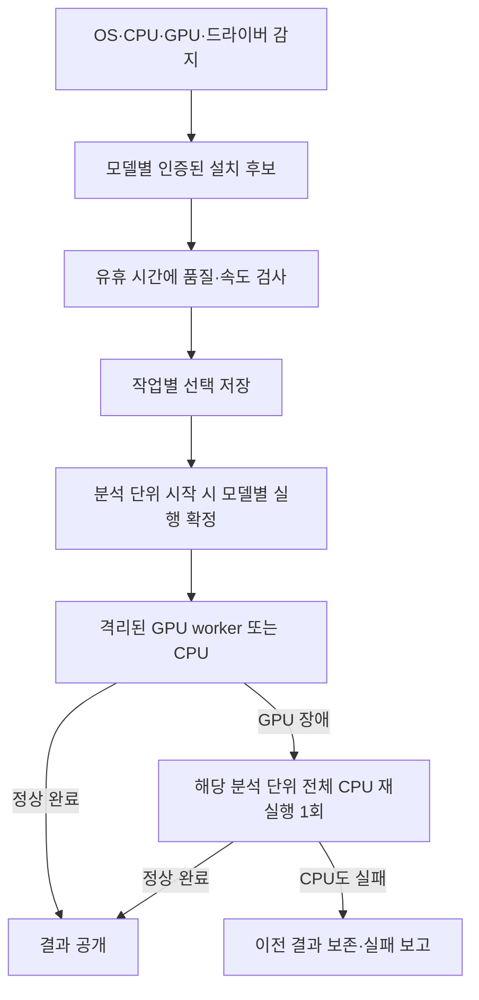

# 세 하이라이트 자동 가속 설계

2026-11-03 KST · 설계 v1 · 상태: 구현 전 검토 문서

## 1. 목적과 결정의 출처

안무·인물·대사 하이라이트가 지원 PC에서 현재 품질을 유지하면서, 검증된 실행 후보 중 해당 작업에 빠른 방식을 모델별로 선택한다. GPU 실행 불가·실패 때 검증된 CPU 경로로 완료할 수 있게 한다. 모든 하드웨어에서 절대 최단 시간을 보장한다는 의미가 아니다.

**사용자 확정 사항:** Apple Silicon Mac만 지원하며 Intel Mac은 제외한다. Windows는 Intel/AMD CPU의 x64부터 지원하고 Windows ARM/Snapdragon은 후속으로 분리한다. 세 플러그인의 모든 현재 모델을 다루며 기존 하이라이트 품질을 유지한다. 이번 요청은 설계·구현 계획 작성이다.

**설계자의 제안:** 사전 인증된 지원표 + PC별 제한된 실측 + 선택 캐시를 조합한다. 아래 시간·수치 기준은 보수적인 v1 엔지니어링 기준이며 제품 성능 실측 결과가 아니다. 기준 완화, 모델 교체, 정책 변경은 자동으로 하지 않는다. 이번 문서 작성은 제품 코드 변경·모델 추론·앱 재시작·커밋을 포함하지 않는다.

### 접근 방식

| 접근 | 장점 | 한계 | 결정 |
|---|---|---|---|
| OS/GPU 이름으로 고정 선택 | 준비가 짧고 단순 | 드라이버·실제 모델·작은 ROI 비용·복수 GPU를 반영 못함 | 초기 기본값/필터에만 사용 |
| 모든 실행기를 설치하고 전수 탐색 | 넓은 후보 비교 | 설치 용량, 컴파일 지연, 오류 조합, 품질 검증 비용이 큼 | 채택하지 않음 |
| 인증된 후보만 짧게 실측하고 저장 | 품질·배포 범위를 통제하며 PC별 차이 반영 | 인증 자료와 캐시 무효화가 필요 | 권장 설계로 구체화 |

기존 지원 OS의 최저 버전이나 RAM 기준을 이 기능이 임의로 낮추거나 높이지 않는다. 가속 pack에는 정확한 OS/드라이버/ISA 최소조건을 넣고, 미충족 시 기존 지원 CPU 경로를 사용한다. 앱 자체 지원 최소 OS가 배포 문서에 명시되지 않았다면 릴리스 담당자가 기존 설치본·의존성·최저 환경 실측으로 먼저 확정한다. 미확정 플랫폼을 '지원 완료'로 표시하지 않는다.

## 2. 현재 구조와 보존할 경계

| 계층 | 현재 존재하는 기능 | 확장할 기능 |
|---|---|---|
| Electron | OS 자원 관측, 플러그인별 uv 환경, 모델 설치, 자식 프로세스 수명 관리 | 정확한 어댑터 대응, 가속 pack 설치, 공통 GPU 자원 임대 |
| Python SDK | `/runtime/accelerators`, 모델 로딩/작업/진행/취소 | 모델별 선택·실제 사용·복구 이력, 실행 설정 주입 |
| Python 모델 소비자 | YOLO/OpenCV/ORT/OpenCLIP/CTranslate2 호출 | 동일 입력·출력 계약의 backend 어댑터 |
| Nest | 플러그인 시작/작업 조정, 자원 bridge, 진단 전달 | 설정·재측정 요청 전달, 모델 진단 정규화 |
| Angular | 플러그인 상태·자원 화면 | 자동/CPU 설정, 재측정, 모델별 사용 상태 |

새 HTTP 잡 큐, 인증 체계, 전사 AI 서비스는 만들지 않는다. 기존 플러그인 경계, 인물·안무의 서로 다른 선택 정책, 공유 face/speech core, 기존 취소·진행·로그 계약을 유지한다. 하이라이트 이름/메인/단체/장면/구간/샘플링 정책을 가속 어댑터에 넣지 않는다. 안무의 현재 미커밋 품질 작업은 별도 작업이며 덮어쓰지 않는다.



새 후보 검사 전에는 기존 인증 경로/CPU로 작업을 시작한다. 모델별로 다른 실행기를 선택할 수 있으며, 최종 하이라이트 품질 검증은 후보를 배포하기 전에 반드시 통과한다.

현재 근거:

- [YOLO 호출](/Users/jina/project/adlight/desktop/clipper_python/plugins/dance_highlight/dance_highlight/services/pose_engine.py), [인물 body 호출](/Users/jina/project/adlight/desktop/clipper_python/plugins/person_highlight/person_highlight/body_detector.py)
- [공통 얼굴 backend](/Users/jina/project/adlight/desktop/clipper_python/clipper_face_core/clipper_face_core/opencv_backend.py), [AuraFace session 주입](/Users/jina/project/adlight/desktop/clipper_python/clipper_face_core/clipper_face_core/auraface.py)
- [안무 GPU 얼굴 어댑터](/Users/jina/project/adlight/desktop/clipper_python/plugins/dance_highlight/dance_highlight/services/opencv_acceleration.py), [안무 embedding 세션](/Users/jina/project/adlight/desktop/clipper_python/plugins/dance_highlight/dance_highlight/services/face_runtime.py)
- [CLIP 호출](/Users/jina/project/adlight/desktop/clipper_python/plugins/dialog_highlight/dialog_highlight/services/pipeline/embedding_pipeline.py), [Whisper 장치 선택](/Users/jina/project/adlight/desktop/clipper_python/clipper_speech_core/clipper_speech_core/model.py), [음성 출력 계약](/Users/jina/project/adlight/desktop/clipper_python/clipper_speech_core/clipper_speech_core/transcript.py)
- [SDK 진단](/Users/jina/project/adlight/desktop/clipper_python/clipper_plugin_sdk/clipper_plugin_sdk/base.py), [설치 환경](/Users/jina/project/adlight/desktop/clipper_electron/src/main/plugin/plugin-venv.ts), [Nest 진단](/Users/jina/project/adlight/desktop/clipper_nestjs/src/modules/plugins/application/plugins.service.ts)
- [이전 구조 감사](02-app-gpu-architecture-audit.md), [첨부 시험 분석](03-windows-onnx-trial-and-highlight-gpu-review.md). 과거 감사와 현 작업 트리가 다르면 현 소스를 우선한다.

## 3. 모델 재고와 후보

후보는 '이미 제품에서 동작 확인됨'이라는 뜻이 아니다. 인증 상태 `experimental → qualified → enabled`를 별도로 기록한다. `qualified`는 품질과 해당 하드웨어군 실측을 모두 통과한 상태다.

| 안정 model_id | 소비자 / 현재 기준 | Mac 후보 | Windows x64 후보 | CPU 기준 |
|---|---|---|---|---|
| `pose.yolov8s` | 안무·인물 / yolov8s-pose.pt, 소비자별 conf/NMS/관절 계약 | PyTorch MPS, ORT CoreML | ORT DML, PyTorch CUDA, ORT CUDA, 이후 TensorRT | 기존 Ultralytics PyTorch CPU; ORT CPU도 별도 인증 후 후보 |
| `face.yunet` | 안무·인물 / 2023mar ONNX | OpenCV CPU, ORT CoreML | OpenCV CPU, ORT DML/CUDA; 이후 OpenVINO | 기존 OpenCV CPU |
| `face.auraface` | 안무·인물 / glintr100.onnx, 512차원 | ORT CoreML | ORT DML/CUDA; 이후 OpenVINO | ORT CPU |
| `face.sface` | 안무 보조 / 2021dec ONNX | OpenCV CPU, ORT CoreML | OpenCV CPU, ORT DML/CUDA | 기존 OpenCV CPU |
| `visual.clip_b32` | 대사 / ViT-B-32, laion2b_s34b_b79k, image encoder | PyTorch MPS, ORT CoreML | ORT DML, PyTorch CUDA, ORT CUDA; 이후 TensorRT/OpenVINO | 기존 OpenCLIP PyTorch CPU |
| `speech.whisper_small` | 인물·대사 / faster-whisper + CTranslate2, word timestamps | CTranslate2 CPU, MLX Whisper를 별도 인증 | CTranslate2 CUDA/CPU; AMD·Intel 음성 가속은 별도 pack 인증 | 기존 CTranslate2 CPU int8 |
| `body.sam2_tiny` | 안무 / SAM2.1 tiny, 현재 heavy 경로 OFF | v1에서는 선택/설치/측정 안 함 | 동일 | 재활성화가 별도 승인되기 전 실행 안 함 |
| `text.easyocr_ko_en` | 대사 / 검출·인식 모델, 현재 OFF·기본 의존성 없음 | v1에서는 선택/설치/측정 안 함 | 동일 | 기능을 다시 켤 때 검출/인식 weight를 각각 등록·인증 |

Whisper의 현재 실제 호출은 `vad_filter=False`, `word_timestamps=True`이다. 옛 상수의 VAD=True를 근거로 VAD 모델을 추가 실행하지 않는다. CLIP은 현재 image encoder만 가속 대상이다. 대사의 LLM은 Nest→web API가 처리하므로 로컬 GPU 후보 목록에 넣지 않는다. PySceneDetect content, MFCC, SIFT, 정렬, 군집, FFmpeg는 모델이 아니며 시간 측정에는 포함하되 이번 모델 backend 변경과 기능을 섞지 않는다.

### 단계적 후보 범위

1. **기본 지원:** 기존 CPU, Mac의 기존 MPS/CoreML, Windows DML. 여섯 모델 모두 공통 선택·진단·복구를 사용한다. Whisper에서 GPU 후보가 미인증이면 CPU가 정상적인 선택이다.
2. **성능 확장:** 호환되는 NVIDIA CUDA, Mac MLX Whisper. 모두 동일 품질 gate를 통과한 모델/소비자 조합만 추가한다.
3. **추가 최적화:** TensorRT, Intel OpenVINO, 지원되는 AMD MIGraphX/ROCm·음성 backend. 이 단계도 전체 계획에 포함하되 후보별 불합격이면 기본 지원을 유지한다. Windows ARM은 여기에 포함하지 않는다.

CUDA API가 노출된다는 이유로 GPU 제조사를 NVIDIA로 추정하지 않는다. 최신 CTranslate2에는 ROCm 구성도 있으므로 pack의 실제 빌드 backend와 장치 정보를 함께 검사한다. Windows ML catalog의 OS/RTX 요건은 DirectML 기본 요건과 별도이며 GTX 1660 Ti 시험을 NVIDIA vendor EP 성공으로 취급하지 않는다.

## 4. 등록 계약과 책임 분리

새 경량 workspace package `clipper_accelerators`를 추가한다. 모델 라이브러리는 지연 import하고, SDK의 다른 플러그인에 torch/ORT를 강제 설치하지 않는다. 순환 의존성을 막기 위해 공통 package는 소비자 플러그인을 import하지 않는다. face/speech core는 기존 기본값을 유지하며 실행 객체 주입을 받는다.

### 공통 타입

```python
@dataclass(frozen=True)
class Workload:
    consumer: str                 # dance/person/dialog
    model_id: str
    shape: tuple[int, ...]
    batch: int
    preprocessing_id: str        # 실제 전처리 버전+옵션 hash
    purpose: str                  # full_frame/roi/gallery/visual/stt
    estimated_items: int | None

@dataclass(frozen=True)
class BackendKey:
    model_id: str
    artifact_sha256: str
    runtime_pack_id: str
    runtime_pack_sha256: str
    backend: str
    adapter_id: str | None
    precision: str
    quality_certificate: str

@dataclass(frozen=True)
class ExecutionContext:
    job_id: str
    attempt: int                 # 0=선택한 계획, 1=CPU 복구
    epoch: str                  # 중간 결과·cache namespace
    mode: str                   # auto/cpu
    workload: Workload
    backend: BackendKey
```

`AnalysisContext(job_id, unit_id, attempt, epoch, mode, selections)`는 한 분석 단위의 불변 실행 계획이다. `selections`는 workload ID별 `BackendKey` 매핑이며 각 모델 호출은 여기서 위 `ExecutionContext`를 얻는다. CPU 복구는 AnalysisContext 전체를 새 epoch의 CPU 선택으로 바꾸므로 모델 하나만 바뀌어 중간 결과가 섞이지 않는다.

등록 항목 `ModelSpec`에는 weight/export hash, source revision, 입력/출력 명세, 원래 CPU factory, 허용 전처리·정밀도·shape/batch 범위, CPU 인증, 복구 단위, runtime 후보, fixture/certificate hash를 넣는다. `RuntimePackSpec`에는 플랫폼, Python ABI, 모든 wheel/native library의 버전·해시, driver/OS/ISA 조건, model별 tested device 조건, 다운로드 용량을 넣는다. unknown/missing certificate는 자동 실행 후보에서 제외한다. CPU pack도 설치·로딩 검증 대상이다.

CPU/GPU라는 문자열 하나로 backend, 정밀도, adapter, 모델을 대신하지 않는다. 후보 선택은 `select_backend(workload, environment, registry, measurements, policy) -> Selection` 순수 함수이며 설치·다운로드를 수행하지 않는다.

### 인증이 적용되는 장치 범위

`QualityCertificate.support_scope`에 OS build 범위, native arch, CPU ISA, GPU vendor/device ID 허용 목록(Apple은 chip family), driver 허용 범위, 모델·소비자·shape·정밀도·pack hash를 명시한다. 기본은 실제 시험한 device ID와 정확한 driver/OS 버전이다. 계열 전체/버전 범위로 확대하려면 해당 범위를 별도로 선언하고 최소·최대 조건, 대표 장치, 알려진 제외 조건의 실측 근거를 첨부해 릴리스 검토를 통과해야 한다. 같은 제조사라는 이유로 전체 GPU에 인증을 전파하지 않는다.

범위 안의 새 PC에서도 배포용 fixture를 이용한 로컬 CPU 대 후보 검사와 smoke를 통과한 뒤 신규 후보를 활성화한다. 범위 밖의 GPU·새 driver는 자동 인증하지 않으며 인증된 기존 경로/CPU를 쓴다. 로컬 시험만으로 지원표를 넓히지 않는다. 이 보수적 제한은 '다양한 PC에서 앱이 실행됨'과 '모든 GPU가 즉시 가속됨'을 구분한다. 추가 장치 시험→새 certificate 배포로 가속 범위를 넓힌다. 이 표는 최저 OS 제품 지원 계약을 대체하지 않는다.

## 5. 설치와 프로세스 격리

### 가속 pack

- 기존 per-plugin venv는 호스트·기존 CPU 기준을 담당한다. CPU 복구에 필요한 모델/런타임이 준비되지 않으면 GPU 후보를 활성화하지 않는다.
- 가속 pack은 기존 Electron 설치 진행/해시/재시도 구조를 재사용하여 `userData/accelerators/packs/<pack-id>/<manifest-sha>/`에 별도 설치한다. 모델 원본은 기존 캐시를 재사용하고 export 산출물은 별도 immutable hash 경로에 둔다.
- `onnxruntime`, `onnxruntime-directml`, `onnxruntime-gpu`를 같은 venv에 중복 설치하지 않는다. 예: `win-dml`, `win-cuda`, `mac-apple`, `mac-mlx`는 격리된다. 기본 DML은 현재 시험한 1.24.4를 최초 인증 후보로 하고, 이후 버전 변경도 새 pack/certificate다. CUDA/MLX 등의 정확한 버전 조합은 lock 생성·실기기 인증 단계가 생산하며, 검증 전 'latest' 자동 설치를 허용하지 않는다.
- 신규 버전은 별도 경로에 설치→hash 확인→CPU/worker smoke→완료 marker를 원자적으로 기록한 뒤 활성화한다. 취소/실패 시 기존 설치를 보존한다. 실행 중 pack을 삭제·교체하지 않는다. 동시에 같은 pack 설치 요청이 오면 하나로 합친다.
- 최초 기본 설치 동의 범위 안의 기본 runtime만 자동 확보한다. 선택적 대형 CUDA/TensorRT/MLX 다운로드는 기존 모델 설치 동의 UI에서 용량과 목적을 표시한다. 거부·오프라인이면 설치된 검증 후보/CPU를 사용한다. 사용자의 GPU 드라이버를 자동 변경하지 않는다.
- export는 개발/릴리스 환경에서 재현 스크립트로 수행한다. 고객 PC에서 임의 torch→ONNX 변환을 하지 않는다. exporter·원본 weight·opset·precision·전처리 hash를 산출물과 함께 고정한다.

### worker 경계

GPU 추론과 선택적 native runtime은 플러그인 소유의 별도 worker 프로세스에서 실행한다. 이로써 native DLL 충돌/driver crash/hang 시 플러그인 호스트와 CPU 복구를 유지한다. CPU 기준은 호스트에서 실행할 수 있고, 격리가 필요한 CPU native 엔진도 동일 worker 계약을 쓸 수 있다.

worker는 runtime pack별로 재사용하며, 모델은 lazy load하고 명시적으로 unload한다. 부모 plugin이 종료되면 worker도 종료된다. Electron의 Windows owned process tree와 기존 graceful-stop→강제종료를 재사용한다. worker는 임의 플러그인 정책·클립 출력 파일을 수정하지 않는다.

전송 v1은 Python 3.11 `multiprocessing.connection`의 인증된 loopback `AF_INET` connection을 사용한다. `send_bytes/recv_bytes`만 사용하고 pickle `send/recv`를 사용하지 않는다. 부모가 생성한 일회용 authkey는 환경/전용 bootstrap 경로로 전달하고 로그에는 남기지 않는다. 프로토콜은 최대 64KiB JSON header와 선언된 C-contiguous tensor raw bytes, 응답 metadata/tensor로 구성한다. tensor payload 합계는 요청당 64MiB, dtype/shape/product/길이를 검증한다. audio는 상위에서 준비한 immutable 로컬 파일을 허용된 작업 root의 상대경로+hash로 전달한다. arbitrary path/import/eval 명령은 없다. stdout은 기존 JSON Lines 로그 전용이다.

프로토콜 operation은 `probe`, `load`, `infer`, `unload`, `close`로 한정하고 `request_id`, `job_id`, `epoch`, `BackendKey`, `Workload`를 포함한다. 취소는 부모가 poll하며 worker 종료를 요청하고 5초 뒤 강제 정리한다. inference timeout은 모델별 상한을 사용한다(시각 호출 30초, STT 기존 3600초 상한 유지); auto calibration은 더 짧은 자체 예산으로 취소한다. IPC 복사·세션 준비 비용을 성능 점수에 포함하므로, 작은 얼굴 연산은 CPU가 선택될 수 있다. v1에 shared-memory pool이나 GPU tensor 직접 공유를 추가하지 않는다.

## 6. 환경 감지·선택·캐시

### 환경

`EnvironmentSnapshot`은 OS/빌드, 실제 host arch와 process arch, CPU ISA/cores, RAM, 모든 GPU의 stable id/PCI/LUID/driver/dedicated 또는 shared memory, runtime pack, available/usable 상태를 구분한다. Apple Silicon의 Rosetta x64 실행을 native arm64 지원으로 오인하지 않는다. Windows ARM의 x64 emulation도 지원군으로 오인하지 않는다.

Electron 자원 관측을 확장하고 backend worker probe가 실제 adapter를 확인한다. CUDA index, DXGI index, OS 목록 순서는 같다고 가정하지 않는다. DML은 index 0 고정 대신 stable adapter id 대응 후 실행한다. GPU 목록 조회 실패는 'GPU 없음'과 별도 unknown 상태로 기록하고 CPU가 유효하면 계속 실행한다.

### 후보 필터 순서

1. 활성화된 현재 모델/소비자/전처리인가 → 2. 설치 완료 pack인가 → 3. OS/arch/driver/shape/batch/precision 조건에 맞는가 → 4. CPU와 candidate 품질 인증이 있는가 → 5. quarantine 중이 아닌가 → 6. 실제 session load·finite 출력 smoke를 통과했는가 → 7. 자원 예산 내인가.

ORT provider 목록은 노드 배정 증거가 아니다. 릴리스 인증 시 실제 EP 배정·CPU partition을 기록하고, 사용자 PC에서는 실제 선택 adapter·실행 성공·타이밍을 확인한다. 혼합 CPU/GPU graph는 `mixed`로 보고한다. DML의 sequential, memory pattern off, session 단일 호출 lock은 explicit/auto/probe 모두 적용한다.

### 제한된 실측 정책 v1

- foreground 작업이 없을 때만 calibration. 사용자 작업이 오면 중단하고 완결된 측정 row만 보존한다. 첫 작업은 기존 인증된 안정 경로/CPU로 바로 진행하며 신규 후보는 로컬 검사 완료 후 다음 분석 단위부터 사용한다.
- 작업 프로필별 한 차례에 CPU 기준 + 가속 후보 최대 2개, PC별 자동 calibration 한 차례 120초 wall budget. 나머지 인증 후보/다른 adapter와 미완료 프로필은 저장된 순환 대기열로 다음 idle 회차에 평가하여 첫 두 후보에 고정되지 않는다. 시각 후보 30초, STT 후보 60초 상한 안에 완료 못 하면 `deferred`이며 실패/0ms로 저장하지 않는다. 미완료 프로필은 다음 idle 기회에 이어간다. 컴파일 비용은 첫 실행 기록에 남긴다.
- 시각은 배포용 대표 입력 24개(전체 프레임·ROI는 서로 다른 프로필), warmup 3회, 최소 10회×3 round. 후보 순서를 round마다 교차한다. STT는 배포용 짧은 한국어/영어·무음 포함 audio 세트를 사용하고 예산 내 3회 반복한다. 성공 row를 후속 batch 실패가 덮어쓰지 않는다.
- 모델 load/cold/steady median/p90/peak RAM·VRAM/IPC·전후처리 시간을 각각 저장한다. 사용자 영상 원문이나 프레임을 진단 서버로 전송하지 않는다.
- 후보 전환은 현재 기준보다 예상 stage cost가 **10% 이상 감소**, p90이 기준의 **1.05배 이하**, 품질 검사 통과일 때만 한다. 차이가 작으면 현재 인증된 선택을 유지한다.
- 예상 비용은 `필요한 load/compile 시간 + estimated_items × 장당 end-to-end median`이다. 횟수를 모르면 동일 workload의 warm 성능만으로 새 cold backend 전환을 결정하지 않고 incumbent를 유지한다. 짧은 작업/shape별 cold 비용을 무시하지 않는다.
- 선택은 분석 단위 시작 시 고정한다. 프레임마다 재선택하지 않는다. batch 증가·FP16/INT8 변경도 별도 후보로 인증해야 하며 메모리 부족을 이유로 샘플링/해상도/모델을 몰래 낮추지 않는다.

선택 캐시 키: model artifact hash + 소비자/전처리/NMS/입력 shape·batch + precision + runtime pack hash + OS build/arch + stable adapter/driver + quality certificate + policy version. 사용자/계정 소유 결과 캐시와 장치 성능 캐시는 별도다. 드라이버·모델·pack·정책·계약 변경 시 관련 선택만 무효화한다. 전원 모드가 변경되면 후보 결과를 그대로 확정하지 않고 idle 재측정을 예약한다. 열·외부 부하로 분산이 커진 측정은 `inconclusive`다.

## 7. 품질 인증과 golden 기준

### 기준을 먼저 동결

구현 시작 시 네 desktop repo의 HEAD와 전체 미커밋 diff/관련 untracked 파일 hash, 설치된 라이브러리, 모델 hash, 설정, 대표 이미지, 원본 영상, 현재 승인된 출력 snapshot을 보존한다. 지금 변경 중인 안무 작업의 HEAD만을 기준으로 삼지 않는다. 모델에 따라 CPU 기준과 현재 Mac MPS/CoreML 결과를 함께 기록한다. CPU 복구 경로도 동일한 최종 결과 gate를 통과해야 한다.

숫자 기준은 시험 corpus에서의 gate이며 모든 미래 입력의 수학적 동일성을 보증하지 않는다. 새로 차이가 발견되면 재현 fixture를 추가하고 후보 인증을 중지한다. 기준 결과를 새 출력으로 자동 갱신하지 않는다.

| 모델 | 수치·구조 gate v1 | 제품 의미 gate |
|---|---|---|
| YOLO | 유한값/shape 동일, 소비자 threshold별 인원수 동일, box 일대일 matching IoU≥0.995 및 좌표 최대차≤0.5 원본 pixel, 관절 좌표 최대차≤0.5px, score 최대차≤0.001, visibility 판정 동일 | 인물 추적·안무 메인/단체 판정·프레임 index 동일 |
| YuNet | 실제 decode+NMS 후 개수/순서 동일, box/5점 좌표 최대차≤0.5px, score 최대차≤0.001; .28/.6 등 소비자 실제 threshold 각각 검증 | 얼굴 선택·정렬·identity/이름 판정 동일 |
| AuraFace/SFace | shape·finite·norm 검증, 정규화 vector cosine≥0.99999, 임계값 양옆 fixture의 accept/reject 동일 | 등록 인물·unknown·경쟁 인물 판정 동일 |
| CLIP | 전처리 픽셀/resize/crop/mean/std 동일, embedding cosine≥0.99999, shot mean/L2 규칙 동일 | shot 차이/장면 경계/후속 후보·최종 선택 동일 |
| Whisper | NFC+공백 정리 후 segment/word 텍스트 동일(문장부호 제거 안 함), word start/end 최대차≤50ms, 단조·유한·범위 검증 | 최종 자막 텍스트·타이밍의 저장 정밀도 및 clip start/end frame 동일 |

최종 gate가 더 강하다. 숫자 오차가 작아도 멤버/유형/선택 clip이 바뀌면 불합격이다. 입력/타이밍/정렬 contract를 바꾸어 수치 gate에 맞추지 않는다. 최종 목록을 `(person/type, source, start_frame, end_frame, order, subtitle)`로 정규화해 비교하며 기존에 의미 없는 임시 경로·생성 시각만 제외한다. 부동소수 타이밍을 임의 정밀도로 잘라 차이를 숨기지 않고 실제 소비자가 쓰는 저장/프레임 변환 규칙을 따른다.

CPU/GPU conversion 전후도 별도 비교한다. 이번 키트의 ONNX-CPU 대 ONNX-GPU 비교만으로 기존 `.pt`/OpenCV 대비 동등성을 인정하지 않는다. AuraFace는 batch1을 먼저 인증하고 batch8은 output shape 오류가 해결·검증되기 전 candidate에서 제외한다.

### 모델별 구현 보존점

- YOLO: 안무 conf=.25/iou=.7/half 규칙, 인물 conf=.1/classes 및 추가 중복 제거, 현재 Ultralytics rect padding·좌표 복원을 보존한다. 고정640 정사각 키트 모델을 바로 대체하지 않는다. 원본 `.pt` hash에서 batch1·동적 H/W ONNX를 재현 export하고, CoreML용 고정 shape는 같은 전처리 결과에 맞춰 파생한다.
- YuNet: 원본 전체 프레임과 ROI를 별도 workload로 등록한다. 현재 OpenCV의 정수 박스 NMS/threshold/landmark 순서·원본 padding을 유지한다. ROI를 빠르게 만들기 위해 해상도를 줄이지 않는다.
- 얼굴 embedding: 원본 정렬·RGB 순서·정규화·gallery 비교를 유지한다. 미커밋 안무 캐시/lock을 보존하며 공통화는 계산 어댑터만 한다.
- CLIP: image encoder weight와 동일 전처리, L2/shot averaging, batch 순서를 유지한다. 같은 이름의 다른 pretrained weight로 대체하지 않는다.
- Whisper: 현재 small 모델 계열, chunked feature extraction, decode 설정, word timestamps, VAD=False를 고정한다. MLX는 같은 의미·타임라인 contract가 확인된 경우에만 활성화한다. 모델 변환/engine 교체가 정확도 향상처럼 보여도 현 품질 gate 실패면 자동 채택하지 않는다.

## 8. 실패 복구와 결과 원자성

실패 종류를 구분한다: `backend_unavailable`, `worker_crashed`, `backend_timeout`, `oom`, `invalid_output`는 가속 복구 후보이며, 손상된 입력/설정 오류/취소는 GPU를 바꿔 숨기지 않는다.

시작 전 후보 실패는 결과가 없으므로 다음 인증 후보 또는 CPU를 선택한다. 결과를 일부 만든 뒤 오류가 나면 **동일 분석 단위 전체를 CPU로 한 번 재실행**한다. v1은 중간 GPU tensor·gallery·tracking 상태를 CPU 결과와 혼합하지 않는다.

| 소비자 | 복구 단위 | 보존·폐기 |
|---|---|---|
| 안무 | 해당 영상의 분석 run 전체(렌더/다운로드 제외) | 원본·참조 이미지 재사용, pose/face/identity/구간 임시 산출물 모두 새 CPU epoch에서 재계산 |
| 인물 | 분석 결과 생성 run 전체; 음성은 독립 STT 단위 | 원본 재사용, tracking/gallery/frame 결과 재계산; partial occurrence 파일 공개 금지 |
| 대사 | 실제 `transcribe_media` 또는 `analyze_media` stage 각각 | 현재 기본 workflow의 `analyze_media`는 STT와 CLIP을 함께 실행하므로 둘 모두 CPU로 재계산. 독립 `transcribe_media` 호출은 전체 audio가 단위. 이미 성공한 별도 stage와 서버 LLM을 불필요하게 재호출하지 않음 |

`run_with_cpu_recovery(operation, context: AnalysisContext, transaction, cancel)`는 attempt0 실패 원인을 기록→worker 종료·자원 반환 확인→attempt0 scratch 폐기→관련 cache epoch 무효화→모든 참여 모델을 인증 CPU로 pin→attempt1 실행→성공 시 commit한다. CPU도 실패하면 원인과 두 attempt 이력을 가진 실패로 종료한다. 무한 재시도하지 않는다. CPU 복구를 성공으로 보고하면서 clip/인물/자막 일부를 생략하지 않는다.

출력은 job 전용 `attempt-<epoch>` 디렉터리에 staging한다. 외부에 공개하는 result manifest만 성공 후 원자 교체한다. 기존 project/result는 변경 전까지 그대로 남는다. 절대 경로가 포함된 결과는 commit 시 소유 root 안에서만 최종 경로로 재작성한다. 취소는 staging과 해당 worker만 정리하고 다른 작업/이전 성공 결과를 삭제하지 않는다. 참조 검증처럼 동기 route는 별도 작은 분석 단위로 동일 epoch 원칙을 적용한다.

구체적으로 `output_root/.acceleration/runs/<unit_id>/<epoch>/`를 완결된 generation으로 남기고, `output_root/.acceleration/committed.json`의 unit→generation/commit_revision/상대 artifact 경로 매핑을 같은 파일시스템의 임시 JSON+원자 replace로 바꾼다. 비어 있지 않은 디렉터리를 Windows에서 원자 교체한다고 가정하지 않는다. 파일 hash/경로 검증과 취소 확인 후 pointer를 바꾸고 그 뒤에만 완료 이벤트를 보낸다. commit 중 취소와 경합하면 pointer 교체를 경계로 성공/취소를 단 한 번 확정한다. 동일 project의 commit은 직렬화하고 시작 시 pointer revision(단조 증가 정수)을 고정한다. 같은 logical artifact는 가장 높은 성공 commit_revision으로 해석한다. 기존 source/ref와 이미 성공한 stage는 immutable 입력으로 전달하며 실패한 epoch의 결과 파일을 다음 stage가 읽지 못하게 한다.

생산자뿐 아니라 Nest `LocalArtifactStorage`와 프로젝트 경로 해석, 대사 `dialogArtifactPaths`/workflow의 stage별 읽기에도 이 resolver를 적용한다. 대사 workflow 시작 때 모든 경로를 한 번 계산해 두지 않고 각 stage 성공 후 최신 pointer를 읽는다. Python의 후속 stage 입력에도 committed 경로를 명시한다. 기존 프로젝트에 pointer가 없으면 기존 고정 경로를 그대로 읽는다. 사용자 편집/렌더 결과는 기존 위치를 유지하고 분석 산출물만 generation에 둔다. 응답의 `output_root`는 계속 논리 프로젝트 root이며 파일 응답은 resolver가 준 실제 경로를 사용한다. 원본을 generation마다 복제하지 않는다.

embedding/CLIP/speech 결과 cache에는 실제 backend·precision·artifact·전처리·certificate를 포함한다. STT 기존 `requested_device`만으로 key를 만드는 schema1은 그대로 새 engine에 재사용하지 않고 schema2 namespace로 분리한다. CPU 재실행 시 reference gallery도 CPU epoch에서 다시 만든다.

해당 후보가 오류를 일으키면 동일 environment/workload에서 quarantine한다. 재시작 때 자동 무한 재시험하지 않으며, pack/driver 변경 또는 사용자의 '다시 최적화'로 해제한다. OOM은 고정 불량과 구분해 해당 작업에서만 차단하고 다음 idle에서 재검사한다. 원문 오류 bytes를 보존 가능한 안전 문자열로 기록해 한국어 Windows의 native UTF-8 변환 오류가 원인을 지우지 않게 한다.

## 9. 자원 관리

Electron resource bridge에 소형 lease broker를 추가한다. lease는 `plugin_pid + unit_id + stable_adapter_id + epoch + peak_bytes` 소유이며 실제 소유가 확인된 `worker_pids` 집합을 등록한다. 서로 다른 pack의 worker가 한 분석 단위에 참여해도 같은 lease의 총 peak 예산을 나누어 쓰며 추가 worker load 전에 합계 예산을 재심사한다. v1은 GPU-heavy foreground 분석을 장치당 하나만 허용하고, 활성 plugin 안의 모델은 calibration에서 확인한 전체 peak 범위 안에서만 함께 올린다. calibration은 foreground가 없을 때만 lease를 얻는다. 외부 앱의 사용량은 제어할 수 없으므로 시작 직전 여유와 실행 실패도 처리한다.

기존 bridge 구현은 Electron `src/main/backend/plugin-host-bridge.ts`다. Nest의 전체 bridge token을 Python에 전달하지 않고, Electron이 등록한 plugin process와 시작 nonce에 묶인 제한된 accelerator credential을 발급한다. worker 등록은 실제 소유 process tree로 확인한다. Python credential은 자기 설정/환경 조회·lease·측정 상태만 허용하고 다른 플러그인 시작/종료나 pack 임의 설치 권한은 갖지 않는다. worker를 먼저 CPU-only bootstrap하고 소유 등록·lease 획득 뒤 GPU session을 load한다. bridge가 없거나 소유 확인/임대가 불가능하면 새 GPU 실행은 시작하지 않고 CPU admission을 확인한다. 임대가 바쁘다고 이미 진행 중인 분석을 강제 이동하지 않으며 시작 전에 기존 대기/CPU 정책으로 결정한다.

OS가 여유 VRAM을 제공하면 `free - max(512MiB, total×0.10)` 안에 인증된 예상 peak가 들어오는지 본다. Apple/shared memory는 RAM과 VRAM을 더하지 않으며 `available RAM - max(1GiB, total RAM×0.15)`를 공통 예산으로 본다. 값이 unknown이면 성공 probe만으로 무제한 GPU를 허용하지 않고 최소 batch의 단일 worker부터 확인한다. 메모리 부족 때 batch를 줄이는 경우도 등록된 batch 후보만 사용하며 frame/sample 수는 줄이지 않는다.

worker heartbeat 5초, heartbeat 부재만으로 메모리가 회수됐다고 가정하지 않는다. 취소·비정상 종료 때 process tree 종료 확인 후 lease를 반환한다. 다른 작업 lease를 timeout으로 강탈하지 않는다. 모델 idle unload 60초, plugin 기존 idle 정책과 충돌하지 않게 소유 관계를 유지한다. CPU-only 동시 실행에서도 기존 자원 admission과 CPU thread 합계를 제한한다. CPU fallback을 허용한다는 것이 RAM 부족/미지원 ISA에서도 반드시 완료됨을 의미하지 않는다.

## 10. 설정·진단 계약

기본은 `auto`. 사용자에게는 기존 플러그인 관리 화면 안에서 `자동`, `CPU 사용`, `다시 최적화`만 제공한다. CPU 사용은 다음 분석 단위부터 적용하며 실행 중 강제 교체하지 않는다. 다시 최적화는 캐시 무효화/idle 예약이며 현재 작업을 끊지 않는다. backend 상세는 진단 펼침에 둔다.

기존 `/runtime/accelerators`의 selected dict에 additive schema2를 넣는다:

```json
{"schema":2,"mode":"auto","models":[{"model_id":"pose.yolov8s","state":"ready","selected_backend":"ort_dml","actual_backend":"ort_dml","adapter_id":"...","artifact_sha256":"...","precision":"fp32","workload_id":"...","quality_certificate":"...","selection_reason":"measured","median_ms":12.9,"cpu_median_ms":null,"timing_source":"local_calibration","fallback_count":0,"fallback_reason":null}],"calibration":{"state":"idle","policy_version":1}}
```

12.9는 schema 예시 값일 뿐 제품 속도 보장이 아니다. `unloaded`, `disabled`, `unsupported`, `unmeasured`, `quality_blocked`, `ready`, `mixed`, `recovering`, `cpu_fallback`, `failed`를 구분한다. GPU presence/available/session-created/actual-used를 섞지 않는다. 실제 모델별 호출 시간, cold/steady, backend 변경 이력은 결과 diagnostics에도 저장한다. 가공되지 않은 frame/음성/인물 특징은 telemetry에 넣지 않는다.

설정 API는 기존 local Nest `plugins` controller에 `GET/PUT /v1/plugins/:name/acceleration-settings`, `POST /v1/plugins/:name/acceleration-calibration`을 추가한다. 설정 `{mode:'auto'|'cpu'}`와 결과 `{state:'scheduled'|'already_scheduled'}`는 raw이며 세 highlight 이름만 허용한다. Nest→Electron 기존 authenticated resource bridge에 설정/pack/lease route를 명시적으로 추가한다. Python은 launch 때 설정 snapshot/bridge 주소를 받고 분석 시작 때 유효 설정을 다시 읽는다. public web API와 회원/이용권 계약은 변경하지 않는다. 기존 내부 API 계약 문서가 별도 없다면 이 설계의 JSON schema fixture를 source-of-truth로 tests/fixtures에 두고 TS/Python/FE contract tests를 함께 만든다.

## 11. 검증 corpus와 출하 gate

구현 작업 T01이 만드는 immutable corpus manifest에는 input sha, reference image 순서, model/consumer config, baseline snapshot/hash, 기대 출력, 사용자 확인된 경계 사례, 라이선스/로컬 보관 위치를 넣는다. 안무 기존 MMN/ANT/NEON과 사용자 검토 fixture를 우선 재사용한다. 인물은 단독·다인/가림·음성 결합의 최소 3영상, 대사는 한국어·영어혼합·음악/무음·긴 발화 최소 4사례를 확보한다. 각 안무/인물 영상에서 적어도 96프레임과 중요 경계 프레임 전부, CLIP 최소64 shot, STT 최소12 audio 구간을 포함한다. 누락 자료는 release blocker이고 PASS/skip으로 바꾸지 않는다. 임의 인터넷 영상으로 baseline을 대신하지 않는다.

LLM·네트워크 응답은 기록된 fixture를 고정해 비교한다. 서버 생성 변동을 로컬 GPU 차이로 해석하지 않는다. baseline 동일 설정 반복 3회로 기존 변동도 기록하고, 변동성이 있는 case를 자동으로 느슨하게 통과시키지 않는다.

### 사용자 PC에 배포하는 시험 자료

내부 품질 corpus와 `calibration-fixtures-v1`은 별도 산출물이다. MMN/ANT/NEON 또는 사용자 개인 영상·참조 얼굴을 고객 설치본에 복사하지 않는다. 배포 fixture는 재배포가 명시적으로 허용된 동의 촬영/라이선스 자료와 합성 경계 입력만 사용한다. 시각 프로필당 24 입력, 짧은 한국어·영어·무음 audio를 manifest의 input/expected-output hash·라이선스와 함께 작은 별도 자산으로 고정한다. 압축 25MiB 상한을 넘으면 무단 추가 다운로드 대신 fixture 구성을 조정하고 재인증한다. 기본 모델 설치 동의에 포함하며 설치 후 오프라인에서 동작한다. 로컬 품질 검사에서는 저장된 CPU 기대 출력과 현 PC의 CPU 출력을 먼저 비교한 뒤 후보 출력을 비교한다. baseline 자체가 다르면 `quality_blocked`이며 속도 측정으로 인증을 대체하지 않는다.

소형 fixture는 앱 전체 품질 인증 corpus의 대체물이 아니다. 누락/손상/라이선스 불명확 시 신규 가속 후보를 켜지 않고 기존 인증 경로/CPU를 유지한다. 배포용 자료 확보와 크기·라이선스 검증도 T01의 필수 산출물이다. 인물 식별 embedding은 공개 진단에 포함하지 않으며 fixture 패키지 내 시험 자료로만 사용한다.

### 하드웨어 필수 매트릭스

- Apple Silicon 기본/낮은 메모리 기기와 현재 M4 기준 기기: arm64, 실제 지원 최저 macOS 및 최신 시험 OS.
- Windows x64: 가속 사용 불가 환경, Intel 내장 GPU, AMD GPU, NVIDIA GTX1660Ti/Windows10 build19045 기존 장비, 지원 RTX/Windows11, 내장+외장 hybrid 노트북.
- 각 환경에서 세 플러그인: 정상, cold/warm, offline-after-install, 업데이트/중단 설치, GPU 오류/프로세스 crash/hang, 메모리 압박, 취소, 한국어·공백 경로.
- 강제 CPU 시험과 실제 GPU runtime 미설치 시험을 별도로 수행한다. Windows ARM/Intel Mac은 early unsupported 경로를 검사한다.

각 조합마다 `PASS / FAIL / BLOCKED(no hardware/fixture) / INELIGIBLE`를 기록한다. 자료가 없는 조합은 enabled로 출하하지 않는다. 전체 앱 시간은 기준/변경을 순서 교차해 최소3회 비교한다. 모델 선택 gate 외에 최종 앱 median이 기준보다 5% 넘게 느려지면 기본 활성화하지 않는다. cold 첫 설치/모델 다운로드와 warm 작업은 별도 보고한다. 더 빠른 모델 한 개의 배율을 전체 앱 배율로 보고하지 않는다.

### 완료 기준

1. 활성 6모델 모두 등록·CPU 기준·실제 진단·복구 테스트가 있고 SAM/OCR OFF가 보존된다.
2. 모든 활성 candidate가 제품 품질 gate와 certified matrix를 통과한다. 미인증 후보는 자동 선택되지 않는다.
3. 설치된 검증 후보만 PC별 선택되고, 정밀도·shape·driver·cache 변경에 올바르게 반응한다.
4. GPU crash/timeout/OOM 후 CPU 한 번 재실행으로 golden 결과가 보존되며 취소/실패 결과가 부분 성공으로 공개되지 않는다.
5. GPU가 없는 지원 PC에서도 전체 설치·분석·결과 저장이 통과한다.
6. 실제 앱 기준 성능 회귀와 품질 차이가 없다는 증거가 존재한다. hardware가 없으면 그 조합의 출하를 보류한다.

## 12. 출하 순서·롤백

먼저 계약/관측/CPU baseline을 넣고 선택 결과만 기록하는 shadow 상태로 검증한다. 다음 모델별 기본 후보를 enable한다. CUDA/MLX 및 고급 vendor pack은 각각 별도 certificate를 통과한 뒤 추가한다. 모두 플러그인·model_id·candidate 단위 feature flag를 갖는다. 문제가 있으면 candidate enable flag만 내려 인증된 이전 pack 또는 CPU로 돌아가며 사용자 프로젝트/원본/기존 결과를 마이그레이션하거나 삭제하지 않는다.

현재 설치된 사용자에게는 이전 model asset·cache를 보존하고 신규 namespace를 추가한다. 미사용 pack 삭제는 실행 참조 0, 정상 설치된 대체/CPU 확인 후 별도 정리 정책으로 수행한다. 세 플러그인 동시 전환을 성공 조건으로 강제하지 않는다.

## 13. 공식 기술 근거와 한계

- [ORT DirectML](https://onnxruntime.ai/docs/execution-providers/DirectML-ExecutionProvider.html): DirectX12 장치·adapter index·동시 호출 제한. 이 설계의 실측과 lock 조건의 근거다.
- [ORT CUDA](https://onnxruntime.ai/docs/execution-providers/CUDA-ExecutionProvider.html): runtime/CUDA/cuDNN 조합이 필요하다. 정확한 버전은 release pack lock으로 고정한다.
- [ORT CoreML](https://onnxruntime.ai/docs/execution-providers/CoreML-ExecutionProvider.html): Apple backend 후보의 조건. provider 존재를 ANE/GPU 배정 증거로 삼지 않는다.
- [CTranslate2 hardware](https://opennmt.net/CTranslate2/hardware_support.html): CPU/NVIDIA/ROCm 조건은 빌드에 의존한다. 현재 앱 설치 버전과 최신 문서를 구분한다.
- [MLX Whisper](https://github.com/ml-explore/mlx-examples/tree/main/whisper): 모델 변환·word timestamps를 지원하나 현재 앱과 품질 동등성은 미검증이다.
- [Python connection](https://docs.python.org/3.11/library/multiprocessing.html#listeners-and-clients): 인증된 로컬 binary 전송에 사용한다.

이 문서는 가능한 실행기 목록을 모두 지원 완료라고 선언하지 않는다. 상세 구현 태스크·파일·테스트·단계별 산출물은 동반 구현 계획을 따른다.
