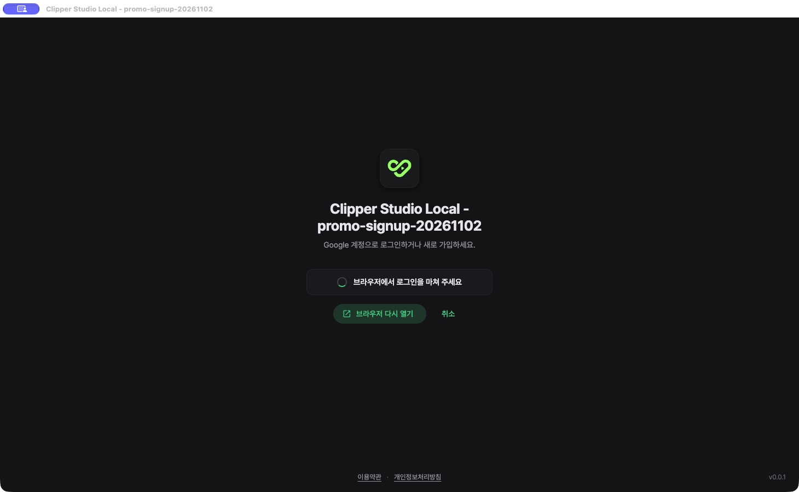
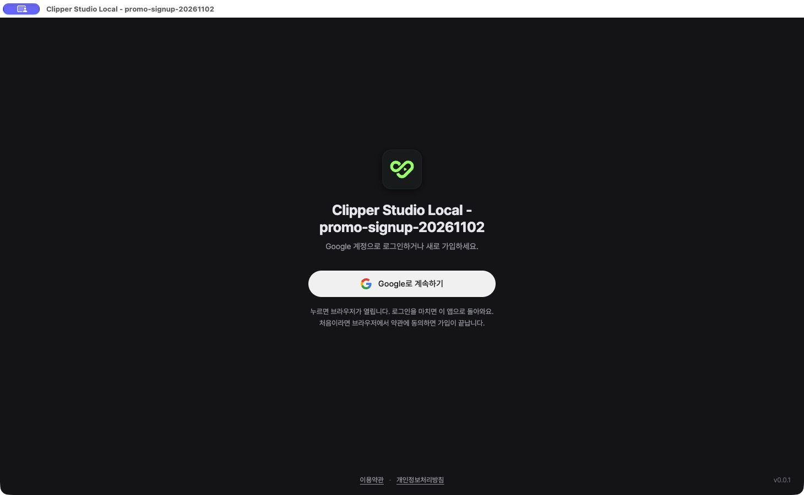
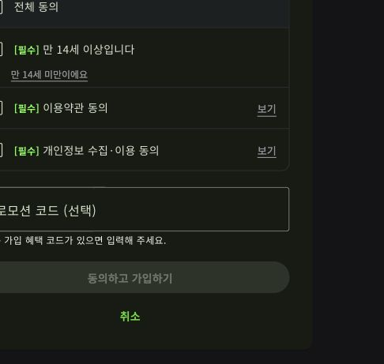

# 프로모션 작업 브랜치 전용 로컬 실행 환경

## 2026-11-03 최신 변경: 감사 이력 표시

API4340 최신 PID37139 health 정상, Admin4242 번들 갱신. 기존 감사 원본1건의 해시 유지 및 실제 화면18행 표시 확인. DB 마이그레이션/초기화 없음. Client4241·설치형 앱·다른 환경 유지. [변경 기록](../../../../../features/plugin-catalog/records/2026/11/03-readable-plugin-audit.md).

## 최신 변경: 요금제별 플러그인 관리 적용

API4340 최신 PID81887, Admin4242 최신 번들 반영. admin migration CatalogPluginSettings1793664100000 추가 적용(기존 회원·크레딧·결제·프로모션 보존). private admin dump: runtime/backups/before-plugin-settings-2026-11-02T141617555Z/admin.dump. 실제PG16검사 변경은 롤백. Client4241·웹 프로세스·설치형 앱 및 다른 환경 유지. [구현/검증](../../../../../features/plugin-catalog/records/2026/11/02-plan-plugin-settings-implementation.md).

## 최신 재초기화 요청: 테스트 데이터 삭제·4개 빌드·앱 실행 완료

2026-11-02. 사용자의 새 초기화 요청에 따라 기존 사용자/크레딧/캠페인 테스트 기록을 초기화했다. 기존 유지 지시는 이번 명시 요청 범위에서 해제되었다. 이후 사용자 테스트로 생기는 데이터는 다시 임의 초기화하지 않는다.

- 초기 상태: users1/sessions2/onboarding1/consents3/ticket1, credit_grants2/ledger2/campaign1/code1/redemption1. 주문/구독/이용권0.
- 전용 API4340만 정지 후 컨테이너 `clipper-promo-signup-local-20261102`/15438의 user/admin/release DB3개를 private runtime `backups/before-reset-20261102-222123/*.dump`로 먼저 백업(권한600)했다. 이후 명시적 DB 타깃 guard가 있는 reset-session-databases.cjs로 재생성하고 user13/admin103/release5 migration을 적용했다.
- 기존 env의 관리자2계정을 seed했다(비밀번호 유지). 초기화 후/실행 준비 최종 검증 시 users/sessions/onboarding/consents/tickets, grants/ledger/access/orders/subscriptions/campaigns/codes/redemptions, release_versions/builds/artifacts 모두0, operators2를 확인했다. 이후 사용자가 가입하면 생기는 기록은 보존한다.
- 현재 소스 API/Client/Admin 빌드와 local-api mac-arm64 앱 전체 패키징 성공. 최신 캠페인 정책/확인창의 동일 배경·구분선·흐린 왼쪽 라벨이 포함된 관리자 번들을4242에 반영했다. 웹은60587 프로세스를 유지하며 사본만 갱신했다.
- API4340 최신PID19844,3DB health 모두ok. 웹4241/4242 HTTP200. 앱 main20762/Nest20891/동적 port56212 health ok. 산출물 runtime config의API4340/localProfile/autoUpdateDisabled와 인증 공개키 일치 확인. 앱의 프로젝트·미디어 데이터는 삭제하지 않았다.
- 기존 다른 작업 API3000 PID16748/관리자4202 PID17622/DB5433·5434·5435 유지. 다른 앱에 killall/pkill 사용 없음.
- 로그 runtime `logs/latest-rebuild-{api,client,admin,app}.log`. 기존 FE 번들 예산 경고와 로컬 미서명 앱 안내는 유지. 새 제품 소스 변경/커밋/푸시/원격 배포 없음.

## 최신 후속: 종료일 미정 수정 포함 재빌드·실행

2026-11-02. 사용자 요청으로 전용 환경을 다시 점검했다. 회원/세션/가입작업/동의/티켓, 크레딧/원장/이용권/주문/구독/캠페인/코드/등록, 릴리스 데이터가 이미 전부0건이라 추가 DROP/초기화를 하지 않았다. 관리자2계정과 기본 정책/상품은 유지했다. 사용자DB15438을 다른 QA DB와 혼동하거나 지우지 않았다.

현재 소스의 API/Admin/Client 및 local-api mac-arm64 앱 전체 재빌드를 완료했다. API와 이 세션 앱만 재실행하고 웹 프로세스는 번들 교체로 유지했다. public runtime config의 API4340/localProfile/autoUpdateDisabled와 앱 안 공개키가 세션 API 공개키와 일치함을 실제 산출물에서 확인했다.

- API4340 PID14845, health user/admin/release 모두ok.
- Client4241/Admin4242 Python PID60587 유지, HTTP200 및 실제 로그인/프로모션 페이지 표시 확인.
- 앱 main16214 / 내장 Nest16285, 동적 포트51814의 `/v1/health` ok. 새 앱 로그인 화면을 표시했다.
- 전용DB migration user13/admin103/release5개, pending 없음. 캠페인 ends_at nullable=YES. 종료일 미정과 양방향 수정 검증 코드는 그대로 포함한다.
- 기존 다른 작업 API3000 PID16748·관리자4202 PID17622 및 DB5433/5434/5435 유지.
- 앱 종료 시 SIGTERM만으로는 확인창 때문에 종료되지 않아 전용 앱의 Quit→종료 확인으로 정상 종료한 뒤 빌드했다. 다른 앱에 killall/pkill을 쓰지 않았다.
- 관리자 첫 로드에서 동적 import 일시 실패가 있었지만 파일/HTTP200 확인 후 한 번 reload하여 정상 화면을 확인했다. source bootstrap을 변경하지 않았다.
- 사용자 대신 Google 가입/결제/캠페인 생성을 진행하지 않았으며 마지막 데이터 건수도0이었다. 사용자가 관리자에서 캠페인/코드를 생성한 뒤 신규 가입으로 시험할 수 있다.

로그는 runtime `logs/relaunch-{api,client,admin,app}.log`. 빌드4개 모두 통과했고 기존 FE 번들 예산 경고/미서명 로컬 앱 경고는 유지된다. 이 요청은 실행 준비이므로 제품 소스/커밋/푸시/원격 배포 변경 없음. 이제 환경을 실행 상태로 유지하고 후속 명시 요청 없이 종료/초기화하지 않는다.

## 최신 후속: 사용자 요청으로 전용 DB 초기화·앱 재빌드 완료

2026-11-02. 사용자가 다시 DB 초기화와 API/Admin/Client 실행, local-api 앱 재빌드·실행을 명시 요청했다. 이전 테스트 데이터 유지 지시는 이 **전용 환경에 대한 이번 초기화 요청**으로 해제되었다. 이후에는 다시 사용자가 요청하기 전 임의 초기화/종료하지 않는다.

- 전용15438 컨테이너의 clipper_promo_user/admin/release3DB를 모두 private runtime `backups/before-user-requested-reset/*.dump`로 백업 후 재생성했다. user13/admin102/release5 migration과 관리자 seed2개 적용. 기본 상품·정책은 migration 기본값이다.
- 실제 COUNT: users/user_sessions/user_onboarding_jobs/user_consents/signup_ticket_redemptions, credit_grants/credit_ledger_entries/user_access_grants/payment_orders/subscriptions/promotion_campaigns/promotion_codes/promotion_redemptions, release_versions/release_builds/release_artifacts 전부0. operators만2개.
- API4340 새 PID7681, DB3개 health ok. 웹4241/4242 기존 Python60587을 유지하며 두 URL HTTP200. 기존API3000/관리자4202/DB5433·5434·5435는 변경하지 않았다.
- 세션 전용 mac-arm64 앱 전체 재빌드 성공(Angular packaged/Nest ncc/Electron tsc/uv/electron-builder). 공개 설정 webApiBaseUrl=http://127.0.0.1:4340, localProfile=promo-signup-20261102, autoUpdateDisabled=true, bundled JWT public key가 서버 전용 공개키와 동일함을 확인했다.
- 새 앱 main PID8088, 내장 Nest PID8131/port65380의 /v1/health ok. 앱 로그인 화면을 CUA로 확인했다. 기존 다른 작업의 원본 dev 앱 main18096/helper18126은 유지한다. 앱의 로컬 프로젝트/미디어 데이터는 삭제하지 않았다.
- 최초 보조 스크립트의 createRequire 상대경로 오류는 DB 삭제 전 발생했다. 절대 경로로 바로잡은 재실행에서 전체 초기화/seed/기동을 완료했고 백업을 보존했다.
- 빌드 로그: 전용 runtime/logs/app-rebuild-clean-db.log. API/웹 관리: 기존 manage.py. 비밀번호·서명 비밀키는 문서에 기록하지 않는다.
- 제품 소스 수정·추가 커밋·푸시 없음. 실제 Google 회원가입이나 크레딧 지급을 실행하지 않아 빈 회원 DB 상태를 유지했다.

2026-11-02 KST. 사용자가 이 브랜치의 회원/크레딧/결제 등을 완전히 초기화한 DB, local-api 앱 빌드와 API/Admin/Client 실행을 요청했다. **아래 환경은 실행 상태로 남긴다. 임시 QA처럼 종료하지 않는다.**

## 접속과 앱

| 대상 | 전용 주소/위치 |
|---|---|
| 클라이언트 | http://127.0.0.1:4241/ |
| 관리자 | http://localhost:4242/ (127.0.0.1:4242도 허용) |
| API | http://127.0.0.1:4340/health |
| DB | 컨테이너 `clipper-promo-signup-local-20261102`, loopback15438 |
| 앱 | `Clipper Studio Local - promo-signup-20261102.app` |
| 앱 산출물 | `/Users/jina/project/adlight/.worktrees/signup-promotion-plugin-access-20261028/desktop/clipper_electron/dist-app/mac-arm64/Clipper Studio Local - promo-signup-20261102.app` |
| 앱 데이터/로그/캐시 | `~/Library/Application Support/Clipper Studio Local - promo-signup-20261102` |

관리자 계정은 원본 로컬 env의 seed 설정을 사용해 생성했다. `superadmin@gmail.com`은 super-admin/active, `admin@gmail.com`은 developer/active다. 비밀번호는 기존 로컬 값이며 `.local-runtime/promotion-signup-20261102/admin-login.txt`에만 보관한다. 문서/패키지에 비밀값을 복사하지 않는다.

## DB 초기화 범위

기존 DB를 지우는 대신 이 브랜치용 **새 PostgreSQL16 컨테이너/3개 DB**를 생성했다. 이름은 `clipper_promo_user`, `clipper_promo_admin`, `clipper_promo_release`. 사용자13/관리자101/릴리스5개 마이그레이션을 빈 DB에 적용했다. 상품/정책 설정은 마이그레이션 기본값이며 기존 운영 데이터나 이전 검증 픽스처를 복사하지 않았다.

준비 후 실제 COUNT 확인: users/sessions/onboarding, credit_grants/credit_ledger_entries/user_access_grants, payment_orders/subscriptions, promotion_campaigns/codes/redemptions **모두0**. 관리자 계정2개만 seed로 준비했다. 관리자 로그인 API201, 인증된 캠페인 목록200/0건을 확인했다. 이후 사용자의 테스트로 생기는 데이터는 유지한다. 재실행 스크립트는 DB를 다시 초기화하지 않는다.

기존 원본 API3000(PID16748), 관리자4202(PID17622), 개발 앱(PID51561/51589), DB5433/5434/5435를 중지·초기화·교체하지 않았다. 앞선 자동 검증 컨테이너15437도 중지 상태로 보존한다. 다른 작업 중인 Python 원본의 미커밋 파일은 건드리지 않고 origin/dev `4b54bced17e13aadbeb97be75259b7f7213a9b24`의 tracked 스냅샷만 앱 패키지에 사용했다.

## 실행 분리 구현

Electron 기존 local-api 기본값은3000, development identity의 경로는 기존 앱과 같았다. 같은 브랜치에 loopback 전용 `CLIPPER_LOCAL_API_BASE_URL`과 안전한 basename `CLIPPER_LOCAL_PROFILE`을 추가했다. --local-api에서만 허용하고 원격 URL·경로·사용자정보·잘못된 프로필은 거절한다. 일반 dev/prod 기본값은 유지했다.

이번 빌드 값은 API `http://127.0.0.1:4340`, profile `promo-signup-20261102`다. 고유 bundleID/name과 userData/sessionData/log/cache를 적용하고 공통 URL scheme을 등록하지 않는다. 앱 로그인은 기존 request ID/S256 검증을 유지하는 loopback 반환을 쓴다. 내장 Nest와 plugin bridge는 기존 앱과 다른 동적 포트로 시작했다(확인 시58159/58157, 기존54632/54628). 자동 업데이트는 꺼진 local-api 빌드다. 앱 번들에는 공개키만 넣고 API의 비밀키/Google 비밀값은 전용 서버 설정에만 둔다.

초기6개 회귀 시험 RED 후 전체 Electron1,913/1,913·tsc·mac arm64 local-api 패키징이 통과했다. 처음 전체 실행의2개 실패는 새 공개 프로필키 기대 목록과 아직 생성 전이던 Nest bundle fixture였다. 목록/패키징 완료 뒤 전체가 통과했다. [독립 검토](02-promotion-branch-local-evidence/electron-local-profile-review.md)는 Critical/Important/Minor 지적 없음이다.

## Google 로그인

새 callback은 `http://127.0.0.1:4340/auth/google/callback`이다. 초기 Google redirect_uri_mismatch를 확인한 뒤 사용자가 기존 OAuth 클라이언트에 해당 주소를 **추가 완료**했다고 답했다. 재확인 시 정상 Google 로그인 화면으로 진입했다. 사용자 계정 로그인이나 실제 가입은 대신 수행하지 않았다.

웹 기본 주소는127.0.0.1:4241이며 localhost4241/4242와127.0.0.1:4241/4242를 전용 API의 CORS에 허용했다. 패키징 renderer의 Origin:null도 이 loopback API에서 허용한다. 실제 localhost:4242 로그인 preflight 응답과 API3DB health를 확인했다. 기존 API/Google 설정은 수정하지 않았다.

## 가입 화면 후속 수정

사용자 후속 요청으로 `프로모션 코드 (선택)` 입력란을 필수 동의 영역 아래, 가입 버튼 위로 이동했다. 동의/코드 검증 동작은 바꾸지 않았다. 기존 signup-consent42개 시험과 Client build 통과 후 실행 중인4241 산출물에 반영했다. 회원 생성 없이 단기 서명 대기표로 실제 화면만 확인했으며 필수 동의 영역 bottom566.86px/코드 입력 top586.86px로 아래20px 간격을 확인했다. 확인용 대기표/탭은 취소·정리했고 가입을 제출하지 않았다.

## 시작/상태/종료와 구성 위치

전용 runtime: `/Users/jina/project/adlight/.worktrees/signup-promotion-plugin-access-20261028/.local-runtime/promotion-signup-20261102`.

`python3 <runtime>/manage.py status|start|stop`은 **이 환경의 API/웹 두 프로세스만** 관리한다. 모르는 PID나 점유 포트를 강제로 종료하지 않는다. DB는 `docker start clipper-promo-signup-local-20261102`로 재개할 수 있으며 삭제/초기화하지 않는다. 앱은 해당 .app을 열고 닫는다. 기존 앱을 대상으로 pkill/killall하지 않는다.

Node24.19.0 사용. 웹은 이 브랜치의 빌드 산출물 복사본을 serve하며 API origin만4340으로 바꿨다. 소스 수정은 build 후 client/admin 해당 runtime 복사본에 반영해야 한다(ng serve HMR 모드가 아님). 서버는 별도 세션으로 실행해 현재 채팅/빌드 명령 종료에 함께 종료되지 않게 했다. 로그는 `<runtime>/logs/`에 있다. private env/키/비밀번호는 runtime 밖으로 기록하지 않는다.

커밋·푸시·병합·배포는 하지 않았다. 앞선 [구현/검증 기록](../../../../../features/promotions/records/2026/11/02-ai-booth-signup-free-implementation-and-verification.md)의 manifest는 그 작업 완료 당시 스냅샷이며, 이번 Electron 로컬 프로필과 가입 UI 이동은 [이번 manifest](02-promotion-branch-local-evidence/source-manifest.json)로 구분한다.
