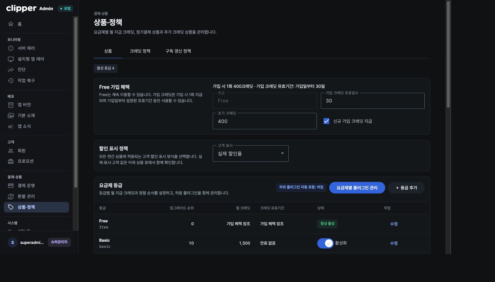
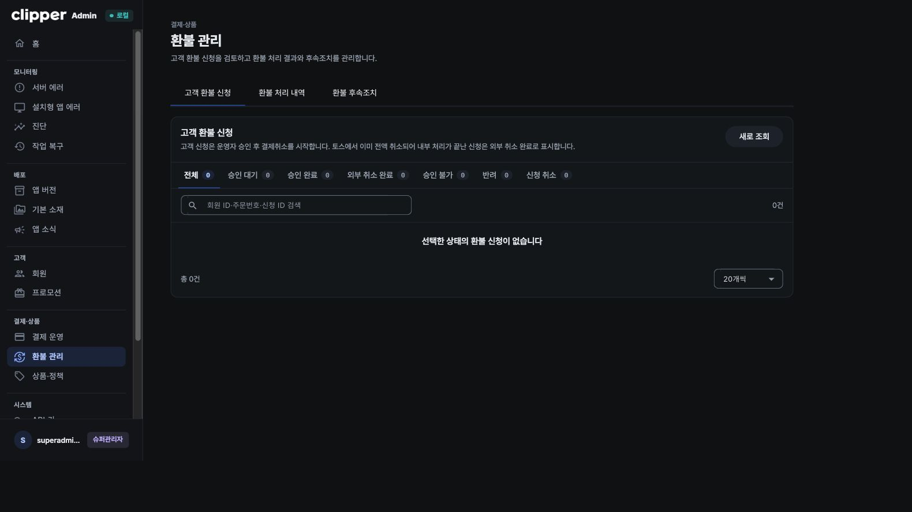
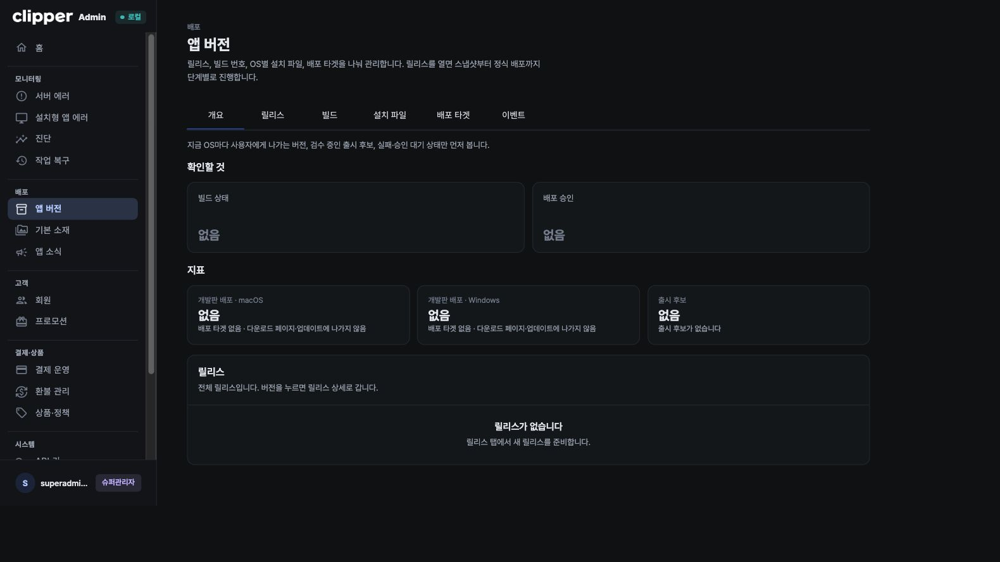
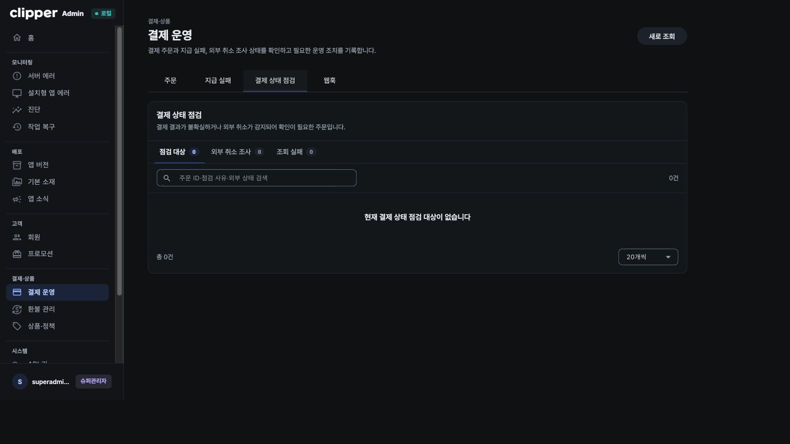

# 원본 로컬3DB 백업·31개 마이그레이션 적용 및 관리자 검증

2026-11-04 KST. 사용자 요청에 따라 원본 로컬DB만 백업한 뒤 미적용31개를 정식 TypeORM 마이그레이션으로 적용했다. 원본DB 초기화·소스 수정·공유 .gitignore 변경은 하지 않았다.

## 완료 결과

| 원본 DB | 포트 | 이번 적용 | 적용 후 총 이력 | 미적용 |
|---|---:|---:|---:|---:|
| clipper_user | 5435 | 2 | 13 | 0 |
| clipper_admin | 5433 | 27 | 115 | 0 |
| clipper_release | 5434 | 2 | 5 | 0 |

세 DB 모두 원본 `.env`의 localhost 연결과 실제 컨테이너 포트 매핑·current_database를 확인했다. 다른 worktree DB15438·564xx 및 개발/운영 서버는 대상에 포함하지 않았다. source HEAD는 `197af457fc00517de11e0f89fbb7c78863ca897c` 그대로다.

## 백업

백업 위치: `/Users/jina/project/adlight/.local-runtime/original-db-migration-20261104-040308/backups/`

- user.dump: 25,008 bytes / archive TOC50 entries
- admin.dump: 1,155,960 bytes / archive TOC355 entries
- release.dump: 22,080 bytes / archive TOC51 entries

각 원본 컨테이너의 pg_dump로 custom archive를 만들었고, 세 백업을 모두 끝낸 뒤 적용을 시작했다. 파일 권한600, SHA256 기록, pg_restore --list 및 --file=/dev/null로 전체 archive 읽기·복호화 없는 압축 해제 검증을 완료했다. 이는 별도 DB에 복원하여 동작시킨 시험은 아니다. 이후 최종 검사에서도 세 파일 해시가 동일함을 확인했다. 실제 DB 데이터가 든 dump·기존 env 백업은 private runtime 안에만 보관했고 문서 repo로 복사하지 않았다.

백업 manifest: `/Users/jina/project/adlight/.local-runtime/original-db-migration-20261104-040308/backup-manifest.json`

## 적용과 데이터 보존

승인된 pending 이름31개가 직전 조회와 동일한지 guard하고, 각 DataSource의 runMigrations({transaction:'all'})로 user→admin→release 순서로 적용했다. DB별 전체 트랜잭션이며 세 DB를 묶는 분산 트랜잭션은 아니다. 전체31개가 성공했다. reset·synchronize·수동 임의 CREATE로 우회하지 않았다.

backup의 data-only COPY 구간에서 주요 테이블의 행 개수만 추출해 실제 DB와 비교했다. 사용자1, 사용자 세션11, 가입 작업1, 동의3, 관리자3, 크레딧 grant3, 원장108, 요금제4, 상품6 등의 기존 행 개수가 동일했다. 결제·가상계좌 삭제 후보·프로모션·환불·릴리스 행은 기존0건이며 적용 후에도0건이다. 인증정보·행 내용은 증거에 넣지 않았다.

승인된 migration에 따라 Free 전환·상품6개 가격 및 등급별 크레딧·플러그인 설정·기타 정책/스키마는 갱신됐다. 기존 값 전체를 그대로 유지한 작업이라는 뜻은 아니다.

## 릴리스 관리의 별도 설정 해결

적용 직후 catalog·환불 요청·결제 대사는200이었지만 release-console은503과 `DESKTOP_RELEASE_TARGET must be explicitly configured`를 반환했다. DB 쿼리는 통과한 뒤 별도 로컬 설정 누락이 드러난 것이다.

사용자가 추가 질문에서 **로컬 설정 추가와 API3000 재시작을 명시 승인**했다. 기존 `.env`를 private runtime의 `api-env-before-release-target.private`에 권한600으로 백업하고, 비추적 원본 `.env`에 `DESKTOP_RELEASE_TARGET=development`만 추가했다. dotenv로 변경 전후 키를 비교해 그 한 항목만 바뀌었음을 확인했다. API PID81330을 SIGTERM으로 종료하고 같은 원본에서 Node24.19 `node dist/main`으로 재시작했다. 새 PID14957. 4201/4202는 같은 프로세스를 유지했다. 원격 릴리스 실행기 활성화나 빌드·게시·배포 요청은 하지 않았다.

## 실제 기능 검증

기존 로컬 관리자 계정으로 로그인해 아래 조회 요청을 실제API에 보내 모두 HTTP200을 확인했다. 인증값과 응답의 개인정보는 출력·기록하지 않았다. 직접 API 검증 세션은 자기 세션만 로그아웃했다.

| 관리자 기능 | 실제 요청 | 최종 결과 |
|---|---|---|
| 상품·정책 | GET /admin/catalog | 200 |
| 고객 환불 신청 | GET /admin/customer-refund-requests?limit=20&offset=0 | 200 |
| 앱 버전/릴리스 | GET /admin/release-console | 200 |
| 결제 상태 점검 | GET /admin/payments/reconciliation?limit=20&offset=0 | 200 |
| DB health | GET /health | 200, user/admin/release 모두ok |

실제4202 관리자 UI에서도 로그인한 뒤 상품·정책(Free·4등급·새 상품가격), 고객 환불 신청(0건), 앱 버전 개요, 결제 상태 점검(0건)을 열어 정상 표시를 확인했다. API 재시작 이후 해당 검증 탭 console error0건이었다. 결제·환불 실행·새 릴리스 생성·가격 수동 저장은 하지 않았다. UI 검증용 로그인도 로그아웃하고 이번에 만든 탭만 닫았다. 사용자 기존 브라우저 탭·로그인 세션은 조작하지 않았다.

## 최종 상태 — 04:07:57 KST

- 원본 Client4201 PID98035 / Admin4202 PID98036: 기존 프로세스 유지, HTTP200.
- 원본 API3000 PID14957: 승인된 설정 변경 후 재시작, HTTP200 및3DB ok.
- 별도4241·4242·4340: 계속 종료 상태.
- 원본8개 Git status 모두 비어 있음. 소스·공유 .gitignore 수정 없음.
- 새 API 로그에 QueryFailedError/누락 스키마 오류0건.
- 기존 서버 오류 이력은 삭제하거나 상태를 임의 변경하지 않았으므로 과거 목록에 남을 수 있다. 새 조회 정상 여부와 과거 오류 이력을 구분한다.

같은 이름 JSON에 안전한 metadata와 적용31개 목록·최종 검증을 저장했다. 백업/실행 로그/검증 원본은 위 private runtime에 있다.
