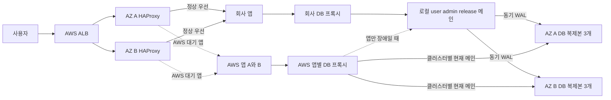

# 클리퍼 로컬 메인과 AWS 보조 운영 상세 설계

> 2026-10-28 재점검: COMMIT 취소 경고의 성공 판정, COMMIT 기한, 부분 통신 장애, 점검 중 쓰기 차단, worker 인계, 최초 bootstrap에 보완할 계약이 확인됐다. 이 문서를 배포 가능한 최종 명세로 간주하지 않는다. [남은 결정·조사·검증 점검표](28-local-primary-aws-standby-remaining-audit.md)의 보완 사항을 함께 적용한다.

설계 기준일: 2026-10-28. 회사 정전과 회사 인터넷 단절을 대상으로, 성공으로 확정한 회원·결제 데이터를 보존하고 AWS에서 운영을 이어간다. 정상 시 사용자 요청과 DB 쓰기는 회사에서 처리한다. AWS 앱과 복제 DB는 항상 실행한다.

이 문서는 채택할 기준 구성, 안전 조건, 장애별 상태 전이, 결제 처리, 도입과 복귀, 백업, 인수 시험을 지정한다. 장비 주소·AWS 계정 ID·비밀값은 배포 인벤토리로 분리한다. 시간과 용량 수치는 아래 인수 시험의 설계 기준이며 측정 결과로 표현하지 않는다.

## 1. 보호 범위와 완료 조건

- 보호 장애: 회사 전원 전체 차단, 회사 WAN 전체 단절, VPN 단절, 앱 프로세스 종료, DB 프로세스 종료, 연결 복구 중 재단절. 개별 AWS 노드 장애에서도 안전한 데이터 사본을 우선한다.
- 데이터 목표: 성공으로 확정한 DB 트랜잭션의 RPO 0. 성공은 애플리케이션이 필요한 동기 커밋을 확인한 후 반환한 성공이다. 결제사의 승인만으로 우리 서비스의 결제 완료를 확정하지 않는다.
- 진행 중 요청: 결과 불명 상태를 허용하고 동일 작업 ID로 조회·재처리한다. 고객이 다시 클릭했다고 별도 결제를 생성하지 않는다.
- 복구 목표: 회사 정전·WAN 차단 후 외부에서 인증·DB 쓰기가 다시 성공하기까지 p95 40초 이하, 시험 중 최대 60초 이하를 초기 인수 기준으로 삼는다. 앱만 종료되고 DB가 정상인 경우 p95 10초 이하를 목표로 한다. 이 값은 사용자에게 약속한 SLA가 아니라 이 기준 구성의 합격선이다.
- 결제사 응답 대기와 기존 미확정 거래의 대조 완료 시간은 API 재개 시간과 따로 측정한다. 단절 직전 결제는 API 복구 후에도 확인 중일 수 있다.
- 데이터 보존 조건과 복구 시간 기준이 충돌하면 쓰기를 중단한다. 시간 기준을 맞추기 위해 비동기 저장이나 뒤처진 DB의 강제 승격을 하지 않는다.
- 정상 부하의 2배로 30분 시험하고, 동기 커밋 지연 p95 150ms 이하·p99 500ms 이하를 초기 성능 기준으로 삼는다. 결제사·LLM 호출 시간은 별도 계측한다. 기준 미달 시 네트워크/용량을 조정하고 같은 시험을 다시 한다.

## 2. 현재 코드에서 유지할 것과 바꿀 것

| 확인 근거 | 설계에 반영하는 내용 |
|---|---|
| `web/clipper_infra/db/compose.yml` | user/admin/release는 3개의 독립 PostgreSQL이다. 하나로 합치지 않고 DB별 3노드 클러스터를 만든다. 총 9개 PostgreSQL 노드다. |
| `web/clipper_infra/runbooks/production-deployment-team-guide.md` | 기존 운영 앱은 m4-prod, 개발·운영 DB는 m2-db, HTTPS 입구는 m2-proxy로 기술돼 있다. 새 공개 입구를 AWS에 두고 운영 DB를 개발 DB와 분리한다. |
| `src/core/health/health.controller.ts`, `src/core/database/db-health.service.ts` | 현재 health는 DB 실패를 본문에 담고 HTTP 200을 반환할 수 있다. 이를 전환 판단에 쓰지 않고 별도 readiness 계약을 만든다. |
| `src/modules/payments/application/payment-recovery.scheduler.ts` | 매분 정기 결제·복구 등이 실행된다. HTTP 요청이 없어도 실행되는 작업을 전환 설계에 포함한다. |
| `payment-refund-recovery.scheduler.ts` | 환불 복구는 10초마다 실행된다. 프로세스별 running 플래그만으로 사이트 간 소유권을 판단하지 않는다. |
| `typeorm-payment-orders.repository.ts`, `typeorm-payment-refunds.repository.ts` | advisory transaction lock, 행 잠금, SKIP LOCKED, 처리 lease가 이미 있다. 이를 유지하고 새로운 메인 DB에서 동일 작업을 재확인한다. 중복 처리 장치가 없다고 가정하지 않는다. |
| `http-toss-payments.provider.ts` | 멱등키 전달과 결과 불명 예외가 이미 있다. 승인 계열의 타임아웃과 복구 정책을 통일한다. |
| `subscription-payments.service.ts`의 scheduled initial 처리 | 작업 준비 트랜잭션과 외부 청구가 분리된 흐름이 있다. 외부 호출 전 준비 정보의 동기 커밋을 모든 결제 경로의 공통 조건으로 삼는다. |

위 경로는 `/Users/jina/project/adlight` 기준이며 API 경로는 `web/clipper_web_api/` 아래다. 현재 문서의 장비 주소를 배포 자동화의 실제 주소로 추정해서 사용하지 않는다.

## 3. 채택하는 구성과 제외한 대안

채택: PostgreSQL 16 물리 스트리밍 동기 복제, Patroni 4.1.5, etcd v3 API, AWS 서울 리전의 서로 다른 두 AZ, 상시 실행 EC2 앱, ALB와 HAProxy, Site-to-Site VPN, pgBackRest와 S3.

- 꺼둔 앱·DB를 장애 후 켜는 방식은 복구 목표와 맞지 않아 제외한다.
- 비동기 복제와 백업만으로 전환하는 방식은 정전 직전 확정 데이터 보존 조건과 맞지 않아 제외한다.
- RDS를 로컬 PostgreSQL의 네이티브 물리 대기 노드로 사용하는 구성은 채택하지 않는다. 이번 구성은 로컬 메인을 유지하므로 AWS DB도 직접 운영한다.
- ALB만으로 로컬 우선·AWS 대기 우선순위를 구현하지 않는다. 이 우선순위는 두 AWS HAProxy가 담당한다. DB 메인 선정은 Patroni가 담당한다.
- Kubernetes, 자체 DB 선거 알고리즘, DB 간 분산 트랜잭션은 도입하지 않는다.

### 3.1 실행 단위

| 위치 | 노드 | 역할과 초기 자원 기준 |
|---|---|---|
| 회사 | 기존 운영 앱 맥미니 | customer/admin 웹·API 컨테이너, 앱 로컬 DB 프록시. 운영 중 이미지 빌드 금지. |
| 회사 | 운영 전용 Linux DB 호스트 | Ubuntu 24.04 LTS x86_64, 최소 12 CPU 스레드·48GiB RAM, SSD, UPS. KVM으로 user/admin/release 전용 Linux VM 3개를 실행한다. 각 VM 2 vCPU·8GiB RAM부터 시작한다. 개발 DB는 이 호스트에서 실행하지 않는다. |
| 회사 | control-local VM | etcd 노드 1개, 2 vCPU·4GiB RAM. DB 호스트와 전력 장애 범위를 공유해도 AWS 두 노드로 과반수가 남는다. |
| AWS AZ A | db-user-a / db-admin-a / db-release-a | 각각 독립 EC2 Linux 노드. 각 2 vCPU·8GiB RAM, 비버스터블 범용 인스턴스부터 시작한다. PostgreSQL과 Patroni 및 watchdog만 실행한다. |
| AWS AZ B | db-user-b / db-admin-b / db-release-b | A와 같은 구성. 각 DB별 다른 AZ 사본. |
| AWS AZ A | app-a | 4 vCPU·16GiB RAM. 웹·API, HTTP/DB HAProxy, etcd-a. etcd는 독립 systemd 서비스와 전용 gp3 볼륨, CPU·메모리 예약을 둔다. |
| AWS AZ B | app-b | app-a와 같은 구성. etcd-b. 앱 배포는 etcd·HAProxy를 재시작하지 않는다. |

AWS 기준 구성은 **EC2 8대**다. DB 6대와 앱/라우터/제어 2대이며, DB 3분리를 유지하고 각 PostgreSQL에 독립 watchdog을 주는 선택이다. 각 앱 노드는 단독으로 전체 피크 부하를 감당해야 한다. etcd에 최소 1 vCPU·2GiB RAM을 예약하고 앱에는 메모리 상한을 둔다. 동시 자원 압박 시험이 실패하면 etcd를 독립 노드로 분리하며 안전 기준을 낮추지 않는다.

DB 데이터 볼륨은 노드별 `max(100GiB, 현재 DB 크기×3 + 피크 WAL 생성량/초×7200)` 이상으로 산정한다. gp3 3,000 IOPS/125MiB/s에서 시작하고 측정에 따라 올린다. user/admin/release 각각의 크기와 WAL을 측정한다. etcd 데이터는 20GiB 이상 별도 볼륨에 두고 DB·로그와 디스크 큐를 공유하지 않는다.

하드웨어 이름은 선거 규칙을 바꾸지 않는다. Mac·Windows 모두 로컬 앱으로 사용할 수 있다. **이번 기준안은 운영 DB의 OS와 차단 장치를 Linux VM 단위로 통일한다.** 기존 macOS Docker Desktop의 DB 컨테이너에 watchdog을 얹는 방식은 채택하지 않는다. 로컬 DB 호스트의 확보가 이 기준안의 자원 요건이다. macOS나 Windows 위 VM 유지가 반드시 필요하다면 이 실행 프로파일의 변경이며, 현재 안과 동일하다고 간주하지 않는다.

### 3.2 전체 경로

AZ별 DB 승격 결과는 서로 다를 수 있다. 예를 들어 user는 A, admin은 B가 메인이어도 지원한다. 세 DB를 같은 노드로 억지로 동시에 승격하지 않는다.

공개 입구를 AWS에 두므로 정상 요청도 ALB/라우터에서 회사 앱까지 WAN을 지난다. 정상 시 앱의 일반 DB 조회는 회사 내부에서 끝나지만, HTTP 요청 경로와 DB 쓰기 확정에는 회사↔AWS 지연이 들어간다. 이것을 지연이 전혀 없는 로컬 운영으로 설명하지 않는다. 공개 입구가 회사 정전과 함께 사라지지 않고 DNS 변경 없이 전환되도록 선택한 경로다.

## 4. 절대 바꾸지 않을 안전 조건

1. DB 클러스터별 쓰기 메인은 최대 1개다. 공개 트래픽 라우팅이 메인 권한을 생성하지 않는다.
2. 성공 확정은 현재 메인의 동기 커밋 완료 후에만 한다. 복제 불가 시 비동기로 전환하지 않는다.
3. 정상 3노드 상태에서는 로컬과 AWS 두 사본의 저장을 확인한다. 한 노드가 빠지면 남은 두 노드의 저장을 확인한다. 하나만 남으면 쓰기를 확정하지 않는다.
4. 승격은 Patroni가 안전하다고 판단하는 동기 후보에서만 한다. 지연 허용 바이트 값을 0으로 설정한 것만으로 안전하다고 판단하지 않는다.
5. DCS 과반수를 잃은 메인은 권한 만료 전에 PostgreSQL 쓰기를 중단한다. 실패 시 watchdog이 해당 DB VM/인스턴스를 리셋한다.
6. 응답을 받지 못한 COMMIT은 실패로 단정하지 않는다. 로컬에서 행이 보인다는 이유만으로 사용자 성공이나 외부 결제를 확정하지 않는다.
7. 단절된 이전 메인의 데이터 파일을 새 메인에 병합하거나, 오래된 DB를 강제 메인으로 올리지 않는다.
8. 전환 후 로컬이 돌아와도 자동으로 운영 요청을 되돌리지 않는다. 완전한 동기화 후 운영자가 계획된 복귀를 수행한다.

## 5. PostgreSQL과 Patroni

### 5.1 DB별 독립 클러스터

세 scope는 `clipper-prod-user`, `clipper-prod-admin`, `clipper-prod-release`다. 각 scope에 `local`, `aws-a`, `aws-b` 노드를 둔다. DCS namespace와 데이터 디렉터리·복제 계정·포트를 분리한다. 한 DB의 승격이나 마이그레이션이 다른 DB의 원자적 변경을 보장하지 않는다. 교차 DB 업무는 기존 ID 참조와 재처리 가능한 단계로 유지한다.

PostgreSQL 16을 유지하되 새 노드는 모두 같은 x86_64 Linux 배포판과 같은 패치 버전·확장 버전으로 만든다. 최초 전환은 논리 dump/restore로 수행해 기존 ARM/Alpine 데이터 파일의 직접 복사를 피한다. 새 클러스터 안의 후속 복제는 물리 복제다.

### 5.2 기준 설정

| 설정 | 기준값 |
|---|---|
| `synchronous_mode` | `on` |
| `synchronous_mode_strict` | `true` |
| `synchronous_node_count` | `2` |
| `ttl` / `loop_wait` / `retry_timeout` | `20` / `1` / `3`초 |
| `primary_start_timeout` / `primary_stop_timeout` | `0` / `3`초 |
| `failsafe_mode` | `false` |
| `check_timeline` | `true` |
| `use_pg_rewind`, data checksums | 활성화 |
| PostgreSQL `synchronous_commit` | `on` |
| `fsync`, `full_page_writes` | `on` |
| watchdog | `mode=required`, `safety_margin=-1` |
| 복제 슬롯 | Patroni 관리. 디스크 용량에 맞춘 상한과 부족 경보 |

`1 + 2×3 <= 20`을 만족한다. 동기 노드 수 2는 적격 노드 수가 줄면 Patroni가 조정한다. strict는 복제본이 전혀 없을 때 단독 쓰기로 내려가지 못하게 한다. 따라서 항상 3사본을 약속하는 설정이 아니라 정상 3사본·장애 후 최소 2사본 정책이다. `synchronous_standby_names`를 별도 자동화가 덮어쓰지 않는다. 앱 역할은 비관리자이며 코드/마이그레이션에 동기 커밋을 끄는 문장을 금지한다. 실제 세션 값도 감시한다. [Patroni 설정](https://patroni.readthedocs.io/en/latest/dynamic_configuration.html), [동기 모드](https://patroni.readthedocs.io/en/latest/replication_modes.html)

영구 저장 ACK는 WAL의 디스크 flush를 의미한다. 기본은 `on`이며 `remote_write`로 낮추지 않는다. `remote_apply`를 필수로 하지는 않고, AWS replay 지연을 별도 관리한다. 동기 복제 지연이 길면 쓰기 지연을 감수하며 성공 응답을 먼저 보내지 않는다. [PostgreSQL WAL 설정](https://www.postgresql.org/docs/16/runtime-config-wal.html)

### 5.3 정상 트랜잭션과 불명 결과

앱은 상위 트랜잭션의 COMMIT 완료를 기다린다. 쿼리 한 문장이 끝난 시점이나 트랜잭션 콜백 내부에서 성공 응답·외부 청구를 보내지 않는다.

COMMIT 중 연결이 끊기거나 대기 중 취소되면 결과를 `unknown`으로 취급한다. 요청의 동일 idempotency ID로 현재 메인에서 결과를 확인한다. 결과 불명 요청은 새 주문번호/새 멱등키로 자동 전환하지 않는다. 같은 ID에 다른 요청 내용이 오면 요청 hash 비교로 거절한다.

**독립적인 조회 요청도 이 규칙의 적용 대상이다.** 취소된 COMMIT의 행은 다른 연결에 보이지만 원격에는 없을 수 있다. 회원 가입·활성화, 결제 완료·환불 완료·이용권 부여 등을 외부에 확정 상태로 공개하는 모든 경로에 공통 내구성 확인 절차를 둔다. 신규 처리에서 해당 변경의 동기 COMMIT 성공을 직접 확인한 경로는 그대로 응답한다. 기존 행을 읽고 완료를 반환하는 상태조회·재요청의 조기 반환·웹훅 처리·worker 재실행은 현재 메인에서 관련 상태를 읽고 잠근 뒤, 실제 WAL을 발생시키는 확인 기록을 추가하고 **새 동기 COMMIT의 성공 이후에만** 완료 응답 또는 외부 효과를 허용한다. 단순 SELECT, readiness 캐시, 아무 변경도 없는 `ON CONFLICT DO NOTHING`은 이 확인을 대신하지 않는다. 확인 기록 자체가 보인다는 이유만으로 다음 요청의 확인을 생략하지 않는다. [COMMIT 대기 취소의 예외](https://patroni.readthedocs.io/en/latest/replication_modes.html)

확인 기록은 DB별 전용 테이블에 `(request_id, business_id, observed_version, checked_at)`를 새로 쓰는 방식으로 구현한다. 원래 업무 행을 읽은 이후 같은 DB에 발생한 WAL이 동기 저장됨을 확인하는 용도다. 여러 DB의 업무 완료를 공개하면 관련 DB 각각의 확인을 끝낸다. 재시도는 확인용 request ID를 새로 만들되 실제 주문·결제의 business ID와 결제사 멱등키는 유지한다. 확인 기록은 7일 후 정리할 수 있으며 원장은 삭제하지 않는다. 인증·권한 발급도 유실 가능한 신규 회원/이용권 상태를 근거로 성공시키지 않도록 같은 규칙에 포함한다. 이 설계에서는 금융·회원 확정 상태 응답을 CDN이나 프로세스 캐시에서 바로 반환하지 않는다.

## 6. 메인 권한과 실제 쓰기 차단

etcd는 local/a/b 총 3개 voting member로 구성하고 2379/2380 mTLS를 사용한다. office가 사라져도 AWS 두 개가 과반수를 유지한다. 모든 client는 세 endpoint를 알고, 로컬 endpoint만 바라보지 않는다. heartbeat 250ms, election timeout 2,500ms를 초기값으로 사용한다. 세 노드의 시간값은 같게 설정한다. 회사↔AWS RTT p99와 디스크 지연을 측정해 선거가 반복되면 값을 늘리고 RTO 시험을 다시 한다. [etcd 조정 원칙](https://etcd.io/docs/v3.6/tuning/)

각 PostgreSQL은 독립 Linux VM/EC2에서 Patroni에 의해서만 시작된다. OS의 별도 PostgreSQL 자동 시작 서비스를 비활성화한다. VM 3개가 호스트의 watchdog 한 개를 나눠 갖지 않는다. 각 VM에 개별 watchdog 인터페이스를 제공하며 로컬 KVM은 가상 watchdog의 reset 동작을 설정한다. EC2에서는 Linux softdog를 사용하고 실제 재부팅을 비활성화하는 `soft_noboot` 옵션은 금지한다.

Patroni가 메인으로 승격되기 전에 watchdog을 확보해야 한다. `ttl=20`, `safety_margin=-1`이면 watchdog의 목표 만료는 10초다. 정상 강등은 PostgreSQL 중단이며, 관리 루프가 진행되지 않으면 watchdog이 노드를 리셋한다. watchdog이 설치되지 않았거나 실제 reset 대신 로그만 남기면 그 노드는 메인이 될 수 없다. [watchdog의 동작과 지원 범위](https://patroni.readthedocs.io/en/latest/watchdog.html)

**VM 메모리를 멈췄다가 그대로 재개하는 운영은 금지한다.** 가상 watchdog의 시간도 VM 정지와 함께 멈출 수 있어, 그 장치만으로 오래된 메모리 상태의 재개를 보호한다고 주장하지 않는다. libvirt 운영 역할은 suspend/resume, managed-save, RAM snapshot/restore, live migration 권한을 갖지 않는다. 배포 자동화도 이 동작을 제공하지 않는다. I/O 오류 후 자동 resume 등 자동화의 복원 경로에도 같은 금지를 적용한다. 호스트와 guest의 sleep/hibernate를 비활성화하고 부팅은 항상 cold start로 한다. 일시 정지된 VM을 발견하면 재개하지 않고 전원을 끈 뒤 Patroni로 새로 시작한다. 정전 후에도 저장된 RAM을 불러오지 않는다. EC2도 hibernation을 사용하지 않는다. 이 실행 프로파일은 회사 정전·WAN 단절 및 guest 내 프로세스 장애를 대상으로 하며, hypervisor가 VM 전체를 임의로 정지·재개하는 기능의 지원을 포함하지 않는다. 해당 기능이 필요해지면 VM 외부 fencing 또는 독립 물리 Linux DB 노드가 필요하다.

### 6.1 로컬 DB의 재승격 제한

로컬 Patroni는 시작할 때 `nofailover=true`로 설정한다. 강등 시 callback도 같은 값을 다시 적용한다. 이는 replica로 재합류하는 것을 막지 않으며, 자동 메인 후보에서 제외하는 용도다. 앱의 로컬 사용 허가와 DB의 승격 권한은 구분한다.

초기 도입 및 계획된 복귀만 로컬 승격을 허용한다. 운영 명령은 해당 scope·local 노드·현재 timeline에 묶인 60초짜리 1회 허가를 etcd 운영 namespace에 기록하고, 로컬 태그를 `nofailover=false`로 바꾼 뒤 명시적인 switchover를 실행한다. local의 `pre_promote` hook은 etcd transaction으로 허가를 한 번만 소비할 수 있을 때 0을 반환하며, 허가가 없거나 DCS에 접근할 수 없으면 실패한다. 일반 자동 승격에는 허가를 생성하지 않는다. 실패·시간 초과 시 태그를 다시 true로 돌리고 허가를 지운다. 재시작은 항상 true로 돌아간다. 따라서 강등 callback이 늦어져 태그 반영이 지연돼도 허가 없는 로컬 재승격은 차단된다. AWS의 일반 승격에는 이 수동 허가를 요구하지 않는다. [Patroni의 태그와 pre_promote](https://patroni.readthedocs.io/en/latest/yaml_configuration.html)

앱과 작업자는 별도의 요청·작업 시작 가드를 둔다. 마지막 성공한 권한/DB 상태 확인이 2초를 넘으면 새 변경 업무를 시작하지 않는다. 이 가드는 빠른 차단용이며 DB fencing을 대신하지 않는다. 이미 외부 결제사에 보낸 요청은 취소됐다고 가정하지 않고 같은 작업 ID로 복구한다.

회사 정전은 로컬 프로세스를 실제로 멈춘다. 회사 인터넷 단절은 외부 서비스 접근만 막을 뿐 진행 중 요청·스케줄러·사내 요청까지 종료하지 않는다. 일부 통신만 복구되거나 재연결되는 시점에도 위 권한 규칙을 유지한다. 이 규칙은 장비가 Mac인지 Windows인지와 무관하다.

## 7. 요청 경로와 DB 접속 주소

### 7.1 네트워크

- AWS 서울 리전에 새 VPC를 만들고 두 AZ에 public/private subnet을 둔다. CIDR는 기존 사내/VPC 대역과 겹치지 않는 범위만 배포 인벤토리에서 허용한다.
- 공개 ALB는 두 public subnet에 둔다. 앱·DB·etcd는 private subnet에 둔다. 외부 송신이 필요한 앱은 AZ별 NAT Gateway를 사용한다. 한 NAT를 공유해 AZ 장애 의존성을 만들지 않는다.
- AWS Site-to-Site VPN의 두 터널을 회사의 지원되는 customer gateway에 연결한다. 양쪽 터널 경로를 모두 구성한다. 같은 회사 회선의 단절까지 VPN 터널 두 개가 해결한다고 가정하지 않는다.
- 공개 DNS는 ALB로 고정한다. 장애 전환 때 DNS 레코드를 바꾸거나 EIP를 옮기지 않는다.
- 회사 앱은 AWS 라우터의 사설 경로로만 공개 업무 요청을 받는다. 기존 NPM/포트포워딩의 외부 우회 진입은 전환 시 차단한다.
- PostgreSQL 5432는 앱 DB 프록시·복제 노드·백업 계정에서만 허용한다. Patroni 8008, etcd 2379/2380은 관리/제어 대상만 허용하며 인터넷에 공개하지 않는다.
- 운영자 접속은 회사 WAN에 의존하지 않는 AWS SSM 및 AWS Client VPN 경로를 준비한다. admin 웹의 기존 접근 제한도 유지한다.

### 7.2 로컬 우선 HTTP 라우팅

ALB target은 app-a/app-b의 HAProxy다. 각 HAProxy backend에는 로컬 앱을 일반 서버로, AWS 앱 두 개를 backup 서버로 등록하고 backup 간 분산을 활성화한다. customer 웹·admin 웹·API를 별도 backend로 둔다. 로컬 API readiness가 정상일 때만 로컬 API를 우선한다. 모든 API backend가 준비되지 않으면 503을 반환한다.

이 우선순위에 **지속적인 로컬 사용 허가**를 추가한다. etcd의 별도 운영 key `/clipper/ops/local-admitted`는 최초 false이며, 운영자 복귀 명령만 true로 바꿀 수 있다. AWS 라우터의 관측 서비스는 local-raw-ready가 3초 연속 실패하거나 DB 한 개라도 AWS 메인으로 확인되면 false로 기록한다. 각 라우터는 즉시 자기 로컬 backend도 비활성화하며 기록 실패 시에도 로컬 사용을 재개하지 않는다. 두 라우터·로컬 API·로컬 worker는 선형화 읽기와 최대 2초 캐시로 이 값을 확인하며, 읽기 실패·값 부재·캐시 만료는 false로 취급한다. 라우터 재시작의 기본값도 로컬 비활성이다. 이것은 DB 선거가 아니라 운영 복귀 제한이다.

라우팅 실패 판단은 허가 값 자체를 제외한 `/health/local-raw-ready`를 관측해 순환 의존성을 피한다. HAProxy의 정상 local backend 복구만으로 허가를 열지 않는다. API만의 장애라도 3초 이상이면 같은 정책으로 AWS 앱 운영을 유지한다. 3초 미만의 순간 흔들림에서 DB 메인 변경이 없으면 기존 허가를 유지할 수 있다. 계획된 복귀 명령은 두 라우터가 동일 etcd revision을 반영했는지 확인한 후 완료한다.

계획된 작업 중 변경 업무를 멈추는 값은 같은 운영 namespace의 `writes-paused`로 둔다. 관리 명령만 값을 변경하며 이유와 revision을 기록한다. 앱과 worker는 매 요청/claim 전에 2초 이내의 값을 확인하고 true·읽기 실패·값 부재이면 새 변경을 받지 않는다. 배포 초기값은 true이며 준비 확인 후 false로 연다. 이 가드가 전파될 최대 2초를 기다린 뒤 DB의 진행 중 트랜잭션을 drain한다. 30초 안에 끝나지 않은 앱 DB 세션은 종료하고 결과 불명 거래로 기록한다. 이미 보낸 결제사 요청은 독립적으로 완료될 수 있어 ID 대조 대상으로 남긴다. 동기 probe와 운영자 검사는 업무 가드의 전용 예외이며 일반 고객 권한에는 주지 않는다.

HAProxy의 API 상태 검사는 1초 간격, timeout 1초, fall 2, rise 3으로 시작한다. 쓰기 요청을 프록시에서 다른 서버로 자동 재전송하지 않는다. 앱/클라이언트가 동일 작업 ID로 재시도한다. ALB의 router 상태 검사는 5초 간격·실패 2회·복구 2회로 설정한다. ALB가 모두 비정상인 target에도 요청을 보낼 수 있으므로 router와 앱은 준비되지 않은 쓰기를 자체 거부한다. [ALB 상태 검사](https://docs.aws.amazon.com/elasticloadbalancing/latest/application/target-group-health-checks.html), [HAProxy 설정](https://docs.haproxy.org/3.2/configuration.html)

### 7.3 고정 DB 접속

앱마다 전용 HAProxy DB 프록시를 둔다. 컨테이너 서비스명 `db-proxy`와 user/admin/release 전용 포트를 고정한다. DB 프록시는 각 클러스터의 3개 노드를 알고 Patroni `/primary`로 메인 여부를 검사한다. DB가 살아 있는지만 확인하는 `/health`나 `pg_isready`로 쓰기 메인을 고르지 않는다. 기존 연결도 메인 상실 시 종료해 오래된 노드로 세션이 계속 남지 않도록 한다. 프록시에서 SQL을 재실행하지 않는다. [Patroni REST API](https://patroni.readthedocs.io/en/latest/rest_api.html)

TypeORM의 3 DataSource는 각 고정 포트로 연결한다. 연결 획득 timeout 2초, idle transaction timeout 30초, 일반 SQL statement timeout 15초를 초기값으로 사용한다. 마이그레이션/관리 작업은 별도 역할로 시간 한도를 명시한다. 커넥션 장애 시 현재 트랜잭션은 재사용하지 않고 새 연결에서 작업 ID를 조회한다. 결제사 호출 대기는 DB 트랜잭션 밖에 둔다.

### 7.4 상태 검사 계약

| 경로 | 200 조건 | 실패 시 |
|---|---|---|
| 기존 `/health` | 기존 진단 호환을 유지 | 라우팅 결정에 사용하지 않음 |
| `/health/live` | API 프로세스 이벤트 루프 응답 | 503 또는 무응답 |
| `/health/ready` | 필요한 세 DB writer 접근, 스키마/키 준비, 최근 동기 probe와 권한 확인 성공 | 503 |
| `/health/local-raw-ready` | ready 조건 + 세 DB의 메인이 모두 local. 운영 허가/점검 값은 제외하며 제어망에서만 접근 | 503; 로컬 복귀 조건 불충족 |
| `/health/local-primary-ready` | ready 조건 + 세 DB의 메인이 모두 local + local-admitted=true | 503; AWS API 사용 |

동기 probe는 각 클러스터의 전용 작은 테이블을 1초 주기로 갱신하고 COMMIT까지 확인한다. 건강 캐시는 2초 이내만 사용한다. probe 자체가 동기 커밋을 대신하지 않는다. 실제 업무 역시 동기 커밋을 해야 한다. user/admin/release 중 하나라도 쓰기 준비가 안 되면 v1 API 전체를 준비되지 않은 상태로 두어 데이터 의존성이 애매한 부분 운영을 피한다. 정적 웹은 유지하고 재연결 안내를 보여준다.

로컬 앱만 고장이고 DB들이 정상인 경우 AWS 앱이 DB 프록시를 통해 로컬 DB를 사용한다. 이때만 SQL WAN 왕복이 생기며 불필요한 DB 승격을 하지 않는다. DB 일부만 AWS로 넘어간 경우에도 AWS 앱이 각 DB의 현재 메인에 연결한다.

## 8. 업무와 외부 결제 처리

### 8.1 앱과 작업자

같은 버전의 앱 이미지를 로컬·AWS 두 곳에 미리 실행한다. Apple Silicon의 linux/arm64와 AWS x86_64의 linux/amd64 이미지를 같은 소스 버전에서 빌드·검증해 ECR의 multi-platform manifest digest로 고정한다. 각 플랫폼의 실제 image digest도 배포 기록에 남긴다. 운영 서버에서 소스를 pull/build하지 않는다. 모든 앱이 같은 인증 서명키·암호화키·Toss 상점과 키 버전·OAuth callback 설정을 사용한다. Secrets Manager의 버전을 배포 manifest에 기록한다. 실제 키는 문서·Git에 넣지 않는다.

작업 실행은 `APP_ROLE=web`와 `APP_ROLE=worker`로 분리한다. API의 자동 Cron 등록을 역할별로 통제한다. local/worker-a/worker-b는 모두 준비되지만, admin DB의 명명된 advisory **session lock**을 잡은 worker만 스케줄러 tick을 시작한다. lock 전용 DB 연결이 끊기면 즉시 새 작업을 멈춘다. 연결을 되살렸다고 lock을 계속 소유한다고 간주하지 않는다.

최초 도입에서는 local worker를 먼저 실행하고 AWS worker는 3초 뒤 경쟁에 참여한다. 이후 AWS worker는 HTTP 상태와 무관하게 2초마다 lock 취득을 시도한다. 따라서 local worker만 종료돼도 자동 인계된다. local worker는 local-admitted=true일 때만 새 lock을 취득하거나 새 작업을 claim한다. 허가를 잃으면 새 claim을 즉시 중단하고 전용 lock 연결을 해제한다. 이미 보낸 외부 요청은 공유 원장의 동일 업무 ID로 대조하며, 그 응답을 기다리느라 worker 소유권 이전을 60초간 붙잡지 않는다. 취득 후 1초 주기 소유권/동기 probe를 확인하며, 회복한 로컬은 실행 중 AWS worker를 빼앗지 않는다. 작업별 기존 transaction lock·행 claim·멱등키는 그대로 유지한다. worker leader lock은 중복 tick을 줄이는 장치이며 외부 결제의 exactly-once를 단독 보장하지 않는다.

### 8.2 결제의 기록 순서

1. 주문·요청 ID·결제사 idempotency key·작업 상태를 admin DB 트랜잭션으로 생성 또는 claim한다.
2. 해당 트랜잭션의 동기 COMMIT이 끝난 뒤에만 외부 승인·청구·취소 요청을 시작한다.
3. 결과를 admin DB에 동기 저장한다. 회원 이용권 등 다른 DB 효과는 기존 처리 ID로 중복 없이 적용하고 적용 상태를 다시 기록한다.
4. 필요한 단계가 완료된 후에만 기존 API 계약상 완료 응답을 한다. 처리 중 상태는 기존 조회 계약으로 노출한다. 새로운 응답이 필요하면 OpenAPI와 소비 앱을 함께 변경한다.
5. 네트워크 오류·메인 전환·COMMIT 취소는 `unknown/reconciliation_required`로 처리한다. 기존 요청 ID/키로 결과 조회 또는 안전한 재요청을 수행한다.

이미 전송된 결제사 요청은 로컬이 꺼져도 결제사에서 완료될 수 있다. AWS는 복제된 작업 정보와 결제사 조회·웹훅으로 이를 확정한다. DB advisory lock이 사라졌다고 결제사 작업이 취소된 것은 아니다.

Toss 멱등키는 동일 API 키·주소·메서드와 함께 재사용해야 한다. 서버 전환을 이유로 키/상점/요청 키를 바꾸지 않는다. 15일 유효기간이 지난 결과 불명 요청은 신규 멱등키로 자동 재청구하지 않고 조회·대조 후 수동 판단으로 보낸다. 기존 `payment-refund-recovery.service.ts`의 만료 키 자동 회전 분기는 이 정책에 맞게 변경한다. 결과 불명이 해소되지 않았다면 자동 회전을 중단하고 대조 대기 상태로 남긴다. [Toss 멱등키](https://docs.tosspayments.com/reference/using-api/authorization)

결제 처리 API의 read timeout은 60초를 기준으로 한다. HAProxy/API 프런트의 해당 경로 응답 한도는 75초, ALB idle timeout은 90초로 맞춘다. LLM/다운로드 등 기존 장기 요청은 별도 경로 한도로 분리한다. 외부 결제 응답을 기다리는 60초가 DB 선거를 막아서는 안 된다. [Toss timeout](https://docs.tosspayments.com/resources/glossary/timeout)

웹훅은 AWS의 같은 공개 도메인으로 들어온다. webhook inbox를 동기 저장한 뒤에만 수신 성공을 응답한다. 실패 시 재전송을 받을 수 있도록 중복 키로 처리한다. 승격 직후 즉시 복구 sweep을 한 번 실행하고 이후 기존 주기에 따라 반복한다. 타임아웃 또는 키 유효기간 때문에 확정할 수 없는 거래는 자동으로 실패·환불·재청구하지 않는다.

## 9. 장애별 상태 전이

기본 상태는 `LOCAL_ACTIVE`, `TRANSITION`, `AWS_ACTIVE`, `LOCAL_REJOINING`, `PLANNED_RETURN`, `WRITE_PAUSED`다. 이 이름은 관측·운영 설명이며 새로운 자체 선거 서비스가 아니다. DB 권한의 정본은 각 Patroni scope다.

| 사건 | 동작 | 사용자에게 보이는 상태 |
|---|---|---|
| 회사 정전 | AWS DCS 과반수 유지 → 이전 lease 만료 → 각 DB의 안전한 AWS 후보 승격 → AWS 내 동기 replica 확보 → probe/앱 ready → router가 AWS로 전달 | 짧은 재연결·처리 확인 중. 완료 거래는 유지 |
| 회사 WAN/VPN 단절 | 로컬 신규 동기 COMMIT 확정 불가 → 로컬 권한 상실/DB 정지 또는 watchdog reset → AWS 승격과 재개 | 정전과 같은 전환. 로컬은 내부에서 살아 있어도 업무 쓰기 불가 |
| 1~2초 통신 흔들림 | 새 성공은 동기 확인까지 대기. lease가 유효하면 불필요한 승격을 피함 | 일부 지연·재시도 |
| 로컬 API만 종료 | router가 AWS API로 이동, DB는 local 유지 | 빠른 API 복구, 일시적 SQL WAN 왕복 |
| 로컬 DB 한 개 종료 | 해당 scope만 승격, 다른 DB는 그대로. AWS API가 혼합 위치의 현재 메인 사용 | 해당 전환 동안 API 준비 중 |
| AWS 복제본 하나 종료 | 정상 동기 후보 집합 조정 후 남은 두 DB에 저장. 단독 저장은 금지 | 잠깐 쓰기 대기 가능 |
| AWS 복제본 둘 다 접근 불가 | 로컬 단독 성공 확정 금지. 안전 후보 없으면 승격 안 함 | WRITE_PAUSED, 조회도 상태 조건에 따라 제한 |
| etcd 과반수 상실 | 메인 강등, watchdog 보호. 새 메인 선출 금지 | WRITE_PAUSED; 임의 강제 복구 금지 |
| local 네트워크 복구 | 기존 메인으로 직접 시작하지 않음. PostgreSQL을 현재 timeline의 replica로 재합류 | AWS 운영 지속 |
| 원래 AWS 역할과 다른 노드가 승격 | 노드명 우선순위 대신 안전한 현재 메인 사용 | 동일 서비스 주소 유지 |

### 9.1 정전 시 기준 시간표

- t=0: 사무실 차단. 직전 성공 ID는 AWS 동기 사본에 있다.
- 대략 t=0~3초: router는 로컬 API를 사용하지 않게 된다. AWS API는 DB가 준비되지 않았으면 성공 처리하지 않는다.
- 이전 leader lease가 끝날 때까지: 필요한 안전 대기. `ttl=20`은 전체 서비스가 반드시 20초에 복구된다는 뜻이 아니다.
- 승격 후: 다른 AWS replica를 연결하고 동기 COMMIT probe를 통과시킨다. 세 DB가 ready여야 API를 재개한다.
- API 재개 후: 결과 불명 거래 sweep과 정상 작업을 진행한다. 이전 미확정 결제가 모두 끝날 때까지 새 정상 요청 전체를 막지는 않는다.

API 재개와 거래 대조 완료를 따로 기록한다. 40/60초 기준을 맞추기 위해 안전 단계나 동기 보호를 생략하지 않는다.

## 10. 로컬 복귀 절차

1. local-admitted=false를 확인하고 AWS 운영을 유지한다. local 앱·worker는 비활성 상태로 둔다. WAN이 30분 연속 안정적이며 전력 문제가 해소됐는지 확인한다.
2. 이전 local 데이터 볼륨을 증거/복구용으로 보존한 뒤 Patroni가 `pg_rewind` 또는 새 base backup으로 replica를 만든다. 마지막 성공 거래에 대한 별도 수동 데이터 병합은 하지 않는다.
3. 세 local DB는 nofailover=true로 재합류한다. timeline·WAL 수신/적용·동기 후보 상태를 확인한다. 실행 중인 배포 digest와 키 버전도 AWS와 맞춘다.
4. 운영자가 계획된 복귀를 시작한다. local-admitted=false와 writes-paused=true로 router를 AWS에 고정하고 새 변경 요청·worker claim을 중단한다. §7.2의 전파 대기와 drain을 수행한다. 외부 요청 결과 불명은 기존 작업 ID로 남기고 임의 실패 처리하지 않는다.
5. §6.1의 일회 허가를 DB별로 발급해 user/admin/release를 하나씩 계획된 switchover로 local에 옮긴다. 각 단계에서 AWS 동기 replica와 probe를 확인한다. 단계 실패 시 이미 옮긴 DB를 강제로 되돌리지 않고 local-admitted=false인 채 AWS 앱의 혼합 DB 접속으로 유지한다.
6. 세 DB가 local 메인이고 동기 보호·raw readiness가 확인되면 local-admitted=true를 기록한다. 두 라우터가 해당 revision을 반영한 것을 확인해 local 우선 라우팅을 재개한다. 도중 실패하면 허가는 false로 두고 AWS 앱을 유지한다.
7. worker는 기존 소유자에서 새 claim을 중단하고 lock 연결을 정상 해제한 뒤 local이 취득한다. writes-paused=false를 기록하고 앱·worker의 반영을 확인한다. 기존 외부 거래는 같은 ID로 대조한다. 5~6단계 실패 시 AWS 앱으로 각 현재 메인의 동기 probe를 확인한 뒤 점검만 해제하며 local-admitted는 false로 유지한다.
8. 30분 집중 관측 후 일반 상태로 전환한다. 불안정하면 AWS 앱 우선 운영을 유지한다.

## 11. 백업과 파일·키

DB마다 pgBackRest stanza를 분리한다. 일요일 02:00 KST full, 나머지 날짜 02:00 differential, WAL continuous archive를 사용한다. hot 복제와 백업을 혼동하지 않는다. 보관 기준은 복원 가능한 일별 체인 35일과 월별 full 12개월로 정한다. 장기 보관은 운영 백업 repo와 분리된 불변 사본으로 관리한다.

운영 pgBackRest repo의 삭제/expire 작업은 일반 버전 관리 S3 repo에서 정상 동작하게 둔다. 별도 백업 계정의 Object Lock 목적지에 비동기 복제하고 기본 보관 90일, 월별 사본은 13개월로 둔다. Object Lock을 운영 repo에 무작정 적용해 expire가 실패하도록 만들지 않는다. KMS 복호화 권한과 키 보존도 백업 계정에서 관리한다.

**불변 복원 인덱스가 완성돼야 보존 완료로 표시한다.** 백업 작업은 DB별로 직렬화하고 자동 expire를 끈 뒤, 백업 완료 → 인덱스 봉인 → 명시적 expire 순으로 수행한다. 봉인 동안 같은 stanza의 다른 backup/expire를 실행하지 않는다. WAL archive는 계속된다. 인덱스는 다음 순서로 만든다.

1. 성공한 backup label과 해당 `backup.info`/사본, `archive.info`/사본, manifest, 참조 full/differential의 모든 데이터 객체, 필요한 timeline history와 시작~종료 WAL 범위를 확정한다. 월별은 매월 첫 성공 full을 별도 선정한다.
2. 각 객체의 source version ID와 checksum, 목적지 key/version ID, 암호화 키 참조를 기록한다. S3의 최신 객체나 delete marker를 기준으로 복원 목록을 만들지 않는다. mutable info 파일의 버전은 이 backup 완료 시점에 잡은 것으로 고정한다.
3. 목적지에 모든 객체 버전이 존재하고 내용 checksum과 Object Lock 보관 종료일이 조건을 충족하는지 확인한다. 누락이 있으면 봉인하지 않고 경보를 낸다. source의 해당 버전은 봉인 전 삭제하지 않는다. source version lifecycle도 이 보호 기간보다 길게 둔다.
4. 검증된 목록을 별도 백업 계정의 불변 `restore-index`로 마지막에 게시한다. 월별 full의 모든 의존 객체에도 13개월 보존을 적용한다. 인덱스만 오래 남기고 데이터/WAL이 먼저 만료되게 하지 않는다.
5. 이후 연속 WAL은 별도 불변 추가 인덱스에 version/checksum을 기록한다. 목적지에 연속 구간이 확인될 때만 복원 가능 최종 LSN/시각을 전진시킨다. 백업 인덱스의 종료점과 WAL 추가 인덱스의 연속성을 검증한다.

복원은 선택한 인덱스의 **정확한 객체 버전들**을 빈 임시 repo로 복사한 뒤 pgBackRest restore로 진행한다. 매일 세 DB 중 하나를 순환 복원하고 매월 세 DB 전체 및 월별 full의 복원을 수행한다. 인덱스만으로 복원할 수 있어야 합격이다. 세 DB의 PITR은 단일 원자적 복원이 아니므로 동일 업무 ID의 결제·권한 상태를 대조하고 미완료 단계를 재처리한다. 마지막 WAL이 S3에 도달하기 전의 백업 지연은 별도 지표다. 회사 정전의 RPO 0은 이 비동기 백업이 아니라 상시 동기 DB 복제가 담당한다.

다른 리전의 백업 사본은 장기 복구용이며, 회사 장애 시 즉시 전환은 살아 있는 AWS DB가 담당한다. 잘못된 삭제는 별도 DB에 시점 복원 후 정상 거래와 대조해 선별 복구한다. 운영 전체를 과거 시점으로 덮어써 이후 정상 거래를 없애지 않는다. [pgBackRest](https://pgbackrest.org/user-guide.html), [S3 Object Lock](https://docs.aws.amazon.com/AmazonS3/latest/userguide/object-lock.html)

업로드·배포 파일은 S3에 기록이 완료된 뒤 해당 DB 메타데이터를 동기 커밋한다. DB 실패로 남은 고아 파일은 나중에 정리하며 고객이 사용하는 파일을 먼저 지우지 않는다. 회사 로컬 디스크는 운영 데이터의 유일 사본으로 사용하지 않는다. 세션·인증·결제 키는 모든 앱에서 같은 버전을 사용할 수 있어야 한다. 임시 캐시·rate-limit 메모리는 데이터 원장이 아니며, 전환 시 초기화 영향과 제한 정책을 별도 시험한다.

## 12. 최초 도입과 배포

1. 배포 인벤토리를 생성한다. 회사 CIDR/공인 IP/customer gateway, AWS account/VPC/AZ ID, 운영 도메인, 실제 DB 크기·WAL·부하, 필요한 secret version을 채운다. 예시 주소나 임의 secret을 운영 값으로 사용하지 않는다.
2. Terraform으로 AWS 네트워크·ALB·EC2·볼륨·권한·백업 버킷·경보를 만든다. Ansible로 Linux·Patroni·etcd·HAProxy·pgBackRest 설정을 고정한다. 패키지와 이미지 patch/digest를 manifest로 잠근다.
3. 실제 거래가 없는 검증 환경에서 같은 노드 수·동기 정책·라우팅과 결제 sandbox를 구성한다. §14 인수 시험을 통과시킨다.
4. 전체 앱과 키를 AWS에서 미리 실행하고, 임시 검증 호스트명에서 로그인·웹훅·권한 발급을 확인한다.
5. 초기 전환은 정해진 점검 시간에 수행한다. 기존 API·worker·직접 DB writer를 중단하고 실행 중 거래를 기록한다. 세 DB 전체 쓰기를 멈춘 뒤 각 DB를 dump하고 새 Linux PostgreSQL 16에 restore한다. 데이터·인덱스·시퀀스·권한·마이그레이션 이력을 검증한다.
6. 새 local에서 AWS 복제본을 생성하고 모두 catch up시킨다. strict 동기 조건과 정상 커밋을 확인한 뒤 새 앱 연결을 연다.
7. DNS를 ALB로 옮긴다. 전파 중 구 공개 입구는 업무 요청을 직접 처리하지 않고 새 ALB로 프록시하거나 점검 응답을 준다. TLS·Google OAuth·Toss callback URL은 기존 공개 도메인을 유지한다.
8. 외부에서 합성 회원가입/테스트 거래와 readiness를 확인하고 운영 요청을 재개한다. 기존 DB는 쓰기 차단 상태의 복구용 사본으로 보관한다.

되돌리기는 두 경우로 나눈다. 새 DB가 쓰기를 받기 전이면 기존 DB로 돌아갈 수 있다. **새 DB에서 성공 거래가 생긴 후에는 옛 DB를 단순 재가동하지 않는다.** 새 데이터 정본을 유지하며 앱 버전만 되돌리거나, 쓰기 중지 후 새 정본을 옮기는 별도 역이관을 한다.

일반 앱 배포는 동일 digest를 AWS 대기 → local 순서로 배포한다. 스키마는 전후 버전이 함께 동작하는 expand/contract를 우선한다. 세 DB의 마이그레이션은 각각 실행되며 전체 원자성을 가정하지 않는다. 앱 시작 시 migration을 중복 실행하지 않는다.

## 13. 관측과 운영 조치

| 신호 | 기준과 조치 |
|---|---|
| 외부 합성 읽기·쓰기 | 5초 주기. 2회 연속 실패 시 알림. 별도 모니터 위치에서 측정 |
| DB leader 변경, DCS 과반수 상실 | 즉시 알림. scope·이전/현재 leader·timeline 기록 |
| 동기 replica 수 부족 | 즉시 알림. 쓰기 우회 금지 |
| 동기 commit / replay 지연 | p95/p99와 바이트·초를 기록. replay 1초 초과 지속 시 경보 |
| WAL/데이터 볼륨 | 70% 경고, 85% 긴급. 상한으로 replica가 재생성 필요해지면 해당 노드를 승격 후보에서 제외 |
| backup archive 지연 | 60초 이상 경고. 마지막 성공 full/diff와 복원 가능한 WAL 범위 표시 |
| 결제 결과 불명 | 2분 초과 경고, 10분 초과 담당자 대응. 자동 신규 키 청구 금지 |
| etcd disk/leader 변동 | fsync 지연과 선거 반복 감시. 앱 부하와 상관관계 확인 |

한 팀원을 당일 운영 담당, 다른 팀원을 대체자로 지정하고 둘 다 복귀·백업 복원 절차를 수행할 수 있게 한다. AWS 고정·점검 모드·복귀 명령은 사유와 실행자를 기록한다. 강제 승격과 동기 모드 해제는 일반 복구 명령에 포함하지 않는다.

## 14. 인수 시험과 합격 판정

외부 시험 클라이언트가 각 요청의 고유 ID, 성공 응답 여부, 업무 결과 hash와 시간을 별도 내구 저장소에 기록한다. 성공 집합 A와 복구 DB의 결과 집합 B를 비교해 `A ⊆ B`와 내용 일치를 확인한다. 미확정 요청은 별도 집합으로 관리하고 중복 효과 여부를 확인한다. 테스트용 기록과 운영 고객 데이터를 섞지 않는다.

| 시험 | 반드시 확인할 결과 |
|---|---|
| 회사 전력 차단 | 마지막 성공 거래 모두 AWS에 있음. 세 DB와 앱이 자동 재개. 외부 RTO 기준 충족 |
| 회사 WAN 차단 | local에 내부 요청과 스케줄러 부하가 있어도 단독 성공 확정 없음. AWS 전환 후 이중 메인 없음 |
| 부분 단절 | DCS만 차단, 복제만 차단, HTTP만 차단을 각각 시험. 안전하지 않은 승격·성공 없음 |
| COMMIT 경계 차단 | 로컬 기록 전후, 원격 flush 전후, 성공 응답 직전·직후에 차단. 성공 ID 유실 없음 |
| Patroni 정지·DB 계속 실행 | watchdog이 실제 노드를 리셋하고 이전 권한의 쓰기가 살아남지 않음 |
| VM 운영 제한·호스트 재시작 | suspend/resume·메모리 복원 권한이 거절됨. 멈춘 VM은 destroy/cold start로 복구. 독립 PostgreSQL 자동 시작 없음 |
| 취소된 COMMIT의 별도 조회 | 다른 요청의 상태조회·기존 주문 재요청·인증·worker가 보이는 행만 근거로 완료하지 않음. 새 동기 확인 전 결과 불명 유지 |
| AWS replica 한 대 종료 | 정상 정책 축소 후 안전한 두 사본 유지. 하나뿐이면 쓰기 중단 |
| API만 종료 | DB를 불필요하게 승격하지 않고 AWS 앱으로 재개 |
| 결제사 응답 유실 | sandbox에서 결제사는 성공, 앱은 응답을 못 받게 함. 동일 ID 복구로 이중 청구·이용권 중복 없음 |
| worker 소유권 이동 | local worker만 종료돼도 AWS가 이어감. 재시작·세션 단절·stale claim 회수 중 같은 외부 거래가 새로운 키로 중복 실행되지 않음 |
| 반복 연결/차단 | 로컬 자동 복귀와 역할 왕복 없음. 계획된 복귀 중 실패도 정본 유지 |
| 백업 복원 | 불변 인덱스의 객체 버전만으로 빈 repo에 복원. 운영 repo expire/delete marker 이후에도 월별 full 복원. 키·파일·업무 일관성 확인 |
| 부하 중 장애 | 피크 2배 부하에서 성공 ID 보존, RTO/커밋 지연/CPU/메모리/디스크 기준 확인 |
| 모든 HTTP target 비정상 | ALB fail-open 상황에서도 앱이 안전하지 않은 쓰기를 받지 않음 |

정전/WAN 차단은 각각 30회 이상, COMMIT 경계와 결제 응답 유실은 각 경계마다 반복한다. 모든 데이터 불변식이 통과하고 RTO·성능 기준을 충족해야 운영 전환한다. 숫자를 맞추기 위한 후보 강제 승격이나 동기 정책 완화는 시험 실패로 기록한다.

## 15. 입력값과 비용 산정

설계 선택은 위에 고정했다. 아래는 현장에서 채우는 배포 입력값이다. 입력을 추정해 실행하지 않으며 자동 검사에서 비어 있으면 적용을 중단한다.

| 입력 | 결정·검증 방식 |
|---|---|
| 회사 IP/CIDR·gateway | 실제 장비 조회. VPN 지원과 비중복 주소 검사 |
| AWS account/AZ/subnet IDs | 실제 계정에서 조회. 서로 다른 AZ ID를 검사 |
| DB 크기·WAL·피크 요청 | 운영 측정 또는 출시 전 부하 시험. §3 공식으로 용량 결정 |
| 패치 버전·이미지 digest | 동일 버전 빌드와 테스트 후 release manifest에 잠금 |
| 키·인증서 | Secrets Manager/보안 배포 인벤토리 참조만 저장 |
| 운영 담당자 | 팀 일정에서 당일 담당/대체 지정 |
| 월 비용 | EC2 8대의 실제 서울 리전 단가 + gp3 + ALB/LCU + NAT 2개 + VPN + 전송 + S3/복제 + 로그/모니터링 + DNS·키 서비스로 계산 |

기존 장비가 있어도 이 설계의 AWS 자원은 상시 과금된다. CPU·디스크와 전송량을 측정하지 않은 상태에서 비용 절감을 확정하지 않는다. 로컬 전기료는 비교에서 제외한다. 로컬 Linux DB 호스트/UPS, 네트워크 장비 확보 비용과 구축·운영 시간을 별도 기록한다.

## 16. 구현할 변경 단위

- Infra: Terraform, Ansible inventory/roles, 3개 Patroni scope, watchdog, etcd 인증, HAProxy 라우팅·DB 접속, VPN·방화벽, 백업·모니터링.
- API: readiness와 작업 가드, web/worker 역할 분리, 모든 확정 상태 응답의 동기 확인, DB 연결 오류와 unknown commit 처리, 결제 준비/결과 동기 경계, 만료된 불명 환불의 자동 키 회전 중단, webhook inbox ACK, 모든 스케줄러의 소유권 적용.
- Client/admin: 동일 업무 ID를 유지하는 재시도와 처리 확인 중 표시. 기존 raw 응답 계약을 유지하고 필요한 변경만 OpenAPI와 함께 반영.
- 운영: bootstrap, 장애 관측, AWS 고정, local rejoin, 계획된 return, restore, deploy/rollback 절차를 명령 단위로 자동화하고 §14 시험에 연결.

이 설계의 핵심은 접속 경로·DB 권한·업무 완료를 같은 것으로 취급하지 않는 데 있다. 외부에서 회사가 다운된 동안에도 진행 중 업무가 남을 수 있으므로, 새 성공은 복제된 커밋으로 판단하고 AWS의 현재 메인에서 동일 업무 ID로 이어간다.
