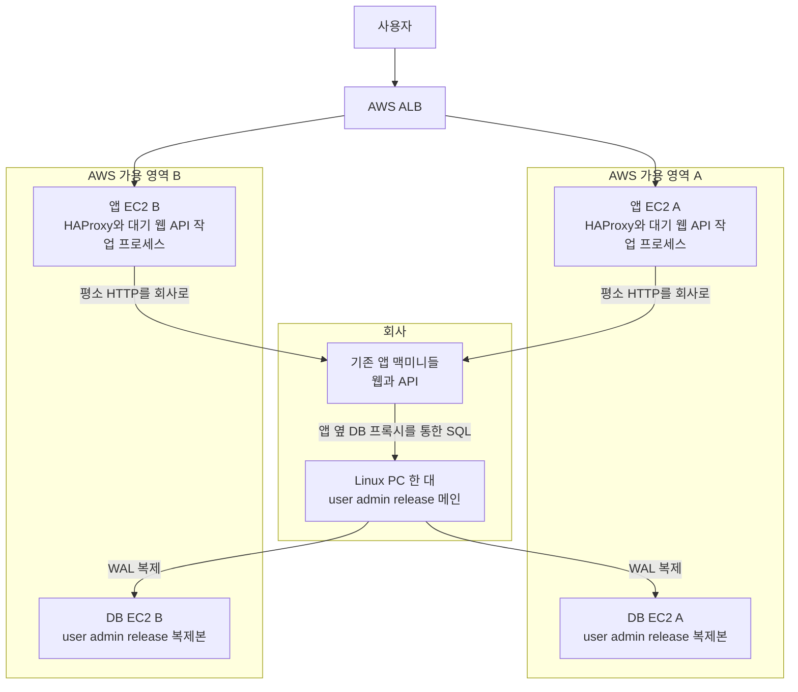
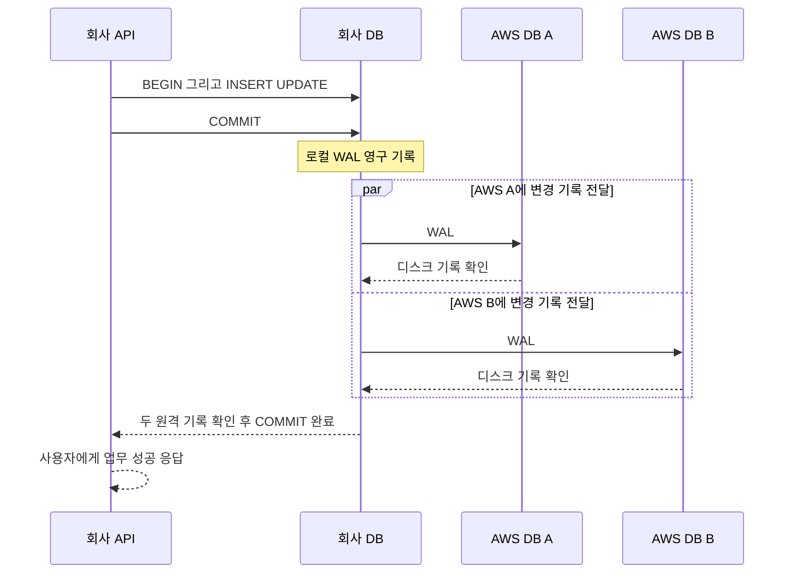
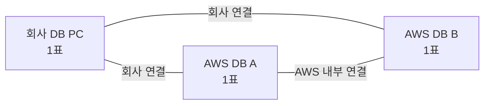
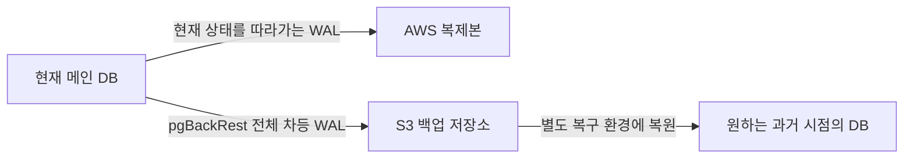

# 클리퍼 운영 이중화와 백업 팀 설명 자료

2026년 10월 30일 대화 기준. 개발팀 화이트보드 설명과 질의응답용이다. 현재 우선안은 회사 앱 맥미니 유지, 회사 DB를 남는 PC의 native Linux로 이전, AWS 두 AZ의 상시 대기 서버로 자동 전환하는 구성이다. Linux PC의 실제 하드웨어 watchdog 시험을 통과해야 이 플랫폼을 확정한다.

## 발표 시작과 순서

첫 문장은 다음처럼 말한다.

> “회사 정전이나 인터넷 단절 때 서비스를 AWS에서 자동으로 이어가려는 설계입니다. 핵심 조건은 사용자에게 성공했다고 확정한 회원·결제 기록을 잃지 않는 것입니다. 이를 위해 데이터를 미리 AWS에도 저장하고, 이전 DB가 더 이상 메인으로 쓰지 못하게 한 뒤, 준비된 AWS 서버로 요청을 넘깁니다. 잘못 삭제한 데이터는 이중화로 해결되지 않으므로 과거로 복원할 백업도 별도로 둡니다.”

약 30분 설명 후 질의응답을 권한다.

| 순서 | 시간 예시 | 설명할 내용 | 화이트보드 |
|---|---:|---|---|
| 목표와 범위 | 2분 | 성공 데이터 보존, 회사 장애의 자동 복구 | 목표 세 문장 |
| 서버 배치와 요청 경로 | 5분 | 회사와 AWS 두 AZ, EC2 네 대 | 그림 1 |
| 정상 저장 과정 | 4분 | COMMIT과 AWS 저장 확인, 대기 비용 | 그림 2 |
| 장애 전환 | 7분 | 과반수, fencing, 승격, 요청 전환 | 그림 3 |
| 백업과 결제 | 5분 | 과거 복원, 중복 결제와 결과 불명 | 그림 4와 결제 흐름 |
| 선택의 변화와 검증 | 7분 | Patroni에서 바뀐 이유, 남은 구현과 시험 | 대안 비교와 시험표 |

화이트보드는 세로로 회사 / AWS AZ A / AWS AZ B를 나눈다. 검정은 장비와 프로그램, 파랑은 HTTP와 DB 접속, 초록은 복제, 빨강은 권한·차단, 회색은 백업으로 구별한다. 색이 없으면 화살표에 HTTP, SQL, WAL, 제어, 백업을 적는다. 모든 선을 처음부터 한꺼번에 그리지 않는다.

## 합의된 방향과 현재 단계

| 항목 | 현재 기준 |
|---|---|
| 운영 위치 | 평소 회사 앱과 회사 DB가 메인, AWS 앱과 DB는 상시 실행 |
| 보호 범위 | 회사 정전·WAN 단절과 관련 프로세스/장비 장애. 성공 확정 데이터 보존과 자동 AWS 전환 |
| 데이터 의미 | 완료로 응답한 업무 기록을 보호. 아직 원격 접수조차 되지 않은 모든 요청의 자동 완료를 뜻하지 않음 |
| AWS 배치 | 두 AZ에 앱 EC2 한 대와 DB EC2 한 대씩, 총 네 대 |
| DB 구성 | 각 DB 호스트에 user/admin/release 독립 PostgreSQL 16 인스턴스 세 개 |
| 회사 DB 우선안 | 남는 PC 한 대에 Linux 직접 설치. Pacemaker·Corosync·PAF·diskless SBD·하드웨어 watchdog |
| 플랫폼 조건 | 실제 watchdog 인식·리셋 시험, 배포판 패키지 조합과 선택적 fencing 검증 후 확정 |
| 기존 맥미니 | 앱 서버는 유지 가능. DB 맥미니는 Linux 검증 실패 시 외부 차단 장비와 함께 대안으로 검토 |
| 정상 저장 정책 | 회사 메인일 때 AWS 두 DB 사본의 영구 기록 확인 후 성공 |
| AWS 운영 시 저장 | 각 DB의 AWS 메인은 다른 AZ의 AWS 복제본 기록 확인 후 성공 |
| 복귀 | AWS 자동 전환. 회사 회복만으로 로컬 DB를 자동 메인으로 되돌리지 않음 |
| 백업 | pgBackRest와 같은 계정 S3. 주간 전체, 일간 차등, 지속 WAL 보관 |
| 이번 범위 밖 | 리전 전체 재해 복구, 별도 AWS 백업 계정, 공기계 테더링, PC 세 대 구성 |

장비 확인은 BIOSTAR A520MT, Ryzen 5 5600X, RAM 약 32GB, 512GB NVMe 후보까지 진행했다. AMD SMBus 1022:790B rev 61이 sp5100_tco의 탐색 대상·처리 분기에 해당함을 확인했다. 이는 드라이버 대상 확인이며 실제 watchdog 작동 증명은 아니다. Ubuntu USB 확인과 리셋 시험을 기다리는 단계다. Linux USB 체험은 기존 Windows 전체 삭제를 요구하지 않는다.

기존 최신 설계 기록은 [논의 정리와 사전 확인](30-decisions-and-preflight.md)이다. 이 발표는 그 기준에 이후 장비 식별 결과와 설명 순서를 덧붙인다. 과거 8 EC2, 별도 백업 계정, 공기계 대안은 현재 배치로 설명하지 않는다.

## 그림 1 서버 배치와 요청 경로



이 그림은 정상 운영 상태다. AWS 운영 상태로 바뀌면 앱 EC2에서 실행 중인 API가 요청을 처리하고, 각 앱 옆 DB 프록시가 DB별로 현재 AWS 메인에 연결한다. 그림의 EC2 상자는 네 개다. ALB는 AWS 관리형 서비스이며 다섯 번째 EC2가 아니다.

말로는 다음처럼 설명한다.

> “사용자가 접속하는 주소는 계속 같은 도메인이고, 입구는 AWS에 둡니다. AWS의 HAProxy가 평소에는 회사 앱으로 요청을 전달합니다. 회사에서 처리할 수 없으면 AWS 앱으로 전달합니다. DB는 회사와 AWS 두 곳에 미리 복제되어 있습니다.”

중요한 보충 설명:

- 로컬 메인이란 회사 앱·DB가 평소 업무를 처리한다는 뜻이다. 공개 접속 입구까지 회사에 둘 필요는 없다.
- 정상 경로는 사용자 → ALB → AWS HAProxy → 회사 앱 → 회사 앱 옆 DB 프록시 → 회사 DB다. 일반 DB 조회마다 AWS를 왕복하게 만들지 않도록 DB 프록시를 앱 옆에도 둔다.
- 공개 HTTP 요청 자체는 AWS에서 회사를 거친다. 저장 확정에도 회사↔AWS 왕복이 추가된다. 인터넷 지연이 사라지는 설계가 아니다.
- AWS 전환 후에는 사용자 → ALB → AWS HAProxy → AWS 앱 → 앱 옆 DB 프록시 → 해당 DB의 AWS 메인이다.
- HTTP용 HAProxy와 DB 접속용 HAProxy는 역할을 구분한다. ALB는 PostgreSQL 접속을 중계하지 않는다.
- 회사↔AWS는 암호화된 사설 연결을 사용한다. VPN은 통신 경로다. 복제 자체는 PostgreSQL이 한다. VPN이 회사 회선 장애를 복구해 주지는 않는다. VPN 종단·주소·라우팅은 현장 확인 후 구현 설정으로 고정한다.
- AWS A↔B는 회사 네트워크를 거치지 않고 통신한다. 그래야 회사가 사라져도 AWS끼리 복제·권한 판단을 계속할 수 있다.
- 파일, 세션, 인증 키, 설정, 큐 등도 AWS에서 독립적으로 사용할 수 있어야 한다. DB만 복제하고 결제 키·파일·인증 프록시가 회사에만 있으면 전환은 불완전하다. 필요 상태별 저장 위치는 기존 코드·배포 설정을 확인해 정한다.
- HTTP 중간 연결이나 WebSocket이 다른 서버로 순간 이동하지는 않는다. 연결이 끊긴 요청은 결과 확인과 안전한 재시도가 필요하다.
- 회사 전체 장애 후에는 AWS 운영 상태를 유지한다. 회사 앱의 health 응답이 돌아왔다는 이유만으로 요청을 회사로 자동 복귀시키지 않도록 운영 모드와 준비 상태에 연결한다. 로컬 DB 재합류와 계획 전환에 맞춰 복귀한다.

세 DB는 한 PostgreSQL 안의 이름 세 개로 합치는 것이 아니다. 현재처럼 독립 프로세스·데이터 디렉터리·포트를 유지한다. 회사 세 개와 AWS 각 세 개, 총 아홉 PostgreSQL 인스턴스다. 호스트는 회사 한 대와 AWS DB EC2 두 대다. DB 간 원자적 트랜잭션이 새로 생기는 것도 아니다.

## 그림 2 저장 성공이 확정되는 순간

화이트보드에 앱 / 회사 DB / AWS DB A / AWS DB B 네 줄을 그린다. DB 하나의 트랜잭션 예시이며 세 DB 각각 같은 원칙을 적용한다.



> “SQL마다 API가 회사 DB와 AWS DB를 따로 수정하는 방식은 아닙니다. API는 현재 메인 DB에서 한 번 처리합니다. PostgreSQL이 변경 기록을 복제합니다. 트랜잭션을 마치는 COMMIT에서 AWS에도 기록됐는지 기다리고, 그 확인을 받은 뒤 성공을 응답합니다.”

WAL은 테이블을 재구성할 수 있는 변경 기록이다. 이번 정책은 AWS의 메모리 수신뿐 아니라 WAL의 영구 기록을 확인한다. AWS가 같은 순간 모든 테이블 페이지에 적용을 끝냈다는 의미는 아니다. 승격 과정에서 필요한 WAL 재생을 완료한다. [PostgreSQL 동기 복제](https://www.postgresql.org/docs/16/warm-standby.html#SYNCHRONOUS-REPLICATION)

| 메인 위치 | 성공에 필요한 AWS 기록 | 복제본을 잃었을 때 |
|---|---|---|
| 회사 | AWS A와 B 모두 | 둘 중 하나라도 확인 불가하면 신규 쓰기 성공을 확정하지 않음 |
| AWS A | AWS B | B가 없으면 신규 쓰기 성공을 확정하지 않음 |
| AWS B | AWS A | A가 없으면 신규 쓰기 성공을 확정하지 않음 |

이것은 의도적으로 보수적으로 선택한 정책이다. RPO 0을 구현하는 모든 방식이 항상 원격 두 대를 요구하는 것은 아니다. 현재 후보에서 승격 적격 사본과 저장 보장을 명확하게 만들기 위해 택한 대가로, 회사가 정상이어도 AWS 복제본 한 대 장애가 쓰기 중단을 유발한다. 과반수가 살아 있다는 사실과 성공에 필요한 데이터 사본이 있다는 사실은 별개다.

설정 의도를 개발자에게 보일 필요가 있을 때만 아래를 적는다. 실제 운영 파일은 노드별로 관리하고 데이터 복사로 덮어쓰지 않는다.

```text
회사 메인: synchronous_standby_names = 'ANY 2 ("aws-a", "aws-b")'
AWS A 메인: synchronous_standby_names = 'FIRST 1 ("aws-b")'
AWS B 메인: synchronous_standby_names = 'FIRST 1 ("aws-a")'
공통: synchronous_commit = on, fsync = on, full_page_writes = on
```

앱 성공 판정도 함께 검증한다. 동기 복제 대기가 취소되면 로컬에는 COMMIT됐지만 원격 완료는 확인되지 않은 상태가 생길 수 있다. 경고·취소·연결 종료를 놓치고 성공으로 답하면 설계 조건이 깨진다. 같은 DB 연결에서 트랜잭션의 결과를 끝까지 확인하고 불명확한 요청은 결과 조회 대상으로 둔다. synchronous_commit은 앱 세션이 바꿀 수 있으므로 역할 권한 설정만으로 우회를 막았다고 설명하지 않는다. [동기 복제의 취소 주의점](https://patroni.readthedocs.io/en/latest/replication_modes.html#synchronous-mode)

| 정전 시점 | 사용자에게 설명할 결과 |
|---|---|
| 성공 응답 이후 | 이미 AWS에 저장된 기록으로 복구 |
| AWS 저장 이후 응답 유실 | 기록은 존재하며 요청 번호로 결과 확인 |
| AWS 저장 전에 처리 중단 | 완료되지 않았거나 결과 불명. AWS에 요청 기록이 없다면 AWS가 스스로 알아낼 수 없음 |

UPS는 진행 중 작업을 마무리하거나 정상 종료할 시간을 주므로 유용하다. 하지만 이미 성공으로 확정한 데이터는 정전 전에 AWS에 있어야 한다. 그래서 Linux 자체 차단안에서 UPS는 그 보존 조건의 필수 장비가 아니다. UPS를 붙인다고 단절된 인터넷이 복구되거나 모든 처리 중 요청이 완료되는 것은 아니다.

## 그림 3 권한 판단과 이전 메인 차단

처음에는 삼각형으로 DB 호스트 세 대를 연결한다. 호스트마다 한 표라고 쓴다. 회사 DB가 세 개라고 회사에 세 표를 주지 않는다. AWS 앱 EC2들도 이 투표에 추가하지 않는다.



회사 인터넷 장애를 설명하면서 회사 쪽 선 두 개에 X를 긋는다.

> “회사 PC는 살아 있지만 AWS 두 대와 연락하지 못합니다. 회사는 혼자 한 표이고, AWS는 서로 연락되는 두 표입니다. 전체 세 표 중 두 표가 있는 AWS 쪽이 운영 결정을 이어갑니다. 동시에 회사 쪽의 쓰기 권한을 제거해야 합니다.”

여기서 health check와 fencing을 구분한다.

> “헬스체크 실패는 응답을 못 받았다는 증거입니다. 그 서버가 꺼졌다는 증거는 아닙니다. 인터넷이 끊겨도 기존 DB 세션이나 예약 작업은 남아 있을 수 있습니다. 그래서 새로운 메인을 만들기 전에 이전 메인이 더 이상 쓰지 못하게 하는 조치가 필요합니다. 이것이 fencing입니다.”

화이트보드 아래에 다음 순서를 쓴다.


감지·후보 확인·차단 작업 일부는 병행할 수 있다. 하지만 이전 메인의 안전한 차단 조건을 충족하기 전에 새 메인을 열어서는 안 된다. 하드웨어 watchdog의 실제 제한 시간, SBD 동작, 클러스터 대기 설정을 함께 검증해야 한다. [SBD와 선택적 watchdog fencing](https://docs.redhat.com/en/documentation/red_hat_enterprise_linux/10/html/configuring_and_managing_high_availability_clusters/configuring-sbd-fencing-in-a-high-availability-cluster)

### 구성 요소를 설명하는 짧은 문장

| 용어 | 발표에서 말할 문장 | 역할의 경계 |
|---|---|---|
| PostgreSQL | “실제 데이터를 저장하고 변경 기록을 다른 DB로 복제합니다.” | 복제만으로 안전한 자동 승격 전체가 완성되지는 않음 |
| Corosync | “어느 호스트들이 서로 연결되어 있고, 어느 쪽에 과반수가 있는지 알려줍니다.” | 회원·결제 데이터를 복제하지 않음 |
| Pacemaker | “상태와 정책을 보고 DB를 시작·중단하거나 어느 복제본을 메인으로 바꿀지 관리합니다.” | DB별 동작은 자원 에이전트를 통해 수행 |
| PAF | “Pacemaker가 PostgreSQL의 상태를 이해하고 시작·중단·승격하도록 연결하는 담당 모듈입니다.” | PostgreSQL 자체의 복제 설정과 별개 |
| SBD | “호스트가 안전하게 계속 운영할 수 있는지 감시하고, 필요하면 watchdog을 통해 스스로 차단하도록 합니다.” | 여기서는 공유 디스크 없는 diskless 모드 |
| 하드웨어 watchdog | “정해진 시간 동안 정상 신호가 안 오면 PC를 재시작시키는 하드웨어 타이머입니다.” | 단순한 HTTP 확인 프로그램이나 softdog와 장애 범위가 다름 |
| fencing | “이전 메인이 더는 업무 쓰기를 할 수 없도록 확실히 차단하는 절차입니다.” | 전원 OFF만을 뜻하지 않으며 검증된 자체 재시작도 수단 |
| quorum | “운영 결정을 이어갈 수 있는 과반수입니다. 이 구성에서는 세 호스트 중 두 대입니다.” | 데이터의 최신성을 증명하지는 않음 |
| RPO | “장애 후 어느 시점까지의 데이터를 보존해야 하는지를 나타냅니다.” | 이번에는 올바르게 성공 확정한 거래의 유실 0이 목표 |
| RTO | “장애가 시작된 뒤 서비스가 다시 정상 처리되기까지 목표로 하는 시간입니다.” | 정기적으로 서비스를 중단하겠다는 뜻이 아님 |
| split brain | “둘이 동시에 자신을 메인으로 여기며 서로 다른 내용을 쓰는 상태입니다.” | 라우팅 변경만으로 모든 기존 작업을 멈출 수 없음 |
| failover | “장애 때문에 보조가 메인 역할을 이어받는 것입니다.” | 새 EC2를 그때 켜거나 S3 백업을 복원하는 과정이 아님 |
| failback | “회복한 회사 서버로 메인 역할을 되돌리는 것입니다.” | 이번에는 자동으로 하지 않음 |

PAF는 Pacemaker의 PostgreSQL 자원 에이전트이며, PostgreSQL 스트리밍 복제와 함께 사용한다. [PAF 공식 설명](https://clusterlabs.github.io/PAF/)

### 왜 PC 한 대의 DB 세 개에 이 조합을 택했는가

기존 독립 PostgreSQL 세 개를 유지하면서 물리 watchdog은 하나만 있다. SBD 한 프로세스가 watchdog을 소유하고, Pacemaker가 PostgreSQL 세 개를 별도 자원으로 관리하면 소유권을 모을 수 있다. 세 Patroni 프로세스가 같은 watchdog 장치를 제각각 여는 구성을 피한다.

DB 한 개를 안전하게 중단·복구할 수 있으면 그 DB만 조치할 수 있다. 중단이 되지 않아 호스트를 차단해야 하면 다른 두 DB도 함께 영향을 받는다. 이는 장비 수 절감으로 받아들이는 장애 범위다. CPU·메모리·디스크 I/O도 공유하므로 부하 제한과 합산 용량 검증이 필요하다.

AWS에서도 각 DB EC2에 세 DB를 함께 둔다. 한 EC2 장애가 세 DB 사본에 동시에 영향을 미친다. 두 번째 AZ의 DB EC2가 있어도 현재의 동기 저장 조건을 충족하지 못하면 신규 쓰기를 멈춘다. 한 대당 한 DB로 분리하면 자원·장애 격리가 좋아지지만 비용과 관리 대상이 늘어나므로 초기에는 네 EC2 배치를 택했다.

AWS 승격 후 user는 A, admin은 B처럼 DB별 메인이 달라도 된다. 세 메인을 한 호스트에 억지로 묶으면 DB별 최신 적격 후보를 선택하는 데 방해가 될 수 있다. 세 DB의 접속 경로를 각각 관리한다.

### 실제 장애별 동작

회사 정전에서는 로컬 앱과 DB가 멈춘다. AWS DB 두 호스트는 서로 연결된 과반수를 유지하고, 안전한 차단 대기 절차와 적격성 확인 후 승격한다. AWS 간 복제와 앱 준비가 확인되면 요청을 처리한다. 성공 데이터는 이미 AWS에 있다.

회사 WAN 단절에서는 로컬 PC가 켜져 있어도 동기 저장 성공을 새로 확정하지 못한다. 로컬은 과반수 상실에 따라 DB를 중단하며, 제어가 멈추거나 중단을 보장하지 못하는 경우 watchdog 기반 차단이 작동해야 한다. AWS는 그 안전 조건을 확인한 뒤 승격한다. AWS가 끊긴 회사 회선을 통해 전원 OFF 명령을 보낼 필요가 없는 것이 이 안의 장점이다.

API 맥미니나 Docker Desktop만 멈춘 경우에는 우선 AWS API로 전환한다. 회사 DB와 연결·복제 조건이 정상이라면 DB까지 무조건 승격하지 않는다. 앱 전환과 DB 전환은 별도 판단이다.

복제 통신만 끊기고 Corosync 통신은 살아 있는 경우에는 과반수 검사만으로 장애를 발견할 수 없다. 제한 시간 있는 동기 쓰기 준비 검사와 복제 상태 감시가 필요하다. 이 감시는 Pacemaker에 전환을 요청하며 직접 pg_ctl promote를 실행하지 않는다. SELECT 1 또는 HTTP 200만으로 정상 판정을 끝내지 않는다.

AWS DB EC2가 이전 메인이 되는 장애도 있으므로 AWS 측 fencing이 필요하다. 대상은 DB EC2다. 현재 확인한 fence_aws 소스는 stopping을 off로 매핑한다. 이번 기준은 정확한 인스턴스 ID에 대해 실제 stopped 완료까지 확인하는 것이므로 해당 경로를 고정 버전에서 보완·검증해야 한다. API 오류·시간 초과·대상 불명은 차단 성공으로 처리하지 않는다. [fence_aws 소스](https://github.com/ClusterLabs/fence-agents/blob/main/agents/aws/fence_aws.py), [EC2 정지 완료 확인](https://docs.aws.amazon.com/boto3/latest/reference/services/ec2/waiter/InstanceStopped.html)

watchdog으로 재시작한 뒤 옛 DB가 독립 서비스로 자동 기동되면 차단의 의미가 사라진다. 재부팅 시 SBD·클러스터 참여 절차를 거쳐야 하며, 옛 데이터를 현재 메인으로 바로 열지 않는다. 복제본으로 재동기화하거나 재구축하고, 계획된 전환으로만 로컬 메인에 복귀한다.

## ALB와 HAProxy와 감시의 역할

| 구성 | 쉬운 설명 | 이번 용도 |
|---|---|---|
| ALB | “AWS가 관리하는 HTTP 접속 입구입니다.” | 같은 공개 주소, TLS, 두 앱·라우터 EC2로 요청 분산 |
| HTTP HAProxy | “요청을 현재 준비된 앱으로 보내는 안내자입니다.” | 평소 회사 우선, 회사 장애 후 준비된 AWS 앱 선택 |
| DB HAProxy | “앱의 DB 접속을 현재 메인으로 연결합니다.” | user/admin/release별 고정 접속점, 기존 연결 정리와 재연결 |
| 준비 상태 연결 모듈 | “클러스터가 인정한 메인과 실제 쓰기 가능 상태를 프록시에 알려줍니다.” | PAF에는 Patroni의 /primary API가 없으므로 별도 연동 필요 |
| CloudWatch | “로그·지표·알림과 감시 프로그램의 생존 신호를 모읍니다.” | 회사 밖의 관측, 장애 기록, 경보 |

ALB만으로 DB 메인을 선정하지 않는다. HAProxy가 메인 DB를 임의로 승격하지도 않는다. 역할 판단은 클러스터가 하고 프록시는 그 결과에 따라 연결한다. CloudWatch 알림을 사람이 읽어야 전환되는 설계가 아니다.

ALB는 모든 대상이 unhealthy이면 해당 대상으로도 요청을 보낼 수 있다. 앱과 프록시 자체도 쓰기 준비가 안 된 상태의 업무를 거절해야 한다. [ALB 상태 검사](https://docs.aws.amazon.com/elasticloadbalancing/latest/application/target-group-health-checks.html)

프록시에서 결제 POST나 SQL을 다른 서버로 무작정 재전송하지 않는다. 요청 ID를 이용한 업무별 재시도로 중복을 통제한다. DNS를 장애마다 바꾸지 않아도 연결 단절과 처리 중 요청의 결과 불명은 남는다.

## 그림 4 복제와 백업의 차이

화이트보드에 현재 상태를 복제하는 선과 과거 기록을 보관하는 선을 따로 그린다.



그림의 백업 출발점은 논리적 표현이다. 실제 백업은 적격 AWS 복제본에서 수행하는 구성을 우선 검토하며, DB별 활성 메인·WAL 보관·백업 역할이 전환 후에도 이어지게 설정한다. 회사 정전 때 백업 작업이 회사 장비에 종속되지 않아야 한다.

> “회사 서버가 꺼졌을 때는 이미 실행 중인 복제본이 서비스를 이어받습니다. 그런데 실수로 회원 데이터를 삭제하면 그 삭제도 복제됩니다. 그래서 삭제 이전 시점으로 돌아갈 백업을 별도로 보관합니다.”

| 정책 | 설명 |
|---|---|
| 주 1회 전체 백업 | 기준이 되는 전체 데이터 저장 |
| 매일 차등 백업 | 최근 전체 백업 이후 변경 내용 저장 |
| 지속 WAL 보관 | 백업 이후 변경 기록으로 특정 시점까지 복원 |
| 저장 위치 | 같은 AWS 계정의 S3, 버전 관리와 필요한 IAM 권한 분리 |
| 보관 기본 제안 | 주간 full 5세대와 관련 diff·WAL, S3 noncurrent version 30일. 실제 복원 가능 범위 확인 |
| 복원 검증 | 월 1회 별도 환경에 실제 복원하고 회원·결제·앱 동작 확인 |

user/admin/release는 별도 백업 단위로 구성한다. 세 DB에 걸친 업무 정합성은 따로 검증한다. S3에 WAL을 지속 보관한다고 모든 순간의 WAL이 이미 S3에 있다는 뜻은 아니다. 백업 업로드의 최신 시점과 실패·지연을 관측한다. 자동 failover의 성공 데이터 보존은 실행 중인 AWS 동기 복제본으로 달성한다. [pgBackRest 백업과 복원](https://pgbackrest.org/user-guide.html)

잘못된 삭제는 정상 SQL처럼 보일 수 있으므로 무조건 자동 감지·과거 복원할 수 있다고 약속하지 않는다. 과거 복원은 이후 정상 거래까지 되돌릴 수 있어 별도 복구 환경에서 영향과 결제사 상태를 확인한 뒤 적용한다.

## 결제와 작업 프로세스를 반드시 따로 설명

현재 API 안에는 매분 실행되는 PaymentRecoveryScheduler가 있다. 예약 최초 결제, 정기 갱신, 미완료 이용권 처리, 빌링키 정리, 접근 만료 등을 수행한다. 단순히 API를 두 곳에 띄우면 이런 작업도 두 곳에서 실행될 수 있다.

> “worker는 사람이 아니라 예약 작업을 수행하는 프로그램입니다. 메인 DB가 하나라는 것만으로 이미 결제사에 보낸 요청까지 취소되지는 않습니다. 작업을 누가 처리할지 잠금으로 조정하고, 같은 결제는 같은 요청 번호를 써서 중복 승인을 막아야 합니다.”

그릴 흐름:

```text
결제 요청 ID와 주문 상태를 동기 저장
    → 작업 소유권 확인
    → 같은 결제에는 같은 멱등키로 결제사 호출
    → 결과를 동기 저장
    → 사용자에게 확정 결과 응답

중간 단절 → AWS에서 기존 요청 ID로 DB와 결제사 결과 대조 → 상태 정리
```

멱등성이란 같은 업무 요청을 다시 받아도 결제가 두 번 발생하지 않게 만드는 성질이다. 외부 결제 API의 실제 지원 방식과 키 유효 기간을 맞춰야 한다. 무제한 재시도나 DB 잠금 하나로 외부 결제의 정확히 한 번 실행을 보장한다고 설명하지 않는다.

현재 코드에는 구독 DB 잠금과 결제 멱등키 처리도 존재한다. 이를 없다고 설명하지 않는다. 여러 호스트에서 동시에 실행하거나 연결이 중간에 끊길 때도 기존 처리가 충분한지 시험하고 보완한다. API/작업 역할 분리, 작업 소유권 상실 시 새 작업 중단, 결과 대조는 구현·검증 대상이다.

브라우저·앱 종료 후에도 요청을 자동 재전송하는 클라이언트 영구 outbox는 후속 항목이다. 이번 범위에서는 동일 요청 ID, 결과 조회, 안전한 재시도와 서버 측 결제 접수 기록을 우선한다. ALB는 요청을 영구 보관하는 큐가 아니다.

소스 확인 위치:

- [API 스케줄러](/Users/jina/project/adlight/web/clipper_web_api/src/modules/payments/application/payment-recovery.scheduler.ts:32)
- [구독 단위 DB 잠금](/Users/jina/project/adlight/web/clipper_web_api/src/modules/payments/infrastructure/typeorm-subscriptions.repository.ts:53)
- [기존 PostgreSQL Compose](/Users/jina/project/adlight/web/clipper_infra/db/compose.yml:1)

## 설계 과정에서 바뀐 선택과 이유

아래는 설계 검토 중 발견한 제약과 수정이다. 실제로 구축해서 장애를 겪은 이력으로 발표하지 않는다.

| 처음 생각한 방식 | 발견한 제약 | 현재 정리 |
|---|---|---|
| 장애가 나면 꺼 둔 AWS를 켜기 | 기동·배포·DB 준비 시간이 필요하고 꺼진 DB에는 지속 복제가 안 됨 | 빠른 복구용 앱·DB 상시 실행 |
| DB를 AWS에만 두기 | 일반 DB 조회도 회사↔AWS 왕복, 회사 회선 의존 | 회사 DB 메인과 AWS 동기 사본. 단 저장 확정 지연은 수용 |
| 주기적 백업만으로 데이터 유실 방지 | 마지막 백업 이후 성공 거래가 빠질 수 있음 | 동기 복제와 과거 복원 백업을 함께 구성 |
| health check 실패 즉시 AWS 승격 | 응답 없는 기존 메인이 계속 실행 중일 수 있음 | 과반수와 fencing을 승격 조건에 포함 |
| macOS Docker 안의 감시만 사용 | Docker VM이나 호스트가 정지하면 감시도 함께 멈출 수 있음 | Linux 하드웨어 자체 차단 우선, Mac은 외부 차단 대안 |
| 회사 인터넷으로만 PDU 제어 | 회사 회선이 끊기면 차단 명령도 못 보냄 | Mac 대안에는 전용 LTE/VPN 라우터와 제어 전원 유지 |
| 공기계 USB 테더링 | 재부팅·USB 연결·테더링 자동 복구 신뢰성 문제 | 사용자 결정으로 제외 |
| Patroni 세 개가 물리 watchdog 하나 사용 | 장치 소유권 충돌. 컨테이너 세 개로 타이머 세 개가 생기지 않음 | SBD 한 개가 watchdog을 관리하고 Pacemaker가 세 DB 관리 |
| DB별 KVM 가상머신과 가상 watchdog | 게스트 밖 Linux 호스트의 정지·재개까지 같은 방식으로 보장할 수 없음 | 물리 호스트 보호까지 필요하므로 단순화 대안으로 채택하지 않음 |
| Linux PC 세 대 | 사용 가능한 PC 수와 맞지 않음 | 한 PC의 세 DB를 유지 |
| AWS DB 여섯 EC2로 분리 | 장비 수·비용 증가 | DB EC2 두 대에 세 DB씩, 앱 두 대 포함 총 네 EC2 |
| 세 DB 메인을 한 AWS 호스트에 강제 배치 | DB별 최신 적격 후보가 다를 수 있음 | DB별 승격·접속 경로 관리 |
| 옛 로컬이 돌아오면 바로 메인 복귀 | 옛 데이터·옛 연결로 다시 쓰거나 운영 중인 AWS를 덮을 위험 | 복제본 재합류와 계획 복귀 |
| fence_aws 설치만으로 차단 조건 충족 | 확인한 소스는 stopping도 off로 취급 | 실제 stopped까지 확인하는 경로 보완·시험 |

Patroni는 PostgreSQL HA를 관리하는 도구이고, etcd는 Patroni가 리더 권한·상태를 공유할 때 사용할 수 있는 분산 저장소다. etcd가 회원 데이터를 복제하는 것은 아니다. Patroni는 PostgreSQL 스트리밍 복제를 사용한다. [Patroni 복제 설명](https://patroni.readthedocs.io/en/latest/replication_modes.html), [etcd FAQ](https://etcd.io/docs/v3.6/faq/)

현재 Linux 우선안에서는 Patroni·etcd를 Pacemaker·Corosync·PAF·SBD와 함께 설치해 같은 PostgreSQL을 동시에 관리하지 않는다. Patroni 자체가 나빠서 바꾼 것이 아니라, 독립 DB 세 개·물리 호스트 한 대·watchdog 하나라는 조건에 맞춰 관리 주체를 바꿨다.

Mac 대안의 UPS는 진행 중 데이터 보호에도 도움이 되지만, 이전 설계에서는 정전 중에도 PDU 관리 회로와 LTE 제어 경로를 유지하는 목적이 특히 중요했다. Linux 자체 차단안은 이 외부 제어 경로를 요구하지 않는다. 두 방식의 차이는 OS 이름보다 차단 구조에 있다.

## 선택의 비용과 구현 부담

> “이 설계는 로컬을 메인으로 유지한다는 조건 아래의 선택입니다. AWS 비용이 거의 안 드는 구조라고 설명하면 안 됩니다. 대기 서버도 계속 켜져 있고, 회사와 AWS에 걸친 복제와 권한 판단을 우리가 운영합니다.”

월 비용은 EC2 네 대, EBS, ALB, 회사↔AWS 연결, 데이터 전송, S3와 백업 요청, 로그·감시 등의 합계다. 소프트웨어 라이선스가 무료여도 설정·배포·패치·장애 시험과 복구 절차 유지에 시간이 든다. 실제 용량·트래픽 기반 산정 전에는 클라우드 단독보다 저렴하다고 결론내리지 않는다.

RDS 같은 관리형 DB는 운영 부담을 줄일 수 있지만, 이번 안은 회사 PostgreSQL과 AWS PostgreSQL을 같은 물리 복제·직접 제어 체계로 관리하므로 EC2를 사용한다. RDS 인스턴스에 PAF나 SBD를 직접 설치해 같은 호스트 제어를 할 수는 없다. RDS의 논리 복제 기능은 있지만 이번 물리 standby 구성과 동일한 대체재는 아니다. 로컬 메인 제약을 풀면 관리형 DB를 포함한 클라우드 중심 구성을 다시 비교할 가치가 있다. [RDS PostgreSQL 논리 복제](https://docs.aws.amazon.com/AmazonRDS/latest/UserGuide/PostgreSQL.Concepts.General.FeatureSupport.LogicalReplication.html)

기존 API 이미지·스키마·마이그레이션·세 DataSource 구조는 재사용한다. DB 제어는 기존 Compose의 restart 정책에서 PAF 관리로 바뀐다. API 옆 DB 프록시, 준비 상태 연결 모듈, 성공 판정 공통 처리, 작업 소유권, EC2 차단 완료 확인, 복제·백업 자동화가 필요하다. 도구를 설치하는 것만으로 완료되는 작업이 아니다.

출시 전 운영 테스트 DB 초기화가 허용되어 있으므로 기존 ARM Mac의 PGDATA를 x86 PC에 그대로 복사하지 않는다. 빈 운영 DB 세 개를 구성하고 migration·필수 seed·시험 데이터를 넣는다. 보존이 필요한 데이터가 생기면 별도의 논리 이관을 수행한다. 개발 DB와 다른 프로젝트 데이터는 초기화 대상이 아니다.

## 장애 시험과 합격 기준

시험 전에 공개 clipperstudio.ai의 비허용 방문자에게 Coming soon을 유지한다. 테스터는 회사 공인 출구 IP와 별도의 외부 검증 경로로 제한한다. 회원가입 API, 설치파일, 업데이트 경로와 원본 직접 접근도 함께 통제한다. 회사 WAN을 끊을 때 회사 IP만 허용하면 외부 검증이 막히므로 독립된 허용 시험 경로가 필요하다. 결제는 테스트 키·시험 프로필로 분리한다.

회사 밖의 시험 클라이언트가 고유 요청 ID로 가입·갱신·결제 모의 요청을 계속 보낸다. 업무 완료 응답을 받은 ID와 기대 결과를 별도 기록한다. 장애 후 AWS의 거래 기록과 대조한다. 단순 행 개수 비교만으로 합격시키지 않는다.

| 시험 | 주입할 장애 | 기대 결과 |
|---|---|---|
| 회사 정전 | 전용 시험 장비와 관련 전원 차단 | 성공 확정 ID 보존, AWS 자동 서비스 재개 |
| 회사 WAN 단절 | 회사 외부 통신 차단, 내부 LAN 유지 | 로컬 쓰기 차단, AWS 과반수 유지 후 전환 |
| 비대칭 단절 | 회사→AWS 또는 AWS→회사 한쪽 차단 | 양방향 완전 단절과 별도로 안전한 단일 메인 유지 |
| VPN 단절 | VPN 프로세스·터널 중단 | 불안전한 성공 응답 없이 감지·전환 또는 안전 중단 |
| API 장애 | 회사 API 종료, hang, Docker Desktop 중단 | AWS API가 처리. 건강한 DB를 불필요하게 차단하지 않음 |
| PostgreSQL 장애 | DB 하나 종료·정지 | 제한된 복구 또는 해당 DB 전환, 나머지 DB 영향 확인 |
| DB 종료 실패 | stop이 끝나지 않는 상태 유도 | 필요한 경우 호스트 전체 차단 후 세 DB 복구 |
| 제어 프로그램 장애 | Pacemaker·SBD 중단 또는 정지 | 설정한 정책에 따라 watchdog 차단, 안전 대기 후 AWS 승격 |
| 호스트 멈춤 | 별도 시험 단계에서 OS hang 등 유도 | 물리 watchdog의 실제 동작 확인. 단순 프로세스 종료 시험과 구분 |
| 복제만 단절 | PostgreSQL 복제 연결만 차단 | SELECT 1이 성공해도 쓰기 준비 실패 감지. 비동기 성공 금지 |
| 동기 복제 대기 취소 | COMMIT 대기 중 취소·연결 종료 | 결과 불명을 성공으로 오인하지 않음 |
| 응답 유실 | 원격 저장 후 HTTP 응답 차단 | 같은 요청 ID 조회·재시도에 결과 일관, 중복 처리 방지 |
| 결제 중간 단절 | 결제사 처리 전후에 연결 차단 | 결제사 대조와 멱등키로 중복 결제·이용권 누락 방지 |
| 작업자 동시 실행 | 회사·AWS 작업 프로세스 경쟁 | 작업 소유권·주문 단위 중복 방지 유지 |
| 디스크 장애 | full, read-only, I/O 지연 | 오류 감지, 안전 중단 또는 적격 복제본 전환 |
| AWS 앱 한 대 중단 | 앱 EC2/HAProxy 한쪽 종료 | 다른 앱·라우터 경로 사용 |
| AWS DB 한 대 중단 | DB EC2 정지·격리 | 성공 데이터 보존. 필요한 동기 사본 부족 시 쓰기 중단 |
| 과반수 상실 | 세 호스트가 서로 필요한 연결을 잃음 | 임의 승격 없이 안전 중단 |
| AWS fencing 실패 | API 오류·권한 오류·stopping 장기화 | stopped 확인 전 차단 성공으로 처리하지 않음 |
| 로컬 전원 복구 | AWS 운영 중 회사 PC 재부팅 | 옛 DB가 독립 메인으로 자동 기동하지 않음 |
| 반복 단절·복구 | 회선이 끊겼다 붙는 상태 반복 | 자동 로컬 복귀·동시 메인·전환 폭주 방지 |
| 오래된 복제본 재가입 | 뒤처진 데이터로 노드 시작 | 재동기화 전 승격 금지 |
| 백업 업로드 실패 | S3 접근·자격증명 오류 | 경보, 최신 복원 가능 시점 확인, WAL 공간 감시 |
| 백업 복원 | 전체·차등·WAL로 별도 환경 복구 | 세 DB와 앱의 실제 회원·결제 기능 확인 |
| 논리 삭제 | 시험 데이터 DELETE 후 PITR | 삭제 전 상태를 별도 환경에서 재현 |
| 감시 장애 | 감시 프로세스 종료·생존 신호 중단 | 외부에서 감시 중단 자체를 발견 |
| 모든 라우팅 대상 비정상 | 앱·라우터 준비 상태를 모두 실패로 만들기 | ALB가 요청을 보내더라도 준비되지 않은 쓰기는 앱에서 거부 |
| 외부 의존성과 공통 설정 장애 | 결제사·OAuth·S3 접근 실패, 인증서·DNS·설정 오류 | 원인별 감지와 오류 처리. 같은 문제를 가진 서버로 전환만 해서 해결됐다고 판단하지 않음 |
| 성능·장시간 부하 | 예상 피크와 여유 부하, WAN 지연·손실 | 동기 COMMIT p95/p99, 메모리·I/O·복제 지연·WAL 증가량 확인 |

성공 조건은 다음과 같다.

1. 장애 전에 완료 응답한 모든 업무 ID와 결과가 전환 후에도 보존된다.
2. 이전 메인의 차단 조건을 충족하기 전 새 메인이 쓰기를 허용하지 않는다. 오래된 노드가 업무 쓰기를 성공 확정하지 못한다.
3. 같은 결제·갱신 요청으로 결제사 승인이나 이용권 발급이 중복되지 않는다.
4. 회사 정전·WAN 단절 시험에서 사람의 승격 명령 없이 AWS 서비스가 재개된다.
5. 동기 사본이나 과반수가 부족하면 멋대로 보호 수준을 낮추지 않고 안전하게 중단한다.
6. 로컬 재부팅이 운영 중인 AWS 데이터를 덮거나 자동 failback을 일으키지 않는다.
7. 별도 환경에 백업을 복원하고 실제 앱으로 데이터를 사용할 수 있다.

복구 시간은 장애 시작 → 감지 → 차단 조건 충족 → DB 승격 → AWS 동기 저장 준비 → 외부 요청 연속 성공까지 나눠 기록한다. health endpoint의 첫 200만 측정하지 않는다. 초기 설계상의 회사 장애 복구 목표는 약 30~60초이며 실제 WAN·watchdog·세 DB 준비 시험으로 조정할 검증 목표다. 서버 이름만으로 시간을 보장하지 않는다.

## 남은 구현과 팀에 요청할 검토

| 남은 일 | 완료 판단 |
|---|---|
| PC watchdog 시험 | Linux 장치 인식과 실제 시간 내 하드웨어 리셋 |
| 패키지 조합 고정 | Ubuntu 후보에서 PostgreSQL 16·PAF·Pacemaker·SBD·선택적 fencing 통합 시험 |
| 연결과 용량 | VPN 경로·주소·방화벽·AWS 두 AZ 연결, EC2/EBS 크기, 디스크 건강 상태와 부하 측정 |
| DB HA와 부팅 순서 | 자원별 승격·역할 확인, 옛 메인 기동 차단, rewind/reseed 절차 |
| 프록시 연동 | 클러스터 권한·DB 쓰기 준비를 반영하는 경로, 기존 연결 종료·재연결 |
| 앱·결제 | 동기 COMMIT 결과 판정, 요청 ID, 작업 소유권, 결제사 결과 대조 |
| 백업 | DB별 pgBackRest와 S3, WAL 누락 감지, 복원 시험 |
| 실제 장애 시험 | 위 합격 기준과 외부 관측 결과 |

팀에는 다음 세 가지를 검토해 달라고 요청하면 된다.

- AWS 복제본 한 대 장애만으로도 회사의 신규 쓰기를 멈추는 현재 보호 정책을 이해하고 수용하는지.
- 회사 장비에만 남아 있는 파일·인증·설정·작업 의존성이 무엇인지.
- 결제·예약 작업·재시도 코드에서 여러 호스트 실행과 결과 불명을 처리해야 할 경계가 어디인지.

발표 마무리는 다음처럼 말한다.

> “현재 합의한 것은 로컬 메인과 AWS 네 EC2 배치, 성공 전 원격 저장 확인, 이전 메인 차단, 별도 백업입니다. 한 PC에서 DB 세 개를 관리할 우선 도구도 정했습니다. 지금은 그 PC의 실제 watchdog 동작을 확인할 차례이고, 이후 구현 결과는 정상 접속 화면이 아니라 성공 데이터 보존·중복 결제 방지·옛 메인 차단·백업 복원 시험으로 판단하겠습니다.”
