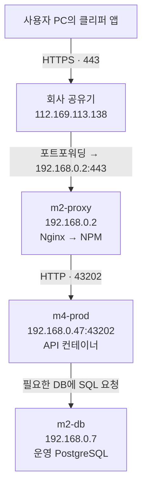
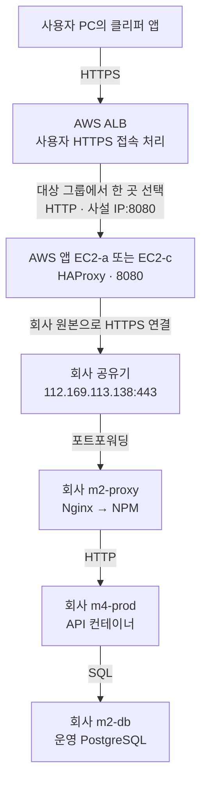
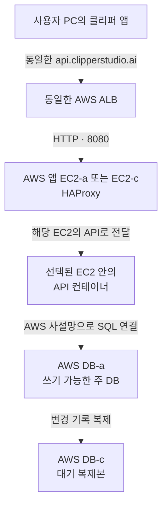

# 클리퍼 API 요청 경로와 ALB 전환 설명

이 문서는 11월 2일의 전환 전 경로와 단계별 개념 설명이다. 이후 실제 실행과 전체 운영 전환 결과는 [11월 3일 전체 기록](03-aws-production-cutover-full-record.md)을 기준으로 읽는다. 현재는 운영 고객 웹과 관리자 및 API가 모두 AWS이고 회사 운영 컨테이너 6개는 정지 상태다.

기준일: 2026-11-02 KST. 설치형 클리퍼 앱의 API 요청이 현재 회사 서버에 도달하는 과정과, ALB를 앞에 둔 이후의 두 단계 전환을 설명한다. DNS 주소 조회와 실제 요청 전달을 구분하고, 요청 예시·연결 주소·프로그램 역할·DB 쓰기 위치를 함께 기록한다.

[Production HA 진입점](../../../README.md) · [작업 현황판](../../../../../handoff/WORKBOARD.md)

## 기준 시점과 적용 범위

- 현재 회사 경로는 2026-11-02 대화에 공유된 공유기·Nginx·NPM·Docker 설정과 사용자 실행 출력 기준이다.
- 같은 대화에서 AWS DB-a/DB-c의 user/admin/release 복제본 6개가 `healthy`, 회사에서 관측한 연결이 `streaming`·TLS 사용·지연 0바이트임을 확인했다. 이는 해당 확인 시점의 비동기 복제 상태다.
- ALB와 AWS HAProxy를 통한 회사 중계, 이후 AWS API/주 DB 사용은 아래에 설명하는 후속 구성이다. 이 문서를 ALB 연결·운영 DNS 전환·AWS 주 DB 승격 완료 기록으로 읽지 않는다.
- 이번 구축 범위는 회사 Mac 서버를 유지하고 AWS EC2 네 대를 준비하는 수동 전환 우선 구성이다. VPN은 후속으로 미뤘다. 과거 Linux/watchdog/Pacemaker 등의 자동 HA 논의와 구분한다.

## 사용자 앱에서 API 호출이 시작되는 예시

회사 밖 사용자 PC의 클리퍼 앱에서 사용자가 계정 정보 저장 버튼을 눌렀다고 가정한다. 앱은 다음과 같은 요청을 만든다. `/users/me`와 본문은 흐름 설명용 예시이며 실제 구현 엔드포인트 계약을 뜻하지 않는다.

```text
요청 주소: https://api.clipperstudio.ai/users/me
요청 방식: PATCH
요청 내용: {"nickname":"새 별명"}
인증 정보: 로그인한 사용자의 토큰
```

앱은 `api.clipperstudio.ai`라는 API 주소를 사용한다. 그 주소 뒤에서 회사 서버가 처리할지 AWS 서버가 처리할지는 DNS와 전달 설정이 결정한다. 이 도메인을 유지하는 전환에서는 앱의 API 기본 주소도 유지할 수 있다.

## DNS 주소 조회와 실제 요청 전달

현재 DNS가 최종 접속 IP를 찾는 과정은 다음과 같다.

```text
api.clipperstudio.ai
→ CNAME으로 metabuzz.iptime.org의 IP를 사용
→ 현재 접속 IP: 112.169.113.138
```

PC가 사용하는 DNS 서버는 필요한 정보를 조회하거나 캐시에서 찾아 앱에 IP를 알려 준다. 이미 조회한 주소나 기존 연결을 재사용할 수 있으므로 매 API 호출마다 모든 DNS 서버를 다시 조회하는 것은 아니다.

호스팅케이알 DNS와 ipTIME DDNS는 이 과정에서 주소를 안내한다. API 요청 본문이 두 서비스의 웹 서버를 순서대로 통과하는 구조는 아니다. 앱은 알아낸 IP로 연결한다.

### ipTIME DDNS와 공유기의 역할

`metabuzz.iptime.org`는 회사 공유기에 등록한 DDNS 이름이다. 회사 공인 IP가 바뀌면 공유기가 이 이름의 IP를 갱신한다. m2-proxy에서 브라우저로 공유기 관리 화면을 열었다는 사실이 DDNS 이름을 m2-proxy 전용 주소로 만드는 것은 아니다.

공유기는 들어온 포트에 따라 내부 서버를 선택한다. 같은 회사 공인 IP라도 HTTPS 443번 연결과 PostgreSQL 55202번 연결의 전달 대상은 다를 수 있다. 사용자 앱의 이번 API 예시는 HTTPS 443번 경로를 사용한다.

## 현재 회사 서버의 실제 요청 경로



1. 앱이 DNS로 접속 IP를 알아낸 뒤 `112.169.113.138:443`으로 연결한다. HTTPS 주소에 별도 포트가 없으면 기본 포트는 443이다.
2. 공유기는 외부 443번 연결을 `192.168.0.2:443`으로 포트포워딩한다. 공유기의 역할은 내부 전달 대상 선택이며 계정 저장 같은 API 업무 처리가 아니다.
3. m2-proxy의 앞쪽 Nginx가 TLS 연결을 중계하고, 클리퍼 경로에서는 NPM이 인증서를 제시해 HTTPS 연결을 처리한다.
4. NPM은 요청 도메인이 `api.clipperstudio.ai`인 것을 확인하고 HTTP로 `192.168.0.47:43202`에 전달한다.
5. m4-prod의 `clipper-web-api-prod` 컨테이너가 토큰·권한·요청 내용을 검사하고 필요한 운영 DB에 SQL 요청을 보낸다.
6. DB의 처리 결과를 받은 API가 응답을 만들고, 응답이 m2-proxy와 공유기의 연결을 거쳐 앱으로 돌아간다. 앱은 응답에 따라 저장 완료 등의 화면을 표시한다.

### m2-proxy 내부의 연결 포트

확인한 HTTPS 중계 설정을 펼치면 다음 순서다.

```text
공유기 외부 443 → m2-proxy의 Nginx:443
→ 같은 Mac의 중간 연결 127.0.0.1:18444
→ Docker에 공개된 호스트 포트 127.0.0.1:18443
→ NPM 컨테이너의 HTTPS:443
```

`18444`와 `18443`은 m2-proxy 안에서 프로그램끼리 연결하는 포트다. 공유기의 확인된 전달 규칙은 외부 443에서 m2-proxy의 443으로 연결하는 규칙이다. 앞쪽 Nginx는 SNI라는 TLS 접속 도메인 정보를 읽어 분기하며, 클리퍼 연결의 TLS를 직접 해제하지 않고 NPM 쪽으로 중계한다.

DNS에서 별칭을 따라가도 앱이 요청한 사이트 이름은 `api.clipperstudio.ai`로 유지된다. NPM은 이 도메인을 보고 서버를 선택한다.

| 요청 도메인 | 현재 NPM의 전달 대상 | 역할 |
|---|---|---|
| `api.clipperstudio.ai` | `http://192.168.0.47:43202` | API |
| `admin.clipperstudio.ai` | `http://192.168.0.47:42302` | 관리자 웹 |
| `clipperstudio.ai`, `www.clipperstudio.ai` | `http://192.168.0.47:42202` | 고객 웹 |

### API와 운영 DB의 연결

API는 요청에 필요한 DB에 별도 연결을 만든다. 모든 요청이 세 DB를 모두 거치는 것은 아니다.

| DB | 현재 접속 대상 |
|---|---|
| user | `192.168.0.7:55202` |
| admin | `192.168.0.7:55212` |
| release | `192.168.0.7:55222` |

회사 DB에서 AWS DB-a/DB-c로 보내는 변경 기록 복제는 사용자 API 요청 전달과 별도의 흐름이다. 현재 사용자 요청의 처리는 회사 API와 회사 주 DB가 담당하고, AWS 복제본은 회사에서 발생한 변경 기록을 받아 반영한다.

## ALB를 앞에 두고 회사 서버를 계속 사용하는 단계

이 단계에서는 사용자 요청을 처음 받는 곳을 ALB로 바꾸되 실제 API 처리와 DB 쓰기는 회사에서 유지한다. 주소 조회는 다음처럼 바뀐다.

```text
현재: api.clipperstudio.ai → metabuzz.iptime.org → 회사 공인 IP
전환 후: api.clipperstudio.ai → ALB의 DNS 이름 → ALB의 공인 IP들
```

사용자 앱은 동일한 `https://api.clipperstudio.ai`를 사용한다. ALB에는 해당 도메인을 포함하는 ACM 인증서를 연결한다.



### ALB와 AWS 프록시의 역할

ALB는 사용자와의 HTTPS 연결을 처리하고 대상 그룹의 EC2 중 한 곳으로 요청을 보낸다. 대상 그룹은 서버 목록·포트·상태 검사 설정을 관리한다. 계획한 전달 대상은 다음 두 사설 주소다.

- 앱 EC2-a: `10.80.1.178:8080`
- 앱 EC2-c: `10.80.2.59:8080`

각 EC2의 HAProxy는 전달받은 요청을 회사로 보낼지 AWS의 API로 보낼지 결정하는 중계 프로그램이다. 회사 사용 단계에서는 다음 정보를 구분해서 전달해야 한다.

| 구분 | 회사로 전달할 때의 값 |
|---|---|
| 실제 접속 대상 | `metabuzz.iptime.org:443` |
| TLS 인증서 선택·검증에 사용할 도메인 | `api.clipperstudio.ai` |
| HTTP 요청 도메인 | `api.clipperstudio.ai` |
| 경로·본문·로그인 토큰 | 사용자가 보낸 내용을 유지 |

사용자 IP와 원래 HTTPS 여부가 필요한 곳에는 ALB의 전달 헤더를 올바르게 전달·신뢰하도록 구성해야 한다. HAProxy/NPM이 원래 도메인이나 인증 정보를 잘못 바꾸지 않도록 확인한다.

ALB 전환 후 회사 원본을 찾을 때 `api.clipperstudio.ai`를 다시 DNS 조회하면 그 이름이 ALB를 가리켜 요청이 ALB로 돌아오는 순환이 생길 수 있다. 따라서 회사 원본 접속에는 계속 `metabuzz.iptime.org`를 사용하고, 요청 도메인과 TLS용 도메인은 `api.clipperstudio.ai`로 유지한다.

### HTTPS 연결이 성립하는 구간

| 연결 구간 | 계획한 방식 |
|---|---|
| 사용자 앱 ↔ ALB | HTTPS, ACM 인증서 |
| ALB ↔ AWS HAProxy | AWS 내부 사설망의 HTTP:8080 |
| AWS HAProxy ↔ 회사 NPM | HTTPS, 회사 NPM의 기존 인증서 검증 |
| 회사 NPM ↔ 회사 API | 현재처럼 내부 HTTP |

ALB가 사용자 HTTPS를 처리한 뒤 회사 쪽에는 HAProxy가 별도의 HTTPS 연결을 만든다. 이 단계에서는 요청의 첫 도착지는 AWS지만 실제 처리는 회사에서 하므로, 회사 전원·인터넷 장애를 견디려면 아래의 AWS API/DB 전환도 필요하다.

## API와 DB까지 AWS로 전환하는 단계

AWS DB-a를 쓰기 가능한 주 DB로 선택한 예시다. user/admin/release 세 PostgreSQL 각각에 대해 주 DB 역할과 접속 대상을 맞춰야 한다.



- HAProxy의 전달 대상을 회사 원본에서 AWS의 API 컨테이너로 바꾼다.
- API의 DB 접속 대상을 회사 DB에서 선택한 AWS 주 DB로 바꾼다. AWS API가 실행 가능한 설정·인증키·백그라운드 작업 운영 조건도 준비되어야 한다.
- 선택한 AWS 복제본을 쓰기 가능한 주 DB로 승격하고 다른 AWS 복제본은 새 주 DB를 따라가도록 연결한다.

앱 EC2-a가 DB-a에 쓰고 앱 EC2-c가 DB-c에 따로 쓰는 구조가 아니다. DB-a를 주 DB로 선택했다면 양쪽 앱 서버 모두 DB-a의 해당 PostgreSQL에 쓰고 DB-c는 대기 복제본으로 둔다.

사용자는 같은 도메인과 ALB를 계속 사용한다. 이 두 번째 전환에서는 DNS를 다시 바꾸기보다 ALB 뒤의 처리 목적지와 DB 역할을 전환한다.

계획 전환에서는 회사 쪽 쓰기를 멈추고 최종 복제 반영을 확인한 뒤, 회사 주 DB의 중복 쓰기를 차단하고 AWS DB를 승격한다. 현재의 비동기 복제에서는 갑작스러운 회사 장애 때 AWS로 전달되지 않은 마지막 변경이 유실될 수 있다. 과거 확인 시점의 지연 0바이트를 상시 무손실 보장으로 해석하지 않는다. 이는 전환 순서의 개념 설명이며, 실행 명령과 복구 절차는 별도로 검증해야 한다.

## DNS에서 바뀔 값과 유지할 값

| 이름 | 현재 역할 | ALB를 앞에 둔 이후 |
|---|---|---|
| `api.clipperstudio.ai` | 회사로 사용자 API 요청 안내 | ALB의 DNS 이름으로 안내 |
| `admin.clipperstudio.ai` | 회사 관리자 웹으로 안내 | ALB의 DNS 이름으로 안내 |
| `clipperstudio.ai` | 회사 고객 웹으로 안내 | ALB를 가리키는 DNS 구성 필요 |
| `www.clipperstudio.ai` | `clipperstudio.ai`를 따라감 | 루트 도메인이 ALB를 가리키면 함께 따라갈 수 있음 |
| `metabuzz.iptime.org` | 회사 공유기의 공인 IP 안내 | 회사 원본에 접근하는 주소로 유지 |
| 개발용 `dev`, `dev-admin`, `dev-api` | 회사 개발 서비스로 안내 | 이번 운영 도메인 전환과 구분해 유지 |
| ACM의 `_검증문자열…` 레코드 | 도메인 소유권 검증 | 인증서 발급·갱신을 위해 유지 |

ALB는 AWS가 제공한 DNS 이름을 대상으로 연결한다. 특정 시점에 조회된 ALB 노드 IP를 고정 IP처럼 서비스 A 레코드에 복사하는 방식으로 구성하지 않는다.

루트 도메인 `clipperstudio.ai`는 현재 회사 IP를 지정한 A 레코드이므로 ALB의 DNS 이름을 연결할 Alias 등의 구성이 필요하다. 호스팅케이알은 루트 CNAME(Alias)를 `ns1.hostingkr.net`/`ns2.hostingkr.net`의 Cloud 네임서버에서 지원한다고 안내한다. 대화에서 확인한 `ns1.hosting.co.kr`~`ns4.hosting.co.kr`와 다르므로, 실제 루트 도메인 전환 전에 DNS 서비스와 이전 방식을 정해야 한다. 도메인 등록기관과 DNS 서비스를 구분하며, 검증용 CNAME 추가만을 이유로 네임서버를 변경하지 않는다.

DNS 전환 뒤에는 사용자의 DNS 캐시나 기존 연결 때문에 잠시 기존 경로를 이용하는 사용자가 있을 수 있다. 실제 전환에서는 이 중첩 기간도 고려한다.

## ACM 검증과 API 요청의 관계

ACM은 인증서를 발급·갱신하는 관리 서비스다. 사용자 API 요청을 매번 중계하는 곳은 ALB다. `_검증문자열…` CNAME은 도메인 소유권을 확인하는 별도 DNS 이름이며 서비스용 `api`/`admin` CNAME과 구분한다.

ALB에 새 ACM 인증서를 연결하는 것과 회사 NPM의 기존 인증서를 유지하는 것은 함께 가능하다. 전자는 사용자 ↔ ALB 연결, 후자는 AWS 프록시 ↔ 회사 NPM 연결에서 사용한다.

## 공식 참고 자료

- [Nginx SSL preread와 SNI 중계](https://nginx.org/en/docs/stream/ngx_stream_ssl_preread_module.html)
- [AWS ALB 대상 그룹과 전달 포트](https://docs.aws.amazon.com/elasticloadbalancing/latest/application/load-balancer-target-groups.html)
- [ALB HTTPS 리스너와 TLS 연결 종료](https://docs.aws.amazon.com/elasticloadbalancing/latest/application/create-https-listener.html)
- [ALB의 DNS 이름과 연결](https://docs.aws.amazon.com/elasticloadbalancing/latest/application/application-load-balancers.html#application-load-balancer-dns-name)
- [ALB의 X-Forwarded 헤더](https://docs.aws.amazon.com/elasticloadbalancing/latest/application/x-forwarded-headers.html)
- [ACM DNS 검증](https://docs.aws.amazon.com/acm/latest/userguide/dns-validation.html)
- [호스팅케이알 루트 CNAME Alias 지원 조건](https://help.hosting.kr/hc/ko/articles/5695232561561)
- [PostgreSQL 대기 서버와 비동기 복제](https://www.postgresql.org/docs/16/warm-standby.html)
