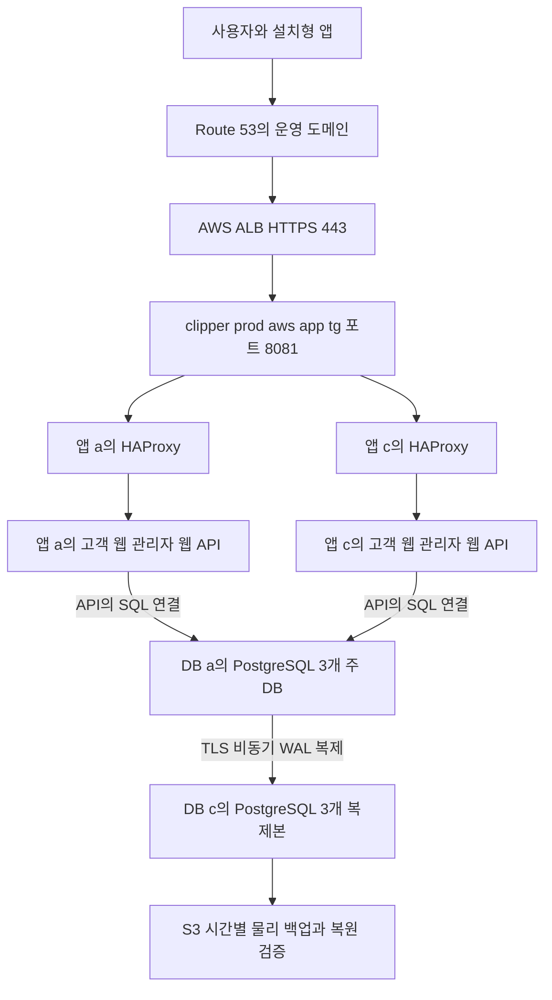

# 클리퍼 운영 서비스 AWS 전환 전체 기록

작성일은 2026년 11월 3일이며 모든 시각은 별도 표시가 없으면 한국시간이다. 11월 2일 회사 서버 조사부터 11월 3일 전체 운영 서비스의 AWS 전환과 회사 운영 컨테이너 정지 시험까지를 기록한다. 앞선 10월 26일부터 30일까지의 자동 이중화 논의는 배경으로 연결하고, 이번에 실제 구축한 수동 전환 구성과 구분한다.

**마지막으로 검증한 운영 상태는 고객 웹과 관리자 웹과 API가 모두 AWS에서 실행되고, AWS DB-a가 쓰기 주 DB이며 DB-c가 복제본인 상태다. 회사의 클리퍼 운영 컨테이너 6개는 모두 정지했고 재시작 정책은 `no`다.** 현재 자동 장애 감지와 자동 DB 승격 시스템은 구축하지 않았다.

이 기록의 서비스 상태는 11월 3일 약 05시까지의 실행 결과와 이후 사용자 확인을 기준으로 한다. 문서 작성 과정에서는 운영 설정을 추가 변경하거나 새 장애 시험을 하지 않았다. 인증서 개인키, DB 비밀번호, GitHub 토큰, JWT 비밀값, 외부 서비스 키는 적지 않는다. 값이 필요한 경우 아래에 기록한 실제 보호 파일을 사용한다.

## 1 현재 운영 상태

### 사용자 요청 경로



DNS는 접속 주소를 알려주는 역할이며, 사용자 HTTP 요청을 중계하는 프로그램은 ALB와 HAProxy다. 현재 ALB의 HTTPS 기본 작업은 AWS 대상 그룹 한 개로만 전달한다. 회사 경로 대상 그룹은 남아 있지만 기본 전달 대상으로 선택하지 않는다.

| 주소 | 용도 | 현재 처리 위치 |
|---|---|---|
| `https://clipperstudio.ai/` | 운영 고객 웹 | AWS 앱-a 또는 앱-c |
| `https://www.clipperstudio.ai/` | 운영 고객 웹 | AWS 앱-a 또는 앱-c |
| `https://admin.clipperstudio.ai/dashboard` | 운영 관리자 웹 | AWS 앱-a 또는 앱-c |
| `https://api.clipperstudio.ai` | 운영 API | AWS 앱-a 또는 앱-c의 API → AWS DB-a |
| `dev.clipperstudio.ai` | 개발 고객 웹 | 기존 회사 개발 환경 유지 |
| `dev-admin.clipperstudio.ai` | 개발 관리자 웹 | 기존 회사 개발 환경 유지 |
| `dev-api.clipperstudio.ai` | 개발 API | 기존 회사 개발 환경 유지 |
| `metabuzz.iptime.org` | 회사 공유기 공인 IP를 알려주는 DDNS | 회사 원본 주소로 유지 |

ALB는 HTTP 요청 하나를 두 EC2에 복제하지 않는다. 요청별로 앱-a 또는 앱-c 한 곳을 선택하므로, 목록 조회와 삭제처럼 서로 다른 요청이 거의 동시에 양쪽에서 처리될 수 있다. 같은 API 경로에 대한 별개의 요청들도 각각 다른 EC2에 배분될 수 있다. 두 API가 접속하는 쓰기 DB는 동일한 DB-a다. 두 API 프로세스의 예약 작업은 요청 분산과 별개의 실행이다.

### 실행 중인 AWS 구성과 정지한 회사 구성

| 위치 | 구성 | 마지막 확인 상태 |
|---|---|---|
| AWS 앱-a | HAProxy와 고객 웹과 관리자 웹과 API | 실행 중이며 상태 검사 정상 |
| AWS 앱-c | HAProxy와 고객 웹과 관리자 웹과 API | 실행 중이며 상태 검사 정상 |
| AWS DB-a | user와 admin과 release PostgreSQL | 세 클러스터 모두 주 DB, 쓰기 가능, 타임라인 2 |
| AWS DB-c | user와 admin과 release PostgreSQL | 세 클러스터 모두 읽기 전용 복제본, DB-a에서 TLS 스트리밍, 타임라인 2 |
| 회사 m4-prod | `clipper-web-client-prod` | 정지, 종료 코드 0, `restart=no` |
| 회사 m4-prod | `clipper-web-admin-prod` | 정지, 종료 코드 0, `restart=no` |
| 회사 m4-prod | `clipper-web-api-prod` | 정지, `restart=no` |
| 회사 m2-db | `clipper-db-user-prod` | 정지, 종료 코드 0, `restart=no` |
| 회사 m2-db | `clipper-db-admin-prod` | 정지, 종료 코드 0, `restart=no` |
| 회사 m2-db | `clipper-db-release-prod` | 정지, 종료 코드 0, `restart=no` |

회사 Mac 자체와 Docker Desktop 전체를 종료한 것이 아니다. 회사의 다른 서비스, 개발 환경, 공유기, m2-proxy와 NPM은 이번 정지 대상에 포함하지 않았다. 정지한 운영 컨테이너, 원본 볼륨, 설정 백업도 삭제하지 않았다.

## 2 원래 목표와 이번 작업의 범위

출발점은 원래 대화 **2026.10.26-30 운영서버 이중화**에서 논의한 회사 메인과 AWS 대기 구성이다. 원래 장기 목표에는 회사 정전이나 WAN 장애의 자동 감지, 이전 쓰기 메인의 확실한 차단, 안전한 AWS 승격, 성공 응답 데이터 보존, 별도의 백업이 포함됐다.

원래 대화 ID는 `01a176cf-706f-7290-8bf8-6d27d78c4732`이며 이번 실행 대화 ID는 `01a19820-165f-7fb1-89a0-b641d390cd01`이다. 이번 작업에서는 실제 Mac 환경을 조사한 뒤 기존 Mac을 유지하고, EC2 네 대와 컨테이너로 수동 전환을 먼저 검증했다. 사용자가 VPN은 나중에 추가하겠다고 명시했으며, 자동 장애 전환보다 직접 회사 또는 AWS 경로를 고정할 수 있는 구성을 우선했다.

이후 사용자는 격리 복사본 시험과 실제 운영 전환 중 **실제 전환인 2번을 승인**했고, 현재 출시 전이며 실사용자와 내부 테스트 사용자도 없다고 설명했다. API와 DB의 실제 전환 후에는 **전체 서비스의 AWS 전환까지 진행**하라고 요청했다. 현재 AWS가 실제 운영 위치가 된 것은 이 수동 전환 시험의 결과이며, 원래 자동 이중화 전체가 완료됐다는 뜻은 아니다.

### 앞선 자동 이중화 후보와 현재 구현의 차이

| 주제 | 앞선 논의 | 이번 실제 상태 |
|---|---|---|
| EC2 대수 | 초기에 DB별 분리 등 8대 안도 검토, 이후 4대로 축소 | 두 AZ에 앱 1대와 DB 1대씩 총 4대 |
| 회사 DB 플랫폼 | Mac과 외부 차단 장비, 또는 남는 PC의 native Linux 대안 검토 | 기존 Mac DB에서 AWS로 실제 이관했으며 새 회사 Linux DB는 구축하지 않음 |
| 자동 선출 | Patroni와 etcd, 후속 Linux 후보의 Pacemaker와 Corosync와 PAF와 SBD 검토 | 어느 자동 선출 조합도 이번 구성에 배포하지 않음 |
| 쓰기 보존 | 원격 durable flush를 기다리는 동기 복제 목표 | 현재 실제 복제는 비동기이며 상시 무손실 보장을 하지 않음 |
| 회사 쓰기 차단 | 원격 PDU와 독립 LTE 통신 또는 실제 hardware watchdog 검토 | 사람이 승인한 계획 전환에서 회사 API 정지, DB SQL 차단, 기존 세션 종료, DB 컨테이너 정지를 수행 |
| 백업 | pgBackRest 주간 full과 일간 diff와 지속 WAL 검토 | 자체 스크립트의 시간별 물리 전체 백업과 S3 왕복 및 실제 복원 검사 |
| 회사 장애 감지 | AWS 감시와 CloudWatch 생존 신호 및 경보 검토 | 회사 정기 HTTP 점검은 사용자 요청으로 중단, 자동 감지와 경보는 미구축 |
| 복귀 | 자동 회사 복귀는 하지 않기로 논의 | 회사는 정지 상태 유지, 최신 AWS 데이터 기준의 별도 재복제 절차 필요 |

10월 30일 후보 PC는 BIOSTAR A520MT와 Ryzen 5 5600X, 약 32GB RAM, 512GB NVMe였으며 AMD SMBus `1022:790B rev 61`이 Linux 드라이버 탐색 대상이라는 조사까지 있었다. 이는 실제 watchdog 리셋 성공이나 이번 배포 완료를 의미하지 않는다. 공기계 테더링과 PC 세 대 구성, 타 리전 DR, 별도 백업 계정도 당시 후속 결정에서 제외됐다.

## 3 회사 환경의 최초 조사

### 장비와 자원

조사는 Chrome 원격 데스크톱의 표시 이름을 실제 호스트명과 구분하면서 진행했다. 장비와 Docker 버전, Compose 프로젝트, 네트워크, 볼륨, 외부 진입 경로를 읽기 전용으로 수집했다.

| 표시 이름 | 실제 호스트와 유선 IP | 칩과 RAM | macOS | Docker에 보이는 RAM | 내부 디스크와 당시 여유 |
|---|---|---|---|---|---|
| m2-db | `metabuzzui-Macmini.local` / `192.168.0.7` | M2 Pro 10코어 / 16GB | 14.6.1 | 약 11.67GiB | 500.3GB / 277GiB |
| m2-proxy | `metabuzz-staging.local` / `192.168.0.2` | M2 8코어 / 8GB | 14.5 | 약 1.93GiB | 251GB / 91GiB |
| m2-stage | `192.168.0.23` | 실제 칩은 M1 8코어 / 8GB | 14.7.5 | 약 3.83GiB | 251GB / 46GiB |
| m4-prod | `m4-produi-Macmini.local` / `192.168.0.47` | M4 10코어 / 24GB | 26.5 | 약 7.75GiB | 500.3GB / 349GiB |

모두 ARM64 Docker Desktop 환경이었다. m2 세 대의 Engine은 28.0.4와 Compose v2.34.0-desktop.1, m4-prod는 Engine 29.4.3과 Compose v5.1.3으로 조사됐다. 유선과 Wi-Fi가 함께 연결돼 있었고 기본 게이트웨이는 유선의 `192.168.0.1`이었다. `utun` 인터페이스만으로 AWS VPN이 있다고 판단하지 않았으며 사용자는 기존 회사와 AWS 간 VPN이 없다고 답했다.

앱 자원 표본은 운영 3개 합계 약 107MiB와 개발 3개 합계 약 182MiB였다. 운영 DB 표본은 user 22.84MiB, admin 36.02MiB, release 22.12MiB로 합계 80.98MiB였고 CPU는 0부터 0.01%였다. 이 값은 당시 낮은 부하의 단일 표본이며 용량이나 성능 보장값이 아니다. DB 서버의 11.67GiB는 컨테이너 하나의 독점 메모리가 아니라 Docker 전체가 공유하는 상한이다.

### 기존 컨테이너와 파일 배치

운영 앱 세 개는 m4-prod, 개발 앱 세 개는 m2-stage에 있었다. 운영 포트는 고객 웹 `42202`, 관리자 `42302`, API `43202`이고 개발은 각각 `42203`, `42303`, `43203`이다. 운영 앱은 `clipper-prod_clipper-app` 네트워크를 사용했다.

회사 앱 소스 루트는 `/Users/m4-prod/Documents/projects/clipperstudio`이며, API에는 `.secrets/web-api-prod`가 `/run/clipper-web-api-secrets`로 바인드 마운트돼 있었다. 고객 웹과 관리자 웹에는 조사 결과 영속 마운트가 없었다.

회사 DB Compose는 `/Users/metabuzz/Desktop/project/clipper2/clipper_infra/db/compose.yml`이다. 운영 PostgreSQL 데이터는 `clipper_postgres_data_user_prod`, `clipper_postgres_data_admin_prod`, `clipper_postgres_data_release_prod`라는 Docker named volume에 있었다. `/var/lib/docker/volumes/.../_data`는 Mac의 일반 폴더가 아니라 Docker Desktop Linux VM 안의 경로다.

m2-db에는 Clipper 운영 3개와 개발 3개 외에도 viewx, coldmail, buildingon, rewards 계열 DB가 함께 있었다. 클리퍼 staging DB는 실행 목록에서 확인되지 않았다. m4-prod와 m2-proxy 양쪽에 `clipper-web-monitor`도 있었다. 다른 프로젝트를 함께 쓰는 Mac이므로 이번 작업은 지정된 Clipper 운영 컨테이너만 대상으로 했다.

### PostgreSQL 최초 상태

| 항목 | 최초 확인값 |
|---|---|
| 버전과 플랫폼 | PostgreSQL 16.14 / Alpine 3.23.4 / `linux/arm64` |
| 이미지 | `postgres:16-alpine`, 이후 정확한 digest 고정 |
| user DB 크기 | 8519kB |
| admin DB 크기 | 17MB |
| release DB 크기 | 8183kB |
| 확장 | `pgcrypto 1.3`, `plpgsql 1.0`, `uuid-ossp 1.1` |
| 당시 다른 접속 수 | user 1, admin 2, release 1 |
| 복구 모드 | 세 DB 모두 `pg_is_in_recovery()=false` |
| 복제 | 연결 없음, `wal_level=replica`, WAL sender와 slot 상한 각각 10 |
| 동기 설정 | `synchronous_commit=on`, `synchronous_standby_names` 비어 있음 |
| 아카이브 | `archive_mode=off`, 성공과 실패 통계 모두 0 |
| 메모리와 접속 | `shared_buffers=16384 × 8kB`, `max_connections=100` |
| TLS | `ssl=off` |
| 암호와 HBA | SCRAM, 외부 일반 접속 `scram-sha-256`, 로컬 trust 규칙 존재 |
| 복구 보조 설정 | `data_checksums=off`, `wal_log_hints=off`, `full_page_writes=on` |
| 자동 백업 | 사용자가 아직 설정하지 않았다고 확인 |

## 4 기존 회사 외부 접속 경로

### 공유기와 DDNS

ipTIME AX3000Q의 DDNS에서 호스트 이름을 `metabuzz`로 등록해 `metabuzz.iptime.org`를 사용했다. 당시 회사 공인 IPv4는 `112.169.113.138`이다. m2-proxy에서 해당 관리 화면을 열었다고 해서 DDNS가 Mac 자체에 설치된 것은 아니다.

공유기의 외부 TCP 80과 443은 각각 `192.168.0.2:80`과 `192.168.0.2:443`으로 전달됐다. 반면 NPM 컨테이너는 Mac 포트 `18080→80`, `18443→443`, 관리 화면 `81→81`로 공개돼 있었다. 이 차이를 조사하면서 macOS의 Homebrew Nginx가 NPM 앞에 있다는 사실을 확인했다.

### Homebrew Nginx와 NPM

Homebrew Nginx 1.31.2의 실행 파일은 `/opt/homebrew/opt/nginx/bin/nginx`, 실제 Cellar 경로는 `/opt/homebrew/Cellar/nginx/1.31.2/bin/nginx`, 설정은 `/opt/homebrew/etc/nginx/nginx.conf`였다. master PID는 조사 당시 24168이며 `daemon off;`로 실행되고 있었다. 프로세스 ID는 당시 관측값이며 고정 설정이 아니다.

macOS PF는 `Disabled`였고 해당 포트 차이를 만드는 NAT 규칙은 확인되지 않았다. TLS 경로는 Nginx `stream`의 SNI 판정으로 나뉘었다.

| SNI | 전달 위치 |
|---|---|
| `admin.leadmesh.ai`, `app.leadmesh.ai` | `127.0.0.1:8443` |
| `dev-admin.leadmesh.ai`, `dev-app.leadmesh.ai` | `127.0.0.1:8543` |
| 나머지 도메인 | `127.0.0.1:18444` → `127.0.0.1:18443` → NPM |

443 앞단은 PROXY protocol을 보내며 18444 구간에서 이를 받아 일반 TLS 연결로 NPM에 중계했다. Clipper는 Leadmesh 예외 도메인이 아니므로 NPM 기본 경로를 사용했다. HTTP 80의 기본 서버는 `http://127.0.0.1:18080`으로 전달했다. Leadmesh의 같은 운영 두 도메인을 8443 한 곳으로 보낸 것은 HTTP/2 연결 통합 때 도메인이 잘못 선택되는 것을 피하려는 기존 설정이었다. 이 기존 Leadmesh 구조는 수정하지 않았다.

NPM 저장 위치는 `/Users/metabeojeu/Desktop/infra/proxy-server/data → /data`, 인증서는 같은 루트의 `letsencrypt → /etc/letsencrypt` 바인드 마운트다.

| NPM 도메인 | 당시 HTTP 대상 | SSL과 접근 |
|---|---|---|
| `clipperstudio.ai`, `www.clipperstudio.ai` | `192.168.0.47:42202` | Let's Encrypt / Public |
| `admin.clipperstudio.ai` | `192.168.0.47:42302` | Let's Encrypt / Public |
| `api.clipperstudio.ai` | `192.168.0.47:43202` | Let's Encrypt / Public |
| `dev.clipperstudio.ai` | `192.168.0.23:42203` | Let's Encrypt / Public |
| `dev-admin.clipperstudio.ai` | `192.168.0.23:42303` | Let's Encrypt / Public |
| `dev-api.clipperstudio.ai` | `192.168.0.23:43203` | Let's Encrypt / Public |

회사 내부 IP로 강제 연결하되 원래 도메인과 TLS를 유지한 `api.clipperstudio.ai/health` 시험에서 HTTP 200과 user와 release와 admin DB 모두 `ok`를 확인했다. DNS와 HTTP Host와 TLS SNI는 각각 다른 역할이므로 DDNS로 CNAME을 지정해도 NPM은 원래 Clipper 도메인을 기준으로 앱을 선택한다.

## 5 구축 중 의사결정과 변경 이력

| 순서 | 처음 제안하거나 확인한 내용 | 이후 결정과 실제 적용 |
|---|---|---|
| 1 | 사양 확정 전에 기존 네 Mac 조사 | 실제 ARM64와 저장 경로와 프록시 배치부터 확인 |
| 2 | 앱 `t4g.small` 두 대, DB `t4g.medium` 두 대 | 비용과 낮은 초기 표본을 고려해 네 대 모두 `t4g.small` |
| 3 | WireGuard 연결 제안 | 사용자 요청으로 VPN 제외, 나중에 필요할 때 구현 |
| 4 | 사설 DB와 NAT Gateway 두 개 또는 앱 EC2 NAT 비교 | 두 대의 DB에도 EIP를 붙이고 IGW 사용, 관리형 NAT와 EC2 NAT 모두 제외 |
| 5 | T2가 더 저렴한지 질문 | T2 Ubuntu와 Docker는 가능하나 ARM 이미지 재빌드와 물리 복제 호환성 검토 필요, 당시 동일 RAM의 T4g가 더 저렴해 T4g 채택 |
| 6 | EIP 추가 할당 한도 확인 | 미사용 기존 EIP 네 개 재사용, 추가 할당이나 한도 증액을 하지 않음 |
| 7 | Session Manager 관리 접속 제안 | 새 키페어 `clipper-prod-ssh`와 SSH 채택, 기존 키 재사용으로 잘못 이해한 안내 정정 |
| 8 | SSH 소스를 내 IP로 한정 제안 | 사용자 선택에 따라 IPv4 전체 `0.0.0.0/0`으로 22번 허용 |
| 9 | Docker Desktop 사용 여부 질문 | Ubuntu의 Docker Engine과 CLI와 Compose만 설치 |
| 10 | ECR에 이미지 보관 제안 | ECR과 GHCR과 Docker Hub와 파일 전송 대안 설명 후 기존 Git과 Docker build와 Compose 방식 채택 |
| 11 | 별도 빌드 환경 권장 | 실제 초기 배포는 앱-a에 2GiB swap을 추가해 순차 빌드하고 동일 이미지를 앱-c로 복사 |
| 12 | 기본 브랜치 HEAD로 최신 커밋 조사 | infra 기본 브랜치가 dev임을 발견, 네 저장소 모두 운영 main 커밋에 명시적으로 맞춤 |
| 13 | pgBackRest와 지속 WAL 백업 제안 | 이번 실제 구현은 시간별 물리 전체 백업과 매번 S3 다운로드 및 격리 복원 검사 |
| 14 | AWS 회사 프록시에 주기 HTTP 검사 설정 | 사용자 요청으로 회사 HTTP 검사 전부 중단, 이후 다시 켜지 않음 |
| 15 | HAProxy에서 회사와 AWS 모드 선택하는 초기 구상 | ALB에서 회사 8080 대상 그룹과 AWS 8081 대상 그룹 중 하나를 직접 선택하도록 구체화 |
| 16 | AWS API까지 미리 실행 가능 여부 검토 | seed와 예약 작업의 쓰기를 확인해 API는 준비 단계에서 실행하지 않음 |
| 17 | 격리된 시험 복사본 또는 실제 전환 두 선택지 | 사용자가 실제 전환 2번을 승인 |
| 18 | 우선 API와 DB만 전환 | 이후 사용자가 고객 웹과 관리자 웹까지 전체 AWS 전환 요청 |
| 19 | 루트 도메인 ALB 연결에 HostingKR Cloud 제안 | 결제 화면과 유료 정책 확인 후 사용자가 Route 53을 선택, Cloud 결제하지 않음 |
| 20 | 회사 정적 웹을 DNS 갱신 동안 유지 | 전파와 기능 시험 후 회사 웹 두 개도 정지해 AWS 독립 서비스 확인 |
| 21 | 이메일 알림 통로 다음 단계 제안 | 사용자는 이메일과 나중 Slack을 원했으나 감시 설계 논의로 넘어가 실제 SNS나 경보는 만들지 않음 |

이 표의 초기 제안은 현재 적용값이 아니다. 특히 동기 복제, 자동 승격, Parameter Store, CloudWatch 경보, ECR, pgBackRest를 현재 구축 완료 항목으로 읽지 않는다.

## 6 AWS 계정과 초기 비용 및 한도 조사

계정은 `327655937726`, 콘솔 사용자 이름은 `METABUZZ_ADMINISTRATOR`, 리전은 서울 `ap-northeast-2`다. 해당 계정에 기존 `clipperstudio` S3 버킷이 있었다. 작업 Mac CLI의 `S3-ACCESS-USER`는 이 관리자와 다른 권한이며 EC2와 ACM과 ELB와 Route 53의 일부 조회가 거절됐다. 편의를 위해 광범위한 권한을 추가하지 않고 관리자 콘솔과 CloudShell, 기존 EC2 역할을 사용했다.

최초 서울 VPC는 기본 VPC `vpc-0d1848612f1521e3a`, `172.31.0.0/16` 하나였다. 실행 중인 기존 EC2는 9대로, t2.micro 5대와 t2.medium 2대, t3.small 1대, t4g.small 1대가 화면에 보였다. 이 서버들을 Clipper 서버로 재사용하거나 중단하지 않았다.

Standard On-Demand vCPU 할당량 코드 `L-1216C47A`의 사용은 13, 한도는 124였다. 새 네 대의 8vCPU를 더해도 당시 산정으로 21/124이므로 증액하지 않았다. EIP 할당량 `L-0263D0A3`는 한도 20인데 목록은 27로 보여 단순 숫자로 추가 가능 여부를 확정하지 않았다. 사용자가 미사용 주소가 많다고 알려줘 미연결 EIP 네 개를 골라 재사용했다. 미사용 주소 전체를 임의 해제하지 않았다.

### 당시 비용 비교

아래는 **11월 2일 설계 때 안내한 견적 이력**이며 현재 재조회한 요금이나 실제 청구서가 아니다. 서울 Linux 온디맨드와 월 730시간, ALB 평균 1LCU를 가정했다.

| 비교 | 당시 월 예상 |
|---|---:|
| 초기 앱 small 두 대와 DB medium 두 대, NAT Gateway 두 개 안 | 약 236달러 |
| 초기 EC2 사양에 앱 EC2 NAT를 맡기는 안 | 약 143달러 |
| 최종 small 네 대와 EIP, NAT 제외 기본 인프라 | 약 119.50달러 |
| 앱만 t2.small 두 대이고 DB는 T4g인 기본 인프라 | 약 131.2달러 |

| 동일 RAM 비교 | T2 한 대 월 | T4g 한 대 월 |
|---|---:|---:|
| 1GiB micro | 10.51달러 | 7.59달러 |
| 2GiB small | 21.02달러 | 15.18달러 |
| 4GiB medium | 42.05달러 | 30.37달러 |

앱 두 대 기준 t2.small은 시간당 0.0288달러씩 월 42.05달러, t4g.small은 시간당 0.0208달러씩 월 30.37달러로 비교했다. T2 small은 1vCPU, T4g small은 2vCPU다. T4g 선택은 macOS와 같은 OS를 맞추려는 것이 아니라 ARM64 실행 환경과 물리 복제 조건 및 가격을 고려한 것이다.

119.50달러의 당시 구성은 EC2 60.74달러, gp3 160GiB 14.59달러, ALB 22.27달러, EC2 EIP 네 개와 ALB IPv4 기본 두 개 가정 21.90달러였다. 여기에 S3 저장과 요청, 데이터 전송, 로그와 지표, 추가 CPU 크레딧, 세금은 별도다. 이후 추가한 Route 53도 이 초기 합계에는 들어 있지 않다. 기존 EIP 재사용은 신규 할당을 피한 것이며 사용 중인 공인 IPv4의 과금 자체를 없애지는 않는다.

## 7 AWS 네트워크와 보안 구성

### VPC와 서브넷과 라우팅

| 자원 | 실제 값 |
|---|---|
| VPC | `clipper-prod-vpc` / `vpc-02112f6e5414ba35a` / `10.80.0.0/16` |
| VPC 속성 | 기본 VPC 아님, DNS 확인과 DNS 호스트 이름 활성화, IPv6 없음 |
| 앱-a 서브넷 | `subnet-06281b4c52df6762e` / `10.80.1.0/24` / ap-northeast-2a |
| 앱-c 서브넷 | `subnet-0dca68cc0351c54a1` / `10.80.2.0/24` / ap-northeast-2c |
| DB-a 서브넷 | `subnet-0a45af4483b0b8099` / `10.80.11.0/24` / ap-northeast-2a |
| DB-c 서브넷 | `subnet-0c6f092076fb508c8` / `10.80.12.0/24` / ap-northeast-2c |
| 인터넷 게이트웨이 | `igw-01761abecec579bef`, 해당 VPC에 Attached |
| 인터넷용 라우팅 테이블 | `clipper-prod-public-rt` / `rtb-0ae90f4282c236e02` |
| 주요 경로 | `10.80.0.0/16 → local`, `0.0.0.0/0 → igw-01761abecec579bef` |
| 서브넷 연결 | 네 개 모두 위 라우팅 테이블에 명시적으로 연결 |
| VPC 기본 라우팅 테이블 | `rtb-0b0bab71fc17c5cd7`, 새 인터넷 테이블과 별개 |
| S3 Gateway endpoint | `clipper-prod-s3-endpoint` / `vpce-0437fd48eed349c50` |
| Endpoint 서비스 | `com.amazonaws.ap-northeast-2.s3`, Gateway, IPv4, service-defined |
| Endpoint 연결 | `rtb-0ae90f4282c236e02` 연결, 같은 서울 리전, 리전 간 옵션 선택 안 함 |

VPC 생성 직후 DNS 호스트 이름이 꺼져 있어 활성화했다. 서브넷 화면의 `10.80.0.0/20`은 고정값이 아니라 회색 예시였으며 사용자가 실제 CIDR을 붙여넣어 정상 생성했다. 네 서브넷 모두 공인 IPv4 자동 할당은 껐고 EIP를 수동 연결했다. DB 서브넷도 IGW 경로가 있으므로 현재 사설 전용 서브넷이라고 부르지 않는다. S3 Gateway endpoint에서 프라이빗 DNS가 아니요인 것도 당시 유형에 맞는 상태다.

### 보안 그룹

| 이름과 ID | 인바운드 | 아웃바운드 |
|---|---|---|
| `clipper-prod-alb-sg` / `sg-039e4cacdba276e8b` | TCP 80과 443 / `0.0.0.0/0` | TCP 8080과 8081 / 앱 SG |
| `clipper-prod-app-sg` / `sg-0c04b7f809e795216` | TCP 8080과 8081 / ALB SG, TCP 22 / `0.0.0.0/0` | 기본 전체 허용 |
| `clipper-prod-db-sg` / `sg-050f6be7f163ec517` | TCP 55202와 55212와 55222 / 앱 SG 및 자기 SG, TCP 22 / `0.0.0.0/0` | 기본 전체 허용 |

ALB의 기본 전체 아웃바운드를 제거하고 앱 포트만 허용했다. AWS 경로 8081을 추가할 때 앱 SG 인바운드와 ALB SG 아웃바운드를 모두 보완했다. DB 포트는 인터넷 전체에 연 것이 아니며 앱 SG와 DB SG를 출처로 허용했다. DB 서버에 공인 IP가 있다는 것과 DB SQL 포트가 누구에게나 열려 있다는 것은 다르다.

### IAM 역할

| 역할 | 연결 정책 |
|---|---|
| `clipper-prod-app-role` | `AmazonSSMManagedInstanceCore`, `CloudWatchAgentServerPolicy` |
| `clipper-prod-db-role` | 위 두 정책과 `clipper-prod-db-backup-policy` |

DB 백업 정책은 해당 백업 버킷의 ListBucket, ListBucketVersions, GetBucketLocation, GetBucketVersioning, ListBucketMultipartUploads 및 버킷 객체의 GetObject, GetObjectVersion, PutObject, PutObjectTagging, DeleteObject, AbortMultipartUpload, ListMultipartUploadParts를 허용한다. 역할에 CloudWatch나 SSM 정책이 붙어 있다는 사실만으로 CloudWatch 수집과 경보 또는 Session Manager 운영 절차까지 구축됐다고 보지 않는다.

## 8 EC2와 디스크와 관리 접속

### 인스턴스 목록

| 역할 | 인스턴스 ID | 사설 IPv4 | 재사용 EIP | EIP 할당 ID |
|---|---|---|---|---|
| `clipper-prod-app-a` | `i-0d225a5516599e8e8` | `10.80.1.178` | `13.125.76.59` | `eipalloc-09c276cfb23ace42c` |
| `clipper-prod-app-c` | `i-0cc1b6497d48b218a` | `10.80.2.59` | `13.209.168.199` | `eipalloc-046556c390b4c0a3c` |
| `clipper-prod-db-a` | `i-0136dfbf14051dee5` | `10.80.11.41` | `3.37.76.120` | `eipalloc-08d091484effba568` |
| `clipper-prod-db-c` | `i-0de112dc5ac1bcfa5` | `10.80.12.240` | `43.202.128.103` | `eipalloc-059513ae8ab4526fd` |

네 대 모두 `t4g.small`, Ubuntu Server 24.04 LTS 일반 ARM 이미지 `ami-030be4a60317343e1`, `aarch64`다. AMI 이름은 `ubuntu/images/hvm-ssd-gp3/ubuntu-noble-24.04-arm64-server-20261017`이다. 선택 화면에 함께 표시된 x86 AMI `ami-0e1eeb87102d64f40`는 선택하지 않았다. Marketplace 유료 소프트웨어 이미지나 Ubuntu Pro를 선택한 것이 아니다. 유형 아래의 사전 설치 소프트웨어 추가 요금 문구는 일반 안내였고 T4g 자체의 별도 소프트웨어 요금 표시가 아니었다.

종료 방지를 활성화했고 CPU 크레딧은 unlimited, IMDSv2 required와 hop limit 2를 설정했다. OS 볼륨은 20GiB gp3 암호화, DB에는 40GiB gp3 데이터 볼륨을 하나씩 추가했다. 기본 gp3 3000 IOPS와 125MiB/s, KMS 기본 `aws/ebs` 키 ID `151be80a-7e4e-42fc-8f39-d12bb899c08b`를 사용했다. OS 디스크 네 개와 DB 데이터 디스크 두 개로 **EC2 네 대와 EBS 여섯 개, 합계 160GiB**다. EBS는 EC2 생성 화면에서 만들더라도 EC2 사용 요금과 별도 항목이다.

### DB 데이터 볼륨

| 노드 | OS 볼륨 | 데이터 볼륨 | 데이터 파일시스템 UUID |
|---|---|---|---|
| DB-a | `vol-07c68da386a1496e0` | `vol-015a78630eefcfbef` | `8076ac37-bb4b-4063-9ada-2fabe543e1d8` |
| DB-c | `vol-0d24ea5358ecd06e0` | `vol-010f41fb4f0f620d1` | `406d55e0-9e66-418c-b126-bf7fbff25700` |

데이터 볼륨의 콘솔 장치는 `/dev/sdf`, Ubuntu 실제 장치는 조사 당시 `/dev/nvme1n1`이었다. 새 빈 볼륨일 때 serial과 기존 서명 부재를 확인한 후 ext4로 포맷했고 `/srv/clipper-data`에 마운트했다. `/etc/fstab`에는 UUID 기반 `defaults,nofail 0 2`를 등록했다. 이 디스크는 이미 운영 데이터가 있으므로 최초 포맷 명령을 다시 실행하면 안 된다.

OS 볼륨은 종료 시 삭제 예, 데이터 볼륨은 아니요다. Docker systemd drop-in `/etc/systemd/system/docker.service.d/10-clipper-data.conf`에 `RequiresMountsFor=/srv/clipper-data`와 `ExecStartPre=/usr/bin/mountpoint -q /srv/clipper-data`를 추가해 데이터 마운트 없는 Docker 기동을 막았다.

### SSH 접속

새 키페어는 `clipper-prod-ssh`, 작업 Mac 개인키 파일은 `/Users/jina/Downloads/clipper-prod-ssh.pem`이다. SSM을 쓰지 않겠다는 요청은 기존 키 파일을 재사용하라는 뜻이 아니라 새 키를 만들더라도 키페어와 SSH 방식을 쓰겠다는 의미로 정정됐다.

아래는 작업 Mac에서 실행하는 접속 명령이며 상태 변경을 하지 않는다.

```bash
ssh -o IdentitiesOnly=yes -i /Users/jina/Downloads/clipper-prod-ssh.pem ubuntu@13.125.76.59
ssh -o IdentitiesOnly=yes -i /Users/jina/Downloads/clipper-prod-ssh.pem ubuntu@13.209.168.199
ssh -o IdentitiesOnly=yes -i /Users/jina/Downloads/clipper-prod-ssh.pem ubuntu@3.37.76.120
ssh -o IdentitiesOnly=yes -i /Users/jina/Downloads/clipper-prod-ssh.pem ubuntu@43.202.128.103
```

앱 노드의 ubuntu는 Docker 그룹에 추가하고 재접속해 반영했다. DB 노드 작업은 `sudo docker`를 사용했다. AWS DB 컨테이너의 PostgreSQL Unix 소켓은 `/tmp`를 명시해야 하는 점도 실행 과정에서 반영했다. 회사의 기존 기본 소켓 경로와 혼동하지 않는다.

## 9 Docker와 소스 준비와 이미지 빌드

Ubuntu 공식 Docker 저장소의 ARM64 패키지로 Docker Engine 29.9.2와 Compose v5.6.1을 설치했고 네 대 모두 `hello-world` ARM64 컨테이너 실행을 확인했다. Docker Desktop은 설치하지 않았다. Mac에서는 CLI를 쓰더라도 뒤에 Docker Desktop의 Linux VM이 있지만 이번 EC2에서는 Ubuntu 커널 위의 Docker Engine이 컨테이너를 실행한다.

앱 두 대에 Git 2.43.0, Node.js v22.23.4, npm 10.9.9와 GitHub CLI를 준비했다. Node는 기존 배포 스크립트를 실행하기 위한 호스트 도구이며 컨테이너 Dockerfile의 빌드 Node 버전과 별개다. 고객 웹 Dockerfile은 Node 24 Alpine 빌드 단계와 Nginx Alpine 실행 단계였다.

GitHub는 `Metabuzz-NewBusiness` 계정으로 웹 기기 인증했고 HTTPS Git 인증을 구성했다. 서버에 클립보드 프로그램과 브라우저가 없어 자동 복사와 열기가 실패했지만 사용자가 작업 Mac에서 인증 URL을 열어 정상 완료했다. 기기 일회용 코드는 기록하지 않는다. `gh`는 자격증명이 평문 저장된다고 안내했으며 이를 별도 비밀 관리 서비스로 바꾸는 작업은 하지 않았다.

### 브랜치와 운영 커밋 고정

`OhMyMetabuzz`의 저장소 HEAD를 조회하면서 infra만 기본 브랜치가 `dev`이고 나머지 세 저장소는 `main`임을 확인했다. 최신 기본 브랜치를 바로 배포하지 않고 회사의 실제 운영 main과 실행 이미지 OCI revision을 대조했다.

| 저장소 | 이번 배포 커밋 | 커밋 시각 |
|---|---|---|
| `clipper_infra` | `51fbc6992e48947dd0df947755d43088fd49dd7f` | 10월 27일 16:11:20 |
| `clipper_web_client` | `74fc845e00b7837993b3c4bca514e6501e10b04c` | 10월 28일 17:37:45 |
| `clipper_web_admin` | `2a4316211a842cdb3a320ce2156c7a6541c43571` | 10월 27일 10:37:33 |
| `clipper_web_api` | `dc04f1eb61e1a391772d80ad5a5a27f22a31ab4e` | 10월 27일 10:37:33 |

조사 당시 infra 기본 dev HEAD는 `f304750c4d1d6277483ba71ce73f88baaf33fe80`였으며 이번 배포에 쓰지 않았다. 두 AWS 앱의 `/home/ubuntu/projects/clipperstudio` 아래에 네 저장소 모두 main을 명시해 준비하고 위 SHA와 일치하는지 검사했다.

회사 기존 배포 날짜도 커밋 날짜와 구분했다.

| 서비스 | 회사 이미지 생성 | 당시 회사 컨테이너 생성 | 당시 최근 시작 |
|---|---|---|---|
| 고객 웹 | 10월 29일 09:17:54 | 10월 29일 09:17:55 | 10월 29일 09:17:55 |
| 관리자 | 10월 27일 11:26:21 | 10월 27일 13:17:08 | 10월 29일 09:17:51 |
| API | 10월 27일 11:26:39 | 10월 27일 16:00:58 | 10월 29일 09:17:51 |

최근 시작 시각은 재부팅이나 재시작으로도 바뀌므로 재배포 날짜와 동일시하지 않았다. 이 기록만으로 29일의 재시작 원인을 확정하지 않았다.

### 빌드와 배포 산출물

앱-a는 약 1.8GiB RAM, 사용 459MiB, 가용 1.3GiB, swap 없음, OS 여유 약 16GiB로 확인됐다. `/swapfile` 2GiB를 만들고 mode 600과 fstab 자동 등록을 적용했다. 세 이미지는 동시에 빌드하지 않고 순차 빌드했고 고객 웹과 관리자에 `ANGULAR_CONFIGURATION=prod`, 아키텍처 `linux/arm64`, OCI revision 라벨을 명시했다.

| 이미지 | 두 AWS 앱에 동일하게 적재한 이미지 ID |
|---|---|
| 고객 웹 | `sha256:82ea48fad524a45311eaaa45e9ec5ea09545b2af35bc1b6fbb356dd745cba00e` |
| 관리자 웹 | `sha256:f82aa4ed44f15cde3be4347e9208cbb95d1423c4bcca85c1f2ecf89dd9646f1f` |
| API | `sha256:12957286c3e57e0b0745b7352848337c36b2f912c62cc1daa2792c5ddd8ad503` |

각 이미지는 `prod`와 `prod-전체커밋SHA` 태그를 갖는다. `docker save`와 SSH 전송과 `docker load`로 앱-c에 복사하고 양쪽 이미지 ID를 비교해 `IMAGE_COPY=OK`를 확인했다. ECR 또는 GHCR에 올리는 작업은 하지 않았다. 앱-c나 DB 서버에 동일 swap을 만들었다고 확대해 기록하지 않는다.

## 10 최초 DB 백업과 복원 시험

회사 DB 설정 변경 전에 논리 백업과 계정 정보 및 설정 파일을 보관했다.

```text
/Users/metabuzz/Documents/clipper-db-backups/prod/20261102-121540-yooHzr
```

각 DB에 대해 custom format `.dump`, `globals.sql.gz`, `postgresql.conf`, `postgresql.auto.conf`, `pg_hba.conf`를 만들고 `METADATA.txt`와 `SHA256SUMS`를 포함해 총 17개 파일을 검사했다. dump 읽기와 gzip 검사 및 전체 SHA 검사가 통과했다. user dump 약 48KiB, admin 약 1.2MiB, release 약 32KiB였다.

비공개 백업 버킷의 `bootstrap/20261102-121540-yooHzr/`에 사용자가 콘솔로 17개를 업로드했다. S3 폴더 생성의 암호화 키 지정 안 함은 무암호화가 아니라 버킷 기본 SSE-S3를 사용한다는 뜻으로 안내했다.

DB-a에서 S3 파일을 내려받아 SHA를 대조하고 외부 네트워크 없는 임시 PostgreSQL에 실제 복원했다. 임시 복원 위치는 `/srv/clipper-data/restore-tests/20261102-121540-yooHzr-whgbng`이며 PostgreSQL 16.14와 public 테이블 user 8개, admin 55개, release 9개를 확인했다. `RESTORE_CHECK=OK` 후 시험용 컨테이너를 정리했다. 이 논리 백업은 초기 복구 검증용이며 이후 지속 복제의 최초 데이터는 물리 base backup으로 준비했다.

## 11 PostgreSQL TLS와 복제 계정과 물리 복제 준비

### 고정 이미지와 DB 식별

정확한 이미지 digest는 다음과 같다. 세 DB 모두 같은 digest와 uid 70 및 gid 70을 사용했다.

```text
postgres@sha256:16bc17c64a573ef34162af9298258d1aec548232985b33ed7b1eac33ba35c229
```

| 종류 | DB 이름 | 기존 관리 계정 | 포트 | 시스템 ID |
|---|---|---|---|---|
| user | `clipper_user_prod` | `clipper_user_prod_user` | 55202 | `7693860253065678882` |
| admin | `clipper_admin_prod` | `clipper_admin_prod_user` | 55212 | `7693860253031817250` |
| release | `clipper_release_prod` | `clipper_release_prod_user` | 55222 | `7693860253038637089` |

회사에서 확인한 `계정|DB|f|t`는 `pg_is_in_recovery=false`와 해당 관리 계정의 `rolsuper=true` 결과다. 복제 전용 계정과 같은 권한으로 해석하지 않는다.

### CA와 서버 인증서

회사 m2-db의 `/Users/metabuzz/Documents/clipper-db-pki`에서 사설 PostgreSQL CA와 office 및 AWS-a 및 AWS-c 서버 인증서를 생성했다. CA 개인키는 회사에 두고 AWS 전송 묶음에는 포함하지 않았다.

| 인증서 | 서버 이름 검증에 쓰는 SAN |
|---|---|
| office | DNS `metabuzz.iptime.org` |
| AWS-a | IP `10.80.11.41`, DNS `ip-10-80-11-41.ap-northeast-2.compute.internal` |
| AWS-c | IP `10.80.12.240`, DNS `ip-10-80-12-240.ap-northeast-2.compute.internal` |

발급일은 11월 2일, 만료는 2029년 2월 4일 약 12:44 KST다. CA SHA256 fingerprint는 아래 값으로 대조했다.

```text
AF:08:FE:F3:A3:95:D8:D0:DC:17:D8:FF:61:21:73:E3:4B:56:FF:8C:FF:3E:5E:A3:8E:4B:31:FD:41:DB:95:1E
```

회사 DB의 변경 전 `postgresql.auto.conf`는 `tls-rollback-PO7ZuJ`에 보관했다. 인증서 파일을 각 PGDATA의 `clipper-tls`에 배치하고 설정 reload로 TLS를 켰다. 세 DB 모두 `verify-full`로 TLS 1.3과 `TLS_AES_256_GCM_SHA384` 연결을 검증했고 당시 기존 회사 API의 세 DB health도 계속 정상이었다. 기존 회사 앱의 모든 SQL을 TLS만 허용하도록 한 번에 바꾸지는 않았고 복제 계정에 TLS 전용 규칙을 적용했다.

### 복제 계정과 파일 전달

`clipper_repl_user`, `clipper_repl_admin`, `clipper_repl_release`를 만들고 생성한 비밀번호를 보호 파일에 저장했다. 값은 채팅이나 문서에 출력하지 않았다. SCRAM과 replication 권한을 검사했다.

회사 경로는 `replication-private`와 `aws-transfer`이며, 전송 묶음은 CA 인증서, AWS-a와 AWS-c의 서버 인증서 및 개인키, 세 `.pgpass`, 메타데이터, SHA 목록 등 총 10개 파일이다. `bootstrap/replication-secrets-20261102/`에 업로드한 뒤 두 AWS DB에서 내려받고 파일 SHA와 CA fingerprint, 인증서 체인과 키 일치와 권한을 검사했다.

| 노드 | 실제 runtime 비밀 파일 디렉터리 |
|---|---|
| DB-a | `/srv/clipper-data/replication-secrets/aws-a-amQ8nT/runtime` |
| DB-c | `/srv/clipper-data/replication-secrets/aws-c-IFJLMW/runtime` |

컨테이너에는 `/run/clipper-db-secrets`로 읽기 전용 연결했다. 필요한 파일 소유자는 70:70, 비밀번호와 개인키 mode는 600으로 맞췄다. 원본 다운로드와 CA 파일이 들어 있는 S3 bootstrap 영역을 일반 공개 영역으로 바꾸지 않았다.

### HBA와 WAL 한도 검증

회사 HBA의 변경 전 파일은 `hba-rollback-xx3581`에 보관했다. 복제 역할은 TLS와 암호 인증을 사용하며 평문 복제, SQL 로그인, 잘못된 비밀번호를 각각 거절하는지 시험했다. 결과는 세 DB 모두 `REPL_TLS=OK`, `PLAINTEXT=REJECTED`, `SQL=REJECTED`, `BAD_PASSWORD=REJECTED`였다. 두 AWS DB에서도 회사 원본에 실제 복제 프로토콜로 접속해 위 시스템 ID를 확인했다.

회사 세 DB의 `max_slot_wal_keep_size`를 `1024MB`로 설정했다. 원본 auto.conf는 `wal-limit-rollback-RmM1Cm`에 보관했고 재시작 없이 적용됐으며 설정 오류 0이었다. 이는 slot이 붙잡는 WAL의 제한 설정이지 모든 WAL 사용량을 엄격하게 1GiB 이하로 보장하는 장치가 아니다. 복제가 오래 끊겨 필요한 WAL이 사라지면 base backup을 다시 받아야 한다.

### 두 AWS 노드에 최초 복제본 구성

DB-a와 DB-c 각각 회사 user와 admin과 release를 `pg_basebackup`으로 복사하고 `pg_verifybackup`으로 manifest를 검사했다. 각 노드의 `/srv/clipper-data/postgres/compose.yml`과 data 디렉터리에 세 독립 클러스터를 구성했다. DB 한 개의 데이터베이스 이름 세 개로 합친 것이 아니다.

| 노드 | 최초 공개 포트 | 최초 역할 |
|---|---|---|
| DB-a | `10.80.11.41:55202/55212/55222 → 5432` | 회사 DB를 따르는 복제본 3개 |
| DB-c | `10.80.12.240:55202/55212/55222 → 5432` | 회사 DB를 따르는 복제본 3개 |

Compose 프로젝트는 `clipper-prod-db`, 서비스는 user와 admin과 release, 컨테이너는 `clipper-db-KIND-prod`다. PostgreSQL별 메모리 제한은 512MiB, shm 128MiB, 정지 유예 60초, 로그 회전 10MiB 세 개로 구성했다. 초기 guard는 standby.signal을 요구했고 recovery와 read-only와 streaming을 확인했다.

회사에서 `clipper_aws_a`, `clipper_aws_c` 두 복제 연결이 각 DB에 나타났고 `streaming`, `async`, slot active, `wal_status=reserved`, TLS 참, 지연 0바이트를 확인했다. **이 당시 지연 0 표본과 `synchronous_commit=on`만으로 동기 복제나 RPO 0을 달성한 것은 아니다.**

## 12 S3 백업 버킷과 시간별 자동 백업

### 버킷과 IAM 시험

버킷은 `clipper-prod-db-backup-327655937726`, ARN은 `arn:aws:s3:::clipper-prod-db-backup-327655937726`, 서울 리전이며 11월 2일 06:34:42 생성됐다. 일반 목적 버킷, ACL 비활성화와 버킷 소유자 적용, 퍼블릭 액세스 전체 차단, 버전 관리 활성화, SSE-S3 기본 암호화, Object Lock 비활성화로 구성했다.

`amazon/aws-cli:2.39.3` ARM64 컨테이너를 사용해 두 DB에서 STS assumed-role이 `clipper-prod-db-role/해당인스턴스ID`인지 확인했다. 목록과 버전 관리 확인, `_checks/` 시험 객체 쓰기와 읽기 내용 일치, 삭제 마커 생성까지 `S3_CHECK=OK`를 확인했다. 호스트나 스크립트에 백업용 장기 AWS 키를 새로 넣은 것이 아니다.

### 수명 주기

| 규칙 | 범위 | 동작 |
|---|---|---|
| `clipper-prod-backup-cleanup` | 버킷 전체 | noncurrent 30일 뒤 영구 삭제, 만료 삭제 마커 정리, 미완료 multipart 7일 뒤 삭제 |
| `clipper-prod-physical-backup-retention` | `physical/` 접두사 | 현재 객체 30일 뒤 만료 |

전체 규칙에는 현재 객체 만료를 넣지 않았고 별도 physical 규칙에만 30일 만료를 넣었다. 버전 관리 버킷에서 현재 객체 30일 만료는 삭제 마커와 이전 버전을 만들 수 있으므로 모든 물리 파일이 생성 후 정확히 30일에 영구 삭제되는 뜻이 아니다. bootstrap 설정이나 전송 묶음에는 physical 접두사 만료 규칙이 적용되지 않는다. 해당 비밀 전송 객체의 영구 삭제나 별도 불변 보관은 이번에 수행하지 않았다.

### 실제 백업 처리

DB-c의 `/usr/local/sbin/clipper-physical-backup`이 아래 작업을 수행한다.

1. 겹친 실행을 잠금으로 막고 마운트와 노드 및 DB 역할을 확인한다.
2. 세 DB를 각각 물리 전체 백업하고 manifest와 필요한 WAL을 검증한다.
3. user와 admin과 release tar, 노드 설정 tar, 메타데이터와 checksum을 S3 `physical/db-c/run-.../`에 올린다.
4. S3에서 다시 내려받아 모든 checksum을 확인한다.
5. 외부와 격리된 임시 DB로 세 백업을 실제 복원하고 시스템 ID와 public 테이블 수를 확인한다.
6. 모든 검증 성공 후 완료 마커와 `last-success.txt`를 갱신하고 시험 컨테이너와 임시 자원을 정리한다.

스크립트 SHA256은 `89c23680cea11613a185364077a402f023606aeca667745a7364bbbf2949aeda`다. 서비스는 `clipper-physical-backup.service`, 타이머는 `clipper-physical-backup.timer`, 상태 파일은 `/srv/clipper-data/physical-backup/last-success.txt`다. 매시간 정각, persistent 모드로 등록했고 실제 systemd 서비스 실행도 먼저 시험했다.

| 검증 시점 | S3 경로의 run 부분 | 결과 |
|---|---|---|
| 11월 2일 최초 1회 | `run-20261102T081150Z-ELAax9` | 백업과 S3 왕복과 세 실제 복원 성공 |
| 11월 2일 17:29:52 완료 | `run-20261102T082920Z-8raKr8` | systemd 실제 실행 성공 후 시간별 타이머 활성화 |
| 11월 2일 22:37:50 전환 직전 | `run-20261102T133718Z-c929BS` | 회사 최종 데이터 기준 백업과 복원 성공 |
| 11월 2일 22:57 전환 직후 | `run-20261102T135633Z-ZNBayW` | 새 AWS 주 DB 기준 백업과 복원 성공 |
| 마지막 별도 관측 11월 2일 23:00:35 | `run-20261102T140001Z-zaMhiG` | 자동 시간별 백업 성공 |

C 재복제 중 타이머를 잠시 중단했지만 재복제 후 `enable --now`로 복구했고 active를 확인했다. 문서 작성 시점의 최신 백업 시간을 위 마지막 관측값으로 단정하지 않는다. 이 구현은 매시간 전체 복원 지점을 만드는 방식이며 지속 WAL archive와 임의 시각 복원인 PITR, pgBackRest 차등 백업은 아직 없다. 세 DB를 순서대로 백업하므로 세 클러스터의 시점이 하나의 원자적 시점이 되지는 않는다.

## 13 ACM 인증서와 검증 과정

처음 `clipperstudio.ai` 한 개만 넣고 요청한 인증서 `9fa77499-c62c-4a6f-a8f6-0c0789e83223`는 사용자가 삭제했다. 새 요청 `aa59f99d-b5c0-4a64-aace-ffe0db46bfd9`에는 apex와 www와 api와 admin 네 이름을 함께 넣었다. RSA 2048의 AWS 발급 공개 인증서이며 리전은 서울이다.

www만 먼저 성공하고 다른 세 개가 검증 대기 중이던 시점이 있었다. 서비스용 CNAME이 `metabuzz.iptime.org`를 가리키는 것과 ACM의 `_검증문자열` CNAME은 서로 다른 이름이므로, 서비스용 CNAME 대상 자체를 발급 실패 원인으로 단정하지 않았다. AWS 상태와 DNS 응답을 대조했고 이후 사용자가 네 도메인 모두 성공과 발급 완료를 확인했다.

인증서 검증 CNAME은 서비스 트래픽을 다른 서버로 옮기는 레코드가 아니므로 기존 회사 서비스 중단을 요구하지 않았다. 회사 NPM의 기존 인증서와 새 ALB 인증서도 함께 사용할 수 있었다. 네 ACM 레코드는 이후 Route 53 이관 때 보존했다. 실제 이름과 값은 부록 DNS 목록에 있다.

## 14 AWS HAProxy와 ALB 최초 회사 중계 경로

### 회사 경로 설치

두 앱에서 회사 공개 HTTPS 네 도메인에 접속해 HTTP 200과 인증서 검증 성공, API 세 DB 정상 및 포트 8080 비어 있음을 확인했다. 이후 같은 앱 EC2에 `clipper-proxy-prod` HAProxy 컨테이너를 설치했다. 프록시만을 위한 EC2를 추가한 것이 아니다.

HAProxy 이미지는 `haproxy@sha256:5893840576071e6217cd52ebdcc14f454c6f7a631056fa6f4e0f40d3cac4215b`, 실행 버전은 3.2.26이다. host network를 사용하고 설정 경로는 `/home/ubuntu/projects/clipperstudio/aws-runtime/proxy/config/haproxy.cfg`, Compose 프로젝트는 `clipper-prod-proxy`다.

최초 회사 경로는 ALB → AWS 앱의 8080 → 회사 DDNS 443 → m2-proxy → 회사 앱이었다. 연결 주소는 DDNS를 쓰되 HTTPS SNI와 Host는 각 원래 Clipper 도메인으로 유지했고 회사 TLS 인증서를 검증했다. 운영 도메인을 원본 연결 주소로 쓰면 DNS를 ALB로 바꾼 뒤 다시 ALB로 돌아오는 순환이 생길 수 있어 원본 DDNS를 유지했다.

클라이언트와 관리자와 API와 `/readyz` 정상, 알 수 없는 Host 403을 시험했다. 초기에는 각 프록시가 회사 고객 웹 `/`, 관리자 `/`, API `/health`를 약 5초 간격으로 별도 검사했고 `fall 2 rise 2`로 연속 두 실패와 두 성공을 판정했다. 두 노드의 시각을 조율하지 않았으므로 동시에 검사할 수 있었고 정상 응답 속도 기준 합계 분당 약 72회였다.

### ALB 생성

| 항목 | 값 |
|---|---|
| 이름 | `clipper-prod-alb` |
| 유형과 체계 | Application, Internet-facing, IPv4 |
| VPC | `vpc-02112f6e5414ba35a` |
| 서브넷 | 앱-a와 앱-c의 두 서브넷 |
| ALB ARN | `arn:aws:elasticloadbalancing:ap-northeast-2:327655937726:loadbalancer/app/clipper-prod-alb/f3de62fe98770b6e` |
| DNS | `clipper-prod-alb-1706545749.ap-northeast-2.elb.amazonaws.com` |
| ALB의 canonical hosted zone | `ZWKZPGTI48KDX` |
| 보안 그룹 | `sg-039e4cacdba276e8b` |
| HTTPS | 443, 위 ACM 인증서 |
| 보안 정책 | `ELBSecurityPolicy-TLS13-1-2-Res-PQ-2025-09` |
| HTTP | 80에서 원래 host와 path와 query를 유지해 HTTPS 443으로 301 |

최초 대상 그룹 `clipper-prod-app-tg`는 instance 타입 HTTP 8080, 두 앱 인스턴스를 등록했다. ARN 끝은 `targetgroup/clipper-prod-app-tg/e163145f42a7dfd8`다. ALB에 연결하기 전 Unused와 `Target group is not configured to receive traffic from the load balancer`가 표시됐고 연결 후 정상 2개를 확인했다. CloudFront와 WAF와 Global Accelerator는 추가하지 않았다. ALB access log용 별도 버킷도 제안에만 있었으며 이번 완료 자원으로 기록하지 않는다.

## 15 감시 설계 재확인과 회사 정기 점검 중단

시간별 백업 후 SNS 이메일 통로를 다음 단계로 제안했다. 사용자는 이메일도 원하고 기존 회사 Slack 알림과 나중에 연결할 수 있기를 원했다. 기존 로컬 모니터에는 Slack Incoming Webhook 기능이 있었지만 이번 AWS 경보와 연결하지 않았다.

CloudWatch와 UPS 및 회사 독립 PC의 역할에 대한 설명이 맞지 않아 사용자가 원래 대화에 직접 물어보라고 요청했다. 그 요청 범위에서 원래 대화에 확인했다. 독립 회사 Windows PC가 LTE로 명령을 받아 PDU 전원을 제어하는 안이 실제 있었으며, 후속에는 LTE/VPN 라우터가 PDU에 직접 연결해 해당 PC를 생략하는 안도 있었다. 특정 AWS 관리형 서비스가 회사 PC 하나를 감시 대상으로 확정한 것으로 기록하지 않았다.

이번에 새로 제시했던 AWS 네 EC2의 지표 발신안을 원래 합의인 것처럼 설명한 부분은 정정했다. CloudWatch Synthetics도 검토 후보였을 뿐 설치 완료가 아니다. 사용자와 협의한 후 회사 정기 HTTP 검사는 먼저 끄고 수동 경로 선택을 완성하기로 했다.

`disable-both-office-http-checks-20261102.sh` 실행으로 두 HAProxy 모두 회사 HTTP active check를 중단했다. 8080의 `/readyz`는 회사 서비스 전체가 아니라 **프록시 자체의 로컬 응답 200**으로 바꿨다. 이 상태의 ALB 정상 2개는 회사 DB의 안전성이나 회사 서비스의 정상 운영을 보장하지 않는다.

중단한 것은 새 AWS HAProxy가 회사에 보내던 HTTP 점검이다. 기존 회사 Slack 모니터를 제거하거나 중단한 작업은 아니다. Docker의 컨테이너 내부 readiness 검사와 ALB 대상 그룹의 상태 검사는 별개이며 이를 회사 대상 주기 검사와 혼동하지 않는다.

적용 중 나온 `office_dns` socket과 이름 해석 경고는 네트워크를 차단한 사전 구문 검사 환경에서 발생한 것이었고, 실제 실행 컨테이너에서는 DNS와 경로를 별도로 확인했다. 이후 검사는 실행 중인 프록시 안에서 수행하도록 했다. DNS 갱신용 요청이나 실제 사용자 요청까지 차단한 것은 아니며 **회사 웹/API에 정기 health 요청을 보내는 기능을 끈 것**이다.

## 16 AWS 앱 설정과 비밀 파일 이관

### 회사 설정 내보내기

회사 실행 API의 환경과 네 비밀 파일을 내보내 checksum을 만들었다. 소스 묶음은 다음과 같다.

```text
/Users/m4-prod/Documents/clipper-app-transfer/runtime-prod-20261102-155552-Hxg35d.tar.gz
SHA256 3b98bbc1431e65ab65fa11dce494ca996c9ca1964b1283c480c3840ad312e48f
```

묶음에는 `api-runtime.env.json`, `METADATA.txt`, `SHA256SUMS`, `web-api-secrets/` 아래 네 파일이 있다. 비공개 S3에 사용자가 1개 업로드하고 작업 Mac을 거쳐 두 AWS 앱의 `aws-runtime/incoming/`으로 복사했다. 모든 지점에서 SHA를 대조했다.

| 비밀 파일 | 기존 컨테이너 경로와 AWS에서 보존한 용도 |
|---|---|
| `user-jwt-private.pem` | `/run/clipper-web-api-secrets/user-jwt-private.pem`, 사용자 JWT 서명 |
| `user-jwt-public.pem` | 같은 디렉터리, 사용자 JWT 검증 |
| `operator-jwt-secret` | 같은 디렉터리, 운영자 인증 |
| `github-app-clipper-release.pem` | 같은 디렉터리, 릴리스 GitHub App |

JWT 키쌍과 읽기 가능 여부를 검사했고 기존 API_KEY_ENC_SECRET, 결제 HMAC, Google과 Toss와 Resend 설정, 정적 AWS 자격증명, release runner token도 내보낸 설정 기준으로 보존했다. AWS 앱 설정이 모두 IAM 역할로 대체된 것은 아니다. SSM Parameter Store 또는 Secrets Manager 이관은 이번에 하지 않았다.

### AWS 설정 변환

두 앱의 `/home/ubuntu/projects/clipperstudio/aws-runtime/apps`에 준비했다. `compose.yml`은 JSON 형식으로 작성한 유효 YAML이며 실제 환경 비밀값을 포함하므로 mode 600이고 내용을 통째로 출력하면 안 된다.

| 항목 | 회사 조사값 | AWS 적용값 |
|---|---|---|
| 환경 | `CLIPPER_ENV=prod` | 유지 |
| DB 공통 호스트 | `192.168.0.7` | `ip-10-80-11-41.ap-northeast-2.compute.internal` |
| DB별 호스트 | 미설정이면 공통 호스트 사용 | AWS 주 DB 주소에 맞춰 명시 |
| 세 DB 포트와 DB명 | 55202와 55212와 55222 및 기존 DB명 | 유지 |
| AWS_REGION | 잘못된 `aa-northeast-2` | `ap-northeast-2`, 기본 리전도 함께 명시 |
| DB TLS | 회사 기존 앱은 비TLS 연결 가능 | `PGSSLMODE=verify-full`, 사설 CA와 서버 이름 검증 |
| Node CA | 기존 별도 설정과 구분 | `NODE_EXTRA_CA_CERTS=/run/clipper-db-ca/ca.crt` |
| Node TLS 검증 | 해당 실행 설정 검사 | `NODE_TLS_REJECT_UNAUTHORIZED=1` |
| API 포트 | 43202 | `127.0.0.1:43202` 로컬 공개 |
| 고객 웹과 관리자 | 회사 42202와 42302 | AWS loopback 42202와 42302 |

`RELEASE_METADATA_BACKEND=db`, `RELEASE_S3_BUCKET=clipper-release`, `RELEASE_S3_PREFIX=clipper2/prod`, 기본 미디어 `clipperstudio/default-media/prod`, `CLIPPER_RELEASE_RUNNER_MODE=github-actions`, desktop auth와 release target production을 조사했다. 공개 downloads/latest의 실제 Windows x64와 macOS arm64 두 설치 파일은 `clipperstudio.s3.ap-northeast-2.amazonaws.com`을 가리켰다. 초기 `clipper-release` 익명 Head 요청은 404였고 `clipperstudio`는 403과 서울 리전 헤더를 반환했다. 단순 익명 HTTP 응답만으로 버킷 소유나 릴리스 업로드 기능을 완전히 판정하지 않았으며 버킷 이름을 임의 변경하지 않았다. 이후 실제 자격증명으로 `clipperstudio` HeadBucket 200을 양쪽 앱에서 확인했다.

API 환경 약 85개 항목과 실제 Compose 일회용 검사 실행을 통해 누락과 변환값을 비교했다. 비교 기준은 당시 회사에서 내보낸 묶음이며 이후 회사 환경이 바뀌지 않았다고 무기한 보장하는 것은 아니다.

### 준비 단계의 API 실행 제한

고객 웹과 관리자 웹만 먼저 기동하고 API는 Compose `api` profile로 분리했다. AWS 복제 DB가 읽기 전용이던 준비 단계에는 실제 API 컨테이너를 만들지 않았다. API가 시작할 때 필수 seed 쓰기와 스케줄러를 실행하기 때문이다.

두 앱에서 양쪽 DB의 세 포트, 총 여섯 연결에 대해 TLS와 계정 로그인 및 standby 역할을 검사했다. Docker 앱 네트워크 안에서도 같은 검사를 통과했다. 고객 웹과 관리자는 정상 200, API는 준비 단계 503을 유지했다.

처음 실행된 설정 준비 스크립트에서 `/run/clipper-prepare/check-db.cjs`의 `MODULE_NOT_FOUND`가 발생했다. 점검 파일 접근 권한 문제를 재현하고 실행 사용자와 파일 접근을 맞춰 수정한 뒤 같은 설치 스크립트를 재실행했다. 두 노드 모두 `BOTH_APPS_PREPARE=OK`로 끝났다. 비밀 파일을 새로 교체하거나 그 오류 상태에서 API를 시작하지 않았다.

## 17 ALB 수동 선택용 두 대상 그룹

같은 EC2의 HAProxy에 두 진입 포트를 만들고 ALB가 대상 그룹으로 이를 구분하도록 했다. 8080과 8081은 이번 구성에서 정한 내부 포트이며 AWS가 정해 둔 회사 또는 AWS 전용 표준 포트가 아니다.

| 선택 | 대상 그룹 | EC2 포트 | HAProxy가 보내는 위치 |
|---|---|---|---|
| 회사 경로 | `clipper-prod-app-tg` | 8080 | 회사 DDNS의 HTTPS 서비스 |
| AWS 경로 | `clipper-prod-aws-app-tg` | 8081 | 해당 EC2 내부의 고객 웹과 관리자와 API |

AWS 그룹 ARN은 `arn:aws:elasticloadbalancing:ap-northeast-2:327655937726:targetgroup/clipper-prod-aws-app-tg/3e8f08dcc324772b`다. HTTP1과 instance 및 IPv4, 두 앱의 8081을 등록했다. `/readyz`, traffic-port, 간격 30초, timeout 5초, healthy threshold 5, unhealthy threshold 2, 성공 200으로 설정했다.

8081을 처음 설치했을 때 고객 웹과 관리자 응답은 200 및 본문 일치였고 API와 readiness는 의도적으로 503이었다. 회사 8080 로컬 readiness는 200, 모르는 Host는 403을 확인했다. ALB health만으로 쓰기를 차단한 것이 아니라 API 컨테이너 자체를 실행하지 않는 방식도 함께 사용했다. ALB는 대상이 모두 unhealthy일 때 fail-open할 수 있으므로 health 실패를 DB fencing으로 간주하지 않았다.

### 테스트 규칙

HTTPS listener ARN은 `arn:aws:elasticloadbalancing:ap-northeast-2:327655937726:listener/app/clipper-prod-alb/f3de62fe98770b6e/23b51b1e46dfc1cd`다. 여기에 우선순위 100의 `clipper-aws-route-test`를 추가했다.

| 조건과 작업 | 값 |
|---|---|
| HTTP 헤더 | `X-Clipper-Test-Route = aws-20261102` |
| AND 소스 IP | `121.138.93.95/32` |
| 작업 | AWS 8081 대상 그룹 하나로 전달, weight 1, stickiness off |
| 당시 기본 규칙 | 회사 8080 대상 그룹으로 전달 |
| 현재 기본 규칙 | AWS 8081 대상 그룹으로 전달 |

규칙의 우선순위와 대상 그룹의 가중치는 다른 값이다. 한 그룹만 weight 1이면 1%가 아니라 그 작업에 맞는 트래픽의 100%다. 실제 테스트로 헤더 없는 요청은 회사 경로, 두 조건이 맞는 요청은 AWS 준비 경로, 틀린 조건은 기본 경로로 가는지 확인했다. 현재 테스트 규칙과 기본 규칙 모두 동일한 AWS 그룹을 가리키므로 일반 사용자에게 시험 헤더를 넣을 필요가 없다.

## 18 실제 API와 DB 전환 순서

이 단계는 사용자가 승인한 계획 전환이었다. 갑작스러운 실제 정전 상태에서 자동 감지와 원격 물리 차단을 시험한 것은 아니다.

### API DNS를 ALB로 먼저 변경

11월 2일 22시 무렵 HostingKR의 `api` CNAME만 ALB DNS로 바꿨다. 당시 ALB 기본은 회사 경로였기 때문에 이 변경 직후에는 사용자 → ALB → 회사 API로 그대로 전달됐다. 사용자 요청의 공통 입구를 ALB로 옮기는 일과 데이터의 주 서버를 AWS로 바꾸는 일을 분리했다.

앱 빌드의 API 주소는 `https://api.clipperstudio.ai`를 유지했다. EC2 IP나 raw ALB DNS를 앱에 하드코딩하지 않았다. 같은 도메인을 유지하면 인증서와 OAuth 및 기존 앱의 환경을 유지하면서 ALB 내부 선택만 바꿀 수 있다.

### 회사 API 정지

회사 m4-prod에서 API만 먼저 정지하고 restart policy를 no로 바꿨다. 결과는 `API_STATUS=exited`, `RESTART_POLICY=no`, `SOURCE_API_STOPPED=OK`다. 상태 디렉터리는 아래다.

```text
/Users/m4-prod/Documents/clipper-manual-cutover/api-stop-20261102-221435-H9g0wl
```

회사 DB는 이 시점에 계속 실행해 AWS가 마지막 변경을 받게 했고 고객 웹과 관리자 정적 웹도 유지했다.

### 회사 DB SQL 차단과 마지막 변경 복제

11월 2일 22:34:10 회사 m2-db에서 세 DB의 시스템 ID와 primary 상태, prepared transaction 0, TLS 복제 연결 2개를 검사했다. 원래 HBA와 auto.conf 및 컨테이너 메타데이터를 보관한 뒤 일반 network SQL을 거절하고 `default_transaction_read_only=on`을 적용했으며 기존 일반 SQL 세션을 종료했다. 복제 연결은 유지했다.

```text
/Users/metabuzz/Documents/clipper-manual-cutover/db-freeze-20261102-223410-nvXAON
```

| DB | SQL 차단 직후 flush LSN |
|---|---|
| user | `0/60001F8` |
| admin | `0/70001F8` |
| release | `0/50001F8` |

시스템 ID는 앞서 기록한 값, timeline은 1이었다. AWS-a와 AWS-c 모두 각 barrier 이상 재생한 상태와 standby 및 read-only 및 streaming을 확인했다. 이후 22:37:50 최종 물리 백업과 S3 다운로드 및 실제 복원도 통과했다.

read-only 기본값만으로 모든 권한의 쓰기를 절대 막는다고 보지 않았다. 일반 접속 거절과 세션 종료를 함께 수행했고, 최종적으로 기존 DB 프로세스 자체를 정지한 후에만 새 주 DB를 승격했다.

### 회사 DB 세 개 정지

11월 2일 22:49:09 `stop-office-db-20261102-09d1e22b73db.sh`를 사용자가 실행했다. 호스트와 시스템 ID 및 SQL 차단 상태와 활성 일반 세션 0을 확인하고 AWS 양쪽의 최종 WAL 반영을 대조한 뒤 세 컨테이너만 정상 정지했다. 모두 종료 코드 0과 restart no를 확인했다.

| DB | 원본 정지 후 마지막 flush LSN | timeline |
|---|---|---:|
| user | `0/60002E0` | 1 |
| admin | `0/70002E0` | 1 |
| release | `0/50002E0` | 1 |

```text
/Users/metabuzz/Documents/clipper-manual-cutover/db-freeze-20261102-223410-nvXAON/stop-20261102-224909-tUH23n
```

이 정지 완료와 barrier 재확인이 AWS 승격의 선행 조건이었다. 컨테이너와 named volume은 삭제하지 않았다.

### AWS DB-a 승격

AWS-a와 AWS-c 모두 원본 정지 barrier 이상 재생했는지 다시 확인했다. A의 세 DB를 `pg_promote`하고 recovery false와 read-only off 및 실제 쓰기 성공을 확인했다. 쓰기 검사는 임시 CREATE와 INSERT 후 ROLLBACK으로 검증했다.

A Compose 시작 guard를 primary용으로 바꿔 `standby.signal` 또는 `recovery.signal`이 있으면 시작을 거절하도록 했고, health도 primary와 read-write를 요구하게 바꿨다. 예전 `primary_conninfo`와 `primary_slot_name`은 제거했다. 이후 세 컨테이너를 재생성해 정상 상태를 확인했고 timeline은 2가 됐다.

```text
/srv/clipper-data/manual-cutover/promote-a-20261102-FGNXb4
```

### AWS DB-c를 A에서 새로 복제

C는 원래 회사에서 복제한 사본이므로 주소만 바꾸는 대신 A에서 세 full base backup을 새로 받기로 했다. 크기가 작았고 timeline 분기 위험을 줄일 수 있었다. 기존 C 데이터를 삭제하지 않고 아래 old-data에 보존했다.

```text
/srv/clipper-data/manual-cutover/reseed-c-20261102-4MIk7g/old-data
```

새 세 backup의 manifest와 WAL 및 시스템 ID를 확인하고 C를 새 PGDATA로 시작했다. C는 읽기 전용, recovery true, timeline 2, sender `10.80.11.41`, TLS verify-full, streaming을 확인했다. A에는 `clipper_aws_c` physical slot이 생겼고 active와 reserved 상태 및 비동기 지연 0을 관측했다.

### AWS API 실행과 8081 활성화

앱-a부터 실제 Compose 환경으로 TLS와 DB 역할을 검사하고 API를 실행한 뒤 앱-c도 같은 순서로 실행했다. 양쪽 `/health` HTTP 200과 세 DB ok를 확인했다. 기존 운영 커밋의 비즈니스 로직은 바꾸지 않았다.

두 API가 동시에 실행할 수 있는 결제 복구와 릴리스 등 일부 예약 작업에 대해 DB advisory lock과 claim 및 SKIP LOCKED 코드가 있는지 검토했다. 전역 scheduler 비활성화 환경변수가 있다고 가정하지 않았다. 프로세스 내부 running 플래그만으로 두 EC2 중복 실행을 막는다고 설명하지 않았고, 외부 실결제까지 포함한 전체 동시성 시험은 하지 않았다.

HAProxy 8081의 API 503 고정 응답을 로컬 `127.0.0.1:43202`로 바꾸고 `/readyz`는 로컬 API `/health`로 연결했다. 두 노드의 최종 설정 SHA는 다음과 같다.

```text
5d5d1df73a8647b9e03571be721193dab097b9ff1e0dc8d5ee1f1fba3994b8d2
```

실행 중인 HAProxy에서 구문 확인 후 설정 파일을 원자적으로 교체하고 USR2로 reload했다. 세 웹 도메인과 API 200, unknown Host 403, ALB 테스트 헤더 경로의 TLS와 응답을 확인했다. 회사 8080의 설정과 회사 정기 점검 중단은 유지했다. C의 새 주 DB 기준 백업과 복원 성공 후 시간별 타이머를 다시 활성화했다.

### ALB 기본을 AWS 100퍼센트로 저장

사용자가 `clipper-prod-alb → HTTPS:443 → 마지막 기본 규칙`의 전달 대상을 회사 그룹에서 **`clipper-prod-aws-app-tg` 하나로 변경해 저장**했다. 건강한 대상 2개와 비정상 0개를 확인했다. 처음 보인 unused 상태는 새로고침 후 정상 2개로 갱신됐다.

시험 헤더 없는 일반 `api.clipperstudio.ai/health`가 ALB IP를 통해 200과 세 DB ok를 반환했고 일반 downloads/latest도 두 artifact를 반환했다. 두 HAProxy 로그에 `aws_app_entry aws_api/local_api` 기록이 있어 실제로 양쪽 AWS API가 서로 다른 요청을 처리하고 있음을 확인했다.

이때 고객 웹과 관리자의 DNS는 아직 회사였으므로 화면 정적 파일은 회사가 주고 브라우저의 API 요청만 AWS로 가는 중간 상태가 있었다. 사용자의 `dev.clipperstudio.ai`와 운영 관리자 URL 혼동은 `admin.clipperstudio.ai/dashboard`로 정정됐으며 개발 클라이언트가 운영 관리자여야 한다고 수정하지 않았다.

## 19 전체 웹 전환과 Route 53 도입

### 루트 도메인 때문에 DNS 서비스를 선택

API와 admin과 www 같은 하위 이름은 CNAME으로 ALB DNS를 지정할 수 있었다. 그러나 기존 HostingKR IDC 네임서버의 apex A 레코드는 IP를 요구하므로 ALB DNS를 그대로 넣을 수 없었다. 당시 조회한 ALB IP를 A 레코드에 고정하는 대신 루트 Alias를 지원하는 DNS를 선택하기로 했다.

기존 IDC NS는 `ns1.hosting.co.kr`, `ns2.hosting.co.kr`, `ns3.hosting.co.kr`, `ns4.hosting.co.kr`였다. HostingKR Cloud의 `ns1.hostingkr.net`, `ns2.hostingkr.net`으로 바꾸는 안을 안내했으나 실제 화면에 결제 단계가 표시됐다. 10월 29일 공지 기준 월 1000원과 VAT, 도메인 만료일까지 선결제 조건이었다. IDC에서 Cloud로는 레코드 자동 복사가 지원되고 Cloud에서 IDC로는 자동 복사가 지원되지 않는다는 방향 차이도 확인했다.

사용자는 **Route 53 사용**을 선택했다. HostingKR Cloud 결제를 진행하지 않았다. Route 53 기본 월 0.50달러는 첫 25개 public hosted zone 구간의 안내이며 일부 DNS 조회 과금이 별도다. 직접 ELB로 가는 Alias A 조회의 무료 범위와 일반 CNAME 등 조회를 구분했다.

도메인 등록과 소유와 갱신은 계속 HostingKR이다. Route 53으로 옮긴 것은 **DNS 레코드와 권한 네임서버 관리**다. 네임서버를 변경하는 목적은 일시적으로 AWS에 고정하기 위해서만이 아니라 운영 도메인 전체가 항상 ALB를 먼저 보게 하는 것이다. 이후 회사 또는 AWS 처리 위치의 선택은 DNS를 다시 바꾸는 대신 ALB에서 한다. 단, 현재 회사 API와 DB는 정지했으므로 지금 바로 회사 그룹으로 되돌릴 수 있는 상태는 아니다.

### 기존 DNS 백업과 단계별 전환

사용자가 전체 HostingKR 레코드 화면을 제공했고 당시 11개를 대조했다. apex A 회사 IP, admin과 dev 세 개 DDNS, api ALB, www apex, ACM 네 CNAME이었다. 캡처에 없던 메일이나 TXT 레코드를 임의 생성하지 않았다. `dns-before-full-aws-cutover-20261103.csv`와 JSON으로 백업했다.

먼저 HostingKR에서 admin과 www CNAME을 ALB로 수정했다. 캐시 때문에 잠시 기존 응답과 새 응답이 혼재했으며 이를 전역 완료로 단정하지 않았다. apex는 Alias 준비 전 회사 A를 유지했다.

### Route 53 공개 영역과 레코드

| 항목 | 값 |
|---|---|
| Hosted zone ID | `Z06349555CIPHA7AYFTT` |
| 도메인 | `clipperstudio.ai` / Public |
| 레코드 변경 ID | `/change/C03579301W5BS9YA51M49` |
| 자동 기본 레코드 | NS와 SOA 2개 유지 |
| 등록한 레코드 | 11개, 합계 13개 |
| Alias 대상의 별도 hosted zone ID | ALB용 `ZWKZPGTI48KDX` |

할당된 권한 NS는 아래 네 개다.

```text
ns-1635.awsdns-12.co.uk.
ns-873.awsdns-45.net.
ns-1131.awsdns-13.org.
ns-186.awsdns-23.com.
```

영역 ID와 ALB target hosted zone ID는 서로 다른 값이다. 도메인 영역의 NS TTL은 172800초, SOA TTL은 900초이며 자동 값을 덮어쓰지 않았다.

사용자는 AWS 관리자 콘솔의 CloudShell에서 `configure-route53-20261103-38fe06a5ba6c.py`를 실행했다. 스크립트는 계정과 public zone 및 정확한 NS 네 개와 ALB 상태를 검사하고, NS와 SOA만 있는 영역에 11개 CREATE를 한 묶음으로 등록했다. 예상 외 기존 레코드가 있으면 덮어쓰지 않도록 했다. 다른 계정과 다른 NS와 다른 ALB 거절 등을 포함한 오프라인 6개 검사를 먼저 수행했다.

```text
ACCOUNT=327655937726
HOSTED_ZONE_ID=Z06349555CIPHA7AYFTT
CHANGE_ID=/change/C03579301W5BS9YA51M49
RECORDS_CREATED=11
TOTAL_RECORDS=13
NS_SOA_UNCHANGED=YES
ROUTE53_RECORDS_CHECK=OK
REGISTRAR_NAMESERVERS_CHANGED=NO
CHECK_DIR=/tmp/clipper-route53-20261103-0b23hvhl
```

이 스크립트는 등록기관의 네임서버를 자동 변경하지 않았다. AWS NS 네 곳에 11개 기록을 각각 직접 대조해 11/11 일치와 apex HTTPS를 확인한 뒤에만 HostingKR의 위임 변경을 진행했다. 부모 DS 조회는 NODATA여서 기존 DNSSEC 체인을 이어야 하는 상태는 확인되지 않았다.

### HostingKR에서 위임 변경

사용자가 HostingKR 네임서버 직접 입력에서 기존 IDC 네 개를 위 AWS 네 개로 교체했다. 기존 DNS 부가서비스 해지 경고는 HostingKR DNS 설정 이용 종료이며 도메인 자체 해지가 아니라는 점을 설명했다. 사용자 완료 보고 후 `.ai` 권한 서버 여섯 곳에서 AWS NS 위임을 확인했다.

초기에는 Google과 Cloudflare 및 KT 기본과 보조 DNS의 캐시 반영 시점이 달랐다. KT 보조가 먼저 AWS로 바뀌었고 기본 DNS도 이후 AWS 응답을 확인했다. 이는 모든 세계 사용자와 OS 캐시가 동시에 갱신됐다는 뜻은 아니다. 정상 도메인 HTTPS 요청도 함께 검사했다.

## 20 최종 DNS 레코드

| 이름 | 유형 | 값 또는 대상 | TTL |
|---|---|---|---:|
| `clipperstudio.ai` | A Alias | ALB DNS, target zone `ZWKZPGTI48KDX`, EvaluateTargetHealth false | Alias 응답 기준 |
| `www.clipperstudio.ai` | CNAME | `clipper-prod-alb-1706545749.ap-northeast-2.elb.amazonaws.com` | 180 |
| `admin.clipperstudio.ai` | CNAME | 같은 ALB DNS | 180 |
| `api.clipperstudio.ai` | CNAME | 같은 ALB DNS | 180 |
| `dev.clipperstudio.ai` | CNAME | `metabuzz.iptime.org` | 180 |
| `dev-admin.clipperstudio.ai` | CNAME | `metabuzz.iptime.org` | 180 |
| `dev-api.clipperstudio.ai` | CNAME | `metabuzz.iptime.org` | 180 |

ACM 네 CNAME은 아래 그대로 유지했다. 이름과 값 끝의 점은 FQDN 표기다.

| 검증 대상 | CNAME 이름 | CNAME 값 |
|---|---|---|
| apex | `_fa6821573e8f373068665bfcd3c2f345.clipperstudio.ai.` | `_4d56a3a23fca3a4f6a75e329499336df.wzccmgtwzk.acm-validations.aws.` |
| www | `_254527ae72bfd489ad51d03f5ea1c1bf.www.clipperstudio.ai.` | `_4a21d14a5930aed18e42444b40dbcf2e.wzccmgtwzk.acm-validations.aws.` |
| api | `_0949e9a456032bcdcced2b3a7a1ec5b2.api.clipperstudio.ai.` | `_2df4e77edcf15353a66cff2f53104e9f.wzccmgtwzk.acm-validations.aws.` |
| admin | `_6442abb5637989fd57834dc1b4cca601.admin.clipperstudio.ai.` | `_936e8dac2ecd95c3cbf1a82b01e97d44.wzccmgtwzk.acm-validations.aws.` |

Route 53에 NS와 SOA, 위 서비스 7개, 검증 4개를 합쳐 13개다. 회사 DDNS의 값을 ALB로 바꾸지 않았다. 루트 도메인의 A Alias에 ALB 노드 IP를 복사하지 않았다.

## 21 회사 웹 정지와 최종 독립 서비스 검증

### 사용자 실제 기능 시험

사용자는 운영 관리자 `/dashboard` 로그인과 목록 조회 및 기존 데이터 표시가 정상이라고 확인했다. 기존 운영 빌드의 설치형 앱을 다운로드해 설치하고, 브라우저 로그인 후 앱으로 돌아오는 흐름과 앱의 로그인 상태 실행도 성공했다고 보고했다.

명시적인 새 업무 데이터 생성과 수정과 삭제, 실결제, 실제 이메일 발송, 신규 릴리스 업로드 성공까지 보고된 것은 아니다. 실제로 한 기능 시험과 HTTP 및 DB 연결 검사 범위를 구분한다.

### 회사 고객 웹과 관리자 웹 정지

11월 3일 04:50:37 회사 m4-prod에서 `stop-office-webs-20261103-da0cd67ecad9.sh`를 실행했다. 두 웹의 기존 OCI revision과 실행 상태를 검사하고 컨테이너와 이미지 및 restart 메타데이터를 보존한 뒤 restart no와 정상 종료를 확인했다. API도 계속 정지해 있음을 검사했다.

```text
/Users/m4-prod/Documents/clipper-manual-cutover/web-stop-20261103-045037-U0wZtp
SOURCE_PROD_WEBS_STOPPED=OK
SOURCE_API_STILL_STOPPED=YES
```

회사 두 정적 웹을 마지막까지 남겼던 이유는 데이터 쓰기를 담당하는 API와 DB의 전환을 먼저 검증하고 DNS 캐시가 갱신되는 동안 웹 파일을 계속 제공하기 위해서였다. 최종에는 그 두 웹도 정지시켜 회사 운영 컨테이너 없이 AWS가 서비스하는지 시험했다.

### 루트 도메인의 잔여 DNS 캐시 문제

정지 직후 www와 admin과 API는 AWS에서 정상 응답했지만 작업 Mac의 기본 이름 조회가 apex를 옛 회사 IP `112.169.113.138`로 해석해 502가 발생했다. 이때 즉시 전체 성공이라고 표시하지 않고 DNS를 대조했다.

KT 기본 `168.126.63.1`과 보조 `168.126.63.2`, Google `8.8.8.8`, Cloudflare `1.1.1.1`을 직접 지정한 응답과 `.ai` 부모 위임 및 Route 53은 AWS였고, apex 호스트로 ALB 두 노드 IP에 직접 연결한 HTTPS도 200이었다. `/etc/hosts` 고정 항목은 없었지만 기본 조회 경로와 Mac 시스템에는 회사 응답이 남아 있었다.

도구의 `sudo -n` 캐시 갱신 시도는 관리자 암호가 필요해 수행되지 않았다. 사용자가 **자기 작업 Mac**에서 아래 두 명령을 실행한 뒤 일반 curl을 다시 확인했다. 회사 m4-prod에서 실행하는 명령이 아니었다.

```bash
sudo dscacheutil -flushcache
sudo killall -HUP mDNSResponder
```

사용자 결과는 `HTTP=200 IP=13.124.168.4`였다. 이 문제를 해결하려고 회사 API나 DB 또는 정적 웹을 재시작하지 않았다.

### 마지막 일반 접속 결과

아래는 DNS 강제 지정과 테스트 헤더가 없는 일반 HTTPS 요청으로 확인했다. IP는 그 시점 ALB 노드의 관측값이며 고정 운영 IP로 쓰면 안 된다.

| 요청 | HTTP | TLS 검증 코드 | 원격 IP |
|---|---:|---:|---|
| `https://clipperstudio.ai/` | 200 | 0 | `13.124.168.4` |
| `https://www.clipperstudio.ai/` | 200 | 0 | `13.124.168.4` |
| `https://admin.clipperstudio.ai/dashboard` | 200 | 0 | `52.78.45.109` |
| `https://api.clipperstudio.ai/health` | 200 | 0 | `13.124.168.4` |

API 응답은 `status=ok`, `service=clipper_web_api`, `db.user=ok`, `db.release=ok`, `db.admin=ok`였다. 공개 설치 파일은 Windows x64와 macOS arm64 두 건으로 계속 조회됐다. 회사 6개 운영 컨테이너 정지 상태에서 이 결과와 사용자 기능 시험을 확보해 전체 운영 서비스의 수동 AWS 전환을 완료 상태로 기록했다.

## 22 오류와 혼동 및 수정 내역

| 항목 | 실제 원인이나 구분 | 처리 결과 |
|---|---|---|
| 답변에 다른 언어 혼입 | 사용자 요구 언어는 한국어 | 한국어로 전체 안내를 다시 했고 문서는 한국어로 작성 |
| 원격 표시 이름 m2-stage | 실제 칩은 M1 | 조사 결과를 기준으로 수정 |
| NPM의 18080과 18443이 공유기 80과 443과 달랐음 | 중간 Homebrew Nginx 존재 | stream과 HTTP 설정을 조사해 전체 경로 확인 |
| `nginx -g dae`처럼 보임 | ps 출력 폭 제한 | `ps -ww`로 daemon off 전체 확인 |
| PF의 ALTQ 경고 | macOS PF 조회의 환경 메시지 | PF disabled와 실제 규칙을 구분, PF NAT 해결책을 임의 추가하지 않음 |
| DB stats를 앱 서버에서 실행해 No such container | DB는 m2-db에 있음 | 올바른 DB Mac에서 다시 실행 |
| 잘못된 AWS_REGION | 회사 API 환경이 `aa-northeast-2` | AWS 변환 파일에 올바른 서울 리전 적용 |
| DB 서버 공인 IP와 도메인 혼동 | EIP는 고정 공인 IPv4, 도메인과 별개 | EIP를 서버에 연결하고 AWS 내부 SQL은 사설 주소 사용 |
| AMI 변경 시 볼륨 삭제 경고 | 새 서버 생성 화면의 이전 예정 스토리지 설정 교체 | 이미 운영 중인 볼륨 삭제와 구분하고 이후 디스크와 SG 재설정 |
| T4g의 사전 설치 소프트웨어 문구 | 선택 AMI에 따라 추가 요금이 있을 수 있다는 일반 안내 | 공식 일반 Ubuntu ARM 이미지 사용 확인 |
| 기존 키페어 사용으로 잘못 이해 | 사용자는 키페어 방식 유지와 새 키 생성을 원함 | 새 clipper-prod-ssh 생성으로 정정 |
| EIP 연결 오류 | `10.80.1.178`과 잘못 고른 ENI가 불일치 | 사용자가 올바른 인스턴스 선택해 연결, 실제 ENI는 `eni-0f8af4a512cccc18a` |
| systemctl 결과가 END 화면에서 멈춤 | pager 실행 | q로 종료하고 다음 설치부터 no-pager 사용 |
| GitHub CLI 브라우저와 클립보드 실패 | EC2에 GUI 도구 없음 | 작업 Mac에서 URL과 기기 인증 진행 |
| 저장소 HEAD가 모두 main이라고 볼 뻔함 | infra 기본 브랜치는 dev | main과 실행 커밋을 명시 검증 |
| ACM www만 먼저 성공 | 네 이름의 검증 상태 반영 시점 차이 | 실제 DNS와 ACM 상태를 비교, 결국 네 개 발급 성공 |
| 서비스 CNAME이 DDNS라서 ACM 실패라는 추정 | 검증 CNAME은 별도 이름 | 서비스용 DNS를 발급 때문에 불필요하게 바꾸지 않음 |
| 설정 점검 파일 MODULE_NOT_FOUND | 점검 실행 사용자와 파일 접근 권한 문제 | 재현 후 권한 수정, 양쪽 준비 검사 통과 |
| HAProxy DNS 경고 | 네트워크 없는 사전 검사 환경 | 실행 중 컨테이너 안에서 재검증 |
| ALB Unused | 아직 listener 작업에 연결하지 않았거나 화면 갱신 전 | 연결과 새로고침 후 상태 확인 |
| 우선순위와 가중치 혼동 | 규칙 평가 순서와 전달 비율은 별개 | priority 100, 단일 그룹 weight 1로 적용 |
| 두 EC2 로그를 동일 요청 중복 처리로 이해 | 요청별 분산과 예약 작업은 별개 | 단일 HTTP 요청은 한 EC2로만 가는 구조 설명 |
| dev 고객 웹을 운영 관리자와 혼동 | 사용자가 URL을 착각했다고 정정 | 올바른 admin/dashboard 확인, 개발 경로 변경 안 함 |
| HostingKR Cloud 요금 사전 설명 부족 | 선택 화면에서 결제가 확인됨 | 유료 조건 확인 후 Route 53 대안으로 변경, 결제 안 함 |
| 정지 후 apex 502 | 기본 DNS와 시스템 캐시의 옛 회사 IP | 작업 Mac 캐시 갱신 후 AWS 200, 회사 컨테이너 재시작 없음 |
| 복사한 터미널 문자열 중 BASH 일부가 겹쳐 보임 | 사용자 붙여넣기 출력에 일부 줄이 섞여 보였음 | 실제 완료 출력과 checksum 및 후속 검증을 근거로 기록, 깨진 문자열을 재실행 명령으로 쓰지 않음 |
| 초기 셸의 compdef not found | 로그인 셸 초기화 메시지 | 핵심 조사 결과와 분리, 이번에 셸 설정 자체를 고치지는 않음 |

## 23 현재 HAProxy와 앱 실행 설정의 운영 의미

8080 `/readyz`는 고정 200의 회사 중계 프록시 로컬 응답이다. 회사 원본 active HTTP check는 없다. 현재 회사 Clipper 운영 앱이 정지돼 있으므로 이를 정상 회사 서비스 경로라고 생각해 기본 TG로 선택하면 안 된다.

8081 `/readyz`는 해당 AWS API `/health`로 연결하며 응답 본문에 AWS DB 상태가 포함된다. ALB는 성공 코드 200을 기준으로 판단하고 JSON의 세 DB 값을 직접 분석하지 않으므로 정상 대상 2개만으로 세 DB 정상까지 확정하지 않는다. 실제 검증에서는 응답의 user와 release와 admin이 모두 ok인지도 별도로 대조했다. 고객 웹은 42202, 관리자 42302, API 43202로 보내며 이 세 포트는 localhost에만 공개한다. 알려진 네 운영 Host 또는 readiness 외에는 403이다. 회사 fallback을 자동 추가하지 않았다.

프록시는 ALB가 전달한 X-Forwarded-For의 마지막 주소를 원본 IP로 취급하고 X-Forwarded-Host 및 Proto https와 Port 443을 설정한다. 이 신뢰 범위는 8080과 8081을 ALB SG에서만 들어오게 한 네트워크 설정과 함께 봐야 한다. 프록시 로그의 `10.80.1.4`와 `10.80.2.93` 같은 연결 출처는 ALB 노드이지 최종 사용자의 공인 IP라고 단정할 수 없다.

로그 형식에는 연결 출처와 시각과 frontend와 backend/server, 상태 코드와 바이트와 종료 상태를 남기며 URL 전체와 query와 쿠키는 의도적으로 넣지 않았다. `aws_app_entry aws_api/local_api`는 그 EC2 내부 API로 전달한 기록이다. 요청 분산 정상 증거와 결제 등 예약 작업의 중복 부수효과 검증은 구분한다.

## 24 복귀 또는 재배포 전에 반드시 읽을 상태

**회사 원래 API와 DB를 단순 재시작하거나 ALB를 회사 그룹으로 돌리면 안 된다.** 회사 데이터는 타임라인 1에서 멈췄고 AWS DB-a는 타임라인 2에서 실제 로그인과 예약 작업 등의 변경을 받았다. 회사 데이터가 비어 있거나 테스트 데이터라는 이유로 최신 데이터를 덮어써도 된다고 해석하지 않는다.

회사를 다시 주 서버로 쓰려면 AWS 최신 DB를 기준으로 회사 복제본을 새로 구성하고 검증한 뒤, 계획된 쓰기 정지와 최종 복제 및 기존 AWS writer 차단과 회사 승격을 별도 절차로 수행해야 한다. 현재 `data_checksums=off`와 `wal_log_hints=off`이므로 `pg_rewind`를 무조건 사용할 수 있다고 가정하지 않는다. 이번 C 재가입처럼 전체 base backup을 사용하는 방향으로 준비해야 한다.

보존한 rollback 디렉터리는 원본 설정과 실행 당시 상태의 증거다. AWS에서 이미 쓰기가 진행된 뒤 원래 auto.conf와 HBA를 복사해 되돌리는 것만으로 안전한 failback이 되지 않는다. 원래 자동 전환 스크립트나 최초 standby 생성 스크립트를 현재 A에 재실행해서도 안 된다.

회사 재배포 스크립트는 컨테이너를 recreate하고 restart policy를 원래대로 돌릴 수 있으므로 현재 정지 상태를 우회하는 실행을 주의한다. AWS 재배포 시에도 기존 runtime 파일의 비밀값과 DB 주소 및 TLS, 두 노드 동일 이미지, scheduler 동시성, 메모리와 빌드 부하를 함께 고려해야 한다. infra의 기본 브랜치 dev를 운영 main으로 착각하지 않는다.

## 25 아직 구축하지 않았거나 확인 범위가 남은 부분

아래 항목은 지금 완료된 수동 전환을 취소하는 항목이 아니라 자동 이중화와 운영 강화 및 추가 기능 시험의 남은 범위다. 사용자가 다음 작업을 별도로 알려주겠다고 했으므로 이 문서화 과정에서 자동으로 착수하지 않았다.

| 항목 | 상태 |
|---|---|
| 회사 장애의 자동 감지와 원인 구분 | 미구축, 회사 정기 HTTP 점검은 중단 유지 |
| CloudWatch custom metric와 alarm와 heartbeat | 미등록, 역할 정책 연결과 구분 |
| SNS 이메일 구독과 실제 발송 | 사용자는 희망했으나 미구축 |
| AWS 알림의 Slack 연결 | 후속 가능 방향만 논의, 미구축 |
| UPS와 독립 PC와 LTE와 PDU 제어 | 논의 이력만 있고 이번 실장비 연동 없음 |
| 자동 fencing과 자동 DB 승격 | 미구축, 이번 차단과 승격은 계획된 수동 작업 |
| AWS DB-a 장애 시 C의 자동 승격 | 미구축 |
| 회사 복귀와 재가입 자동화 | 미구축, 원본 컨테이너 정지 유지 |
| 원격 durable commit을 보장하는 동기 복제 | 현재는 async, 강제 동기 정책 없음 |
| 지속 WAL archive와 PITR와 pgBackRest | 미구축, 시간별 전체 물리 백업만 있음 |
| 별도 계정 또는 타 리전 DR와 불변 Object Lock 복제 | 이번 범위 밖 |
| ECR와 GHCR 이미지 배포 | 채택 안 함, Git과 직접 이미지 전송 사용 |
| Parameter Store 또는 Secrets Manager 이관 | 미구축, 보호 파일과 환경 사용 |
| 별도 ALB access log 버킷과 수집 | 제안 이력만 있음 |
| Budgets와 이번 서비스 전용 비용 경보 | 제안 이력만 있음 |
| 결제와 청구와 환불 전체의 두 API 동시 실행 시험 | 일부 코드 검토만, 실제 외부 결제 포함 시험 미수행 |
| 실제 이메일 발송과 새 릴리스 업로드 | 환경과 키 및 기존 파일 조회 검사만, 실동작 미검증 |
| 명시적인 새 업무 데이터 생성과 수정 시험 | 사용자 보고는 로그인과 목록 및 기존 데이터 확인까지 |
| 외부 테스터 접근 제한과 직접 S3 다운로드 제한 | 앞선 자동 HA 설계 후보, 이번에 새 전역 제한을 구현하지 않음 |
| 성능과 장시간 장애와 실제 전원 차단 인수 시험 | 이번 기능 및 계획 전환 검사와 별도 |
| CA 개인키의 독립 보호 사본과 만료 갱신 운영 | 별도 후속 관리 필요 |

원래 자동 전환 목표의 RPO 0과 수초 복구 또는 30초부터 60초의 목표 수치를 현재 구현의 보장값으로 기록하지 않는다. async에서 갑자기 주 DB가 사라지면 미전달 변경이 있을 수 있다. 이번에는 source 쓰기 중지와 최종 WAL 검증을 거쳐 계획 전환했다.

## 26 확인만 하는 운영 점검 예시

현재 서비스를 바꾸지 않고 다시 확인할 때 사용하는 예시다. 회사 원본의 restart나 AWS promote 및 DB 포맷 명령은 포함하지 않는다.

작업 Mac에서 일반 DNS와 HTTPS 응답을 확인한다.

```bash
dig +noall +answer clipperstudio.ai NS
dig +noall +answer clipperstudio.ai A
curl --noproxy '*' --connect-timeout 5 --max-time 15 -sS \
  -w '\nHTTP=%{http_code} IP=%{remote_ip} TLS=%{ssl_verify_result}\n' \
  https://api.clipperstudio.ai/health
```

앞의 SSH 명령으로 앱-a 또는 앱-c에 접속한 다음 컨테이너 상태만 확인할 수 있다.

```bash
docker ps --format 'table {{.Names}}\t{{.Status}}\t{{.Ports}}'
docker logs --since 2m clipper-proxy-prod 2>&1 | tail -n 20
```

DB-c SSH 접속 후 백업 예약과 마지막 성공 기록을 조회한다.

```bash
sudo systemctl status clipper-physical-backup.timer --no-pager
sudo systemctl list-timers clipper-physical-backup.timer --no-pager
sudo cat /srv/clipper-data/physical-backup/last-success.txt
```

DB Compose나 PG 접속 설정을 확인할 때 전체 inspect와 환경 파일과 pgpass를 출력하지 않는다. 앱 Compose는 비밀값이 들어 있으므로 문서와 채팅에 그대로 붙여넣지 않는다. 위 예시는 문서화 과정에서 새로 실행한 결과로 표시하지 않는다.

## 27 보존 위치와 증거 목록

### 문서 묶음

- [자원과 최종 설정 목록 JSON](03-aws-production-resource-inventory.json)
- [원래 공유기 포트포워딩 19개 목록 CSV](03-office-router-forwarding-inventory.csv)
- [배포 스크립트와 산출물 SHA 목록 CSV](03-aws-production-artifact-manifest.csv)
- [시간순 대화 근거 색인 CSV](03-aws-production-conversation-index.csv)
- [실제 전환 진행 원장 보존본](03-aws-production-cutover-ledger.txt)
- [처음 제공한 회사 네 Mac 조사 원본](03-office-initial-inventory.txt)
- [문서 묶음 무결성 SHA 목록](03-aws-production-document-checksums.txt)

진행 원장은 작업 당시 단계마다 적은 기록이므로 중간의 미완료 표현 뒤에 완료 기록이 이어진다. 현재 상태 판정은 이 문서 앞부분과 최종 검증 절을 따른다. 시간순 대화 색인은 환경 정보 자동 메시지를 제외한 382개 질의와 정정 및 실행 보고의 위치를 다시 찾기 위한 색인이며 API 키나 원문 전체를 복제한 파일이 아니다. 최초 조사 원본은 처음 제공한 639줄의 장비와 네트워크 및 컨테이너 출력을 보존한 역사적 자료이며 그 안의 실행 중 표시는 최초 조사 당시 상태다.

운영 기록 정본은 `/Users/jina/project/adlight/.codex/operations/production-ha`이며 사용자가 바로 볼 산출물 사본은 `/Users/jina/Documents/Codex/2026-11-02/clipper-aws-manual-failover/outputs`에 둔다. 원래 폴더 날짜는 11월 2일이며 3일 작업도 같은 작업 묶음이다.

### 보호 파일과 원본 복구 상태

| 위치 | 보존 내용 |
|---|---|
| 회사 m2-db `Documents/clipper-db-backups/prod/20261102-121540-yooHzr` | 최초 논리 백업과 설정 및 checksum |
| 회사 m2-db `Documents/clipper-db-pki` | CA와 노드 인증서 및 TLS와 HBA와 WAL 설정 rollback |
| 회사 m2-db `Documents/clipper-manual-cutover/db-freeze-20261102-223410-nvXAON` | SQL 차단 이전 설정과 최종 WAL 및 source stop 증거 |
| 회사 m4-prod `Documents/clipper-manual-cutover/api-stop-20261102-221435-H9g0wl` | API 원래 실행 상태 |
| 회사 m4-prod `Documents/clipper-manual-cutover/web-stop-20261103-045037-U0wZtp` | 두 웹 원래 이미지와 컨테이너 및 restart 메타데이터 |
| 회사 m4-prod `Documents/clipper-app-transfer` | API 환경과 네 비밀 파일의 이관 묶음 |
| AWS 각 앱 `projects/clipperstudio/aws-runtime` | incoming과 apps와 proxy 및 보호된 runtime |
| AWS DB-a `manual-cutover/promote-a-20261102-FGNXb4` | 승격과 compose 교체 상태 |
| AWS DB-c `manual-cutover/reseed-c-20261102-4MIk7g` | 새 복제 설정과 old-data |
| S3 `bootstrap/` | 초기 백업과 보호 파일 전송 및 cutover-scripts |
| S3 `physical/db-c/` | 검증한 물리 백업 run과 완료 마커 |
| 작업 Mac `/private/tmp/clipper-live-cutover.XoxbZT` | 전환 원장과 격리 시험 기록, 임시 경로이므로 장기 보관본은 별도 문서 묶음 사용 |

일부 소스 자료의 날짜별 실제 경로는 위 각 절에 전체 경로로 남겼다. 임시 디렉터리를 영구 복구 자원의 유일한 위치로 의존하지 않는다. 이번 기록 저장을 위해 기존 컨테이너나 백업 데이터를 삭제하거나 Git commit과 push를 수행하지 않았다.

### 실행 증거와 검증 경계

source freeze와 stop 및 A 승격과 새 C 복제 순서를 격리 PostgreSQL 16.14 환경에서도 시험했다. 잘못된 호스트 거절, 실제 network SQL 거절, 기존 SQL 세션 종료, 정상 stop과 restart no, A 쓰기, C 새 복제와 행 전달을 검사했다. 시험 컨테이너와 볼륨 및 네트워크는 정리했다.

실제 운영 단계에서는 사용자 회사 터미널 결과와 AWS SSH 검사, S3 readback과 checksum, DB 시스템 ID와 최종 LSN 및 timeline, TLS와 실제 복원 결과, ALB 경로 시험, 일반 HTTPS, 사용자 기능 시험을 서로 대조했다. 전체 세 DB의 업무를 하나의 분산 트랜잭션으로 보장하거나 실제 외부 결제를 포괄한 검사로 확대하지 않는다.

## 28 앞선 기록과 공식 참고

앞선 기록은 당시 설계와 조사 이력을 보존하며 현재 완료 상태와 충돌하면 이 11월 3일 기록을 기준으로 읽는다.

- [10월 28일 초기 구성](/Users/jina/project/adlight/.codex/operations/production-ha/records/2026/10/28-local-primary-aws-standby-design.md)
- [10월 28일 기술 감사](/Users/jina/project/adlight/.codex/operations/production-ha/records/2026/10/28-local-primary-aws-standby-remaining-audit.md)
- [10월 29일 기존 Mac과 외부 차단 후보](/Users/jina/project/adlight/.codex/operations/production-ha/records/2026/10/29-existing-mac-aws-external-fencing-design.md)
- [10월 30일 결정과 사전 확인](/Users/jina/project/adlight/.codex/operations/production-ha/records/2026/10/30-decisions-and-preflight.md)
- [10월 30일 팀 설명 자료](/Users/jina/project/adlight/.codex/operations/production-ha/records/2026/10/30-team-whiteboard-briefing.md)
- [11월 2일 API 요청 경로와 전환 개념](/Users/jina/project/adlight/.codex/operations/production-ha/records/2026/11/02-api-request-path-and-alb-transition.md)

아래는 당시 기술 판단에 참조한 공식 자료다. 이 문서의 실행 결과 자체는 해당 자료의 일반 설명이 아니라 앞의 실제 증거를 기준으로 한다.

- [ALB 대상 그룹](https://docs.aws.amazon.com/elasticloadbalancing/latest/application/load-balancer-target-groups.html)
- [ALB 전달 작업과 가중치](https://docs.aws.amazon.com/elasticloadbalancing/latest/application/rule-action-types.html)
- [ALB 상태 검사와 fail open](https://docs.aws.amazon.com/elasticloadbalancing/latest/application/target-group-health-checks.html)
- [Route 53의 사용 중인 DNS 이전](https://docs.aws.amazon.com/Route53/latest/DeveloperGuide/migrate-dns-domain-in-use.html)
- [Route 53과 ELB Alias](https://docs.aws.amazon.com/Route53/latest/DeveloperGuide/routing-to-elb-load-balancer.html)
- [Route 53 요금](https://aws.amazon.com/route53/pricing/)
- [ACM DNS 검증](https://docs.aws.amazon.com/acm/latest/userguide/dns-validation.html)
- [PostgreSQL 16 물리 대기 서버와 동기 및 비동기 복제](https://www.postgresql.org/docs/16/warm-standby.html)
- [PostgreSQL base backup](https://www.postgresql.org/docs/16/app-pgbasebackup.html)
- [PostgreSQL backup manifest 검증](https://www.postgresql.org/docs/16/app-pgverifybackup.html)
- [PostgreSQL TLS와 서버 이름 검증](https://www.postgresql.org/docs/16/libpq-ssl.html)
- [Docker Engine Ubuntu 설치](https://docs.docker.com/engine/install/ubuntu/)
- [Docker Compose profile](https://docs.docker.com/compose/how-tos/profiles/)
- [S3 Gateway endpoint](https://docs.aws.amazon.com/vpc/latest/privatelink/vpc-endpoints-s3.html)
- [HostingKR 루트 CNAME과 Alias 안내](https://help.hosting.kr/hc/ko/articles/5695232561561)

문서 작성 완료와 서버 설정 변경은 별개다. 이 기록 이후의 새 작업이나 자동 장애 전환 또는 회사 복귀는 사용자의 다음 요청을 기준으로 진행한다.
